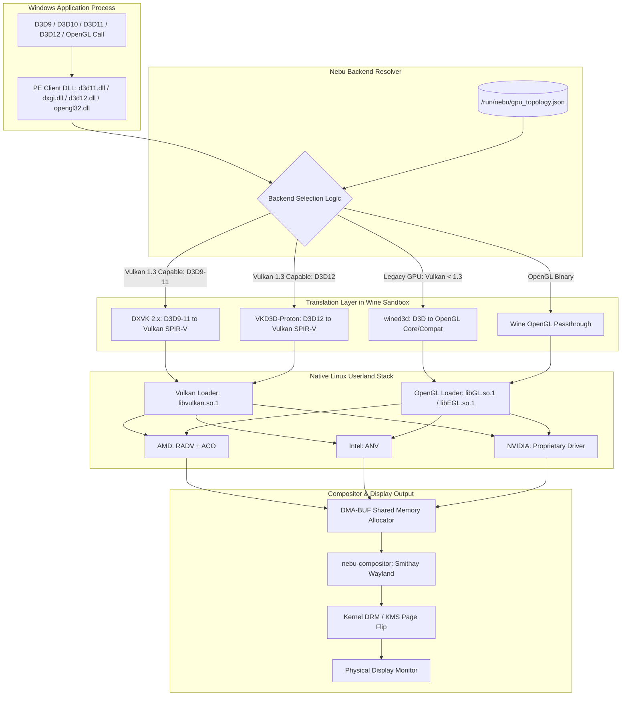
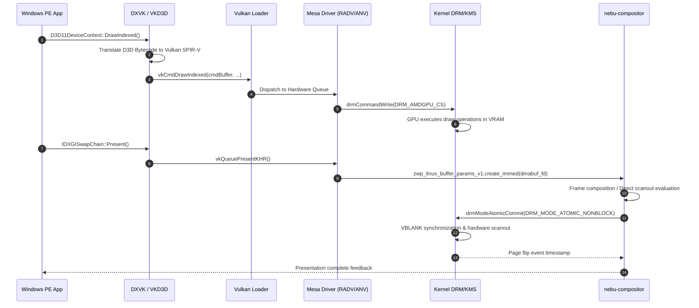

# Master Graphics Specification — NebuOS

## 1. Status
**Status:** DRAFT

## 2. Purpose
This document specifies the master graphics subsystem architecture for NebuOS. It establishes the end-to-end rendering pipeline from Windows Direct3D and OpenGL API calls through translation layers to native Linux graphics drivers, kernel display interfaces, and the Wayland compositor. It formalizes GPU capability detection algorithms and defines the automated backend selection logic determining when to employ DXVK, VKD3D-Proton, wined3d, or native Vulkan passthrough.

## 3. Scope
- End-to-end rendering pipeline: Direct3D 9, 10, 11, 12, and Windows OpenGL translation to native Vulkan and OpenGL substrates.
- GPU capability discovery via Direct Rendering Manager (DRM) and Vulkan physical device enumeration.
- Automated graphics backend selection decision trees for heterogeneous hardware targets (Intel, AMD, NVIDIA).
- Display presentation pipeline: Wayland surface integration, DMA-BUF zero-copy buffer sharing, and Direct Rendering Manager / Kernel Mode Setting (DRM/KMS) page flipping.
- Multi-GPU routing policies (integrated vs. discrete) and frame presentation synchronization.
- Performance invariants, telemetry collection, and graceful fallback behaviors under graphics hardware stress.

## 4. Non-Goals
- Authoring custom GPU kernel drivers or proprietary graphics translation layers from scratch. Upstream Linux kernel DRM drivers, Mesa, DXVK, VKD3D-Proton, and Wine are reused directly.
- Hardware virtualization or hypervisor GPU pass-through (QEMU, KVM, VFIO). All rendering executes on bare metal through native userland processes.
- Implementing software rendering as a primary gaming or CAD target. CPU-based rasterization (llvmpipe) is supported strictly as an emergency diagnostic fallback.
- Support for non-x86_64 architectures in the initial deployment phase.

## 5. Requirements

### Functional Requirements
- **REQ-GFX-001**: The graphics pipeline MUST translate Direct3D 9, 10, and 11 calls to Vulkan 1.3 via DXVK with a frame rate overhead of less than 10% compared to native Windows execution on identical hardware.
- **REQ-GFX-002**: Direct3D 12 calls MUST be translated to Vulkan 1.3 via VKD3D-Proton, supporting DirectX Raytracing (DXR 1.0/1.1) where underlying hardware and drivers permit.
- **REQ-GFX-003**: The runtime MUST automatically detect GPU capabilities at boot and session start, persisting device topology to `/run/nebu/gpu_topology.json`.
- **REQ-GFX-004**: The subsystem MUST provide a backend selection resolver that routes legacy hardware lacking Vulkan 1.3 to wined3d (OpenGL 4.5 fallback) without manual user intervention.
- **REQ-GFX-005**: All rendered frames MUST be presented to `nebu-compositor` via the `linux-dmabuf-unstable-v1` or `wayland-drm` protocols with zero memory copies between client and compositor.
- **REQ-GFX-006**: On hybrid dual-GPU systems, the runtime MUST support dynamic PRIME offloading for both AMD (`DRI_PRIME=1`) and NVIDIA (`__NV_PRIME_RENDER_OFFLOAD=1`).
- **REQ-GFX-007**: Direct3D state cache descriptors MUST be persisted to disk per application to prevent runtime compilation stuttering.

### Non-Functional Requirements
- **REQ-GFX-008**: GPU capability probe latency MUST not exceed 120 milliseconds during session initialization.
- **REQ-GFX-009**: Graphics translation layers MUST not introduce more than 1 frame of presentation latency (<= 16.6 ms at 60 Hz).
- **REQ-GFX-010**: Idle graphics subsystem memory consumption MUST remain below 64 MB VRAM and 32 MB system RAM.
- **REQ-GFX-011**: Zero kernel panic or compositor crash under abnormal client GPU termination or out-of-memory states.

## 6. Architecture



### Complete Rendering Pipeline Stages
1. **API Interception:** The Windows PE executable invokes standard Direct3D or OpenGL entry points. In the Wine prefix, customized PE DLLs (`dxgi.dll`, `d3d11.dll`, `d3d12.dll`, `opengl32.dll`) intercept these calls in userland.
2. **SPIR-V Translation:** DXVK and VKD3D-Proton compile Direct3D bytecode (SM 3.0 to SM 6.6) into Vulkan SPIR-V intermediate representation on dedicated asynchronous worker thread pools.
3. **Pipeline State Object (PSO) Mapping:** Direct3D state mappings are matched to Vulkan `VkGraphicsPipelineCreateInfo` or constructed on-demand using `VK_EXT_graphics_pipeline_library` when available.
4. **Command Buffer Dispatch:** Translated Vulkan draw commands are submitted to queues via Khronos Vulkan Loader (`libvulkan.so.1`).
5. **Mesa / Hardware Compilation:** The driver (Mesa RADV ACO, Mesa ANV, or NVIDIA proprietary compiler) converts SPIR-V into native GPU machine instructions.
6. **Frame Allocation & Export:** Rendered backbuffers are allocated via GBM (Generic Buffer Management) or DRM dumb buffers and exported as DMA-BUF file descriptors.
7. **Wayland Presentation:** The Wine Wayland driver passes DMA-BUF handles across Wayland IPC to `nebu-compositor`.
8. **KMS Scanout:** `nebu-compositor` checks for direct scanout eligibility. If full-screen unoccluded, the client buffer is directly presented to the DRM/KMS plane, bypassing composition overhead.

### Direct3D to Vulkan Stage Translation Mapping

| Direct3D 11/12 Stage | Vulkan Pipeline Stage | Translation Mechanism | Optimization Notes |
|---|---|---|---|
| Input Assembler (IA) | Vertex Input / Primitive Assembly | DXVK Pipeline State Hash | Attribute offset remapping |
| Vertex Shader (VS) | `VK_SHADER_STAGE_VERTEX_BIT` | Bytecode to SPIR-V | Uniform buffer binding offset |
| Hull Shader (HS) | `VK_SHADER_STAGE_TESSELLATION_CONTROL_BIT` | DXBC to SPIR-V | Tessellation factor scaling |
| Domain Shader (DS) | `VK_SHADER_STAGE_TESSELLATION_EVALUATION_BIT`| DXBC to SPIR-V | Normalized domain coordinate fixups |
| Geometry Shader (GS) | `VK_SHADER_STAGE_GEOMETRY_BIT` | DXBC to SPIR-V | Stream output emulation via transform feedback |
| Pixel Shader (PS) | `VK_SHADER_STAGE_FRAGMENT_BIT` | DXBC to SPIR-V | Dual-source blending emulated if supported |
| Compute Shader (CS) | `VK_SHADER_STAGE_COMPUTE_BIT` | DXBC to SPIR-V | Shared memory allocation clamps |
| Output Merger (OM) | Color Blend / Depth Stencil State | Dynamic Rendering / Subpasses | Depth bounds test emulation |

## 7. Components

| Component | Layer / Origin | Technology / Package | Responsibility |
|---|---|---|---|
| `nebu-gpu-probe` | NebuOS System | Rust / `libdrm-rs` | Scans DRM devices at startup; exports GPU topology JSON to `/run/nebu/gpu_topology.json`. |
| `nebu-graphics-daemon` | NebuOS Session | Rust / D-Bus service | Manages per-application GPU profiles, environment variable injection, and dynamic switching. |
| `nebu-compositor` | NebuOS Desktop | Rust / Smithay | Wayland compositor managing DRM/KMS scanout, DMA-BUF imports, and frame pacing. |
| `dxvk` | Upstream Bundled | C++ / PE DLLs (v2.3+) | Direct3D 9/10/11 translation to Vulkan 1.3 SPIR-V. |
| `vkd3d-proton` | Upstream Bundled | C++ / PE DLLs (v2.12+) | Direct3D 12 translation to Vulkan 1.3 SPIR-V. |
| `wined3d` | Wine Core | C / Wine Built-in | Direct3D translation to OpenGL Core/Compatibility profiles for legacy fallback. |
| `libvulkan` | Upstream Fedora | C / Khronos Loader 1.3 | Vulkan ICD dispatch and validation layer chaining. |
| `mesa-vulkan-drivers` | Upstream Fedora | C / Mesa (RADV, ANV, NVK) | Open-source Vulkan driver implementations. |
| `mesa-dri-drivers` | Upstream Fedora | C / Mesa (Gallium) | Open-source OpenGL drivers (radeonsi, iris, nouveau). |
| `kernel-drm` | Linux Kernel | Kernel C (`amdgpu`, `i915`, `xe`, `nouveau`, `nvidia`) | Hardware memory management (TTM/GEM), mode setting (KMS). |

## 8. Data Flow



## 9. Control Flow

### GPU Capability Detection Algorithm
At system startup or hardware hotplug, `nebu-gpu-probe` executes:
1. Call `drmGetDevices2()` to enumerate all DRM nodes in `/dev/dri/`.
2. Filter for primary nodes (`/dev/dri/card*`) and render nodes (`/dev/dri/renderD*`).
3. Read vendor and device IDs via `drmDevicePtr->deviceinfo.pci`.
4. Inspect sysfs paths (`/sys/class/drm/cardX/device/`) to retrieve driver name, PCI bus address, VRAM size, and power state.
5. Initialize a minimal headless Vulkan instance (`vkCreateInstance`) with `VK_KHR_portability_enumeration`.
6. Enumerate physical devices via `vkEnumeratePhysicalDevices()`.
7. For each physical device:
   - Query properties (`vkGetPhysicalDeviceProperties2`).
   - Query supported API version, device type (`DISCRETE_GPU`, `INTEGRATED_GPU`).
   - Query extension list (`vkEnumerateDeviceExtensionProperties`).
   - Verify presence of baseline extensions: `VK_KHR_timeline_semaphore`, `VK_EXT_robustness2`, `VK_KHR_dynamic_rendering`.
8. Classify multi-GPU roles: Primary iGPU (display controller connected) vs. Secondary dGPU (render accelerator).
9. Serialize discovered topology to `/run/nebu/gpu_topology.json`.

```text
fn detect_gpu_topology() -> Result<GpuTopology, ProbeError>:
    devices = drm::get_devices2()?
    topology = GpuTopology::default()
    
    for dev in devices:
        if dev.is_pci():
            pci_info = dev.pci_info()
            sysfs_path = format!("/sys/bus/pci/devices/{}", pci_info.address)
            driver = fs::read_link(sysfs_path.join("driver"))?
            
            gpu_entry = GpuEntry {
                pci_address: pci_info.address,
                vendor_id: pci_info.vendor_id,
                device_id: pci_info.device_id,
                driver_name: driver.file_name(),
                card_node: dev.card_node_path(),
                render_node: dev.render_node_path(),
                vram_bytes: read_sysfs_vram(&sysfs_path),
            }
            topology.gpus.push(gpu_entry)
            
    topology.resolve_hybrid_roles()
    fs::write("/run/nebu/gpu_topology.json", serde_json::to_string(&topology)?)
    return Ok(topology)
```

### Graphics Backend Selection Logic
When launching an application with ID `app_id`:
1. Read `/run/nebu/gpu_topology.json`.
2. Inspect application manifest and SQLite compatibility database for explicit overrides:
   - If profile specifies `backend: "wined3d"`, route to wined3d.
   - If profile specifies `backend: "native_vulkan"`, disable DXVK/VKD3D overrides.
3. If profile is `auto` (default):
   - Evaluate selected GPU's Vulkan capability:
     - IF `vulkan_version >= 1.3` AND all required extensions present:
       - Direct3D 9, 10, 11 -> **DXVK**
       - Direct3D 12 -> **VKD3D-Proton**
       - OpenGL Windows app -> **Wine OpenGL Passthrough**
     - ELSE IF `vulkan_version >= 1.1` (missing required DXVK 2.x extensions):
       - Direct3D 9, 10, 11 -> **wined3d (OpenGL 4.5 fallback)**
       - Direct3D 12 -> **Disabled (unsupported with user notification)**
     - ELSE (Legacy GPU without Vulkan, e.g., Intel Gen7/8):
       - Direct3D 9, 10, 11 -> **wined3d (OpenGL 4.2+ fallback)**
       - Direct3D 12 -> **Disabled**

## 10. Interfaces

### File System Interfaces
- `/dev/dri/card[0-9]+`: DRM master node for display mode setting and scanout.
- `/dev/dri/renderD[0-9]+`: DRM render node for unprivileged GPU acceleration.
- `/run/nebu/gpu_topology.json`: Ephemeral JSON description of enumerated GPUs.
- `/usr/share/vulkan/icd.d/*.json`: Khronos Vulkan Installable Client Driver manifests.
- `~/.nebu/apps/<app_id>/dxvk.conf`: Per-application DXVK override configuration.
- `/usr/share/nebu/profiles/dxvk/`: System-wide curated default configurations.

### D-Bus Interface: `org.nebu.Graphics1`
- **Bus:** System Bus (`org.nebu.Graphics1`)
- **Object Path:** `/org/nebu/Graphics1`
- **Interface:** `org.nebu.Graphics1.Manager`
  - Method `GetGPUTopology() -> (s: json_topology)`
  - Method `GetApplicationBackend(s: app_id) -> (s: backend_name, s: gpu_assigned)`
  - Method `SetApplicationProfile(s: app_id, s: profile_json) -> (b: success)`
  - Method `RequestGPUSwitch(s: app_id, s: target_gpu) -> (b: success)`
  - Signal `GPUTopologyChanged(s: reason)`
  - Signal `GPUHangDetected(s: pci_address, s: message)`

## 11. Dependencies

| Dependency | Provider | Min Version | Criticality |
|---|---|---|---|
| Linux Kernel DRM | Linux Kernel | 6.8.0 | Hard requirement for modern GPU scheduling |
| `libdrm` | Upstream Fedora | 2.4.120 | Hardware discovery and DRM node querying |
| `vulkan-loader` | Upstream Fedora | 1.3.275 | Vulkan entry point dispatch |
| `mesa` | Upstream Fedora | 24.1.0 | Open-source driver stack (RADV, ANV, iris, radeonsi) |
| `dxvk` | NebuOS Packaging | 2.3.1 | D3D9/10/11 translation |
| `vkd3d-proton` | NebuOS Packaging | 2.12.0 | D3D12 translation |
| `wine` | NebuOS Runtime | 9.2 (Staging) | PE execution and Windows API bridging |
| `smithay` | Rust Crates | 0.3.0 | DRM/KMS compositor backend implementation |
| `wayland-protocols` | Upstream Fedora | 1.34 | `linux-dmabuf-v1`, `presentation-time` protocols |

## 12. Security
- **Unprivileged Render Nodes:** Windows applications running under Wine access GPU hardware exclusively through `/dev/dri/renderD*`. Access to primary nodes (`/dev/dri/card*`) is strictly forbidden and blocked by Bubblewrap sandbox namespaces.
- **DMA-BUF Token Sanitization:** Exported DMA-BUF handles shared with `nebu-compositor` undergo capability validation to prevent rogue clients from executing arbitrary kernel memory mappings.
- **No Direct PCI Access:** Windows PE binaries cannot access `/sys/bus/pci/devices/` or `/dev/mem`. Virtual PCI topologies are synthesized by Wine where applications require device enumeration.
- **Shader Cache Isolation:** Application shader caches are written to sandboxed directory trees (`~/.nebu/cache/shaders/<app_id>/`) with POSIX mode `0700`, preventing cross-app state leakage.
- **Buffer Scrubbing:** Compositor enforces that DMA-BUF surface allocations released by terminating processes are scrubbed to eliminate residual frame memory exposure.

## 13. Resource Requirements
- **Idle Memory:** Graphics daemon and probe utilities consume < 15 MB RSS combined.
- **Runtime Memory:** DXVK state cache and pipeline descriptor pools require 50 MB to 200 MB system RAM per active application.
- **VRAM Footprint:** Base desktop compositor uses <= 120 MB VRAM at 1080p, <= 280 MB VRAM at 4K resolution.
- **Disk Storage:** Mesa drivers, Vulkan loaders, and translation DLLs require ~350 MB in the immutable `/usr` partition.
- **CPU Overhead:** Translation thread pool overhead is capped at <= 5% total CPU utilization during active rendering.

## 14. Failure Modes

| Failure Mode | Root Cause | System Impact | Severity |
|---|---|---|---|
| GPU Driver Hang / GPU Reset | Shader lockup or unhandled GPU instruction | Screen freezes temporarily; kernel triggers GPU reset | High |
| Vulkan 1.3 Incompatible | Outdated hardware (Intel Gen8 or older) | DXVK fails to create Vulkan device instance | Medium |
| DMA-BUF Export Failure | Compositor and client driver format mismatch | Black window or presentation stall | High |
| Discrete GPU Sleep Stall | PCIe runtime power management latency | 500ms stutter when offloading app launches | Low |
| VRAM Exhaustion | High-resolution textures exceed physical memory | Buffer eviction to GTT system RAM; severe FPS drop | High |
| SPIR-V Compilation Failure | Unsupported shader instruction in DXBC | Draw call omitted or application crashes | High |

## 15. Recovery Behavior
- **GPU Hang Recovery:** When the kernel driver triggers an engine reset (`amdgpu: GPU reset begin` or `i915: Resetting chip`), `nebu-compositor` traps the lost device event, invalidates broken swapchains, and requests clients re-create surfaces without terminating the desktop session.
- **Backend Fallback:** If DXVK fails initialization with `VK_ERROR_INITIALIZATION_FAILED`, `nebu-runtime-daemon` intercepts the process exit, updates the application's local profile to `backend: wined3d`, and re-launches the application automatically with a user notification.
- **Out of VRAM Fallback:** Memory allocation failure triggers automatic pipeline flushing and dynamic texture downsampling via DXVK configuration overrides (`dxgi.maxDeviceMemory`).
- **Compositor Crash Isolation:** If `nebu-compositor` fails, systemd user session restarts it within 1.5 seconds. Active Wayland DMA-BUF handles are re-anchored using client connection recovery protocols where supported.

## 16. Testing Requirements
- **CTS Validation:** Khronos Vulkan Conformance Test Suite (Vulkan CTS) must pass 100% on all supported Mesa versions.
- **Automated Render Regression:** Automated execution of synthetic Direct3D tests (`vk-gl-cts`, `d3d11-triangle`, `dxvk-bench`) in headless CI using virtual DRM (`vkms`).
- **Real-world Certification Suites:**
  - Autodesk AutoCAD 2024 3D Viewport benchmark (stress testing DirectX 11 translation).
  - Maya 2024 Viewport 2.0 rendering tests (DirectX 11 vs. OpenGL).
  - Unigine Superposition DirectX 11 and Vulkan benchmarks (pacing and stability).
- **Hybrid GPU Switch Testing:** Verification of automated PRIME environment variable application on Intel+NVIDIA and AMD+AMD hybrid laptops.
- **Memory Pressure Tests:** Validation that allocating 95% VRAM induces smooth page eviction without kernel lockup.

## 17. Performance Requirements
- **Frame Rate Parity:** DXVK frame rate must achieve >= 90% of native Windows 11 performance on identical GPU hardware for certified DirectX 11 applications.
- **Frame Pacing Variance:** 99th percentile frame time variance must be < 4 ms during steady-state rendering.
- **Presentation Latency:** End-to-end input-to-display latency under `nebu-compositor` must not exceed 2 refresh cycles (< 33.3 ms at 60 Hz, < 13.8 ms at 144 Hz).
- **Cold Shader Compilation:** First-run shader stutter must be mitigated by asynchronous pipeline compilation, maintaining >= 30 FPS during active shader compilation bursts.

## 18. Compatibility Considerations
- **32-Bit Windows Applications:** Legacy 32-bit CAD and productivity tools require 32-bit multilib Vulkan drivers (`mesa-vulkan-drivers.i686`) and 32-bit DXVK PE binaries located in `SysWOW64`.
- **NVIDIA Proprietary Driver Integration:** Proprietary NVIDIA drivers (550.x+) bypass Mesa RADV/ANV. The subsystem must accommodate NVIDIA's explicit sync mechanisms, `nvkms`, and proprietary ICD manifests without altering the user-facing runtime API.
- **Wayland Protocol Compatibility:** Translation layers must adhere to standard Wayland protocols (`xdg-shell`, `linux-dmabuf`, `presentation-time`). Applications requiring X11-specific features are transparently supported via rootless XWayland.
- **Color Management & HDR:** Future integration requires support for `wayland-color-management` and HDR metadata pass-through to KMS planes.

## 19. Open Questions
- **OPEN QUESTION: DXVK Async Pipeline Compilation Upstream Status:** Upstream DXVK intentionally avoids GPL-violating async patches. Should NebuOS bundle the standard upstream DXVK with `VK_EXT_graphics_pipeline_library` or maintain an internal patch set for aggressive async shader compilation on older drivers?
- **OPEN QUESTION: NVK Readiness for Production Workstations:** Can the Mesa NVK (open-source Vulkan driver for NVIDIA) fully replace the proprietary NVIDIA driver for certified workstation workloads by NebuOS 1.0, or must dual driver stacks be maintained?
- **OPEN QUESTION: Dynamic PRIME Hot-Unplug:** How should `nebu-compositor` handle external eGPU hot-unplug events during active Direct3D compute sessions?

## 20. Related Documents
- [01-gpu-detection.md](01-gpu-detection.md) — DRM device discovery and topology specification
- [02-mesa-integration.md](02-mesa-integration.md) — Mesa packaging, driver pinning, and extensions
- [03-vulkan-opengl.md](03-vulkan-opengl.md) — Vulkan loader, ICD selection, and OpenGL fallback
- [04-dxvk-vkd3d.md](04-dxvk-vkd3d.md) — DXVK/VKD3D integration, DLL overrides, and configuration
- [05-gpu-profiles.md](05-gpu-profiles.md) — Per-application GPU routing and policy enforcement
- [06-shader-cache.md](06-shader-cache.md) — Shader cache storage, eviction, and deduplication
- [../desktop/01-compositor.md](../desktop/01-compositor.md) — NebuCompositor display pipeline
- [../runtime/04-wine-integration.md](../runtime/04-wine-integration.md) — Wine runtime and PE execution
