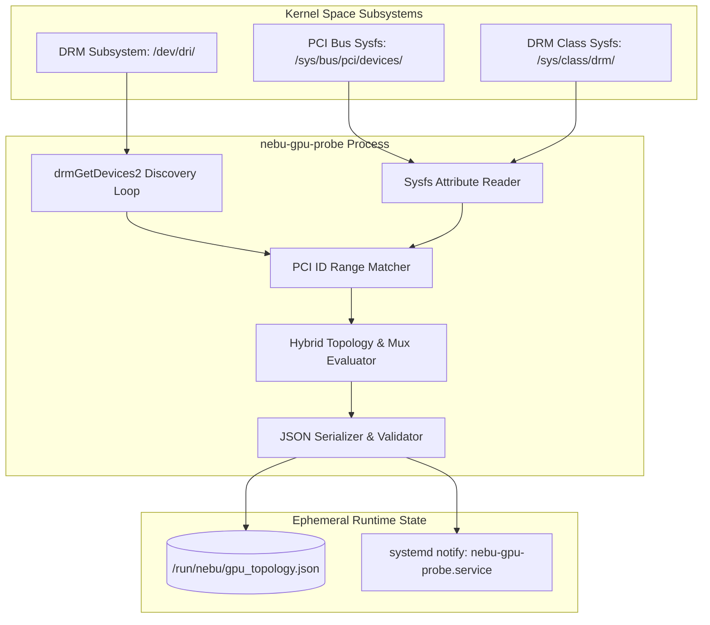
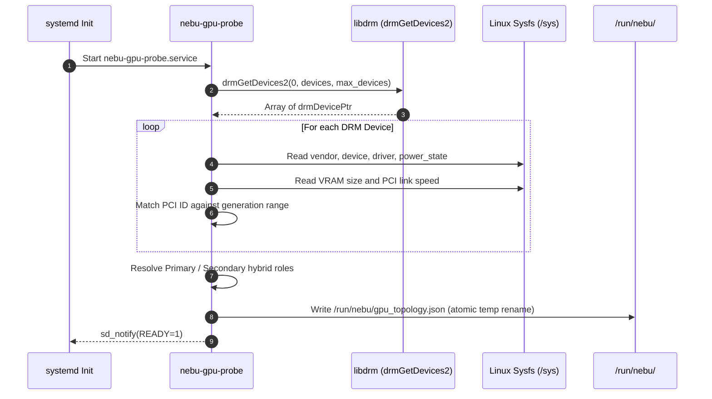

# GPU Detection Specification — NebuOS

## 1. Status
**Status:** DRAFT

## 2. Purpose
This specification defines the hardware discovery, Direct Rendering Manager (DRM) enumeration, PCI vendor identification, and hybrid graphics topology resolution implemented by `nebu-gpu-probe`. It formalizes the sysfs interfaces inspected, PCI ID range lookup tables, the machine-readable output schema (`/run/nebu/gpu_topology.json`), and the dynamic PRIME render offload configuration required for seamless multi-GPU operation.

## 3. Scope
- Enumeration of physical and virtual DRM devices via `libdrm` (`drmGetDevices2`).
- PCI device identification and vendor range classification for Intel, AMD, NVIDIA, and virtualized controllers.
- Sysfs inspection for driver binding, VRAM quantification, power status, and PCIe link capabilities.
- Hybrid GPU topology classification (integrated primary vs. discrete secondary, muxed vs. muxless).
- Generation of the standardized `/run/nebu/gpu_topology.json` runtime state file.
- Automated PRIME routing profile generation for application runtimes.

## 4. Non-Goals
- Real-time GPU temperature or clock telemetry monitoring during application rendering (handled by `nebu-monitoring-daemon`).
- Modification or reloading of kernel GPU modules at runtime (e.g., dynamic rebinding of `vfio-pci`).
- Display resolution, refresh rate, or EDID mode negotiation (delegated to `nebu-compositor` DRM/KMS backend).
- Overclocking, fan curves, or power limit manipulation.

## 5. Requirements

### Functional Requirements
- **REQ-GPD-001**: `nebu-gpu-probe` MUST scan and identify all active DRM primary nodes (`/dev/dri/card*`) and render nodes (`/dev/dri/renderD*`) within 80 milliseconds of execution.
- **REQ-GPD-002**: The probe MUST categorize GPUs into architectural generations using PCI ID ranges covering Intel Gen9 through Battlemage, AMD GCN4 through RDNA3.5, and NVIDIA Pascal through Ada Lovelace.
- **REQ-GPD-003**: The probe MUST accurately determine total dedicated VRAM vs. shared system memory by reading driver-specific sysfs nodes.
- **REQ-GPD-004**: On dual-GPU systems, the probe MUST classify the integrated GPU (connected to physical display outputs) as `primary_display` and the discrete accelerator as `secondary_compute`.
- **REQ-GPD-005**: The probe MUST serialize topology into `/run/nebu/gpu_topology.json` with strict schema validation before the Wayland compositor or user session initializes.
- **REQ-GPD-006**: The probe MUST export appropriate environment variable maps for AMD PRIME (`DRI_PRIME`) and NVIDIA Optimus (`__NV_PRIME_RENDER_OFFLOAD`).

### Non-Functional Requirements
- **REQ-GPD-007**: Probe binary footprint MUST be less than 5 MB static binary size with zero external shared library dependencies beyond `libc.so.6` and `libdrm.so.2`.
- **REQ-GPD-008**: Maximum memory allocation during probe execution MUST NOT exceed 12 MB RSS.
- **REQ-GPD-009**: The probe MUST NOT hang or block indefinitely if a GPU is in a deep runtime power suspend state (`D3cold`).

## 6. Architecture



## 7. Components

| Component | Technology | File / Path | Responsibility |
|---|---|---|---|
| `nebu-gpu-probe` | Rust Binary | `/usr/bin/nebu-gpu-probe` | Core executable probing DRM and sysfs; writes topology JSON. |
| `nebu-gpu-probe.service` | systemd Unit | `/usr/lib/systemd/system/nebu-gpu-probe.service` | One-shot service triggered before `graphical.target`. |
| `nebu-udev-gpu.rules` | udev Rules | `/usr/lib/udev/rules.d/80-nebu-gpu.rules` | Triggers probe re-run upon GPU hotplug/eGPU attach. |
| `gpu_topology.json` | JSON File | `/run/nebu/gpu_topology.json` | Global system topology consumed by shell, compositor, and runtime. |
| `pci.ids` table | Embedded Rust Const | `nebu-gpu-probe::pci_table` | In-memory lookup ranges for device identification. |

## 8. Data Flow



## 9. Control Flow

### DRM Device Enumeration Code Flow
The probe enumerates devices using the following strict sequential procedure:

```text
fn execute_probe() -> Result<(), ProbeError>:
    // Step 1: Query DRM devices
    let mut devices = [null; MAX_DRM_DEVICES];
    let num_devices = drmGetDevices2(0, devices.as_mut_ptr(), MAX_DRM_DEVICES);
    if num_devices < 0 {
        return Err(ProbeError::DrmQueryFailed(num_devices));
    }

    let mut detected_gpus = Vec::new();

    // Step 2: Iterate and inspect devices
    for i in 0..num_devices {
        let dev = devices[i];
        if dev.bustype != DRM_BUS_PCI {
            continue; // Ignore USB or platform devices for primary 3D
        }

        let pci = dev.businfo.pci;
        let pci_slot = format!("{:04x}:{:02x}:{:02x}.{:x}", pci.domain, pci.bus, pci.dev, pci.func);
        let sysfs_pci_dir = Path::new("/sys/bus/pci/devices").join(&pci_slot);

        let vendor_id = pci.vendor_id;
        let device_id = pci.device_id;
        let subvendor_id = pci.subvendor_id;
        let subdevice_id = pci.subdevice_id;

        // Step 3: Parse nodes
        let card_node = dev.nodes[DRM_NODE_PRIMARY]; // e.g. /dev/dri/card0
        let render_node = dev.nodes[DRM_NODE_RENDER]; // e.g. /dev/dri/renderD128

        // Step 4: Determine kernel driver
        let driver_path = fs::read_link(sysfs_pci_dir.join("driver"))?;
        let driver_name = driver_path.file_name().unwrap().to_str().unwrap();

        // Step 5: Read VRAM & Power
        let vram_bytes = read_vram_capacity(&sysfs_pci_dir, vendor_id, driver_name);
        let power_state = read_power_state(&sysfs_pci_dir);

        // Step 6: Classify Generation
        let architecture = match_pci_generation(vendor_id, device_id);

        detected_gpus.push(GpuDescriptor {
            pci_slot,
            vendor_id,
            device_id,
            subvendor_id,
            subdevice_id,
            driver_name: driver_name.to_string(),
            card_node: card_node.map(PathBuf::from),
            render_node: render_node.map(PathBuf::from),
            architecture,
            vram_bytes,
            power_state,
            has_connectors: check_display_connectors(&card_node),
        });
    }

    // Step 7: Resolve Hybrid System Roles
    let topology = classify_topology(detected_gpus);
    write_atomic_topology(&topology, "/run/nebu/gpu_topology.json")?;
    Ok(())
```

## 10. Interfaces

### Sysfs Paths Read
The probe inspects the following kernel sysfs paths for each enumerated device:

| Sysfs Attribute Path | Type / Format | Purpose |
|---|---|---|
| `/sys/bus/pci/devices/<pci_slot>/vendor` | Hex (e.g. `0x8086`) | PCI Vendor Identification |
| `/sys/bus/pci/devices/<pci_slot>/device` | Hex (e.g. `0x9a49`) | PCI Device Identification |
| `/sys/bus/pci/devices/<pci_slot>/subsystem_vendor` | Hex | OEM / Board Subsystem Vendor |
| `/sys/bus/pci/devices/<pci_slot>/subsystem_device` | Hex | OEM / Board Subsystem Device |
| `/sys/bus/pci/devices/<pci_slot>/driver` | Symlink | Bound kernel driver (`amdgpu`, `i915`, `xe`, `nvidia`, `nouveau`) |
| `/sys/bus/pci/devices/<pci_slot>/power/runtime_status` | String (`active`, `suspended`) | Runtime PM state without waking suspended dGPU |
| `/sys/bus/pci/devices/<pci_slot>/current_link_speed` | String (`16.0 GT/s PCIe`) | PCIe link negotiation status |
| `/sys/bus/pci/devices/<pci_slot>/current_link_width` | String (`x16`, `x8`, `x4`) | PCIe lane width allocation |
| `/sys/class/drm/cardX/device/mem_info_vram_total` | Integer (Bytes) | AMDGPU dedicated VRAM allocation |
| `/sys/class/drm/cardX/device/drm/cardX/gt/gt0/mem_info`| Structured text | Intel Xe/i915 local VRAM quantification |

### PCI ID Range Lookup Tables

Rather than maintaining fragile exhaustive lists of thousands of individual PCI IDs, `nebu-gpu-probe` validates device classes against continuous hardware generation ID ranges:

```text
=============================================================================
INTEL ARCHITECTURAL RANGES (Vendor ID: 0x8086)
=============================================================================
Generation Name          Device ID Range        Default Driver   Vulkan Backend
-----------------------------------------------------------------------------
Gen9 / 9.5 (Skylake/KBL) 0x1900 - 0x193F        i915 / iris      ANV (Legacy)
Gen11 (Ice Lake)         0x8A50 - 0x8A7F        i915 / iris      ANV
Gen12 Xe-LP (Tiger Lake) 0x9A40 - 0x9AF0        xe / i915        ANV
Arc Alchemist (DG2)      0x5690 - 0x56C2        xe               ANV
Arc Battlemage (BMG)     0xE200 - 0xE2FF        xe               ANV

=============================================================================
AMD ARCHITECTURAL RANGES (Vendor ID: 0x1002)
=============================================================================
Generation Name          Device ID Range        Default Driver   Vulkan Backend
-----------------------------------------------------------------------------
GCN 4.0 (Polaris)        0x67DF - 0x67FF        amdgpu           RADV (ACO)
GCN 5.0 (Vega / Raven)   0x6860 - 0x687F        amdgpu           RADV (ACO)
RDNA 1.0 (Navi 10/14)    0x7310 - 0x7340        amdgpu           RADV (ACO)
RDNA 2.0 (Navi 21-24)    0x73A0 - 0x743F        amdgpu           RADV (ACO)
RDNA 3.0 (Navi 31-33)    0x7440 - 0x747F        amdgpu           RADV (ACO)
RDNA 3.5 (Strix Point)   0x15BF - 0x15DF        amdgpu           RADV (ACO)

=============================================================================
NVIDIA ARCHITECTURAL RANGES (Vendor ID: 0x10DE)
=============================================================================
Generation Name          Device ID Range        Default Driver   Vulkan Backend
-----------------------------------------------------------------------------
Pascal (GP102 - GP108)   0x1B00 - 0x1DFF        nvidia / nouveau Proprietary / NVK
Turing (TU102 - TU117)   0x1E00 - 0x21FF        nvidia / nouveau Proprietary / NVK
Ampere (GA102 - GA107)   0x2200 - 0x25FF        nvidia / nouveau Proprietary / NVK
Ada Lovelace (AD102-107) 0x2600 - 0x28FF        nvidia           Proprietary / NVK
```

### GPU Topology JSON Output Format
The resulting file at `/run/nebu/gpu_topology.json` conforms to the schema below:

```json
{
  "$schema": "https://nebuos.org/schemas/gpu-topology-v1.json",
  "generated_at": 1772614800,
  "probe_duration_ms": 42,
  "system_type": "hybrid_dual_gpu",
  "primary_gpu_index": 0,
  "has_discrete_gpu": true,
  "gpus": [
    {
      "index": 0,
      "role": "primary_display",
      "pci_slot": "0000:00:02.0",
      "vendor_id": "0x8086",
      "device_id": "0x9a49",
      "vendor_name": "Intel Corporation",
      "device_name": "TigerLake-LP GT2 [Iris Xe Graphics]",
      "architecture": "Intel Gen12 Xe-LP",
      "driver": "i915",
      "card_node": "/dev/dri/card0",
      "render_node": "/dev/dri/renderD128",
      "vram_total_bytes": 0,
      "shared_memory_bytes": 8328298496,
      "power_state": "active",
      "has_connected_displays": true,
      "vulkan": {
        "supported": true,
        "api_version": "1.3.275",
        "driver_name": "Intel open-source Mesa driver",
        "driver_info": "Mesa 24.1.2",
        "icd_manifest": "/usr/share/vulkan/icd.d/intel_icd.x86_64.json"
      }
    },
    {
      "index": 1,
      "role": "secondary_compute",
      "pci_slot": "0000:01:00.0",
      "vendor_id": "0x10de",
      "device_id": "0x25a0",
      "vendor_name": "NVIDIA Corporation",
      "device_name": "GA107M [GeForce RTX 3050 Mobile]",
      "architecture": "NVIDIA Ampere",
      "driver": "nvidia",
      "card_node": "/dev/dri/card1",
      "render_node": "/dev/dri/renderD129",
      "vram_total_bytes": 4294967296,
      "shared_memory_bytes": 0,
      "power_state": "suspended",
      "has_connected_displays": false,
      "vulkan": {
        "supported": true,
        "api_version": "1.3.277",
        "driver_name": "NVIDIA",
        "driver_info": "550.54.14",
        "icd_manifest": "/usr/share/vulkan/icd.d/nvidia_icd.json"
      }
    }
  ],
  "prime_configuration": {
    "recommended_offload_engine": "nvidia_prime",
    "env": {
      "DRI_PRIME": "pci-0000_01_00_0",
      "__NV_PRIME_RENDER_OFFLOAD": "1",
      "__GLX_VENDOR_LIBRARY_NAME": "nvidia",
      "__VK_LAYER_NV_optimus": "NVIDIA_only"
    }
  }
}
```

## 11. Dependencies

| Dependency | Origin | Minimum Version | Criticality |
|---|---|---|---|
| `libdrm` | Fedora Base | 2.4.120 | Hard requirement for `drmGetDevices2` |
| `kernel-headers` | Linux Kernel | 6.8.0 | PCI structures and DRM ioctl definitions |
| `udev` | systemd | 255 | Device node creation and symlink assignment |
| `serde_json` | Rust Crate | 1.0.110 | JSON serialization of topology structure |

## 12. Security
- **Read-Only Sysfs Access:** The probe requires only read access to `/sys` and `/dev/dri`. It does not demand root privileges or capabilities like `CAP_SYS_ADMIN` if render nodes have appropriate udev group access (`video`/`render`).
- **No Private Memory Scanning:** The probe strictly avoids executing GPU memory mapping ioctls, querying metadata exclusively through driver-supported DRM descriptor APIs.
- **Safe State File Creation:** `/run/nebu/gpu_topology.json` is created with mode `0644` using an atomic write-and-rename pattern (`/run/nebu/gpu_topology.json.tmp.<pid>`), preventing race conditions where consumers read partial JSON.

## 13. Resource Requirements
- **Execution Time:** Probe execution finishes in <= 50 ms on single-GPU hardware, <= 80 ms on hybrid laptops.
- **Peak RSS:** Memory footprint stays strictly below 12 MB RSS during peak execution.
- **Disk Footprint:** Binary occupies 2.8 MB on `/usr/bin/nebu-gpu-probe`. Generated JSON consumes < 4 KB in `/run/nebu/`.

## 14. Failure Modes

| Failure Mode | Detection | System Behavior | Mitigation |
|---|---|---|---|
| `drmGetDevices2` returns 0 | No DRM devices listed in `/dev/dri/` | Fallback to sysfs PCI bus scan | Emit critical journal log; trigger emergency llvmpipe fallback |
| dGPU in `D3cold` hang | Reading sysfs blocks for > 500 ms | Probe thread times out via `select()`/worker | Mark dGPU as `power_state: unreachable`, proceed with iGPU |
| Corrupt sysfs attribute | Unexpected EOF or binary garbage | Parser catches read error | Assign default value 0 for VRAM and record warning |
| Missing Render Node | `DRM_NODE_RENDER` path is null | App will lack hardware 3D offload | Flag GPU as display-only controller |

## 15. Recovery Behavior
- **Hotplug Re-enumeration:** If an external eGPU (Thunderbolt/USB4) is attached, `80-nebu-gpu.rules` triggers `systemctl start nebu-gpu-probe.service`. The topology file is refreshed atomically, and `org.nebu.Graphics1.GPUTopologyChanged` signal is broadcast.
- **Transient Driver Lockup:** If DRM device discovery fails during early boot due to asynchronous module loading, systemd retries the service up to 3 times with a 200 ms backoff before marking unit degraded.

## 16. Testing Requirements
- **Mock Sysfs Test Harness:** Comprehensive unit tests in Rust executing against simulated sysfs trees representing Intel Iris Xe, AMD Radeon 780M, NVIDIA RTX 4070, and virtual QEMU/virgl adapters.
- **Live Kernel Test Suite:**
  - Single Intel iGPU desktop boot test.
  - AMD APU + AMD dGPU (SmartShift) laptop verification.
  - Intel iGPU + NVIDIA dGPU (Optimus) hybrid switching verification.
  - Headless server verification without physical display connectors.
- **JSON Schema Validation:** Automated CI test verifying generated output strictly satisfies the `gpu-topology-v1.json` schema.

## 17. Performance Requirements
- **Cold Boot Probe Budget:** Execution must complete within <= 80 ms from service start to `sd_notify(READY=1)`.
- **Zero Suspended GPU Wakeups:** Probing must NOT wake secondary dGPUs from ACPI `D3cold` sleep states during routine desktop session logons.

## 18. Compatibility Considerations
- **Legacy Muxed Laptops:** Older laptops equipped with hardware multiplexers (vga_switcheroo) are detected via `/sys/kernel/debug/vgaswitcheroo/switch`. The probe logs the mux state and adjusts the topology to prevent conflicting concurrent display allocation.
- **Virtual Machines & Cloud Workstations:** When running under KVM/QEMU with virtio-gpu or VMware SVGA, the probe correctly flags `system_type: "virtualized"` and skips hardware-specific PRIME routing rules.

## 19. Open Questions
- **OPEN QUESTION: sysfs VRAM Standardization:** Linux drivers expose VRAM through inconsistent paths (`mem_info_vram_total` on amdgpu vs. complex debugfs/gt nodes on Intel Xe). Should NebuOS advocate for an upstream DRM IOCTL standardizing VRAM queries across all drivers?
- **OPEN QUESTION: Thunderbolt eGPU Disconnect Safety:** When an eGPU is disconnected while topology is cached, can we guarantee all client processes receive orderly eviction signals before accessing dangling render nodes?

## 20. Related Documents
- [00-graphics-specification.md](00-graphics-specification.md) — Master graphics architecture and pipeline
- [05-gpu-profiles.md](05-gpu-profiles.md) — Per-application GPU routing and policy engine
- [../desktop/05-display.md](../desktop/05-display.md) — Display output and compositor DRM scanout
