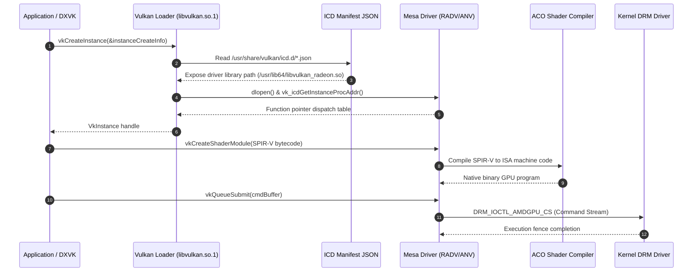

# Mesa Driver Integration Specification — NebuOS

## 1. Status
**Status:** DRAFT

## 2. Purpose
This specification details the packaging, integration, version pinning, and feature qualification of the Mesa 3D Graphics Library within the NebuOS immutable base operating system. It defines the driver modules included in the Fedora Atomic container image, specifies required Vulkan and OpenGL extensions per workload class (CAD, DCC, productivity, gaming), and formalizes the instance and context creation requirements demanded by DXVK, VKD3D-Proton, and wined3d.

## 3. Scope
- Packaging of Mesa userland drivers (RADV, ANV, NVK, Gallium drivers) in the Fedora Atomic bootc/ostree deployment.
- 64-bit (`x86_64`) and 32-bit (`i686`) multilib packaging architecture for legacy Windows PE execution.
- OS version pinning, ABI stability guarantees, and upgrade qualification lifecycles for Mesa releases.
- Technical extension audit tables mapping application categories to explicit Vulkan device extensions and driver capabilities.
- Vulkan instance initialization parameters, ICD manifest discovery paths, and layer execution chains.
- OpenGL Core and Compatibility context requirements for the `wined3d` fallback engine under Wayland.
- Hardware-accelerated video decoding (VA-API/VDPAU) through Mesa gallium drivers.

## 4. Non-Goals
- Maintaining an in-tree downstream fork of Mesa. NebuOS strictly consumes curated Fedora upstream packages, applying only vetted build-time configuration flags where necessary.
- Software rendering optimization for primary production workloads. The CPU rasterizer (`llvmpipe`) is packaged strictly as an emergency diagnostic fallback.
- Support for proprietary AMDVLK (AMD's closed-source Vulkan driver); NebuOS standardizes exclusively on Mesa RADV for AMD hardware.
- Packaging proprietary NVIDIA binary blobs inside the core open-source Mesa container layer.

## 5. Requirements

### Functional Requirements
- **REQ-MES-001**: The OS image MUST bundle both 64-bit (`x86_64`) and 32-bit (`i686`) Mesa drivers for RADV, ANV, iris, and radeonsi.
- **REQ-MES-002**: AMD RADV MUST be compiled with the ACO (AMD Compiler) backend enabled by default for all GCN4 and newer architectures.
- **REQ-MES-003**: The Mesa installation MUST expose Vulkan 1.3 conformance on all certified hardware targets (Intel Gen12+, AMD RDNA1+).
- **REQ-MES-004**: Mesa drivers MUST support `linux-dmabuf-v1` Wayland protocol integration with modifier negotiation (`DRM_FORMAT_MOD_LINEAR`, tile modifiers).
- **REQ-MES-005**: For legacy applications routed to `wined3d`, Mesa Gallium drivers MUST expose OpenGL 4.5 with `GL_ARB_compatibility` support.
- **REQ-MES-006**: The driver stack MUST integrate with `libglvnd` (GL Vendor-Neutral Dispatch) to support coexisting OpenGL implementations without link collisions.
- **REQ-MES-007**: Mesa userland drivers MUST implement dynamic memory budgeting via `VK_EXT_memory_budget`.

### Non-Functional Requirements
- **REQ-MES-008**: Total uncompressed disk footprint for all 64-bit and 32-bit Mesa userland packages MUST not exceed 180 MB in `/usr/lib64` and `/usr/lib`.
- **REQ-MES-009**: Vulkan driver initialization latency (`vkCreateInstance` + `vkCreateDevice`) MUST complete in <= 35 milliseconds.
- **REQ-MES-010**: Driver package updates MUST never introduce breaking ABI changes to `libvulkan.so.1`, `libGL.so.1`, or `libgbm.so.1` within a major OS release series.
- **REQ-MES-011**: Zero memory leaks across continuous swapchain re-creation cycles under Wayland presentation.

## 6. Architecture

```mermaid
graph TD
    subgraph FEDORA_ATOMIC_BASE [/usr Immutable Tree]
        MESA_RPM_64[mesa-*-drivers.x86_64]
        MESA_RPM_32[mesa-*-drivers.i686]
        ICD_FILES[/usr/share/vulkan/icd.d/*.json]
        DRI_LIBS_64[/usr/lib64/dri/*.so]
        DRI_LIBS_32[/usr/lib/dri/*.so]
    end

    subgraph CLIENT_RUNTIMES [Application Execution Sandboxes]
        WIN_64_APP[64-Bit Windows App: AutoCAD / Maya]
        WIN_32_APP[32-Bit Windows App: Legacy Tool / Office 32]
        NATIVE_COMP[nebu-compositor: Smithay Wayland]
    end

    subgraph MESA_BACKENDS [Mesa Driver Hardware Engines]
        RADV_ACO[AMD: RADV with ACO Compiler]
        ANV_INTEL[Intel: ANV Driver]
        NVK_NOUVEAU[NVIDIA: NVK Vulkan Driver]
        GALLIUM_GL[Gallium OpenGL: iris / radeonsi / zink]
    end

    subgraph KERNEL_DRM [Linux Kernel DRM Drivers]
        K_AMDGPU[amdgpu.ko]
        K_XE[xe.ko / i915.ko]
        K_NOUVEAU[nouveau.ko]
    end

    MESA_RPM_64 --> DRI_LIBS_64
    MESA_RPM_64 --> ICD_FILES
    MESA_RPM_32 --> DRI_LIBS_32

    WIN_64_APP -->|DXVK 64-bit / libvulkan.so.1| DRI_LIBS_64
    WIN_32_APP -->|DXVK 32-bit / libvulkan.so.1| DRI_LIBS_32
    NATIVE_COMP -->|GBM / EGL / Vulkan| DRI_LIBS_64

    DRI_LIBS_64 --> RADV_ACO
    DRI_LIBS_64 --> ANV_INTEL
    DRI_LIBS_64 --> NVK_NOUVEAU
    DRI_LIBS_64 --> GALLIUM_GL

    RADV_ACO --> K_AMDGPU
    ANV_INTEL --> K_XE
    NVK_NOUVEAU --> K_NOUVEAU
```

### Packaging Layout in Fedora Atomic Base
The base OS image incorporates Mesa through standard RPM-OSTree packaging specifications:

```text
/usr/
├── lib64/
│   ├── libvulkan_radeon.so          # RADV AMD Vulkan Driver (64-bit)
│   ├── libvulkan_intel.so           # ANV Intel Vulkan Driver (64-bit)
│   ├── libvulkan_intel_hasvk.so     # Legacy Intel Haswell/Broadwell Vulkan
│   ├── libvulkan_nouveau.so         # NVK NVIDIA Open-Source Vulkan Driver
│   ├── libgbm.so.1 -> libgbm.so.1.0.0
│   ├── libEGL_mesa.so.0
│   ├── libGLX_mesa.so.0
│   └── dri/
│       ├── iris_dri.so              # Intel Gen9+ Gallium OpenGL driver
│       ├── radeonsi_dri.so          # AMD GCN+ Gallium OpenGL driver
│       ├── nouveau_dri.so           # NVIDIA Gallium OpenGL driver
│       └── swrast_dri.so            # llvmpipe CPU fallback rasterizer
├── lib/                             # 32-Bit Multilib directory
│   ├── libvulkan_radeon.so          # RADV AMD Vulkan Driver (32-bit)
│   ├── libvulkan_intel.so           # ANV Intel Vulkan Driver (32-bit)
│   └── dri/
│       ├── iris_dri.so              # 32-bit Intel Gallium driver
│       └── radeonsi_dri.so          # 32-bit AMD Gallium driver
└── share/
    └── vulkan/icd.d/
        ├── radeon_icd.x86_64.json
        ├── radeon_icd.i686.json
        ├── intel_icd.x86_64.json
        ├── intel_icd.i686.json
        └── nouveau_icd.x86_64.json
```

## 7. Components

| Package Name | Architecture | Target Directory | Responsibility |
|---|---|---|---|
| `mesa-vulkan-drivers` | `x86_64` | `/usr/lib64/libvulkan_*.so` | 64-bit RADV, ANV, and NVK Vulkan drivers. |
| `mesa-vulkan-drivers` | `i686` | `/usr/lib/libvulkan_*.so` | 32-bit RADV, ANV, and NVK Vulkan drivers. |
| `mesa-dri-drivers` | `x86_64` | `/usr/lib64/dri/` | 64-bit Gallium OpenGL drivers (`iris_dri.so`, `radeonsi_dri.so`). |
| `mesa-dri-drivers` | `i686` | `/usr/lib/dri/` | 32-bit Gallium OpenGL drivers for 32-bit Wine prefixes. |
| `mesa-libgbm` | `x86_64` | `/usr/lib64/libgbm.so.1` | Buffer allocation for `nebu-compositor` DRM/KMS backend. |
| `mesa-libEGL` | `x86_64` | `/usr/lib64/libEGL.so.1` | Native EGL context creation for Wayland surfaces. |
| `mesa-va-drivers` | `x86_64` | `/usr/lib64/dri/*_drv_video.so` | Hardware video decode (VA-API) for media acceleration. |
| `libglvnd` | `x86_64` & `i686` | `/usr/lib64/`, `/usr/lib/` | GL Vendor-Neutral Dispatch library for multi-driver coexistence. |

## 8. Data Flow



## 9. Control Flow

### Version Pinning & Upgrade Lifecycle
NebuOS balances stability for certified CAD workloads with modern GPU feature enablement using the following version lifecycle policy:

```text
=============================================================================
NEBUOS MESA VERSION PINNING STRATEGY
=============================================================================
1. Upstream Branch Selection:
   - NebuOS tracks Mesa Point Releases on even-numbered minor releases (e.g. 24.0.x, 24.2.x).
   - Odd-numbered or x.y.0 releases are strictly quarantined in internal staging.

2. Soak & Qualification Gate:
   - New point releases enter a 14-day automated regression soak in the QA lab.
   - Requires 100% pass rate in Khronos Vulkan CTS and Nebu Certified CAD Suite.
   - Any rendering artifact in AutoCAD or Maya halts promotion.

3. Immutable Image Deployment:
   - Mesa updates are delivered strictly as full container image updates via bootc.
   - No runtime package replacing or dynamic dnf/rpm layering in user production.

4. Rollback Guarantee:
   - If a Mesa regression affects viewport stability, the entire deployment rolls back
     to the prior container snapshot via ostree without user file disruption.
```

## 10. Interfaces

### Vulkan Instance Creation Requirements
When initializing Vulkan under NebuOS, runtimes and compositors MUST adhere to the following parameters:

```c
// Mandatory Instance Extensions for NebuOS Wayland Client
const char* enabled_instance_extensions[] = {
    VK_KHR_SURFACE_EXTENSION_NAME,             // "VK_KHR_surface"
    VK_KHR_WAYLAND_SURFACE_EXTENSION_NAME,     // "VK_KHR_wayland_surface"
    VK_KHR_GET_PHYSICAL_DEVICE_PROPERTIES_2_EXTENSION_NAME, // "VK_KHR_get_physical_device_properties2"
    #ifdef DEBUG
    VK_EXT_DEBUG_UTILS_EXTENSION_NAME          // "VK_EXT_debug_utils"
    #endif
};

VkApplicationInfo app_info = {
    .sType = VK_STRUCTURE_TYPE_APPLICATION_INFO,
    .pApplicationName = "NebuApplication",
    .applicationVersion = VK_MAKE_VERSION(1, 0, 0),
    .pEngineName = "DXVK/VKD3D",
    .engineVersion = VK_MAKE_VERSION(2, 3, 0),
    .apiVersion = VK_API_VERSION_1_3           // Baseline target: Vulkan 1.3
};
```

### Extension Requirements Per Application Class

| Application Class | Target Workloads | Mandatory Vulkan Extensions | Technical Justification |
|---|---|---|---|
| **CAD / Engineering** | Autodesk AutoCAD, Revit, SolidWorks | `VK_EXT_custom_border_color`<br>`VK_EXT_transform_feedback`<br>`VK_EXT_vertex_attribute_divisor`<br>`VK_EXT_depth_clip_enable`<br>`VK_EXT_line_rasterization` | Direct3D stream-out mapping, wide wireframe lines, and non-clamped depth buffering. |
| **DCC & 3D Modeling** | Maya 2024, 3ds Max, Blender 4.x | `VK_KHR_timeline_semaphore`<br>`VK_KHR_dynamic_rendering`<br>`VK_EXT_descriptor_indexing`<br>`VK_KHR_buffer_device_address`<br>`VK_EXT_graphics_pipeline_library` | Asynchronous host-device sync, bindless texturing, and fast viewport shader pipeline compilation. |
| **Modern 3D Games** | Unreal Engine 5, DirectX 12 Games | `VK_KHR_synchronization2`<br>`VK_KHR_ray_tracing_pipeline`<br>`VK_KHR_acceleration_structure`<br>`VK_EXT_mutable_descriptor_type` | Complex barrier graph evaluation and hardware BVH ray tracing traversal via VKD3D-Proton. |
| **General Productivity**| Microsoft Office 2021/2024, Adobe Acrobat | `VK_KHR_swapchain`<br>`VK_KHR_maintenance1`<br>`VK_KHR_dedicated_allocation`<br>`VK_KHR_image_format_list` | Low-power presentation, DirectWrite hardware glyph caching, smooth UI scrolling. |

### OpenGL Context Requirements for `wined3d`
When an application is routed to `wined3d` due to hardware lack of Vulkan 1.3:
- **Context API:** EGL 1.5 over Wayland or GLX 1.4 over rootless XWayland.
- **Profile:** OpenGL 4.5 Compatibility Profile (`GL_ARB_compatibility`).
- **Context Creation Attributes (EGL):**
```c
const EGLint egl_context_attribs[] = {
    EGL_CONTEXT_MAJOR_VERSION, 4,
    EGL_CONTEXT_MINOR_VERSION, 5,
    EGL_CONTEXT_OPENGL_PROFILE_MASK, EGL_CONTEXT_OPENGL_COMPATIBILITY_PROFILE_BIT,
    EGL_CONTEXT_OPENGL_RESET_NOTIFICATION_STRATEGY, EGL_LOSE_CONTEXT_ON_RESET,
    EGL_NONE
};
```
- **Critical OpenGL Extensions Required:**
  - `GL_ARB_base_instance`: Required for instanced drawing translation.
  - `GL_ARB_blend_func_extended`: Direct3D dual-source color blending.
  - `GL_ARB_clip_control`: Matching Direct3D [0, 1] Z-clipping coordinates.
  - `GL_ARB_draw_buffers_blend`: Per-render-target independent blend equations.
  - `GL_ARB_texture_storage`: Immutable texture allocations matching D3D resources.

## 11. Dependencies

| Dependency | Upstream Provider | Target Version | Criticality |
|---|---|---|---|
| `mesa` | Fedora Project | 24.1.x | Core rendering implementation |
| `glibc` | Fedora Base | 2.39 | C runtime and multilib dynamic linking |
| `libdrm` | Freedesktop | 2.4.120 | Kernel ioctl abstraction layer |
| `llvm` | Fedora Base | 18.1.x | LLVM compiler backend for AMD shader compilation fallback |
| `wayland` | Freedesktop | 1.22.0 | Wayland client and protocol bindings |
| `libglvnd` | Freedesktop | 1.7.0 | Multi-vendor OpenGL dispatching |

## 12. Security
- **Sandbox Device Filtering:** Bubblewrap sandbox rules restrict access to `/dev/dri/renderD*`. Direct access to master nodes `/dev/dri/card*` is explicitly denied to prevent clients from reprogramming display controllers.
- **DMA-BUF File Descriptor Validation:** Mesa validates all imported DMA-BUF file descriptors for legitimate GEM handles, valid pitches, and matching DRM fourcc formats before mapping them into GPU address spaces.
- **Memory Zeroing:** Mesa memory allocators zero GPU buffer allocations upon creation (`VK_EXT_memory_budget` and driver internal clearing) to prevent information leakage of discarded desktop framebuffers between applications.
- **Protected Content:** While NebuOS focuses on workstations, driver packaging enforces strict separation between protected decrypt memory regions and accessible host memory.

## 13. Resource Requirements
- **Disk Space:** 165 MB installed footprint in `/usr` for 64-bit and 32-bit drivers combined.
- **RAM Overhead:** Mesa userland state structures consume 18 MB to 45 MB per active process.
- **VRAM Reservation:** Base Mesa driver state allocates ~32 MB VRAM per active Vulkan device.
- **Compilation Buffer:** In-memory ACO shader compilation buffers are bounded to 64 MB per application worker thread.

## 14. Failure Modes

| Failure Mode | Symptom | Diagnostic Log Marker | Action |
|---|---|---|---|
| Incompatible Extension | DXVK aborts during device init | `VK_ERROR_EXTENSION_NOT_PRESENT` | Trigger automatic wined3d fallback |
| ACO Compilation Crash | Application segmentation fault | `radv/aco: internal compiler error` | Force fallback to LLVM compiler backend |
| Missing 32-bit Multilib | 32-bit Windows app displays black window | `Failed to load driver: iris_dri.so (i686)` | Emit missing package alert in system journal |
| GPU Context Lost | Application freeze / crash | `VK_ERROR_DEVICE_LOST` | Notify user, capture core dump, restart runtime |
| DMA-BUF Import Rejection | Black window in compositor | `zwp_linux_dmabuf_feedback: format unsupported` | Fallback to SHM software copy |

## 15. Recovery Behavior
- **ACO to LLVM Compiler Fallback:** If an ACO compilation panic is detected on AMD hardware, the runtime sets `RADV_DEBUG=llvm` and restarts the process, bypassing the broken compilation path.
- **Graceful Extension Fallback:** When a non-essential extension (e.g., `VK_EXT_line_rasterization`) is absent, DXVK emulates the feature via triangle expansion shaders rather than terminating execution.
- **Driver State Reset:** In the event of a GPU context reset, Mesa re-initializes device queues. If non-recoverable, the application prefix state snapshot is marked for repair.
- **Dynamic Resizing Recovery:** If a Wayland buffer swap fails during display resizing, the client drains the queue and allocates a fresh swapchain matching the new output geometry.

## 16. Testing Requirements
- **Automated Vulkan CTS:** Khronos Vulkan Conformance Test Suite executed against RADV and ANV drivers in CI matrix.
- **Piglit OpenGL Regression:** Piglit test suite validating `GL_ARB_compatibility` regressions across Mesa updates.
- **32-Bit Wine Compatibility Matrix:** Verification of 32-bit applications (AutoCAD 2008, Office 2010 32-bit, legacy diagnostic utilities) running over multilib Mesa drivers.
- **Wayland DMA-BUF Stress Testing:** Synthetic presentation test verifying zero-copy presentation across 10,000 continuous frame allocations without memory leaks.
- **Deqp-runner Integration:** Nightly automated execution of Mesa dEQP test suites gating OS container builds.

## 17. Performance Requirements
- **Shader Compilation Latency:** RADV ACO compilation time must be < 1.5 ms per standard Direct3D 11 pixel shader.
- **Vulkan Driver CPU Overhead:** Driver CPU dispatch time must account for less than 4% of the total 16.6 ms frame budget.
- **Direct Scanout Throughput:** 4K 60Hz and 144Hz scanout must sustain unthrottled zero-copy frame throughput without buffer drop or tearing.
- **Context Switch Latency:** Hardware context switching between desktop composition and client 3D rendering must execute in < 0.2 milliseconds.

## 18. Compatibility Considerations
- **Intel Gen9/Gen11 Driver Architecture:** Older Intel GPUs use the legacy `i915` kernel driver and Mesa `iris`/`crocus` OpenGL drivers. While Vulkan is supported via Mesa ANV, certain Vulkan 1.3 features are emulated. The runtime monitors these architectures and selects `wined3d` if extension emulation introduces frame drops.
- **NVIDIA Proprietary Driver Coexistence:** When the proprietary NVIDIA driver is installed via user overlay, Mesa's GLX and EGL dispatchers must gracefully coexist via `libglvnd` (GL Vendor-Neutral Dispatch library) without overwriting symlinks in `/usr/lib64`.
- **Legacy Wayland Compositors:** While NebuOS defaults to `nebu-compositor`, Mesa driver packaging maintains full compatibility with standard wlroots and Mutter compositors.

## 19. Open Questions
- **OPEN QUESTION: NVK Feature Parity Timeline:** When will Mesa NVK achieve Vulkan 1.3 certification with full `VK_EXT_transform_feedback` support, allowing complete deprecation of the proprietary NVIDIA driver on NebuOS?
- **OPEN QUESTION: 32-bit Multilib Deprecation:** Can NebuOS safely phase out 32-bit Mesa libraries in favor of FEX/box64 or Box86 thunking, or does legacy CAD support mandate native 32-bit driver bundling through 2028?
- **OPEN QUESTION: Rust-based Mesa Drivers:** As upstream Mesa experiments with Rust in Asahi and NVK, what build toolchain dependencies must be included in the Fedora Atomic build container?

## 20. Related Documents
- [00-graphics-specification.md](00-graphics-specification.md) — Master graphics architecture and rendering pipeline
- [03-vulkan-opengl.md](03-vulkan-opengl.md) — Vulkan loader and OpenGL configuration
- [04-dxvk-vkd3d.md](04-dxvk-vkd3d.md) — DXVK and VKD3D-Proton integration
- [../updates/01-image-build.md](../updates/01-image-build.md) — Containerfile and OS image build pipeline
