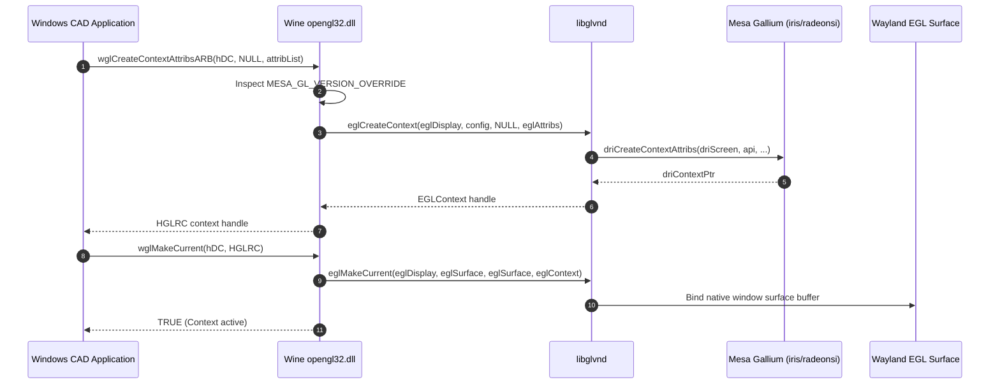

# Vulkan and OpenGL Architecture Specification — NebuOS

## 1. Status
**Status:** DRAFT

## 2. Purpose
This specification establishes the architectural design, loader dispatch infrastructure, Installable Client Driver (ICD) selection mechanics, and layer management for Vulkan and OpenGL within NebuOS. It specifies the configuration of the Khronos Vulkan Loader, details diagnostic and profiling layer topologies, and defines the OpenGL Compatibility Profile requirements necessary to support legacy Windows engineering and CAD software.

## 3. Scope
- Khronos Vulkan Loader (`libvulkan.so.1`) configuration, search path hierarchies, and runtime dispatch mechanics.
- ICD manifest structure and deterministic driver selection algorithms across multi-vendor installations.
- Vulkan layer configuration (implicit vs. explicit), debugging hooks (`VK_LAYER_KHRONOS_validation`), and performance overlays (`VK_LAYER_MANGOHUD_overlay`).
- Windows WGL (Windows Graphics Library) emulation and mapping to native Linux EGL and GLX platforms via Wine.
- OpenGL Core and Compatibility profile enforcement for legacy Direct3D/OpenGL hybrid workloads.
- Multilib 32-bit (`i686`) and 64-bit (`x86_64`) coexistence for legacy and modern Windows binaries.
- Extension exposure auditing and runtime masking for legacy Win32 CAD applications.

## 4. Non-Goals
- Authoring custom Vulkan ICDs or rewriting Khronos loader dispatch tables.
- Emulating Vulkan on top of OpenGL (e.g., Zink) as a primary production target; native Vulkan drivers are mandated.
- Supporting deprecated proprietary GLX extensions lacking modern EGL equivalents.
- Providing software-emulated OpenGL 4.6 on hardware older than Intel Gen7 without hardware GLSL support.

## 5. Requirements

### Functional Requirements
- **REQ-VGL-001**: The system MUST discover and parse all valid Vulkan ICD manifests located in `/usr/share/vulkan/icd.d/` within 10 milliseconds of loader initialization.
- **REQ-VGL-002**: The runtime MUST support deterministic ICD override injection via `VK_DRIVER_FILES` and legacy `VK_ICD_FILENAMES`.
- **REQ-VGL-003**: The runtime MUST provide an isolated mechanism to inject `VK_LAYER_KHRONOS_validation` without polluting system-wide graphics invocations.
- **REQ-VGL-004**: Wine's `opengl32.dll` implementation MUST map WGL context creation calls to EGL 1.5 with support for `EGL_CONTEXT_OPENGL_COMPATIBILITY_PROFILE_BIT`.
- **REQ-VGL-005**: For legacy applications requiring fixed-function OpenGL, the runtime MUST inject `MESA_GL_VERSION_OVERRIDE=4.5COMPAT` and `MESA_GLSL_VERSION_OVERRIDE=450` automatically based on compatibility database profiles.
- **REQ-VGL-006**: The Vulkan loader MUST support multi-device enumeration without reordering physical device indexes between process restarts.
- **REQ-VGL-007**: When legacy CAD software parses extension strings, the subsystem MUST support string length clamping to avoid legacy buffer overrun crashes.

### Non-Functional Requirements
- **REQ-VGL-008**: The Vulkan Loader layer dispatch overhead MUST NOT exceed 1.5% total frame CPU time in production mode (validation layers disabled).
- **REQ-VGL-009**: Layer discovery and parsing MUST NOT cause memory allocation exceeding 8 MB RSS in client processes.
- **REQ-VGL-010**: OpenGL context creation latency under Wine WGL-to-EGL bridging MUST complete in <= 45 milliseconds.
- **REQ-VGL-011**: Frame pacing jitter attributable to loader dispatch MUST be < 0.1 milliseconds across 10,000 frames.

## 6. Architecture

```mermaid
graph TD
    subgraph APP_CONTAINER [Wine Execution Sandbox]
        APP[Windows PE Application]
        WGL[opengl32.dll / wglBridge]
        D3D_VK[DXVK / VKD3D Translation]
    end

    subgraph VULKAN_LOADER_STACK [Khronos Vulkan Loader Subsystem]
        VK_LOADER[libvulkan.so.1 Dispatcher]
        ICD_SEARCH[ICD Manifest Discovery]
        EXPLICIT_LAYERS[Explicit Layers: Validation / MangoHud]
        IMPLICIT_LAYERS[Implicit Layers: Compositor Integration]
    end

    subgraph DRIVER_ICDS [Vendor ICD Manifests]
        RADV_ICD[/usr/share/vulkan/icd.d/radeon_icd.x86_64.json]
        ANV_ICD[/usr/share/vulkan/icd.d/intel_icd.x86_64.json]
        NV_ICD[/usr/share/vulkan/icd.d/nvidia_icd.json]
    end

    subgraph OPENGL_STACK [OpenGL / EGL Native Dispatch]
        LIBGLVND[libglvnd: libEGL.so.1 / libGL.so.1]
        MESA_EGL[Mesa EGL / Gallium Driver]
        NVIDIA_EGL[NVIDIA EGL Implementation]
    end

    subgraph HARDWARE_DRIVERS [Hardware Execution]
        RADV_SO[libvulkan_radeon.so]
        ANV_SO[libvulkan_intel.so]
        NV_SO[libGLX_nvidia.so]
    end

    APP --> WGL
    APP --> D3D_VK

    D3D_VK --> VK_LOADER
    VK_LOADER --> ICD_SEARCH
    ICD_SEARCH --> RADV_ICD
    ICD_SEARCH --> ANV_ICD
    ICD_SEARCH --> NV_ICD

    VK_LOADER --> EXPLICIT_LAYERS
    VK_LOADER --> IMPLICIT_LAYERS

    RADV_ICD --> RADV_SO
    ANV_ICD --> ANV_SO
    NV_ICD --> NV_SO

    WGL --> LIBGLVND
    LIBGLVND --> MESA_EGL
    LIBGLVND --> NVIDIA_EGL
```

## 7. Components

| Component | Packaging / Path | Technology | Responsibility |
|---|---|---|---|
| `vulkan-loader` | `/usr/lib64/libvulkan.so.1` | C (Khronos) | Central dispatcher for Vulkan API calls to vendor ICDs. |
| `vulkan-loader-32` | `/usr/lib/libvulkan.so.1` | C (Khronos) | 32-bit dispatcher for legacy 32-bit Windows executables. |
| `vulkan-validation-layers` | `/usr/lib64/libVkLayer_khronos_validation.so` | C++ | API parameter checking, state tracking, and memory validation. |
| `mangohud` | `/usr/lib64/mangohud/libMangoHud.so` | C++ | Frame timing, FPS, temperature, and VRAM telemetry overlay layer. |
| `libglvnd` | `/usr/lib64/libGLdispatch.so.0` | C | GL Vendor-Neutral Dispatcher routing EGL/GLX calls to vendor drivers. |
| `wine-wgl` | `~/.nebu/apps/<app_id>/.../opengl32.dll` | C (Wine) | Translates Windows WGL calls to host POSIX EGL/GLX contexts. |
| `mesa-vulkan-icd` | `/usr/share/vulkan/icd.d/` | JSON Manifests | Declarative driver metadata linking loader to `.so` binaries. |

## 8. Data Flow



## 9. Control Flow

### ICD Manifest Selection Logic
The Vulkan loader scans filesystem paths in a defined hierarchy to discover available drivers:

```text
=============================================================================
VULKAN ICD SEARCH HIERARCHY
=============================================================================
1. Explicit Environment Override:
   IF $VK_DRIVER_FILES is defined:
       Parse colon-separated list of filenames (highest priority).
   ELSE IF $VK_ICD_FILENAMES is defined:
       Parse legacy colon-separated list of filenames.

2. Ephemeral Session Manifests:
   Scan /run/vulkan/icd.d/*.json (dynamically written by nebu-gpu-probe)

3. System Administrator Overrides:
   Scan /etc/vulkan/icd.d/*.json

4. Base OS Distribution Manifests:
   Scan /usr/share/vulkan/icd.d/*.json

5. Driver Selection Decision:
   For each manifest found:
       Read "ICD" object -> "library_path"
       Resolve absolute path of driver .so
       Call dlopen() and verify vk_icdGetInstanceProcAddr
       Enumerate physical devices exposed by driver
```

### OpenGL Compatibility Context Injection Algorithm
For Windows applications identified in the compatibility database as demanding legacy OpenGL compatibility:

```text
fn prepare_opengl_environment(app_id: &str, compat_db: &CompatDatabase) -> Vec<(String, String)>:
    let mut env_vars = Vec::new();
    let profile = compat_db.get_profile(app_id);

    if profile.requires_opengl_compatibility():
        // Force Mesa to expose 4.5 Compatibility Profile instead of Core Profile
        env_vars.push(("MESA_GL_VERSION_OVERRIDE".into(), "4.5COMPAT".into()));
        env_vars.push(("MESA_GLSL_VERSION_OVERRIDE".into(), "450".into()));
        
        // Prevent application crashes on undefined extension queries
        env_vars.push(("MESA_EXTENSION_OVERRIDE".into(), "+GL_ARB_compatibility +GL_ARB_texture_non_power_of_two".into()));
        
        // Ensure Wine routes directly via EGL rather than legacy X11 GLX
        env_vars.push(("WINE_OPENGL_DRIVER".into(), "egl".into()));
    
    return env_vars
```

## 10. Interfaces

### Vulkan ICD Manifest JSON Schema
Every packaged ICD manifest (e.g., `/usr/share/vulkan/icd.d/radeon_icd.x86_64.json`) conforms to the following schema:

```json
{
  "$schema": "https://json.schemastore.org/vulkan-icd-manifest.json",
  "file_format_version": "1.0.0",
  "ICD": {
    "library_path": "/usr/lib64/libvulkan_radeon.so",
    "api_version": "1.3.275"
  }
}
```

### Layer Manifest Configuration
Diagnostic layers are controlled via JSON manifests in `/usr/share/vulkan/explicit_layer.d/` and `/usr/share/vulkan/implicit_layer.d/`:

```json
{
  "file_format_version": "1.1.2",
  "layer": {
    "name": "VK_LAYER_KHRONOS_validation",
    "type": "GLOBAL",
    "library_path": "/usr/lib64/libVkLayer_khronos_validation.so",
    "api_version": "1.3.275",
    "implementation_version": "1",
    "description": "Khronos Vulkan Validation Layer",
    "enable_environment": {
      "NEBU_ENABLE_VALIDATION": "1"
    },
    "disable_environment": {
      "NEBU_DISABLE_VALIDATION": "1"
    }
  }
}
```

### Environment Variable Control Matrix

| Variable | Target Subsystem | Allowed Values | Effect |
|---|---|---|---|
| `VK_DRIVER_FILES` | Vulkan Loader | Colon-delimited JSON paths | Explicitly forces loader to load specified ICDs only. |
| `VK_INSTANCE_LAYERS` | Vulkan Loader | `VK_LAYER_KHRONOS_validation` | Injects validation layer into application process. |
| `MESA_GL_VERSION_OVERRIDE` | Mesa OpenGL | `4.5COMPAT`, `4.6CORE` | Overrides reported GL version and profile flags. |
| `MESA_GLSL_VERSION_OVERRIDE`| Mesa GLSL | `450`, `460` | Overrides reported GLSL shading language version. |
| `MESA_EXTENSION_OVERRIDE` | Mesa Driver | Space-delimited string (`+GL_...`) | Enables or masks specific OpenGL extension strings. |
| `MESA_EXTENSION_MAX_YEAR` | Mesa Driver | Year integer (e.g. `2014`) | Clamps exposed extensions to prevent legacy string overflow. |
| `MANGOHUD` | MangoHud Layer | `1`, `0` | Toggles telemetry overlay for frame time monitoring. |

## 11. Dependencies

| Dependency | Package | Version | Purpose |
|---|---|---|---|
| `vulkan-loader` | Fedora RPM | 1.3.275 | Dispatcher for Vulkan API calls |
| `vulkan-headers` | Fedora RPM | 1.3.275 | Khronos C header definitions |
| `libglvnd` | Fedora RPM | 1.7.0 | Multi-vendor GL dispatch architecture |
| `mangohud` | NebuOS Package | 0.7.1 | Diagnostics and performance profiling overlay |
| `wine` | NebuOS Runtime | 9.2 (Staging) | WGL-to-EGL bridging implementation |

## 12. Security
- **Explicit Layer Isolation:** Production application environments MUST NOT activate `VK_LAYER_KHRONOS_validation` by default. Validation layers execute arbitrary intercept hooks and increase attack surfaces.
- **ICD Manifest Integrity:** ICD manifests are stored in `/usr/share/vulkan/icd.d/` within the immutable, cryptographically signed root filesystem (`/usr`), preventing malicious tampering or DLL/SO injection.
- **Environment Scrubbing:** `nebu-runtime-daemon` scrubs untrusted user environment variables (e.g., `LD_PRELOAD`, `VK_ADD_LAYER_PATH`) before launching sandboxed Windows binaries.
- **Memory Safety:** Buffer sharing between OpenGL contexts and Wayland is restricted to unprivileged DMA-BUF handles with validated pitch, height, and offset constraints.
- **IPC Namespace Protection:** Vulkan direct display extensions (`VK_KHR_display`) are masked from sandboxed clients, ensuring clients cannot commandeer display outputs from `nebu-compositor`.

## 13. Resource Requirements
- **Memory Footprint:** Base Vulkan loader structures require < 4 MB RSS. When validation layers are activated for debugging, RSS increases by 150 MB to 400 MB.
- **Context Creation Budget:** OpenGL context allocation consumes <= 15 ms on AMD RADV and <= 25 ms on Intel ANV.
- **Disk Storage:** Khronos loader, validation layers, and headers consume 28 MB in `/usr`.

## 14. Failure Modes

| Failure Mode | Root Cause | Detection | Recovery Action |
|---|---|---|---|
| Loader Cannot Find ICD | Missing or malformed JSON in `icd.d` | `vkCreateInstance` returns `VK_ERROR_INCOMPATIBLE_DRIVER` | Check `/run/nebu/gpu_topology.json` and fallback to wined3d |
| Extension String Truncation | Legacy app buffer overflow on large GL string | Crash in `glGetString(GL_EXTENSIONS)` | Inject `MESA_EXTENSION_MAX_YEAR` to truncate legacy string |
| Context Creation Rejection | Driver lacks hardware Compatibility profile | `wglCreateContext` returns NULL | Fallback to OpenGL Core profile with translation shims |
| Validation Layer Crash | Assertion failure in shader state tracker | Segmentation fault in `libVkLayer_khronos_validation.so` | Disable validation layer and re-launch app |
| Multilib Path Conflict | 32-bit binary loading 64-bit ICD driver | Dynamic linker `wrong ELF class: ELFCLASS64` | Correct `VK_DRIVER_FILES` to point strictly to `i686` JSON |

## 15. Recovery Behavior
- **Automatic Extension Masking:** If a legacy Windows CAD program crashes during startup due to parsing thousands of modern OpenGL extensions, the runtime detects the fault and automatically applies `MESA_EXTENSION_MAX_YEAR=2014`, masking modern extensions while preserving required legacy behavior.
- **ICD Re-enumeration:** If an external GPU is plugged in, the runtime writes new manifests to `/run/vulkan/icd.d/` and notifies active applications via `org.nebu.Graphics1.GPUTopologyChanged`.
- **EGL-to-GLX Fallback:** If an application fails to acquire an EGL display connection under pure Wayland, Wine falls back to GLX within the rootless XWayland container automatically.
- **Driver Abort Reset:** When an unhandled driver abort occurs during Vulkan device creation, the runtime logs the device state to journald and re-routes subsequent invocations to wined3d.

## 16. Testing Requirements
- **Automated ICD Manifest Parse Tests:** Unit tests verifying parser handles valid, malformed, and empty JSON files without memory aborts.
- **WGL Conformance Matrix:** Wine conformance tests validating WGL pixel format descriptors (`ChoosePixelFormat`, `SetPixelFormat`, `wglCreateContextAttribsARB`).
- **Legacy CAD Viewport Tests:** Automated render testing of AutoCAD 2012 wireframe and shaded models under `MESA_GL_VERSION_OVERRIDE=4.5COMPAT`.
- **MangoHud Overlay Test:** Verification that injecting MangoHud does not corrupt swapchain present pacing or induce frame drops.
- **32-Bit vs. 64-Bit Isolation:** Conformance test executing parallel 32-bit and 64-bit Vulkan benchmarks to verify independent loader state.

## 17. Performance Requirements
- **Loader Dispatch Overhead:** Vulkan function call dispatch via trampoline functions must execute in < 15 nanoseconds per call.
- **Context Switch Latency:** OpenGL context activation (`wglMakeCurrent`) must complete in < 0.1 milliseconds.
- **Overlay Overhead:** Telemetry layers (MangoHud) must introduce <= 0.5% frame rate reduction at 120 FPS.
- **Extension Query Latency:** Driver extension query iteration must return in < 2 milliseconds.

## 18. Compatibility Considerations
- **Legacy 3ds Max Viewports (Nitrous vs. Direct3D):** Autodesk 3ds Max supports both Direct3D and OpenGL (Nitrous) graphics viewports. When configured for Nitrous OpenGL, NebuOS ensures compatibility profile extensions (`GL_ARB_compatibility`) provide exact visual fidelity matching Windows 10.
- **32-Bit Multi-arch ICDs:** 32-bit Wine PE applications require 32-bit ICD manifests (`/usr/share/vulkan/icd.d/*i686.json`). The loader correctly routes 32-bit clients to `/usr/lib/libvulkan_*.so` without 64-bit library collision.
- **Fixed-Function Pipeline Legacy:** Workloads utilizing `glBegin`/`glEnd` and immediate mode matrix transformations are routed to Mesa's compatibility driver with vertex cache emulation.

## 19. Open Questions
- **OPEN QUESTION: Zink as Unified OpenGL Fallback:** Should NebuOS eliminate native Gallium OpenGL drivers (`radeonsi`, `iris`) entirely in favor of Zink (OpenGL over Vulkan) to reduce OS container footprint, or does Zink's compatibility profile performance still lag native drivers for CAD workloads?
- **OPEN QUESTION: Automated GL Version Override Discovery:** Can the runtime automatically infer whether a legacy app requires `4.5COMPAT` without maintaining explicit per-app recipes in SQLite?

## 20. Related Documents
- [00-graphics-specification.md](00-graphics-specification.md) — Master graphics architecture and pipeline
- [02-mesa-integration.md](02-mesa-integration.md) — Mesa driver packaging and version pinning
- [04-dxvk-vkd3d.md](04-dxvk-vkd3d.md) — DXVK and VKD3D-Proton translation layers
- [../compatibility/01-database-schema.md](../compatibility/01-database-schema.md) — Compatibility database and application profiles
