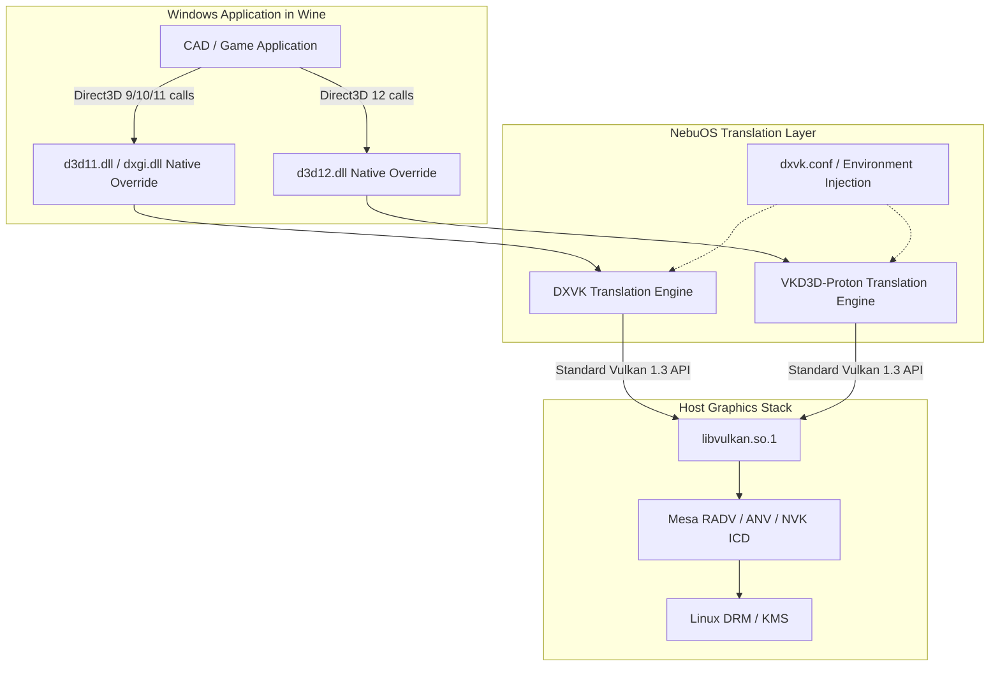
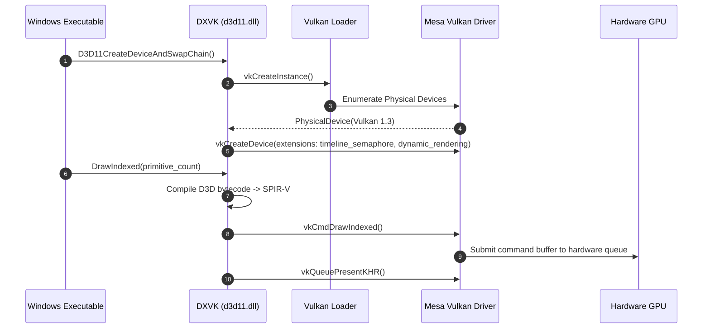

# DXVK and VKD3D-Proton Translation Layer Specification — NebuOS

**Status:** DRAFT  
**Purpose:** Specify the deployment, DLL override configuration, runtime translation, dxvk.conf tuning, and memory management for DXVK (Direct3D 9/10/11 -> Vulkan) and VKD3D-Proton (Direct3D 12 -> Vulkan) in NebuOS.

---

## 1. Status
DRAFT — Technical implementation specification for Phase P5 graphics translation pipeline.

## 2. Purpose
Windows productivity software (CAD, 3D modelling, media suites) and games rely heavily on Microsoft Direct3D APIs. Since NebuOS does not run Windows or a virtual machine, Direct3D calls must be translated natively to Vulkan. This specification defines how DXVK and VKD3D-Proton are packaged, injected into per-application Wine prefixes, configured, and optimized.

## 3. Scope
- Packaging and version pinning of DXVK (2.3+) and VKD3D-Proton (2.12+).
- DLL override mechanisms (`d3d9.dll`, `d3d10core.dll`, `d3d11.dll`, `dxgi.dll`, `d3d12.dll`, `d3d12core.dll`).
- Generation and injection of declarative `dxvk.conf` and `vkd3d-proton.conf` profiles.
- Asynchronous pipeline compilation and state cache management.
- Integration with Mesa RADV, ANV, and NVK drivers.

## 4. Non-goals
- Modifying the upstream source code of DXVK or VKD3D-Proton.
- Emulating DirectX 12 on legacy GPUs lacking native Vulkan 1.3 support.
- Translation of Direct3D to OpenGL (WineD3D used solely as legacy fallback).
- Bypassing GPU VRAM physical hardware constraints.

## 5. Requirements
1. **R-TRN-01:** Deploy pre-compiled 32-bit and 64-bit release binaries of DXVK and VKD3D-Proton in `/usr/lib/nebu/graphics/`.
2. **R-TRN-02:** Provide automated atomic symlinking or hardlinking of translation DLLs into prefix `drive_c/windows/system32/` and `syswow64/`.
3. **R-TRN-03:** Configure Wine DLL overrides to enforce `native,builtin` for translated Direct3D modules.
4. **R-TRN-04:** Provide fine-grained per-application `dxvk.conf` tuning for frame pacing, max frame latency, and pipeline caching.
5. **R-TRN-05:** Deliver >= 90% of native Windows Direct3D 11/12 performance on compatible hardware.

## 6. Architecture
Direct3D calls from Win32 applications execute within the Wine process space and are intercepted by DXVK/VKD3D libraries:



## 7. Components
1. **Translation Library Store (`/usr/lib/nebu/graphics/`):** Houses versioned releases:
   - `/usr/lib/nebu/graphics/dxvk/x64/` and `x32/`
   - `/usr/lib/nebu/graphics/vkd3d-proton/x64/` and `x32/`
2. **DLL Override Provisioner:** Copies or reflinks DLLs into prefix and sets `WINEDLLOVERRIDES="d3d11,dxgi,d3d9,d3d12=n"` in the app launch environment.
3. **Config Injector:** Generates dynamic `dxvk.conf` inside application working directory based on Compatibility Profile flags.
4. **State Cache Coordinator:** Directs DXVK pipeline state cache to persistent storage at `~/.cache/nebu/shaders/<app_id>/`.
5. **Vulkan Capability Validator:** Verifies device supports required extensions before activating DXVK/VKD3D.

## 8. Data Flow
1. Application initiates Direct3D device creation: `D3D11CreateDevice`.
2. Wine loader resolves `d3d11.dll` to DXVK native PE build in prefix `system32`.
3. DXVK initializes Vulkan physical device through `libvulkan.so.1`.
4. Shader bytecode (HLSL SM 4.0/5.0) intercepted by DXVK and compiled to SPIR-V intermediate representation.
5. SPIR-V passed to Mesa Vulkan driver, which compiles machine code for target GPU hardware.
6. Swapchain buffers presented directly to Wayland surface via `VK_KHR_wayland_surface`.

## 9. Control Flow


## 10. Interfaces
- **Direct3D Client APIs:** Direct3D 9Ex, 10.0, 10.1, 11.0, 11.1, 11.2, 11.4, 12.0, 12.1, 12.2.
- **Vulkan Host APIs:** Vulkan 1.3 Core with required extensions:
  - `VK_EXT_custom_border_color`
  - `VK_EXT_descriptor_indexing`
  - `VK_KHR_timeline_semaphore`
  - `VK_EXT_transform_feedback`
- **Tuning Configuration (`dxvk.conf`):**
  ```ini
  dxvk.enableAsync = true
  dxvk.numCompilerThreads = 4
  dxvk.maxFrameLatency = 1
  d3d11.samplerAnisotropy = 16
  ```

## 11. Dependencies
- Upstream DXVK release builds (MPL-2.0 / Zlib).
- Upstream VKD3D-Proton release builds (LGPL-2.1).
- Mesa Vulkan drivers (`mesa-vulkan-drivers`): RADV (AMD), ANV (Intel), NVK (NVIDIA).
- Vulkan Loader (`vulkan-loader`) >= 1.3.275.

## 12. Security
- Translation libraries execute strictly within unprivileged Bubblewrap user sandbox.
- Direct hardware access restricted to `/dev/dri/renderD128` (KMS master nodes blocked).
- DXVK state cache parsed with bounds checking to prevent buffer overflow attacks from malicious cache files.

## 13. Resource Requirements
- **Disk Space:** ~85 MB for complete 32-bit and 64-bit DXVK + VKD3D library bundle.
- **RAM Overhead:** DXVK translation runtime structures: 35–80 MB RSS depending on scene complexity.
- **VRAM Footprint:** Translation tracking structures require ~120 MB VRAM overhead above raw application assets.

## 14. Failure Modes
1. **Missing Vulkan Extension:** Target GPU driver lacks mandatory extension (e.g. `VK_EXT_transform_feedback`).
2. **SPIR-V Compilation Failure:** Obscure Direct3D shader bytecode features unsupported by translator.
3. **VRAM Exhaustion:** Application requests more video memory than physically available.
4. **Pipeline Stutter:** Initial shader compilation introduces visible frame drops.

## 15. Recovery Behavior
- When mandatory Vulkan 1.3 extensions are absent, runtime falls back to WineD3D (OpenGL translation) and issues a warning notification.
- In shader compilation failure, DXVK falls back to safe reference compilation pipeline and dumps failing shader bytecode to `~/.local/share/nebu/shader-errors/`.
- Pipeline stutter mitigated by persistent state caching (`DXVK_STATE_CACHE=1`) and background multi-threaded compilation (`dxvk.enableAsync=true`).

## 16. Testing Requirements
- Automated test executing DXVK test suite across synthetic Direct3D 9, 11, and 12 benchmarks.
- Memory leak test running continuous rendering loops for 12 hours.
- Visual regression comparison between native Windows capture and NebuOS DXVK output (SSIM >= 0.98).

## 17. Performance Requirements
- Translation CPU overhead: <= 3% total CPU time spent in DXVK/VKD3D translation logic.
- Framerate parity: >= 90% of native Windows performance on AMD RADV and Intel ANV.
- Input latency impact: <= 1.0ms added by translation queue.

## 18. Compatibility Considerations
- CAD and 3D modeling tools (AutoCAD, Blender Windows build) utilize specific Direct3D 11 feature levels; DXVK exposes `D3D_FEATURE_LEVEL_11_1` cleanly.
- Legacy DirectX 9 games requiring fixed-function pipelines are handled via DXVK's D3D9 implementation.

## 19. Open Questions
- **OQ-TRN-01:** Should `dxvk-async` patches be enabled by default for gaming profiles despite potential minor visual pop-in?
- **OQ-TRN-02:** What is the optimal memory threshold for automatic DXVK state cache garbage collection?

## 20. Related Documents
- [00-graphics-specification.md](00-graphics-specification.md)
- [01-gpu-detection.md](01-gpu-detection.md)
- [02-mesa-integration.md](02-mesa-integration.md)
- [03-vulkan-opengl.md](03-vulkan-opengl.md)
- [05-gpu-profiles.md](05-gpu-profiles.md)
- [06-shader-cache.md](06-shader-cache.md)
