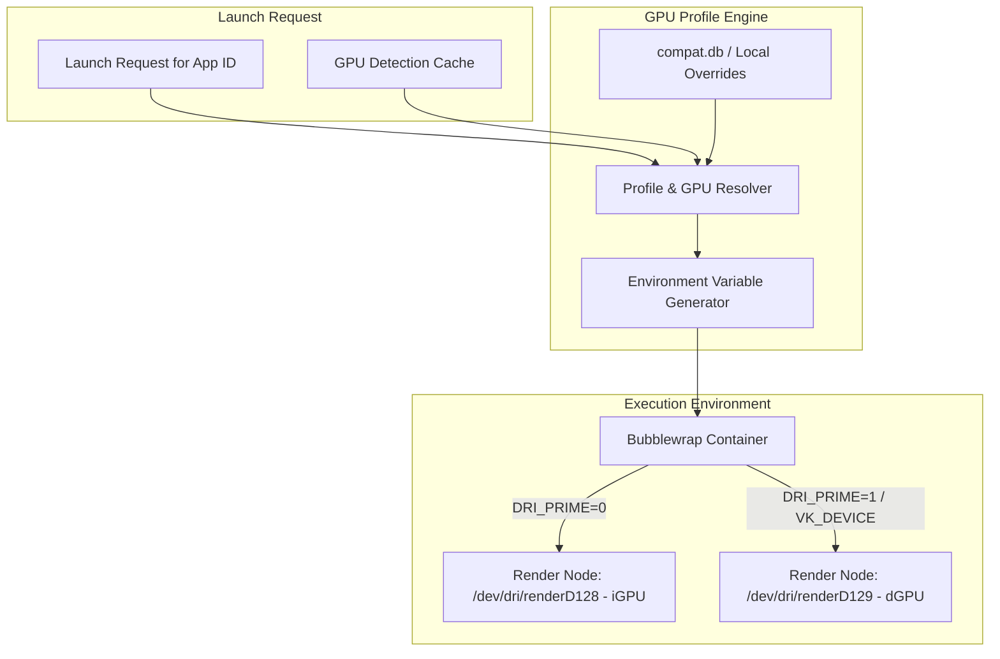
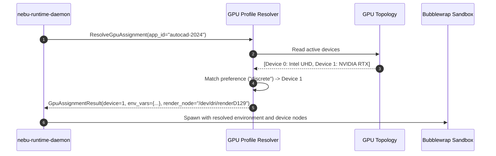

# GPU Profiles Specification — NebuOS

**Status:** DRAFT  
**Purpose:** Specify the declarative GPU profile schema, per-application hardware assignment, multi-GPU routing (iGPU vs dGPU), and runtime environment variable injection in NebuOS.

---

## 1. Status
DRAFT — Technical implementation specification for Phase P5 GPU management.

## 2. Purpose
Modern computing devices frequently feature heterogeneous graphics hardware: power-efficient integrated GPUs (iGPU) alongside high-performance discrete GPUs (dGPU). This specification defines how NebuOS models GPU profiles, matches applications to optimal graphics hardware, and configures runtime environment variables (PRIME, DRI_PRIME, VK_ICD_FILENAMES) transparently.

## 3. Scope
- Declarative JSON schema for GPU profiles.
- Automated GPU routing heuristics (productivity vs. 3D rendering/gaming).
- Dynamic runtime environment variable generation.
- Fallback chain when requested GPU hardware is disconnected or unavailable.
- User customization and override persistence in SQLite and configuration files.

## 4. Non-goals
- Dynamic real-time migration of active rendering contexts across physical GPUs without application restart.
- Proprietary multi-GPU SLI/Crossfire bridging.
- Direct PCI passthrough to virtual machines (NebuOS does not use VMs).

## 5. Requirements
1. **R-PRF-01:** Automatically detect multi-GPU topologies (Intel+NVIDIA, AMD+NVIDIA, Intel+AMD) during system initialization.
2. **R-PRF-02:** Route desktop compositor and lightweight applications to low-power iGPU by default to conserve battery and thermal budget.
3. **R-PRF-03:** Route certified 3D CAD software, video editors, and games to discrete GPU (dGPU) automatically via profile database.
4. **R-PRF-04:** Support declarative profile overrides stored in JSON and queryable via D-Bus `org.nebu.Runtime1`.
5. **R-PRF-05:** Provide seamless fallback to iGPU if external eGPU is detached during system operation.

## 6. Architecture
GPU profile selection operates during application launch preparation inside `nebu-runtime-daemon`:



## 7. Components
1. **GPU Topology Store (`/run/nebu/gpu_topology.json`):** Ephemeral system state generated by `nebu-gpu-probe` on boot.
2. **Profile Resolver:** Matches application fingerprint against database profiles and resolves optimal GPU assignment: `Integrated`, `Discrete`, `External`, or `Auto`.
3. **PRIME Environment Injector:** Sets standard Linux offload environment variables:
   - For AMD/Intel dGPU: `DRI_PRIME=1`
   - For NVIDIA proprietary/open dGPU: `__NV_PRIME_RENDER_OFFLOAD=1 __GLX_VENDOR_LIBRARY_NAME=nvidia __VK_LAYER_NV_optimus=NVIDIA_only`
4. **Device Node Filter:** Ensures Bubblewrap sandbox mounts the correct `/dev/dri/renderD12X` node based on profile.

## 8. Data Flow
1. User requests launch of `autocad.exe`.
2. `neburuntimed` queries `compat.db` for app profile.
3. Profile indicates:
   ```json
   {
     "gpu": {
       "preferred_device": "discrete",
       "power_profile": "performance",
       "dxvk_config": {
         "d3d11.maxTessFactor": "64"
       }
     }
   }
   ```
4. Resolver inspects `/run/nebu/gpu_topology.json`: finds AMD Radeon 780M (iGPU, node 128) and NVIDIA RTX 4060 (dGPU, node 129).
5. Injects offload variables into launch command and maps `/dev/dri/renderD129` into sandbox container.
6. Application starts on RTX 4060; compositing presentation surfaces handed over to `nebu-compositor` via Wayland DMA-BUF sharing.

## 9. Control Flow


## 10. Interfaces
- **JSON Profile Schema:**
  ```json
  {
    "$schema": "https://nebuos.org/schemas/gpu-profile-v1.json",
    "app_id": "com.autodesk.autocad2024",
    "gpu_preference": "discrete",
    "vulkan_icd": "/usr/share/vulkan/icd.d/nvidia_icd.json",
    "power_state": "high_performance",
    "environment": {
      "DXVK_HUD": "0",
      "VKD3D_CONFIG": "no_upload_hvv"
    }
  }
  ```
- **CLI Inspection Interface:** `nebu-gpu-probe --list-devices --json`

## 11. Dependencies
- `mesa-demos` / `vulkan-tools` (`vulkaninfo`).
- Linux DRM subsystem (`libdrm`).
- System topology cache `/run/nebu/gpu_topology.json`.

## 12. Security
- Application sandboxes are restricted strictly to designated GPU render nodes; DRM master control nodes (`/dev/dri/card*`) remain completely blocked.
- Privileged GPU firmware debugging interfaces (`/sys/kernel/debug/dri/*`) are never exposed inside containers.

## 13. Resource Requirements
- Profile resolution execution time: <= 1.5ms.
- Memory footprint of resolver module: <= 200 KB RSS.
- Zero polling threads; state generated statically at boot and updated strictly on hotplug uevents.

## 14. Failure Modes
1. **Discrete GPU Power Gated:** dGPU is asleep via Runtime D3 and fails to power on within timeout.
2. **Missing dGPU Driver:** NVIDIA proprietary driver module missing after kernel update.
3. **eGPU Sudden Disconnection:** External Thunderbolt/USB4 GPU unplugged during active session.

## 15. Recovery Behavior
- If dGPU fails to respond within 2.0s, resolver falls back immediately to iGPU and logs warning to `journald`.
- Missing kernel module triggers automatic fallback to Nouveau or integrated graphics.
- eGPU disconnection sends SIGTERM to affected sandboxed processes with interactive data recovery alert.

## 16. Testing Requirements
- Unit tests validating JSON schema conformance across sample profiles.
- Mock multi-GPU test harness verifying correct environment variable injection for AMD, Intel, and NVIDIA configurations.
- Stress test verifying clean fallback behavior when secondary GPU is absent.

## 17. Performance Requirements
- GPU profile resolution latency: <= 2.0ms.
- Power overhead of idle dGPU when all apps routed to iGPU: 0 Watts (complete PCIe Runtime D3Cold poweroff).

## 18. Compatibility Considerations
- Certain legacy CAD applications fail when running under PRIME offloading due to hardcoded adapter enumeration; profiles inject `DXVK_FILTER_DEVICE_NAME` to present solely the target GPU.

## 19. Open Questions
- **OQ-GPU-01:** Should NebuOS provide an interactive GUI switcher in the Quick Settings tray allowing users to force all apps to dGPU on AC power?
- **OQ-GPU-02:** What is the optimal threshold for automatic battery-saving downclocking of iGPU shader clocks?

## 20. Related Documents
- [00-graphics-specification.md](00-graphics-specification.md)
- [01-gpu-detection.md](01-gpu-detection.md)
- [02-mesa-integration.md](02-mesa-integration.md)
- [04-dxvk-vkd3d.md](04-dxvk-vkd3d.md)
- [06-shader-cache.md](06-shader-cache.md)
