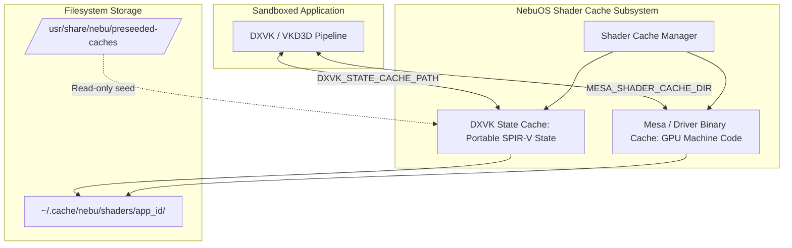
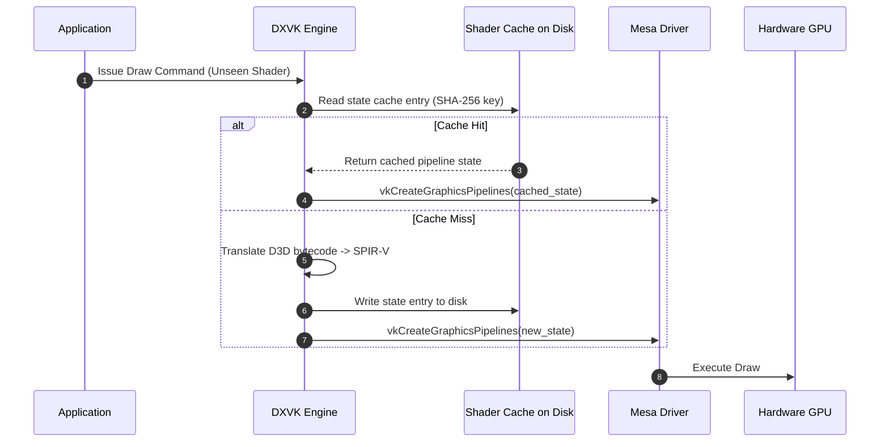

# Shader Cache Specification — NebuOS

**Status:** DRAFT  
**Purpose:** Specify the unified shader cache architecture, disk layout, eviction policies, cross-prefix cache sharing, and corruption recovery mechanisms in NebuOS.

---

## 1. Status
DRAFT — Technical implementation specification for Phase P5 shader caching.

## 2. Purpose
Shader compilation is a primary cause of runtime stutter and latency in translated Windows applications and games. NebuOS implements a high-performance, centralized shader caching architecture that manages DXVK state caches, Mesa pipeline caches, and Vulkan binary caches across isolated application prefixes without compromising security or data integrity.

## 3. Scope
- Directory layout for system and user shader caches.
- Hash-based cache key generation and validation.
- Cross-prefix state cache deduplication and sharing.
- Cache size budgeting, TTL expiration, and LRU eviction policies.
- Corruption detection and automated invalidation.

## 4. Non-goals
- Distributing proprietary copyrighted pre-compiled shader binaries over public networks.
- In-memory shader bytecode reverse engineering or de-compilation.
- Overriding hardware GPU instruction sets.

## 5. Requirements
1. **R-SHD-01:** Maintain centralized persistent shader cache at `~/.cache/nebu/shaders/<app_id>/`.
2. **R-SHD-02:** Share DXVK state caches (`.dxvk-cache`) across identical application binaries running in different user profiles.
3. **R-SHD-03:** Enforce strict disk storage limits: default cap of 2.0 GB per application, 10.0 GB total system-wide shader cache.
4. **R-SHD-04:** Implement CRC32/xxHash checksum validation on cache read to detect driver or filesystem corruption.
5. **R-SHD-05:** Invalidate and purge stale driver binary caches automatically upon Mesa or kernel driver updates.

## 6. Architecture
Shader caching operates across two distinct tiers: declarative DXVK state caches and driver-compiled GPU binary caches:



## 7. Components
1. **Cache Path Resolver:** Injects standardized environment variables into Bubblewrap sandboxes:
   - `DXVK_STATE_CACHE_PATH=~/.cache/nebu/shaders/<app_id>/`
   - `MESA_SHADER_CACHE_DIR=~/.cache/nebu/shaders/<app_id>/mesa/`
   - `VKD3D_SHADER_CACHE_PATH=~/.cache/nebu/shaders/<app_id>/`
2. **Cache Eviction Daemon (`nebu-cache-cleaner.timer`):** Systemd user timer running weekly or under disk pressure to enforce quota caps.
3. **Mesa Version Invalidator:** Compares stored Mesa version hash in `cache.meta` against `/usr/lib64/libvulkan.so.1` build ID; flushes binary caches if mismatch detected.
4. **Btrfs Deduplicator:** Deduplicates shared state cache blocks using Btrfs extent sharing.

## 8. Data Flow
1. Windows application submits Direct3D draw call requiring a new shader combination.
2. DXVK queries local state cache in memory:
   - If present: loads pre-parsed pipeline state immediately.
   - If absent: compiles D3D bytecode -> SPIR-V and records state entry in `.dxvk-cache` file.
3. Vulkan driver receives SPIR-V and checks Mesa shader cache (`~/.cache/nebu/shaders/<app_id>/mesa/`):
   - If present: loads compiled GPU binary code into hardware command queue (< 0.5ms).
   - If absent: executes full compiler pipeline, stores binary in cache, and uploads to GPU.
4. Subsequent executions achieve stutter-free frame delivery.

## 9. Control Flow


## 10. Interfaces
- **Filesystem Directory Layout:**
  ```text
  ~/.cache/nebu/shaders/<app_id>/
  ├── dxvk.dxvk-cache       # DXVK portable state cache
  ├── vkd3d.cache           # VKD3D pipeline cache
  ├── cache.meta            # JSON metadata (Mesa version, timestamps)
  └── mesa/                 # Mesa driver machine code cache
      └── index
  ```
- **Environment Invariants:** `DXVK_STATE_CACHE=1`, `MESA_SHADER_CACHE_MAX_SIZE=2G`.

## 11. Dependencies
- Linux Btrfs filesystem (for reflink/deduplication support).
- Mesa Vulkan driver stack >= 24.0.
- `xxhash` / `crc32fast` for rapid integrity validation.

## 12. Security
- Cache directory mounted private to application sandbox (`0700` POSIX permissions).
- Other applications cannot read or tamper with another app's shader cache.
- Binary cache parser runs with strict memory bounds to prevent memory corruption from malformed cache headers.

## 13. Resource Requirements
- **Disk Budget:** Default per-app cap: 2.0 GB; low-end mode (4GB RAM systems) cap: 512 MB.
- **Cache Read Latency:** Cache hit retrieval < 0.8ms.
- **CPU Overhead:** Background asynchronous cache writes consume < 1% CPU.

## 14. Failure Modes
1. **Cache Corruption from Hard Power Loss:** Machine loses power during write to `.dxvk-cache`.
2. **Driver ABI Mismatch:** Mesa updated across OS image upgrade while old binary cache remains.
3. **Disk Exhaustion:** Shader cache fills remaining free space on root subvolume.

## 15. Recovery Behavior
- When `.dxvk-cache` header CRC check fails, DXVK automatically truncates corrupted tail entries and continues with valid prefix entries.
- Mesa automatically invalidates binary caches when driver build ID changes, rebuilding clean shaders on demand.
- Cache cleaner automatically purges LRU shader caches whenever free disk space drops below 10%.

## 16. Testing Requirements
- Automated test validating cache creation, read hit, and write commit across 1,000 synthetic shaders.
- Corruption simulation test injecting random bitflips into cache files and asserting graceful recovery without crashes.
- Eviction policy test asserting disk usage never exceeds configured hard cap.

## 17. Performance Requirements
- Warm application launch time: >= 60% faster startup due to pre-compiled shader cache.
- Frame time variance during gameplay/rendering: 99th percentile frame time <= 16.6ms (zero compilation stutters).

## 18. Compatibility Considerations
- State caches generated by DXVK are portable across different GPU vendors (AMD, Intel, NVIDIA) because they store SPIR-V pipeline descriptions rather than vendor-specific machine code.

## 19. Open Questions
- **OQ-SHD-01:** Should NebuOS pre-seed popular open-source application shader caches directly in the base OS image?
- **OQ-SHD-02:** What is the optimal compression algorithm (zstd vs lz4) for storing Mesa disk caches on low-end eMMC drives?

## 20. Related Documents
- [00-graphics-specification.md](00-graphics-specification.md)
- [01-gpu-detection.md](01-gpu-detection.md)
- [02-mesa-integration.md](02-mesa-integration.md)
- [04-dxvk-vkd3d.md](04-dxvk-vkd3d.md)
- [05-gpu-profiles.md](05-gpu-profiles.md)
