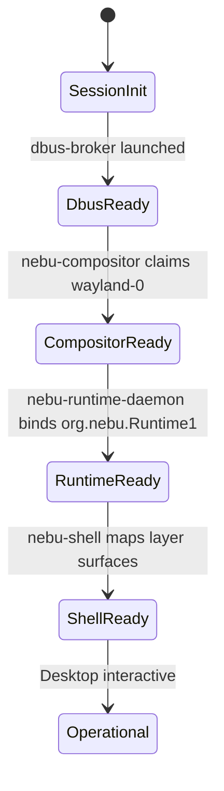

# Interface Architecture & IPC Overview Specification — NebuOS

**Status:** DRAFT  
**Purpose:** Define the holistic inter-process communication (IPC) architecture, subsystem boundaries, data exchange protocols, and interface versioning strategies across NebuOS.

---

## 1. Status
DRAFT — Under active systems architectural review. Governs all IPC protocols, socket assignments, D-Bus namespaces, data contracts, and interface lifecycles across NebuOS components.

## 2. Purpose
This specification defines the inter-process communication topology of NebuOS. It specifies the technical contracts governing how the display compositor (`nebu-compositor`), desktop shell (`nebu-shell`), runtime daemon (`nebu-runtime-daemon`), installer subsystem (`nebu-installer`), system update service (`nebu-update-daemon`), and compatibility databases interact. It establishes concrete wire protocols, transport selections, serialization encodings, latency budgets, and security constraints to ensure that decoupled components communicate reliably, performantly, and securely without compromising system stability or user isolation.

## 3. Scope
- Enumeration and mapping of all inter-process boundaries across user space and privileged daemon spaces.
- Protocol definitions for session communication (D-Bus on `dbus-broker`), display and input streaming (Wayland core and custom protocols), low-latency buffer passing (`linux_dmabuf_v1`, `memfd_create`), and internal POSIX process control channels.
- Transition contracts across privilege boundaries between UID 1000 (desktop user) and UID 0 (system services).
- Detailed interface versioning, negotiation protocols, backward compatibility guarantees, and formal deprecation procedures.
- Resource isolation models for sandboxed Windows PE processes executed via Bubblewrap (`bwrap`).

## 4. Non-goals
- Implementation code or internal language-specific bindings within single compilation units.
- External cloud APIs or remote synchronization endpoints (which are governed by the cloud sync architecture).
- Modification or re-implementation of Linux kernel drivers, subsystems, or syscall specifications (e.g., DRM/KMS, evdev, cgroups v2).
- Virtual machine hypervisor IPC or emulation hypercalls (NebuOS strictly avoids hypervisors and virtual machines).

## 5. Requirements
- **R-IPC-01 (Latency Budget):** Point-to-point D-Bus method call latency between `nebu-shell` and `nebu-runtime-daemon` must be $\le 1.0\text{ ms}$ at 95th percentile under standard desktop loads.
- **R-IPC-02 (Zero-Copy Buffer Sharing):** Display surface frame transfers between application processes (native or Wine) and `nebu-compositor` must utilize kernel DMA-BUF memory handles, incurring 0 bytes of CPU-driven pixel memory copying.
- **R-IPC-03 (Unprivileged Desktop Execution):** All desktop shell, launcher, and runtime management operations must execute entirely under unprivileged user sessions (UID 1000) without requiring setuid binaries or `sudo` rights.
- **R-IPC-04 (Fault Isolation):** A crash, hang, or kernel freeze within an application, installer, or wine process tree must not disrupt the compositor frame loop, tear down the desktop shell, or block database access for other applications.
- **R-IPC-05 (Introspectability):** All exposed D-Bus endpoints must provide standard FreeDesktop Introspection XML describing methods, signals, properties, and error codes.
- **R-IPC-06 (Interface Evolution):** All public IPC interfaces must support backward-compatible additions and provide explicit major version tags in interface namespaces.

## 6. Architecture

NebuOS organizes IPC around four distinct transport tiers:
1. **Control Bus (D-Bus Session):** Employs `dbus-broker` to deliver asynchronous remote procedure calls, lifecycle signals, and state notifications between desktop user daemons.
2. **Display & Presentation Stream (Wayland):** Uses local UNIX domain sockets to stream compositing commands, input events, surface damages, and DMA-BUF file descriptors between clients and `nebu-compositor`.
3. **Sandbox Supervision (Pipes & Sockets):** Employs anonymous socketpairs, POSIX pipes, and signalfd descriptors to manage and supervise isolated Bubblewrap namespaces running `wineserver` and Windows executables.
4. **Data Persistence (Embedded SQLite):** Directly binds thread-safe SQLite3 engines over shared filesystem mounts using Write-Ahead Logging (WAL) and memory-mapped I/O.

```mermaid
graph TD
    subgraph SYSTEM_DOMAIN [System Bus - dbus-broker / Root UID 0]
        PID1[systemd PID 1]
        POLKIT[polkitd]
        UPDATE_D[nebu-update-daemon]
        NM[NetworkManager]
        LOGIND[systemd-logind]
    end

    subgraph SESSION_DOMAIN [User Session Bus - dbus-broker / User UID 1000]
        SHELL[nebu-shell]
        RUNTIME_D[nebu-runtime-daemon]
        PIPEWIRE[PipeWire / WirePlumber]
    end

    subgraph COMPOSITOR_DOMAIN [Display Server / User UID 1000]
        COMP[nebu-compositor]
    end

    subgraph SANDBOX_DOMAIN [Isolated Sandboxes - bwrap / UID 1000]
        WINE_SRV[wineserver]
        APP_WIN[Windows PE Process: acad.exe / app.exe]
        INSTALLER[Windows Installer: setup.exe]
        FLATPAK_APP[Native Flatpak App]
    end

    subgraph STORAGE_DOMAIN [Storage Subsystem - Btrfs / Local FS]
        SYS_DB[(/usr/share/nebu/compat.db - Read Only)]
        USR_DB[(~/.local/share/nebu/user_compat.db - Read/Write)]
        PREFIX_STORE[~/.nebu/apps/<app_id>/ - Btrfs Subvolume]
    end

    %% D-Bus Session Links
    SHELL <-->|org.nebu.Runtime1| RUNTIME_D
    SHELL <-->|org.freedesktop.Notifications| SHELL
    SHELL <-->|StatusNotifierWatcher| RUNTIME_D
    RUNTIME_D <-->|org.nebu.InstallerProgress1| SHELL

    %% Wayland Domain Sockets
    SHELL <-->|wlr-layer-shell-unstable-v1| COMP
    APP_WIN <-->|wl_surface / xdg_shell / dmabuf| COMP
    INSTALLER <-->|wl_surface / xdg_shell / dmabuf| COMP
    FLATPAK_APP <-->|wl_surface / xdg_shell / dmabuf| COMP

    %% Compositor Query & Management
    SHELL <-->|org.nebu.Compositor1| COMP
    COMP <-->|nebu_window_grouping_v1| APP_WIN

    %% Sandboxed Process Control
    RUNTIME_D -->|bwrap --unshare-all / anonymous pipe| WINE_SRV
    WINE_SRV -->|NT IPC / Local Named Pipes| APP_WIN
    WINE_SRV -->|NT IPC / Local Named Pipes| INSTALLER

    %% Database & State Management
    RUNTIME_D -->|rusqlite / WAL Read-Only| SYS_DB
    RUNTIME_D -->|rusqlite / WAL Read-Write| USR_DB
    RUNTIME_D -->|Btrfs ioctl / Snapshot Tree| PREFIX_STORE

    %% System Level Cross-Boundary
    RUNTIME_D -.->|Polkit Session Check / System D-Bus| UPDATE_D
    SHELL -.->|Inhibit / Power Control| LOGIND
    SHELL -.->|Network Status| NM
```



### 6.1 Subsystem Boundary Matrix
The following matrix enumerates every physical and logical boundary across the operating system:

| Source Entity | Target Entity | Mechanism / Transport | Wire Format / Protocol | Latency SLA | Privilege Boundary |
| :--- | :--- | :--- | :--- | :--- | :--- |
| `nebu-shell` | `nebu-runtime-daemon` | Session D-Bus (`$XDG_RUNTIME_DIR/bus`) | D-Bus GVariant Binary | $< 1.0\text{ ms}$ | UID 1000 $\leftrightarrow$ UID 1000 |
| `nebu-shell` | `nebu-compositor` | Wayland Socket (`wayland-0`) | Wayland Wire Protocol | $< 0.2\text{ ms}$ | UID 1000 $\leftrightarrow$ UID 1000 |
| `nebu-shell` | `nebu-compositor` | Session D-Bus (`org.nebu.Compositor1`) | D-Bus GVariant Binary | $< 1.0\text{ ms}$ | UID 1000 $\leftrightarrow$ UID 1000 |
| `nebu-runtime-daemon` | `wineserver` | Anonymous UNIX Socketpair / Pipe | Native Wine RPC | $< 0.5\text{ ms}$ | Host $\leftrightarrow$ Sandbox (`bwrap`) |
| `wineserver` | Windows PE Process | Shared Memory (`/dev/shm`) + UNIX Domain | NT System Call Emulation | $< 0.05\text{ ms}$ | Sandbox Internal |
| Windows PE Process | `nebu-compositor` | Wayland Socket (Bind Mounted) | Wayland Wire + DMA-BUF | $< 0.1\text{ ms}$ | Sandbox $\leftrightarrow$ Host Compositor |
| `nebu-runtime-daemon` | System Database | In-Process Memory / OS Page Cache | SQLite 3 C-ABI / WAL | $< 0.1\text{ ms}$ | Local Disk Read-Only |
| `nebu-runtime-daemon` | User Database | In-Process Memory / File I/O | SQLite 3 C-ABI / WAL | $< 0.2\text{ ms}$ | User Disk Read/Write |
| `nebu-runtime-daemon` | `nebu-update-daemon` | System D-Bus (`/run/dbus/system_bus_socket`)| D-Bus Binary + Polkit Auth | $< 5.0\text{ ms}$ | UID 1000 $\rightarrow$ UID 0 |
| `nebu-compositor` | Kernel DRM Subsystem | Linux Character Device (`/dev/dri/card0`) | DRM/KMS IOCTLs | $< 0.05\text{ ms}$ | User $\rightarrow$ Kernel Ring 0 |

## 7. Components

### 7.1 `nebu-compositor` (NebuOS Native)
- **Role:** Wayland display server, frame compositor, and hardware event dispatcher based on Smithay.
- **Transports Provided:**
  - Standard Wayland socket located at `${XDG_RUNTIME_DIR}/wayland-0`.
  - Session D-Bus service `org.nebu.Compositor1` for workspace, window title, and geometry querying.
- **Direct Hardware Bindings:**
  - DRM/KMS rendering master via `/dev/dri/card0`.
  - Input event aggregation via `libinput` over `/dev/input/event*`.

### 7.2 `nebu-shell` (NebuOS Native)
- **Role:** Primary graphical shell, dock, application launcher, notification center, and settings panel built with Rust (Slint/Iced).
- **Transports Consumed:**
  - Wayland client connection for surface management via `wlr-layer-shell-unstable-v1`.
  - Session D-Bus client calling `org.nebu.Runtime1` and `org.nebu.Compositor1`.
- **Transports Provided:**
  - FreeDesktop Notifications server `org.freedesktop.Notifications`.
  - FreeDesktop StatusNotifierWatcher `org.kde.StatusNotifierWatcher`.

### 7.3 `nebu-runtime-daemon` (NebuOS Native)
- **Role:** Session daemon orchestrating application life cycles, sandbox spawning, prefix configuration, compatibility database queries, and binary inspection.
- **Transports Provided:**
  - Session D-Bus service `org.nebu.Runtime1`.
  - Installation session progress service `org.nebu.InstallerProgress1`.
- **Transports Consumed:**
  - System D-Bus calls to `org.nebu.Update1` (via Polkit).
  - SQLite database access handles.
  - Linux `bwrap` process execution and file-descriptor passing.

### 7.4 `nebu-update-daemon` (NebuOS Native)
- **Role:** System-level privileged service executing atomic operating system upgrades, rollback state persistence, and OSTree container deploys.
- **Transports Provided:**
  - System D-Bus interface `org.nebu.Update1` at `/org/nebu/Update1`.
- **Transports Consumed:**
  - `systemd` PID 1 dbus interfaces (`org.freedesktop.systemd1`).
  - Polkit authorization engine (`org.freedesktop.PolicyKit1`).

### 7.5 External System Daemons (Fedora / Linux Standard)
- **`dbus-broker`:** Session and system bus message routing daemon implementing the FreeDesktop D-Bus wire specification with low-latency in-kernel accounting.
- **`PipeWire` / `WirePlumber`:** Multimedia routing engine communicating with clients over native PipeWire UNIX sockets and D-Bus.
- **`NetworkManager`:** Network link state management exposed via system D-Bus.
- **`systemd --user`:** User session supervisor and cgroups v2 manager.

## 8. Data Flow

### 8.1 Interactive Application Launch Pipeline

```mermaid
sequenceDiagram
    autonumber
    participant User as User
    participant Shell as nebu-shell
    participant Dbus as dbus-broker (Session)
    participant Daemon as nebu-runtime-daemon
    participant DB as SQLite Engine
    participant Sandbox as Bubblewrap (bwrap)
    participant Wine as Wine / wineserver
    participant Comp as nebu-compositor

    User->>Shell: Clicks Application Icon / Opens File
    Shell->>Dbus: Call org.nebu.Runtime1.LaunchExecutable(path, args, opts)
    Dbus->>Daemon: Dispatch LaunchExecutable
    Daemon->>Daemon: Verify executable hash & path safety
    Daemon->>DB: Query CompatProfile by PE SHA-256
    DB-->>Daemon: Return profile: Wine version, DLL overrides, Env vars
    Daemon->>Daemon: Check Btrfs prefix state; apply delta patches if required
    Daemon->>Sandbox: Fork & Exec bwrap with isolated namespaces
    Sandbox->>Wine: Spawn wineserver & wine64 loader
    Daemon-->>Dbus: Return ObjectPath /org/nebu/Runtime1/Apps/<app_id>, PID
    Dbus-->>Shell: Return method response
    Daemon->>Dbus: Emit Signal: ApplicationStarted(app_id, pid)
    Wine->>Comp: Connect Wayland Socket; Commit wl_surface via DMA-BUF
    Comp->>Comp: Identify window grouping via nebu_window_grouping_v1
    Comp->>User: Scanout composited window to monitor
```

### 8.2 Crash Telemetry and State Flow
1. Windows process encounters an unhandled CPU exception (e.g., `STATUS_ACCESS_VIOLATION`).
2. Wine exception handler generates an internal crash dump or triggers `winedbg`.
3. Process terminates unexpectedly; `wineserver` unlinks local socket resources.
4. `nebu-runtime-daemon` detects PID exit via `signalfd` on child subreaper loop.
5. Daemon analyzes exit code and cgroup peak memory metrics.
6. Daemon emits D-Bus signal `ApplicationCrashed(app_id, instance_path, signal, dump_path, backtrace)`.
7. `nebu-shell` catches signal and presents a desktop crash notification offering automatic prefix repair.

## 9. Control Flow

### 9.1 Session Bootstrap Sequence
1. Kernel boots into immutable `/usr` root via OSTree / bootc.
2. `systemd` PID 1 initializes hardware and launches `systemd --user` instance for UID 1000.
3. User session initializes `dbus-broker.service`.
4. `nebu-compositor.service` starts:
   - Acquires DRM master on `/dev/dri/card0`.
   - Initializes Smithay backend and binds `$XDG_RUNTIME_DIR/wayland-0`.
   - Claims `org.nebu.Compositor1` on session bus.
5. `nebu-runtime-daemon.service` starts:
   - Opens `/usr/share/nebu/compat.db` in read-only mode.
   - Initializes user database `~/.local/share/nebu/user_compat.db`.
   - Verifies integrity of base prefix templates.
   - Claims `org.nebu.Runtime1` on session bus.
6. `nebu-shell.service` starts:
   - Connects to Wayland socket; configures layer-shell surfaces (taskbar, launcher).
   - Queries `org.nebu.Runtime1.ListApplications` to populate local memory cache.
   - Binds `org.freedesktop.Notifications` to handle incoming desktop banners.



## 10. Interfaces & Versioning Strategy

### 10.1 Versioning Principles
All NebuOS inter-process contracts are subject to strict semantic versioning:
1. **D-Bus Major Versions:**
   - Represented explicitly in the interface namespace string (e.g., `org.nebu.Runtime1`, `org.nebu.Runtime2`).
   - Breaking changes (altering method argument types, removing methods, changing signal semantics) require an increment of the major version identifier.
   - When a major version is incremented, the daemon MUST expose both the old and new interfaces concurrently for a minimum of one minor OS release cycle to allow smooth client migration.
2. **D-Bus Minor Additions:**
   - Non-breaking changes (adding optional dictionary keys to `a{sv}` parameter maps, introducing new methods, or adding new signals) retain the current interface name.
   - The daemon exposes a read-only property `DaemonVersion` (string `MAJOR.MINOR.PATCH`) enabling clients to detect feature support dynamically.
3. **Wayland Protocol Evolution:**
   - Custom Wayland XML interfaces define an integer `version` attribute.
   - Compositors implement interfaces up to version $N$. Clients specify their supported version $M \le N$ during `wl_registry.bind`. The compositor must strictly honor the semantics of version $M$.
4. **Relational Database Schemas:**
   - The compatibility database uses an internal `schema_migrations` table.
   - Schema alterations must always preserve backward read compatibility with earlier minor versions of `nebu-runtime-daemon`.

### 10.2 Deprecation Policy
- Deprecated methods or signals must be marked in D-Bus Introspection XML with the annotation `<annotation name="org.freedesktop.DBus.Deprecated" value="true"/>`.
- A deprecated interface must remain functional for at least 180 days after official notification in release notes before removal.

## 11. Dependencies

| Subsystem / Crate | Purpose | Upstream Provider | Target Version |
| :--- | :--- | :--- | :--- |
| `zbus` | Pure Rust D-Bus client/server library | Freedesktop / Community | $\ge 4.0$ |
| `smithay` | Modular Wayland compositor framework | Smithay Project | $\ge 0.3$ |
| `wayland-client` / `wayland-server` | Wayland protocol wire bindings | Rust-Windowing | $\ge 0.31$ |
| `rusqlite` | SQLite3 C-API wrapper | Community | $\ge 0.31$ (SQLite $\ge 3.42$) |
| `bubblewrap` (`bwrap`) | Unprivileged container sandboxing | Flatpak Project | $\ge 0.8$ |
| `dbus-broker` | High-performance D-Bus message broker | Fedora Base | $\ge 35$ |
| `libdrm` | Direct Rendering Manager user-space library | X.Org / Mesa | $\ge 2.4.120$ |

## 12. Security & Privilege Boundaries

### 12.1 Privilege Isolation Model
NebuOS implements a two-tier execution privilege model:
1. **Unprivileged Desktop Domain (UID 1000):**
   - `nebu-compositor`, `nebu-shell`, and `nebu-runtime-daemon` run as UID 1000.
   - They possess zero root capabilities (`cap_sys_admin`, `cap_net_admin` are disabled).
   - File system access is governed by standard POSIX permissions and user discretionary access controls.
2. **Privileged System Domain (UID 0):**
   - Only `systemd` PID 1 and `nebu-update-daemon` run as UID 0.
   - Communication from UID 1000 to UID 0 over system D-Bus is intercepted by Polkit (`polkitd`).
   - Every privileged action (e.g., applying OS rootfs updates) requires explicit authorization via rule definitions in `/usr/share/polkit-1/actions/org.nebu.update.policy`.

### 12.2 Sandboxed Client Restrictions
Applications executed via `nebu-runtime-daemon` are isolated inside Bubblewrap namespaces:
- **Mount Namespace:**
  - Read-only binds of `/usr`, `/lib`, `/lib64`, `/bin`, `/sbin`.
  - Private `tmpfs` mounts for `/tmp` and `/run`.
  - The real `/home` is hidden; only the application's isolated prefix directory (`~/.nebu/apps/<app_id>/drive_c`) and explicitly shared folders (`~/Documents`, `~/Downloads`) are exposed.
- **IPC / PID Namespaces:**
  - Applications run in private PID namespaces, preventing inspection or signaling of host desktop processes.
  - The host abstract UNIX socket namespace is unshared (`--unshare-all`).
- **Wayland Socket Sharing:**
  - Only the compositor's Wayland socket (`$XDG_RUNTIME_DIR/wayland-0`) is bind-mounted into the sandbox.
  - Wayland security context protocols are enforced to prevent sandboxed clients from binding privileged interfaces such as `wlr-layer-shell`.

## 13. Resource Requirements
- **File Descriptors:**
  - `nebu-runtime-daemon`: 1,024 soft limit, 4,096 hard limit.
  - `nebu-compositor`: 4,096 soft limit, 16,384 hard limit (accommodating hundreds of client DMA-BUFs and syncobjs).
- **Socket Buffer Memory:**
  - Default Linux socket buffer limits apply (`/proc/sys/net/core/rmem_default` = 212,992 bytes).
  - High-bandwidth Wayland surface streams utilize DMA-BUF file descriptors rather than socket buffers, ensuring minimal kernel buffer memory usage.
- **Daemon Memory Budgets:**
  - `nebu-runtime-daemon` resident memory $\le 25\text{ MB}$ at idle; peak $\le 60\text{ MB}$ during PE parsing.
  - `nebu-compositor` resident memory $\le 75\text{ MB}$ at idle.
  - `nebu-shell` resident memory $\le 45\text{ MB}$ at idle.

## 14. Failure Modes

| Failure Event | Immediate Symptom | System Impact | Detection Mechanism |
| :--- | :--- | :--- | :--- |
| `dbus-broker` terminates | All D-Bus connections return `ECONNRESET` | Shell and runtime lose RPC connectivity | Socket EOF on `zbus` event loop |
| `nebu-compositor` crashes | Display freezes; screen turns black | Wayland clients lose connection and exit | `systemd --user` watchdog timeout |
| Wine application hangs | Window stops updating; no damage events | Specific app unresponsive; shell unaffected | Compositor `ping/pong` timeout |
| SQLite DB locked (`SQLITE_BUSY`) | D-Bus launch method blocks | 5-second launch delay | `rusqlite` error code inspection |
| Malformed PE binary analyzed | Memory parser crashes or errors | Launch request fails | Rust `Result::Err` returned |

## 15. Recovery Behavior

### 15.1 D-Bus Reconnection Loop
If `dbus-broker` restarts, clients (`nebu-shell`, `nebu-runtime-daemon`) must execute an exponential backoff reconnection algorithm:
- Attempt 1: 50ms delay
- Attempt 2: 150ms delay
- Attempt 3: 450ms delay
- Max backoff: 5000ms delay
- Upon reconnection, daemons re-register their bus names and restore state caches.

### 15.2 Stalled Wine Process Teardown
When a user requests termination or an application becomes non-responsive:
1. `nebu-runtime-daemon` sends `SIGTERM` to the process group inside the target cgroup.
2. A 5000ms grace period timer is initiated to allow Wine to flush modified registry keys and clean up temporary files.
3. If processes remain active after 5000ms, the daemon issues `SIGKILL` to all PIDs in `/sys/fs/cgroup/nebu-apps/<app_id>/cgroup.procs`.
4. Any stale lock files (`~/.nebu/apps/<app_id>/.lock`) are pruned.

### 15.3 Compositor Session Recovery
If `nebu-compositor` exits unexpectedly:
- `systemd --user` automatically restarts `nebu-compositor.service` within 500ms.
- Persistent applications supporting Wayland buffer re-attachment rebind to the new `wayland-0` socket.
- `nebu-shell` automatically reconnects and reconstructs layer-shell taskbars and desktop panels.

## 16. Testing Requirements
- **Interface Contract Verification:** Every method, signal, and property defined in the D-Bus Introspection XML must have an automated test in the NebuOS integration suite executing via `busctl` or `zbus-test`.
- **Fuzz Testing:** The PE analysis engine and D-Bus payload deserializers must undergo continuous AFL++ fuzz testing for $\ge 48$ hours without panicking or leaking memory.
- **Protocol Conformance:** Custom Wayland protocols must be validated against `wayland-scanner` schema validators with zero syntax warnings.
- **Socket Disconnect Stress Tests:** Daemons must undergo automated stress testing where the session bus broker and Wayland compositor sockets are abruptly terminated while under peak application launch workloads.

## 17. Performance Requirements
- **D-Bus Call Round-Trip:** Median latency $\le 0.4\text{ ms}$; 95th percentile $\le 1.0\text{ ms}$; 99th percentile $\le 2.5\text{ ms}$.
- **Wayland Dispatch Latency:** Compositor event dispatch to client buffer commit acknowledgement $\le 0.2\text{ ms}$.
- **Cold Process Spawn Overhead:** Time elapsed between D-Bus invocation of `LaunchExecutable` and the `fork/exec` of the target Bubblewrap container $\le 50\text{ ms}$.
- **IPC Memory Overhead:** In-flight D-Bus message buffer memory must not exceed 2 MB per active connection.

## 18. Compatibility Considerations
- **FreeDesktop Desktop Entry Specification:** All Windows applications registered through the runtime daemon must output valid `.desktop` files conforming to Desktop Entry Specification 1.5.
- **Wayland Client Interoperability:** Any standard Linux application adhering to `xdg_shell` (v1-v4) must render and interact seamlessly alongside Windows applications running via Wine.
- **X11 Fallback Mode:** For legacy Windows applications relying on raw X11 window coordinates or GDI hooks incompatible with pure Wayland, the compositor provides seamless rootless Xwayland bridging.

## 19. Open Questions
- **OPEN QUESTION: IPC-01:** Should NebuOS adopt dynamic on-demand systemd socket activation for `nebu-runtime-daemon`, or maintain a persistent resident process to keep compatibility database indices warm in memory?
- **OPEN QUESTION: IPC-02:** For competitive gaming scenarios requiring sub-millisecond input response, should input state bypass Wayland socket buffers and utilize mapped memory rings (`vhost-user` style)?

## 20. Related Documents
- [01-ipc-interfaces.md](01-ipc-interfaces.md) — D-Bus Introspection XML & Signatures
- [02-runtime-interfaces.md](02-runtime-interfaces.md) — Rust Trait Definitions for Runtime Engine
- [03-compositor-interfaces.md](03-compositor-interfaces.md) — Wayland Protocol Extensions & Compositor APIs
- [04-shell-interfaces.md](04-shell-interfaces.md) — Shell Contracts & Notification Interfaces
- [05-installer-interfaces.md](05-installer-interfaces.md) — Installer Progress & Registration Contract
- [06-database-interfaces.md](06-database-interfaces.md) — SQLite Schema & Query Patterns
- [07-update-interfaces.md](07-update-interfaces.md) — D-Bus Introspection XML, Traits & Polkit for org.nebu.Update1
- [../architecture/03-process-and-ipc.md](../architecture/03-process-and-ipc.md) — High-Level Process Hierarchy
