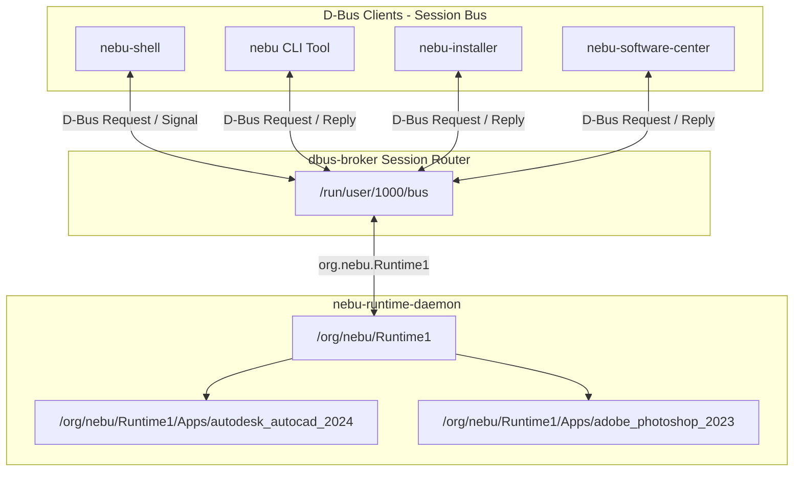
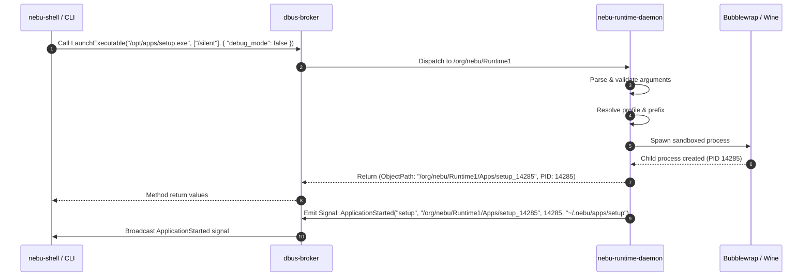

# D-Bus IPC Interface Specification — NebuOS

**Status:** DRAFT  
**Purpose:** Provide the formal, authoritative D-Bus interface specification, Introspection XML, type signatures, property bindings, signal contracts, and error dictionaries for `org.nebu.Runtime1`.

---

## 1. Status
DRAFT — Under active review. Defines the programmatic IPC contract between `nebu-runtime-daemon` and external desktop components (`nebu-shell`, `nebu-cli`, `nebu-installer`, software center).

## 2. Purpose
This specification formalizes the D-Bus application programming interface exposed by `nebu-runtime-daemon` on the session message bus. It defines the exact data structures, GVariant signatures, wire semantics, error definitions, and signal payloads utilized to identify, launch, inspect, supervise, and repair Windows applications executing under NebuOS compatibility prefixes.

## 3. Scope
- Definition of the primary D-Bus service `org.nebu.Runtime1` and primary object path `/org/nebu/Runtime1`.
- Per-instance child object paths `/org/nebu/Runtime1/Apps/<app_id>`.
- Full D-Bus Introspection XML conforming to the FreeDesktop D-Bus Specification.
- Detailed parameter dictionaries (`a{sv}`) and type definitions.
- Signal broadcast contracts and error enumeration schemas.

## 4. Non-goals
- Defining Wayland surface presentation protocols (governed by [03-compositor-interfaces.md](03-compositor-interfaces.md)).
- Internal Rust trait definitions or in-process structs (governed by [02-runtime-interfaces.md](02-runtime-interfaces.md)).
- System-level root D-Bus services (`nebu-update-daemon` or systemd PID 1).

## 5. Requirements
- **R-DBUS-01 (Strict Typing):** All methods, properties, and signals must strictly adhere to standard D-Bus type signatures (`s`, `as`, `a{sv}`, `b`, `i`, `u`, `o`).
- **R-DBUS-02 (Non-blocking Asynchronous Dispatch):** Long-running operations (such as prefix initialization or Windows process launch) must return within 50ms with an instance handle or job token; subsequent state changes must be delivered via signals.
- **R-DBUS-03 (Standard Introspection):** The service must implement `org.freedesktop.DBus.Introspectable` and `org.freedesktop.DBus.Properties` across all exported objects.
- **R-DBUS-04 (Formal Error Namespacing):** All runtime exceptions must be mapped to distinct error names under the `org.nebu.Runtime1.Error` namespace.
- **R-DBUS-05 (Extensibility):** Method option and metadata structures must use variant dictionaries (`a{sv}`) to permit forward-compatible field additions.

## 6. Architecture



### 6.1 Bus Name and Object Paths
- **Well-known Bus Name:** `org.nebu.Runtime1`
- **Root Object Path:** `/org/nebu/Runtime1`
- **Application Instance Object Pattern:** `/org/nebu/Runtime1/Apps/<sanitized_app_id>`
  - Sanitization rule: Non-alphanumeric characters replaced by underscores (e.g., `autodesk.autocad.2024` $\rightarrow$ `autodesk_autocad_2024`).

## 7. Components

### 7.1 Service Provider (`nebu-runtime-daemon`)
- Implements the zbus connection loop.
- Manages local worker threads for PE inspection and cgroups tracking.
- Publishes properties via `org.freedesktop.DBus.Properties`.

### 7.2 Core Consumers
- **`nebu-shell`:** Invokes `LaunchExecutable` when user activates application launcher or desktop shortcuts; consumes `ApplicationStarted`, `ApplicationTerminated`, and `ApplicationCrashed` signals to update the running application indicators on the taskbar.
- **`nebu` (CLI):** Directly wraps `LaunchExecutable`, `RepairPrefix`, `IdentifyExecutable`, and `ListApplications` for command-line diagnostics and automation.
- **`nebu-installer`:** Intercepts setup binaries, calls `IdentifyExecutable`, reports installation progress, and requests prefix provisioning.

## 8. Data Flow



## 9. Control Flow
1. **Method Dispatch:**
   - Incoming D-Bus message is deserialized by `zbus`.
   - Thread pool executes non-blocking logic; long tasks are spawned as Tokio tasks.
   - Reply is serialized and returned to caller.
2. **Signal Notification:**
   - Linux process status changes are trapped by runtime daemon via `signalfd` on PID exit.
   - If exit was clean, `ApplicationTerminated` is emitted.
   - If exit was triggered by crash signal (`SIGSEGV`, `SIGBUS`, `SIGABRT`), `ApplicationCrashed` is emitted with backtrace telemetry.
3. **Property Change Flow:**
   - When application list changes, daemon emits `org.freedesktop.DBus.Properties.PropertiesChanged` with updated `RunningApplications` dictionary.

## 10. Interfaces

### 10.1 Complete Introspection XML (`org.nebu.Runtime1`)

```xml
<!DOCTYPE node PUBLIC "-//freedesktop//DTD D-BUS Object Introspection 1.0//EN"
 "http://www.freedesktop.org/standards/dbus/1.0/introspect.dtd">
<node name="/org/nebu/Runtime1">
  <interface name="org.nebu.Runtime1">

    <!-- Methods -->
    <method name="LaunchExecutable">
      <annotation name="org.freedesktop.DBus.Method.NoReply" value="false"/>
      <arg name="exe_path" type="s" direction="in"/>
      <arg name="args" type="as" direction="in"/>
      <arg name="options" type="a{sv}" direction="in"/>
      <arg name="app_instance" type="o" direction="out"/>
      <arg name="pid" type="u" direction="out"/>
    </method>

    <method name="IdentifyExecutable">
      <arg name="exe_path" type="s" direction="in"/>
      <arg name="app_id" type="s" direction="out"/>
      <arg name="app_name" type="s" direction="out"/>
      <arg name="detected_version" type="s" direction="out"/>
      <arg name="cert_status" type="i" direction="out"/>
      <arg name="recommended_runtime" type="s" direction="out"/>
      <arg name="metadata" type="a{sv}" direction="out"/>
    </method>

    <method name="RepairPrefix">
      <arg name="app_id" type="s" direction="in"/>
      <arg name="repair_flags" type="u" direction="in"/>
      <arg name="success" type="b" direction="out"/>
      <arg name="log_path" type="s" direction="out"/>
    </method>

    <method name="TerminateApplication">
      <arg name="app_id" type="s" direction="in"/>
      <arg name="signal_code" type="u" direction="in"/>
      <arg name="success" type="b" direction="out"/>
    </method>

    <method name="ListApplications">
      <arg name="filter" type="a{sv}" direction="in"/>
      <arg name="applications" type="a(ssssu)" direction="out"/>
    </method>

    <!-- Signals -->
    <signal name="ApplicationStarted">
      <arg name="app_id" type="s"/>
      <arg name="app_instance" type="o"/>
      <arg name="pid" type="u"/>
      <arg name="prefix_path" type="s"/>
    </signal>

    <signal name="ApplicationTerminated">
      <arg name="app_id" type="s"/>
      <arg name="app_instance" type="o"/>
      <arg name="exit_code" type="i"/>
      <arg name="duration_seconds" type="u"/>
    </signal>

    <signal name="ApplicationCrashed">
      <arg name="app_id" type="s"/>
      <arg name="app_instance" type="o"/>
      <arg name="signal_number" type="i"/>
      <arg name="crash_dump_path" type="s"/>
      <arg name="backtrace_snippet" type="s"/>
    </signal>

    <!-- Properties -->
    <property name="RunningApplications" type="a{sa{sv}}" access="read">
      <annotation name="org.freedesktop.DBus.Property.EmitsChangedSignal" value="true"/>
    </property>

    <property name="ActivePrefixes" type="as" access="read">
      <annotation name="org.freedesktop.DBus.Property.EmitsChangedSignal" value="true"/>
    </property>

    <property name="DaemonVersion" type="s" access="read">
      <annotation name="org.freedesktop.DBus.Property.EmitsChangedSignal" value="const"/>
    </property>

    <property name="SystemCompatLevel" type="u" access="read">
      <annotation name="org.freedesktop.DBus.Property.EmitsChangedSignal" value="const"/>
    </property>

  </interface>
</node>
```

### 10.2 Method Signatures and Parameter Contracts

#### 10.2.1 Method: `LaunchExecutable`
- **Signature:** `(s: exe_path, as: args, a{sv}: options) -> (o: app_instance, u: pid)`
- **Description:** Launches a Windows PE binary inside an isolated sandbox using the compatibility profile assigned to the application.
- **`options` Dictionary Keys (`a{sv}`):**

| Key Name | Variant Type | Description | Default if Omitted |
| :--- | :--- | :--- | :--- |
| `custom_prefix` | `s` (String) | Absolute path to alternate prefix directory | Standard `~/.nebu/apps/<app_id>` |
| `wine_version` | `s` (String) | Override Wine runtime (e.g., `wine-staging-9.2`, `proton-9.0`) | Resolved from database |
| `env_vars` | `a{ss}` (Dict) | Additional environment variable key-value pairs | `{}` |
| `debug_mode` | `b` (Boolean) | If true, enables full `WINEDEBUG` logging to file | `false` |
| `virtual_desktop`| `b` (Boolean) | If true, launches inside Wine virtual desktop | `false` |
| `virtual_desktop_res` | `s` (String) | Desktop geometry e.g., `"1920x1080"` | `"1280x720"` |
| `dxvk_hud` | `s` (String) | Sets `DXVK_HUD` configuration string | `""` |
| `prime_offload` | `b` (Boolean) | If true, exports `DRI_PRIME=1` (discrete GPU) | Profile default |
| `working_dir` | `s` (String) | Initial Windows working directory | Parent directory of binary |

#### 10.2.2 Method: `IdentifyExecutable`
- **Signature:** `(s: exe_path) -> (s: app_id, s: app_name, s: detected_version, i: cert_status, s: recommended_runtime, a{sv}: metadata)`
- **Description:** Parses PE headers and SHA-256 signatures to identify known applications and installers against the compatibility catalog.
- **Certification Status Enum (`cert_status`):**
  - `0`: Unknown / Uncertified
  - `1`: Certified (Flawless out-of-the-box operation)
  - `2`: Supported (Functional with known minor quirks)
  - `3`: Limited (Core features work; secondary features degraded)
  - `4`: Broken (Fails to launch or critical unhandled exceptions)
- **`metadata` Dictionary Keys (`a{sv}`):**
  - `pe_sha256` (`s`): Full hexadecimal SHA-256 hash of the binary.
  - `installer_type` (`s`): Detected installer engine (`"msi"`, `"inno"`, `"nsis"`, `"installshield"`, `"generic_pe"`).
  - `architecture` (`s`): `"x86_64"` or `"i386"`.
  - `requires_admin` (`b`): Whether PE manifest specifies `requireAdministrator`.
  - `known_issues_count` (`u`): Number of tracked issues in database.

#### 10.2.3 Method: `RepairPrefix`
- **Signature:** `(s: app_id, u: repair_flags) -> (b: success, s: log_path)`
- **Description:** Executes automated remediation workflows on an application's Wine prefix.
- **Bitmask Definition (`repair_flags`):**
  - `0x0001`: `REBUILD_WINEBOOT` — Regenerates system registry hives and drive mappings.
  - `0x0002`: `RESTORE_BASE_REGISTRY` — Overwrites altered registry keys from baseline profile.
  - `0x0004`: `REINSTALL_DEPENDENCIES` — Re-runs winetricks/proton dependency recipes.
  - `0x0008`: `ROLLBACK_LAST_SNAPSHOT` — Restores Btrfs snapshot to pre-update state.
  - `0x0010`: `PURGE_SHADER_CACHE` — Clears DXVK / VKD3D compiled shader cache directory.

#### 10.2.4 Method: `TerminateApplication`
- **Signature:** `(s: app_id, u: signal_code) -> (b: success)`
- **Description:** Gracefully or forcefully terminates all processes associated with an active application prefix.
- **Signals (`signal_code`):**
  - `15` (`SIGTERM`): Graceful shutdown request to wineserver.
  - `9` (`SIGKILL`): Immediate kernel cgroup process termination.

#### 10.2.5 Method: `ListApplications`
- **Signature:** `(a{sv}: filter) -> (a(ssssu): applications)`
- **Description:** Queries currently active and installed application profiles.
- **Returned Structure:**
  - `app_id` (`s`): Unique application string ID.
  - `name` (`s`): Human-readable display name.
  - `version` (`s`): Installed version string.
  - `status` (`s`): Current state: `"RUNNING"`, `"IDLE"`, `"REPAIRING"`, `"CRASHED"`.
  - `active_instances` (`u`): Count of currently running process trees.

### 10.3 Signal Definitions
- `ApplicationStarted(s: app_id, o: app_instance, u: pid, s: prefix_path)`: Emitted immediately after child process namespaces are unshared and main process execution begins.
- `ApplicationTerminated(s: app_id, o: app_instance, i: exit_code, u: duration_seconds)`: Emitted when all processes in the prefix cgroup have terminated cleanly.
- `ApplicationCrashed(s: app_id, o: app_instance, i: signal_number, s: crash_dump_path, s: backtrace_snippet)`: Emitted when an application terminates due to an unhandled kernel signal or Win32 fault.

### 10.4 Error Hierarchy (`org.nebu.Runtime1.Error`)

| Error Identifier | D-Bus Error Name | Typical Cause |
| :--- | :--- | :--- |
| `InvalidBinary` | `org.nebu.Runtime1.Error.InvalidBinary` | File is not a valid PE32/PE32+ executable |
| `PrefixNotFound` | `org.nebu.Runtime1.Error.PrefixNotFound` | Specified `app_id` prefix does not exist on disk |
| `PrefixCorrupted`| `org.nebu.Runtime1.Error.PrefixCorrupted`| Wine registry hive or filesystem structure invalid |
| `LaunchFailed` | `org.nebu.Runtime1.Error.LaunchFailed` | Bubblewrap fork failed or missing runtime binary |
| `ApplicationNotFound`| `org.nebu.Runtime1.Error.ApplicationNotFound`| Application not in compatibility catalog |
| `DependencyMissing` | `org.nebu.Runtime1.Error.DependencyMissing`| Required DLL override or runtime package missing |
| `SandboxDenied` | `org.nebu.Runtime1.Error.SandboxDenied` | Executable path outside permitted read boundaries |
| `Timeout` | `org.nebu.Runtime1.Error.Timeout` | Wineserver did not respond within timeout window |

### 10.5 Concrete Invocation & Introspection Examples

#### 10.5.1 Command-Line Invocation via `busctl`
Operators and shell developers can directly invoke runtime methods via `busctl`:

```bash
# 1. Identify an untrusted Windows PE binary
busctl --user call org.nebu.Runtime1 /org/nebu/Runtime1 \
  org.nebu.Runtime1 IdentifyExecutable s "/home/user/Downloads/AutoCAD_2024_Setup.exe"

# Output format returned:
# s "autodesk.autocad.2024"
# s "Autodesk AutoCAD 2024"
# s "2024.1.0"
# i 1
# s "wine-staging-9.2"
# a{sv} 5 "pe_sha256" s "e3b0c44298fc1c149afbf4c8996fb92427ae41e4649b934ca495991b7852b855" \
#         "installer_type" s "inno" \
#         "architecture" s "x86_64" \
#         "requires_admin" b true \
#         "known_issues_count" u 0

# 2. Launch an application with custom options
busctl --user call org.nebu.Runtime1 /org/nebu/Runtime1 \
  org.nebu.Runtime1 LaunchExecutable sas a{sv} \
  "/home/user/.nebu/apps/autodesk.autocad.2024/drive_c/Program Files/Autodesk/AutoCAD 2024/acad.exe" \
  1 "/nologo" \
  3 "debug_mode" b false "dxvk_hud" s "fps,devinfo" "prime_offload" b true

# Output format returned:
# o "/org/nebu/Runtime1/Apps/autodesk_autocad_2024"
# u 18452

# 3. Monitor runtime signals in real time
busctl --user monitor org.nebu.Runtime1

# 4. Trigger automated prefix repair
busctl --user call org.nebu.Runtime1 /org/nebu/Runtime1 \
  org.nebu.Runtime1 RepairPrefix su "autodesk.autocad.2024" 3
```

#### 10.5.2 Property Dictionary Layout: `RunningApplications`
The `RunningApplications` property returns a dictionary mapping `app_id` strings to property bags:

```
a{sa{sv}} {
    "autodesk.autocad.2024": {
        "pid": <uint32 18452>,
        "uptime_seconds": <uint32 1420>,
        "memory_rss_bytes": <uint64 685768704>,
        "wine_version": <"wine-staging-9.2">,
        "prefix_path": <"/home/user/.nebu/apps/autodesk.autocad.2024">,
        "cgroup_path": <"/sys/fs/cgroup/nebu-apps/autodesk.autocad.2024">,
        "gpu_device": <"/dev/dri/renderD128">
    },
    "valve.steam": {
        "pid": <uint32 19201>,
        "uptime_seconds": <uint32 489>,
        "memory_rss_bytes": <uint64 348127232>,
        "wine_version": <"proton-9.0">,
        "prefix_path": <"/home/user/.nebu/apps/valve.steam">,
        "cgroup_path": <"/sys/fs/cgroup/nebu-apps/valve.steam">,
        "gpu_device": <"/dev/dri/renderD128">
    }
}
```

## 11. Dependencies
- **System Service:** `dbus-broker.service` running on user session bus.
- **Rust Library:** `zbus` $\ge 4.0$ with `tokio` integration.
- **Base Utilities:** `bwrap`, `wine64`, `wineserver`, `sqlite3`.

## 12. Security
- **Caller Identity Verification:** All incoming requests are verified via `zbus::Connection::peer_credentials()` extracting the caller's UID and PID. Calls originating from UIDs other than the session owner (UID 1000) are rejected with `org.nebu.Runtime1.Error.SandboxDenied`.
- **Path Traversal Sanitization:** All incoming `exe_path`, `working_dir`, and `custom_prefix` string arguments are resolved through `std::fs::canonicalize`. Paths attempting directory traversal (`../`) or pointing outside permitted user storage are rejected immediately.
- **Variant Type Sanitization:** All values in `a{sv}` dictionaries are checked against strict schema types before deserialization to prevent memory exhaustion or serialization attacks.

## 13. Resource Requirements
- **Socket Message Size:** Maximum D-Bus message payload size enforced by daemon is 4 MB (exceeding standard 16MB system broker limit to minimize memory spikes).
- **Concurrent Connections:** Handles up to 64 active D-Bus peer connections concurrently without thread contention.
- **CPU / Memory:** D-Bus request processing consumes $\le 0.5\text{ ms}$ CPU time per call and $< 64\text{ KB}$ heap allocation per request.

## 14. Failure Modes
- **Client Disconnection During Launch:** If caller terminates while `LaunchExecutable` is preparing the prefix, the daemon completes provisioning and terminates the orphaned child if no other client attaches.
- **Broker Exhaustion:** If session bus message queues overflow, D-Bus returns `org.freedesktop.DBus.Error.LimitsExceeded`. Daemon logs a warning and throttles signal emission.
- **Unresponsive Wineserver:** If `wineserver -k` fails during `RepairPrefix`, the daemon escalates to kernel cgroup killing.

## 15. Recovery Behavior
- **D-Bus Reconnection:** If `dbus-broker` restarts, the daemon automatically re-requests ownership of `org.nebu.Runtime1` and re-exports all active application instance objects.
- **State Synchronization:** Upon re-registering on the bus, the daemon re-evaluates all active cgroups and re-emits `ApplicationStarted` signals for any active Windows applications to allow `nebu-shell` to resynchronize its taskbar state.

## 16. Testing Requirements
- **Introspection Validation:** Automated CI test runs `busctl introspect org.nebu.Runtime1 /org/nebu/Runtime1` and validates output against `org.nebu.Runtime1.xml` using `xmllint`.
- **Method Unit Tests:** Integration tests in Python (`pytest-asyncio` + `dbus-next`) exercising every method with valid, boundary, and malformed inputs.
- **Signal Capture Tests:** Automated test verifying that spawning a test Windows executable (`notepad.exe`) emits `ApplicationStarted` and clean exit emits `ApplicationTerminated`.

## 17. Performance Requirements
- **`IdentifyExecutable` Latency:** $\le 15\text{ ms}$ for binaries up to 500 MB (utilizing fast PE header reads and memory-mapped hashing).
- **`LaunchExecutable` Latency:** Method call must return $(o, u)$ within $\le 50\text{ ms}$ of receipt.
- **`ListApplications` Latency:** $\le 5\text{ ms}$ for databases with up to 1,000 registered application profiles.

## 18. Compatibility Considerations
- **Backward Compatibility:** All new fields added to `options` or `metadata` dictionaries must be optional.
- **Major Version Transition:** If `org.nebu.Runtime2` is introduced in a future release, `nebu-runtime-daemon` will implement both `org.nebu.Runtime1` and `org.nebu.Runtime2` side-by-side.

## 19. Open Questions
- **OPEN QUESTION: DBUS-01:** Should streaming standard output/error from sandboxed Windows applications be exposed via D-Bus file descriptor passing (`UNIX_FD`), or directed exclusively to `journald` via `systemd-cat`? (Journald stream recommended for lower daemon memory usage).
- **OPEN QUESTION: DBUS-02:** Should `LaunchExecutable` support an async job token pattern for slow prefix cold-creations rather than returning immediately with a PID?

## 20. Related Documents
- [00-interface-overview.md](00-interface-overview.md) — Subsystem IPC Architecture
- [02-runtime-interfaces.md](02-runtime-interfaces.md) — Rust Trait Definitions for Runtime Engine
- [05-installer-interfaces.md](05-installer-interfaces.md) — Installer Progress Reporting Contract
- [06-database-interfaces.md](06-database-interfaces.md) — SQLite Schema & Query Patterns
