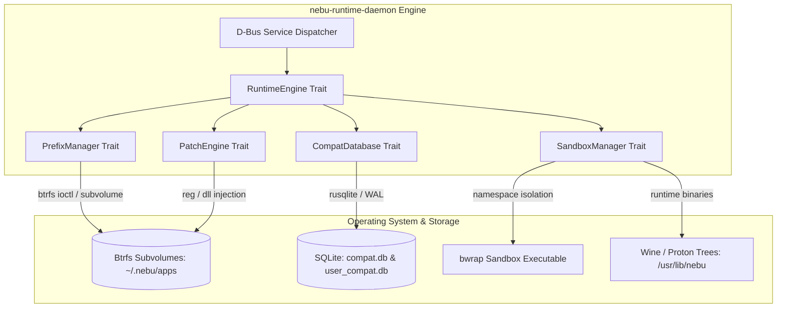
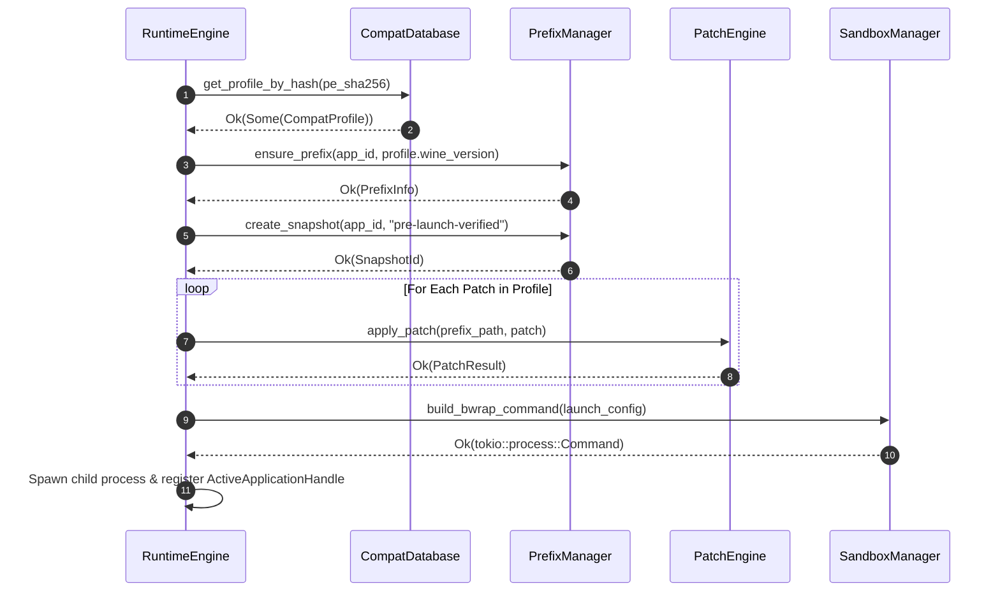

# Runtime Engine Trait & Internal API Specification — NebuOS

**Status:** DRAFT  
**Purpose:** Define the core Rust trait abstractions, asynchronous method contracts, data structures, and typed error enums that govern the internal architecture of `nebu-runtime-daemon`.

---

## 1. Status
DRAFT — Under architectural review. Specifies the internal component boundaries, trait interfaces, and concrete types utilized within the `nebu-runtime-daemon` Rust crate.

## 2. Purpose
This specification establishes the internal Rust programming model for `nebu-runtime-daemon`. It details the modular separation of concerns between executable analysis, prefix provisioning, compatibility resolution, patch application, and sandboxed execution. By defining formal Rust traits with concrete parameter and return types, this document ensures modular testability, strict error containment, zero-cost abstraction, and clean architectural boundaries across the runtime engine.

## 3. Scope
- Trait definitions for `RuntimeEngine`, `PrefixManager`, `CompatDatabase`, `PatchEngine`, and `SandboxManager`.
- Concrete data models, value types, and domain identifiers (`AppId`, `Sha256Digest`, `LaunchConfiguration`).
- Typed error hierarchies and failure categorization using `thiserror`.
- Concurrency and synchronization models across Tokio asynchronous tasks.

## 4. Non-goals
- Specifying external D-Bus wire formats (covered in [01-ipc-interfaces.md](01-ipc-interfaces.md)).
- Implementing Wayland protocol dispatchers (covered in [03-compositor-interfaces.md](03-compositor-interfaces.md)).
- Generating desktop shell UI elements (covered in [04-shell-interfaces.md](04-shell-interfaces.md)).

## 5. Requirements
- **R-RTI-01 (Idiomatic Asynchronous Rust):** All I/O-bound operations (filesystem, process management, database queries) must expose non-blocking `async` trait methods utilizing Tokio.
- **R-RTI-02 (Type-Safe Domain Identifiers):** Domain entities such as application IDs, hashes, and snapshot identifiers must use distinct, strongly typed wrapper structs to eliminate string-typing errors.
- **R-RTI-03 (Zero Panic Invariant):** Runtime traits must never call `unwrap()`, `expect()`, or trigger process panics. All recoverable errors must be encapsulated within `Result<T, E>`.
- **R-RTI-04 (Thread Safety):** All trait implementations must satisfy `Send + Sync + 'static` to support concurrent multi-threaded execution within the Tokio runtime pool.
- **R-RTI-05 (Deterministic Rollback):** Mutations to Wine prefixes must be transactional or verifiable via Btrfs snapshots.

## 6. Architecture



## 7. Components

### 7.1 `RuntimeEngine`
- **Role:** Central coordinator responsible for executable identification, launch configuration assembly, child process supervision, and instance lifecycle tracking.
- **Responsibilities:**
  - Manages active running applications map (`HashMap<AppId, ActiveApplicationHandle>`).
  - Spawns background process monitoring tasks.
  - Integrates `PrefixManager`, `CompatDatabase`, and `PatchEngine`.

### 7.2 `PrefixManager`
- **Role:** Handles Btrfs subvolume lifecycle for application prefixes at `~/.nebu/apps/<app_id>`.
- **Responsibilities:**
  - Creates base prefixes from immutable templates using Btrfs subvolume snapshots.
  - Generates point-in-time recovery snapshots before application updates or patch application.
  - Rolls back corrupt prefixes to known good snapshots.
  - Manages Wine prefix lock files (`.lock`).

### 7.3 `CompatDatabase`
- **Role:** Data access abstraction over system and user SQLite compatibility catalogs.
- **Responsibilities:**
  - Performs SHA-256 PE hash lookups to retrieve `CompatProfile`.
  - Queries DLL overrides, environment variables, and Windows registry injections.
  - Records user custom configuration overrides.

### 7.4 `PatchEngine`
- **Role:** Executes declarative compatibility recipes and shims on target Wine prefixes.
- **Responsibilities:**
  - Merges `.reg` registry scripts into Wine hives (`system.reg`, `user.reg`).
  - Deploys specialized DLL shims (e.g., license stubs, DirectX translations).
  - Verifies cryptographic checksums of applied patch payloads.

### 7.5 `SandboxManager`
- **Role:** Constructs Bubblewrap (`bwrap`) command executions and enforces Linux namespace isolation.
- **Responsibilities:**
  - Configures read-only root mounts and isolated `tmpfs` directories.
  - Restricts filesystem access to authorized user directories.
  - Attaches spawned processes to cgroups v2 resource slices (`/sys/fs/cgroup/nebu-apps/`).

## 8. Data Flow



## 9. Control Flow
1. **Launch Request Ingestion:** `RuntimeEngine::spawn_application` receives a `LaunchConfiguration`.
2. **State Validation:** Checks whether an instance of `AppId` is already running. If running and single-instance is required, returns existing handle.
3. **Prefix Preparation:** Calls `PrefixManager::ensure_prefix`. If missing, provisions from base template.
4. **Patch Verification:** Queries `PatchEngine::verify_patch_integrity`. Applies missing patches in tier order.
5. **Sandbox Assembly:** Calls `SandboxManager::build_bwrap_command` to prepare arguments, environment variables, and mounts.
6. **Process Spawning:** Spawns asynchronous child process via `tokio::process::Command`. Spawns a Tokio supervisor task to wait on child exit and report status.

## 10. Interfaces (Rust Traits & Type Definitions)

### 10.1 Core Domain Identifiers & Types

```rust
use std::path::{Path, PathBuf};
use std::collections::HashMap;
use serde::{Serialize, Deserialize};

/// Strongly typed unique application identifier (e.g., "autodesk.autocad.2024")
#[derive(Debug, Clone, PartialEq, Eq, Hash, Serialize, Deserialize)]
pub struct AppId(pub String);

/// Strongly typed version identifier
#[derive(Debug, Clone, PartialEq, Eq, Hash, Serialize, Deserialize)]
pub struct VersionId(pub String);

/// Strongly typed snapshot identifier for Btrfs points-in-time
#[derive(Debug, Clone, PartialEq, Eq, Hash, Serialize, Deserialize)]
pub struct SnapshotId(pub String);

/// Strongly typed patch identifier
#[derive(Debug, Clone, PartialEq, Eq, Hash, Serialize, Deserialize)]
pub struct PatchId(pub String);

/// Cryptographic SHA-256 digest formatted as 64-character hex string
#[derive(Debug, Clone, PartialEq, Eq, Hash, Serialize, Deserialize)]
pub struct Sha256Digest(pub String);

/// Targeted Wine or Proton runtime release
#[derive(Debug, Clone, PartialEq, Eq, Serialize, Deserialize)]
pub struct WineVersion {
    pub name: String,         // e.g. "wine-staging-9.2", "proton-9.0"
    pub binary_path: PathBuf, // e.g. "/usr/lib/nebu/runtimes/wine-staging-9.2/bin/wine64"
    pub server_path: PathBuf, // e.g. "/usr/lib/nebu/runtimes/wine-staging-9.2/bin/wineserver"
}

/// Graphics rendering backend selection
#[derive(Debug, Clone, Copy, PartialEq, Eq, Serialize, Deserialize)]
pub enum GraphicsBackend {
    Dxvk,
    Vkd3d,
    WineD3D,
    VulkanNative,
    OpenGLNative,
}

/// Process termination aggressiveness
#[derive(Debug, Clone, Copy, PartialEq, Eq)]
pub enum TerminationMode {
    Graceful(std::time::Duration), // SIGTERM with timeout
    Immediate,                     // SIGKILL immediately
}
```

### 10.2 Trait: `RuntimeEngine`

```rust
use async_trait::async_trait;

#[async_trait]
pub trait RuntimeEngine: Send + Sync {
    /// Inspects an arbitrary binary on disk, parsing PE headers and generating SHA-256 digest
    async fn identify_executable(&self, path: &Path) -> Result<ExecutableMetadata, RuntimeError>;

    /// Prepares complete launch configuration merging profile settings with system environment
    async fn prepare_environment(
        &self,
        app_id: &AppId,
        profile: &CompatProfile,
    ) -> Result<LaunchConfiguration, RuntimeError>;

    /// Spawns the application inside an isolated Bubblewrap sandbox
    async fn spawn_application(
        &self,
        config: LaunchConfiguration,
    ) -> Result<ActiveApplicationHandle, RuntimeError>;

    /// Terminates an active application instance
    async fn terminate_application(
        &self,
        app_id: &AppId,
        mode: TerminationMode,
    ) -> Result<(), RuntimeError>;

    /// Lists all currently active running application instances
    async fn list_running(&self) -> Result<Vec<ApplicationStatus>, RuntimeError>;

    /// Retrieves an active handle for a running application
    async fn get_instance(&self, app_id: &AppId) -> Result<Option<ActiveApplicationHandle>, RuntimeError>;
}
```

### 10.3 Trait: `PrefixManager`

```rust
bitflags::bitflags! {
    #[derive(Debug, Clone, Copy, PartialEq, Eq)]
    pub struct RepairFlags: u32 {
        const REBUILD_WINEBOOT       = 0b0000_0001;
        const RESTORE_BASE_REGISTRY  = 0b0000_0010;
        const REINSTALL_DEPENDENCIES = 0b0000_0100;
        const ROLLBACK_LAST_SNAPSHOT = 0b0000_1000;
        const PURGE_SHADER_CACHE     = 0b0001_0000;
    }
}

#[derive(Debug, Clone, Serialize, Deserialize)]
pub struct PrefixInfo {
    pub app_id: AppId,
    pub path: PathBuf,
    pub wine_version: WineVersion,
    pub created_at: chrono::DateTime<chrono::Utc>,
    pub size_bytes: u64,
}

#[derive(Debug, Clone, Serialize, Deserialize)]
pub struct SnapshotDescriptor {
    pub snapshot_id: SnapshotId,
    pub label: String,
    pub created_at: chrono::DateTime<chrono::Utc>,
    pub path: PathBuf,
}

#[derive(Debug, Clone, Serialize, Deserialize)]
pub struct RepairSummary {
    pub actions_performed: Vec<String>,
    pub success: bool,
    pub log_output: String,
}

#[async_trait]
pub trait PrefixManager: Send + Sync {
    /// Ensures that an isolated prefix exists on disk; creates from base subvolume if missing
    async fn ensure_prefix(&self, app_id: &AppId, wine_version: &WineVersion) -> Result<PrefixInfo, PrefixError>;

    /// Takes a read-only Btrfs snapshot of the prefix subvolume
    async fn create_snapshot(&self, app_id: &AppId, label: &str) -> Result<SnapshotId, PrefixError>;

    /// Restores the prefix to an existing snapshot state
    async fn rollback_snapshot(&self, app_id: &AppId, snapshot_id: &SnapshotId) -> Result<(), PrefixError>;

    /// Lists all available snapshots for an application
    async fn list_snapshots(&self, app_id: &AppId) -> Result<Vec<SnapshotDescriptor>, PrefixError>;

    /// Executes automated prefix repair workflows based on provided flags
    async fn repair_prefix(&self, app_id: &AppId, flags: RepairFlags) -> Result<RepairSummary, PrefixError>;

    /// Completely removes an application prefix subvolume and all associated snapshots
    async fn destroy_prefix(&self, app_id: &AppId) -> Result<(), PrefixError>;
}
```

### 10.4 Trait: `CompatDatabase`

```rust
#[derive(Debug, Clone, Serialize, Deserialize)]
pub struct CompatProfile {
    pub profile_id: String,
    pub version_id: VersionId,
    pub runtime_type: String, // "wine" | "proton"
    pub runtime_version: String,
    pub windows_version: String, // "win10" | "win11"
    pub env_vars: HashMap<String, String>,
    pub dll_overrides: HashMap<String, String>,
    pub registry_keys: Vec<RegistryEntry>,
    pub graphics_backend: GraphicsBackend,
    pub dependencies: Vec<ProfileDependency>,
    pub patches: Vec<ProfilePatch>,
}

#[derive(Debug, Clone, Serialize, Deserialize)]
pub struct RegistryEntry {
    pub key_path: String,
    pub value_name: String,
    pub value_type: String, // "REG_SZ", "REG_DWORD"
    pub value_data: String,
}

#[derive(Debug, Clone, Serialize, Deserialize)]
pub struct ProfileDependency {
    pub package_name: String,
    pub sha256: Sha256Digest,
    pub install_order: i32,
}

#[derive(Debug, Clone, Serialize, Deserialize)]
pub struct KnownIssue {
    pub issue_id: i64,
    pub severity: IssueSeverity,
    pub description: String,
    pub workaround: Option<String>,
}

#[derive(Debug, Clone, Copy, PartialEq, Eq, Serialize, Deserialize)]
pub enum IssueSeverity {
    Blocker,
    Major,
    Minor,
    Cosmetic,
}

pub trait CompatDatabase: Send + Sync {
    /// Retrieves full compatibility profile matched by exact executable SHA-256 hash
    fn get_profile_by_hash(&self, pe_sha256: &Sha256Digest) -> Result<Option<CompatProfile>, DatabaseError>;

    /// Retrieves profile by application ID and explicit version string
    fn get_profile_by_app_id(&self, app_id: &AppId, version: &str) -> Result<Option<CompatProfile>, DatabaseError>;

    /// Registers a user-defined profile override in the local user database
    fn register_user_profile(&mut self, profile: &CompatProfile) -> Result<(), DatabaseError>;

    /// Queries known issues and open bugs for a specific application version
    fn query_known_issues(&self, version_id: &VersionId) -> Result<Vec<KnownIssue>, DatabaseError>;
}
```

### 10.5 Trait: `PatchEngine`

```rust
#[derive(Debug, Clone, Copy, PartialEq, Eq, Serialize, Deserialize)]
pub enum PatchTier {
    Environment = 1,
    WineConfig = 2,
    Registry = 3,
    DllOverride = 4,
    BinaryShim = 5,
}

#[derive(Debug, Clone, Serialize, Deserialize)]
pub struct ProfilePatch {
    pub patch_id: PatchId,
    pub tier: PatchTier,
    pub patch_type: String, // "registry_merge", "file_replace", "dll_shim"
    pub payload: String,    // Declarative payload or path
    pub checksum: Sha256Digest,
    pub reversible: bool,
}

#[derive(Debug, Clone, Serialize, Deserialize)]
pub struct PatchResult {
    pub patch_id: PatchId,
    pub applied: bool,
    pub message: String,
}

#[async_trait]
pub trait PatchEngine: Send + Sync {
    /// Applies a declarative compatibility patch to the target prefix directory
    async fn apply_patch(&self, prefix: &Path, patch: &ProfilePatch) -> Result<PatchResult, PatchError>;

    /// Reverts an applied patch if the patch is marked as reversible
    async fn revert_patch(&self, prefix: &Path, patch_id: &PatchId) -> Result<(), PatchError>;

    /// Verifies that an applied patch matches its expected cryptographic checksum
    async fn verify_patch_integrity(&self, prefix: &Path, patch: &ProfilePatch) -> Result<bool, PatchError>;
}
```

### 10.6 Trait: `SandboxManager`

```rust
#[derive(Debug, Clone)]
pub struct LaunchConfiguration {
    pub app_id: AppId,
    pub executable_path: PathBuf,
    pub arguments: Vec<String>,
    pub working_directory: PathBuf,
    pub prefix_path: PathBuf,
    pub wine_version: WineVersion,
    pub environment: HashMap<String, String>,
    pub exposed_directories: Vec<PathBuf>,
    pub enable_network: bool,
    pub cgroup_slice: String,
}

#[derive(Debug)]
pub struct ActiveApplicationHandle {
    pub app_id: AppId,
    pub pid: u32,
    pub started_at: std::time::Instant,
    pub process_cgroup: PathBuf,
    pub exit_receiver: tokio::sync::broadcast::Receiver<i32>,
}

#[derive(Debug, Clone, Serialize, Deserialize)]
pub struct ApplicationStatus {
    pub app_id: AppId,
    pub pid: u32,
    pub uptime_seconds: u64,
    pub memory_rss_bytes: u64,
    pub cpu_usage_percent: f32,
}

pub trait SandboxManager: Send + Sync {
    /// Generates a configured Tokio Command ready to execute Bubblewrap (`bwrap`)
    fn build_bwrap_command(&self, config: &LaunchConfiguration) -> Result<tokio::process::Command, SandboxError>;

    /// Attaches spawned process PID to the appropriate cgroups v2 resource controller slice
    fn configure_cgroup(&self, app_id: &AppId, pid: u32) -> Result<(), SandboxError>;
}
```

### 10.7 Typed Error Hierarchies (`thiserror`)

```rust
use thiserror::Error;

#[derive(Error, Debug)]
pub enum RuntimeError {
    #[error("Executable file not found or inaccessible: {path}")]
    BinaryNotFound { path: PathBuf },

    #[error("Failed to parse PE headers: {reason}")]
    InvalidPeBinary { reason: String },

    #[error("Application prefix error: {0}")]
    Prefix(#[from] PrefixError),

    #[error("Database error: {0}")]
    Database(#[from] DatabaseError),

    #[error("Compatibility patch failure: {0}")]
    Patch(#[from] PatchError),

    #[error("Sandbox initialization failed: {0}")]
    Sandbox(#[from] SandboxError),

    #[error("Process launch execution failed: {0}")]
    ExecutionFailed(#[from] std::io::Error),

    #[error("Application with AppId '{0}' is not currently running")]
    ApplicationNotRunning(AppId),

    #[error("Process termination timed out after {0:?}")]
    TerminationTimeout(std::time::Duration),
}

#[derive(Error, Debug)]
pub enum PrefixError {
    #[error("Prefix directory already locked by active PID {pid}")]
    PrefixLocked { pid: u32 },

    #[error("Btrfs subvolume operation failed: {reason}")]
    BtrfsOperationFailed { reason: String },

    #[error("Requested snapshot '{0}' does not exist")]
    SnapshotNotFound(SnapshotId),

    #[error("Wine registry hive corrupted in prefix: {path}")]
    RegistryCorrupted { path: PathBuf },

    #[error("I/O error during prefix management: {0}")]
    Io(#[from] std::io::Error),
}

#[derive(Error, Debug)]
pub enum DatabaseError {
    #[error("SQLite query error: {0}")]
    Sqlite(#[from] rusqlite::Error),

    #[error("Profile schema migration error: {reason}")]
    MigrationFailed { reason: String },

    #[error("No compatibility profile found matching hash '{0}'")]
    ProfileNotFound(Sha256Digest),

    #[error("Database connection pool exhausted")]
    PoolExhausted,
}

#[derive(Error, Debug)]
pub enum PatchError {
    #[error("Checksum mismatch for patch {patch_id}: expected {expected}, calculated {actual}")]
    ChecksumMismatch {
        patch_id: PatchId,
        expected: Sha256Digest,
        actual: Sha256Digest,
    },

    #[error("Patch '{0}' is marked irreversible and cannot be rolled back")]
    IrreversiblePatch(PatchId),

    #[error("Registry injection failed: {reason}")]
    RegistryInjectionFailed { reason: String },

    #[error("I/O error during patch application: {0}")]
    Io(#[from] std::io::Error),
}

#[derive(Error, Debug)]
pub enum SandboxError {
    #[error("Bubblewrap binary ('bwrap') not found in PATH")]
    BwrapNotFound,

    #[error("Failed to bind mount host path '{path}': {reason}")]
    MountFailed { path: PathBuf, reason: String },

    #[error("cgroups v2 slice configuration failed for PID {pid}: {reason}")]
    CgroupFailed { pid: u32, reason: String },

    #[error("Path '{0}' violates sandbox containment boundaries")]
    PathEscapedSandbox(PathBuf),
}
```

## 11. Dependencies
- **Rust Standard Library & Async:** `tokio = { version = "1.36", features = ["full"] }`, `async-trait = "0.1"`.
- **Error Handling & Serialization:** `thiserror = "1.0"`, `serde = { version = "1.0", features = ["derive"] }`, `bitflags = "2.4"`.
- **System Bindings:** `rusqlite = { version = "0.31", features = ["bundled", "backup"] }`, `nix = { version = "0.28", features = ["fs", "signal", "process"] }`, `chrono = { version = "0.4", features = ["serde"] }`.

## 12. Security
- **Path Confinement:** Every `PathBuf` ingested by `PrefixManager` or `SandboxManager` is canonicalized and validated using `nix::sys::stat` to prevent symlink traversal attacks escaping the user directory.
- **Environment Scrubbing:** `LaunchConfiguration` explicitly filters host environment variables, ensuring that `LD_PRELOAD`, `LD_LIBRARY_PATH`, and host credentials are never leaked into the child process.
- **Seccomp Filtering:** `SandboxManager` applies default Bwrap seccomp profiles blocking `ptrace`, `kexec_load`, and unauthorized namespace creation syscalls.

## 13. Resource Requirements
- **Stack & Heap Allocations:** Trait method calls allocate $\le 16\text{ KB}$ per call context.
- **Active Task Capacity:** Tokio runtime is configured with a worker thread count matching physical CPU cores (min 2, max 16), supporting up to 1,024 concurrent non-blocking tasks.
- **Cgroup Memory Allocation:** Every spawned application is confined to a memory slice under `/sys/fs/cgroup/nebu-apps/<app_id>/` with `memory.high` set to 80% physical RAM and `memory.max` set to 95% physical RAM.

## 14. Failure Modes
- **Btrfs Snapshot Exhaustion:** Disk metadata full condition prevents new snapshot creation, yielding `PrefixError::BtrfsOperationFailed`.
- **Wineserver Crash During Initialization:** Handled by detecting socket EOF, transitioning application state to failed, and rolling back to baseline snapshot.
- **Corrupt SQLite Cache:** Handled by returning `DatabaseError::Sqlite` and falling back to read-only static profile catalog.

## 15. Recovery Behavior
- **Transactional Rollback:** If any step in `spawn_application` fails after taking a snapshot, `rollback_snapshot` is called immediately before returning `RuntimeError`.
- **Stale Lock Invalidation:** If `PrefixLocked` is returned, the engine inspects `/proc/<pid>`: if the process is dead or does not belong to the prefix, the lock file is automatically pruned.

## 16. Testing Requirements
- **Mock Implementations:** Unit test suite must provide `MockPrefixManager`, `MockCompatDatabase`, and `MockPatchEngine` implementations using `mockall`.
- **Property-Based Testing:** `proptest` suites verifying that arbitrary UTF-8 path inputs never trigger panics across any trait method.
- **Integration Tests:** End-to-end tests spawning test binaries under a simulated Btrfs tmpfs mount verifying snapshot and rollback fidelity.

## 17. Performance Requirements
- **`identify_executable`:** $\le 15\text{ ms}$ for 100 MB executable files.
- **`prepare_environment`:** $\le 2.0\text{ ms}$ for profile assembly and env dict construction.
- **`create_snapshot`:** $\le 100\text{ ms}$ leveraging Btrfs copy-on-write subvolume creation.
- **Database Point Query:** $\le 0.8\text{ ms}$ via prepared `rusqlite` statements.

## 18. Compatibility Considerations
- **Architecture Support:** Traits support both 32-bit (`i386`) and 64-bit (`x86_64`) Windows binaries via Wine's multiarch WoW64 subsystems.
- **Proton Compatibility:** `WineVersion` accommodates Valve Proton installations by configuring `STEAM_COMPAT_DATA_PATH` and `PROTON_LOG` directives.

## 19. Open Questions
- **OPEN QUESTION: TRAIT-01:** Should `CompatDatabase` be made fully asynchronous using Tokio blocking threads (`spawn_blocking`), or should `nebu-runtime-daemon` use a dedicated SQLite connection actor? (Dedicated actor loop avoids worker pool starvation).
- **OPEN QUESTION: TRAIT-02:** Should `PatchEngine` support dynamic third-party Rust plugins compiled as shared objects (`.so`) for proprietary application patches?

## 20. Related Documents
- [00-interface-overview.md](00-interface-overview.md) — Subsystem IPC Architecture
- [01-ipc-interfaces.md](01-ipc-interfaces.md) — D-Bus Service Contract
- [05-installer-interfaces.md](05-installer-interfaces.md) — Binary Analysis & Installation Contract
- [06-database-interfaces.md](06-database-interfaces.md) — Database Relational Schema
