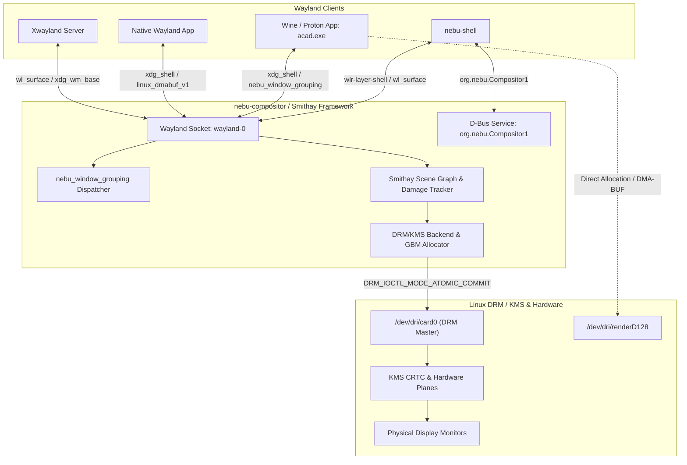
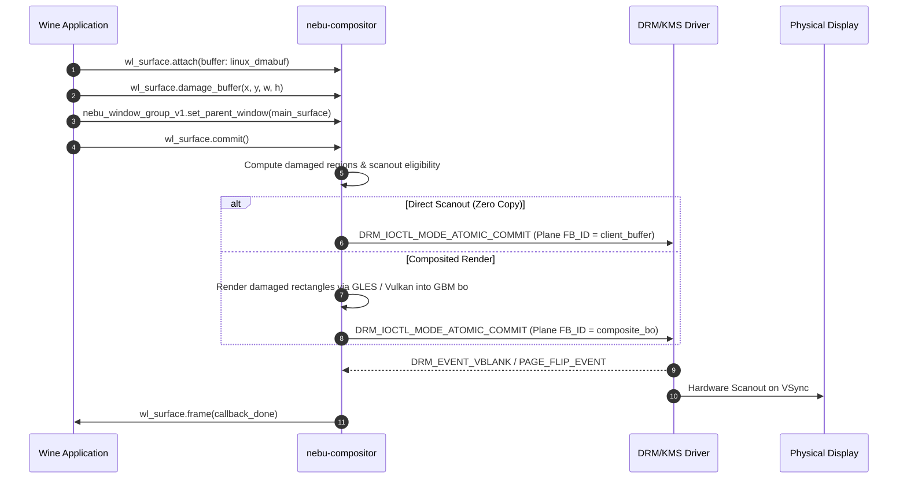

# Compositor Wayland & DRM/KMS Interface Specification — NebuOS

**Status:** DRAFT  
**Purpose:** Formally specify the Wayland protocol extensions, custom window grouping protocol (`nebu_window_grouping_v1`), compositor session D-Bus interface (`org.nebu.Compositor1`), and Linux DRM/KMS atomic modesetting IOCTL usage patterns within `nebu-compositor`.

---

## 1. Status
DRAFT — Under active review. Governs display server protocols, custom Wayland protocol XML definitions, compositor IPC contracts, and low-level kernel display pipeline interactions.

## 2. Purpose
This specification establishes the technical interfaces provided and consumed by `nebu-compositor`. It details how client surfaces (both native Linux and Wine/Proton Windows applications) negotiate presentation and grouping, how `nebu-shell` queries and controls window topologies via D-Bus, and how the compositor drives physical display hardware using modern Linux Direct Rendering Manager / Kernel Mode Setting (DRM/KMS) atomic commit ioctls.

## 3. Scope
- Full XML definition and wire protocol contract for `nebu_window_grouping_v1`.
- D-Bus Introspection XML and signature definitions for `org.nebu.Compositor1`.
- Linux DRM/KMS IOCTL usage patterns, plane assignments, and explicit synchronization pipelines (`linux-drm-syncobj-v1`).
- Security access control boundaries for privileged Wayland protocols.

## 4. Non-goals
- Specifying visual styling, theme variables, or widget hierarchies (governed by [04-shell-interfaces.md](04-shell-interfaces.md)).
- Implementing proprietary GPU driver user-space drivers (e.g., NVIDIA proprietary blobs).
- Internal shader compilation or Vulkan rendering pipeline details within Mesa.

## 5. Requirements
- **R-COMP-01 (Protocol Compliance):** Must fully implement core Wayland interfaces (`wl_compositor` v6, `xdg_wm_base` v4) and desktop extensions (`wlr-layer-shell-unstable-v1` v4, `wp_fractional_scale_v1`).
- **R-COMP-02 (Application Grouping):** Must provide a dedicated Wayland protocol (`nebu_window_grouping_v1`) enabling Wine/Proton to group disparate Win32 dialogs, tooltips, and child top-levels under a unified desktop application identity.
- **R-COMP-03 (Shell Query Interface):** Must expose an introspectable D-Bus service (`org.nebu.Compositor1`) enabling `nebu-shell` to query window lists, geometry, and output metrics with latency $\le 0.5\text{ ms}$.
- **R-COMP-04 (Atomic Display Pipeline):** Display presentation must utilize modern atomic modesetting via `DRM_IOCTL_MODE_ATOMIC_COMMIT` with non-blocking page flips and explicit fence synchronization.
- **R-COMP-05 (Direct Scanout):** Fullscreen application surfaces that match display output geometry and format must bypass compositing shaders and be assigned directly to hardware primary planes.

## 6. Architecture



## 7. Components

### 7.1 `nebu-compositor` Core
- **Implementation:** Rust using the `smithay` compositor modular library.
- **Responsibilities:**
  - Manages event loops for client connections and DRM page flip events.
  - Maintains the global surface hierarchy and damaged region calculations.
  - Implements `nebu_window_grouping_manager_v1` and D-Bus interface `org.nebu.Compositor1`.

### 7.2 Wayland Protocol Dispatch Engine
- Exposes standard protocol globals (`wl_compositor`, `wl_subcompositor`, `wl_shm`, `linux_dmabuf_v1`, `xdg_wm_base`).
- Enforces security filtering: only authorized shell binaries (verified via socket credentials) may bind `zwlr_layer_shell_v1` and `zwlr_foreign_toplevel_manager_v1`.

### 7.3 KMS Backend & Atomic Pipeline
- Discovers display connectors, CRTCs, and plane capabilities via `libdrm`.
- Assembles atomic property request sets (`drmModeAtomicReq`) and issues ioctls to the kernel DRM master handle.

## 8. Data Flow



## 9. Control Flow
1. **Compositor Initialization:**
   - Opens `/dev/dri/card0`, claims `DRM_IOCTL_SET_MASTER`.
   - Iterates through DRM connectors; configures preferred video modes (`CRTC`, `connector_id`).
   - Binds Wayland socket at `$XDG_RUNTIME_DIR/wayland-0`.
   - Initializes D-Bus connection and claims `org.nebu.Compositor1`.
2. **Client Attachment & Grouping:**
   - Client connects to Wayland socket; requests `wl_registry`.
   - Client binds `nebu_window_grouping_manager_v1`.
   - Client creates a `nebu_window_group_v1` assigning its `app_id` (e.g., `autodesk.autocad.2024`).
   - When child dialogs or popups are created, client binds them to the same group object.
3. **Shell Query Flow:**
   - `nebu-shell` queries `GetWindowList` over D-Bus.
   - Compositor serializes active surface tree with geometries and group IDs and returns payload.

## 10. Interfaces

### 10.1 Custom Wayland Protocol: `nebu-window-grouping-v1.xml`

```xml
<?xml version="1.0" encoding="UTF-8"?>
<protocol name="nebu_window_grouping_v1">
  <copyright>
    Copyright (c) 2024-2026 NebuOS Systems Architecture.
    SPDX-License-Identifier: MIT-0
  </copyright>

  <description summary="Window grouping extension for multi-surface Windows applications">
    This protocol allows clients (such as Wine/Proton or multi-window Linux applications)
    to explicitly associate multiple top-level surfaces and dialogs with a unified application
    group ID. This guarantees that window managers and shells correctly group taskbar icons,
    manage stacking orders, and maintain unified window focus.
  </description>

  <interface name="nebu_window_grouping_manager_v1" version="1">
    <description summary="Manager global for creating window groups">
      Global interface used to allocate window group objects.
    </description>

    <request name="destroy" type="destructor">
      <description summary="Destroy the grouping manager global"/>
    </request>

    <request name="get_group">
      <description summary="Create or retrieve a window group for a specific application">
        Instantiates a window group handle associated with a canonical app_id string.
      </description>
      <arg name="id" type="new_id" interface="nebu_window_group_v1"/>
      <arg name="app_id" type="string" summary="Canonical application ID (e.g. autodesk.autocad.2024)"/>
    </request>
  </interface>

  <interface name="nebu_window_group_v1" version="1">
    <description summary="Application window group instance">
      Represents an aggregation of related surfaces belonging to a single logical application.
    </description>

    <request name="destroy" type="destructor">
      <description summary="Destroy the window group handle"/>
    </request>

    <request name="assign_surface">
      <description summary="Assign a Wayland surface to this application group">
        Attaches a top-level xdg_surface or dialog to this group.
      </description>
      <arg name="surface" type="object" interface="wl_surface"/>
    </request>

    <request name="set_title">
      <description summary="Set canonical group display title">
        Sets the primary display title used in shell taskbars when grouping surfaces.
      </description>
      <arg name="title" type="string"/>
    </request>

    <request name="set_icon_name">
      <description summary="Set FreeDesktop themed icon name">
        Sets the icon lookup name for this window group.
      </description>
      <arg name="icon_name" type="string"/>
    </request>

    <request name="set_parent_window">
      <description summary="Declare modal or transient parent hierarchy">
        Establishes parent-child relationships between surfaces within this group.
      </description>
      <arg name="child_surface" type="object" interface="wl_surface"/>
      <arg name="parent_surface" type="object" interface="wl_surface"/>
    </request>

    <event name="group_closed">
      <description summary="Notifies client that all surfaces in the group have been closed"/>
    </event>

    <event name="active_surface_changed">
      <description summary="Notifies client which surface in the group currently has focus">
        Fired when user switches focus among sub-windows of the application.
      </description>
      <arg name="focused_surface" type="object" interface="wl_surface" allow-null="true"/>
    </event>
  </interface>
</protocol>
```

### 10.2 Compositor D-Bus Interface (`org.nebu.Compositor1`)

```xml
<!DOCTYPE node PUBLIC "-//freedesktop//DTD D-BUS Object Introspection 1.0//EN"
 "http://www.freedesktop.org/standards/dbus/1.0/introspect.dtd">
<node name="/org/nebu/Compositor1">
  <interface name="org.nebu.Compositor1">

    <!-- Methods -->
    <method name="GetWindowList">
      <arg name="windows" type="a(usss(iiii))" direction="out"/>
      <!-- Window tuple: (window_id, title, app_id, group_id, geometry: (x, y, width, height)) -->
    </method>

    <method name="ActivateWindow">
      <arg name="window_id" type="u" direction="in"/>
    </method>

    <method name="SetWindowGeometry">
      <arg name="window_id" type="u" direction="in"/>
      <arg name="geometry" type="(iiii)" direction="in"/>
    </method>

    <method name="SetWorkspace">
      <arg name="workspace_index" type="u" direction="in"/>
    </method>

    <method name="GetDisplayOutputs">
      <arg name="outputs" type="a(suuuud)" direction="out"/>
      <!-- Output tuple: (name, width, height, refresh_mhz, scale_factor, fractional_scale) -->
    </method>

    <!-- Signals -->
    <signal name="WindowCreated">
      <arg name="window_id" type="u"/>
      <arg name="app_id" type="s"/>
      <arg name="title" type="s"/>
    </signal>

    <signal name="WindowDestroyed">
      <arg name="window_id" type="u"/>
    </signal>

    <signal name="ActiveWindowChanged">
      <arg name="window_id" type="u"/>
    </signal>

    <signal name="OutputConfigurationChanged"/>

    <!-- Properties -->
    <property name="ActiveWindowId" type="u" access="read">
      <annotation name="org.freedesktop.DBus.Property.EmitsChangedSignal" value="true"/>
    </property>

    <property name="WorkspaceCount" type="u" access="readwrite">
      <annotation name="org.freedesktop.DBus.Property.EmitsChangedSignal" value="true"/>
    </property>

    <property name="ActiveWorkspace" type="u" access="readwrite">
      <annotation name="org.freedesktop.DBus.Property.EmitsChangedSignal" value="true"/>
    </property>

  </interface>
</node>
```

### 10.3 DRM/KMS IOCTL Usage Patterns

`nebu-compositor` interacts directly with Linux Direct Rendering Manager ioctls via `libdrm`. It enforces atomic modesetting semantics exclusively; legacy `drmModePageFlip` and `drmModeSetCrtc` are strictly prohibited.

#### 10.3.1 Atomic Request Assembly (`drmModeAtomicReq`)
The compositor builds atomic property requests setting plane, CRTC, and connector attributes simultaneously:

```c
/* Pseudocode pattern of the atomic commit pipeline in Rust/FFI */
drmModeAtomicReqPtr req = drmModeAtomicAlloc();

/* 1. Primary Plane Buffer Binding */
drmModeAtomicAddProperty(req, primary_plane_id, prop_fb_id, gbm_framebuffer_id);
drmModeAtomicAddProperty(req, primary_plane_id, prop_crtc_id, crtc_id);
drmModeAtomicAddProperty(req, primary_plane_id, prop_src_x, 0 << 16);
drmModeAtomicAddProperty(req, primary_plane_id, prop_src_y, 0 << 16);
drmModeAtomicAddProperty(req, primary_plane_id, prop_src_w, mode_width << 16);
drmModeAtomicAddProperty(req, primary_plane_id, prop_src_h, mode_height << 16);
drmModeAtomicAddProperty(req, primary_plane_id, prop_crtc_x, 0);
drmModeAtomicAddProperty(req, primary_plane_id, prop_crtc_y, 0);
drmModeAtomicAddProperty(req, primary_plane_id, prop_crtc_w, mode_width);
drmModeAtomicAddProperty(req, primary_plane_id, prop_crtc_h, mode_height);

/* 2. Explicit Synchronization Fences */
drmModeAtomicAddProperty(req, primary_plane_id, prop_in_fence_fd, render_complete_fence_fd);
drmModeAtomicAddProperty(req, crtc_id, prop_out_fence_ptr, (uint64_t)&out_fence_fd);

/* 3. Non-blocking Atomic Commit IOCTL */
uint32_t flags = DRM_MODE_ATOMIC_NONBLOCK | DRM_MODE_PAGE_FLIP_EVENT;
int ret = drmModeAtomicCommit(drm_fd, req, flags, user_data_context);
```

#### 10.3.2 Direct Scanout Pipeline Verification
Before falling back to GLES/Vulkan composition, the compositor evaluates whether a client DMA-BUF qualifies for hardware direct scanout:
1. Surface dimensions must exactly match CRTC active mode dimensions.
2. Surface pixel format (e.g., `DRM_FORMAT_XRGB8888` or `DRM_FORMAT_ARGB8888`) must be supported by the hardware primary plane.
3. No active shell overlay surfaces (such as volume flyouts or notification banners) may intersect the window viewport.
4. If eligible, the compositor executes a test commit with `DRM_MODE_ATOMIC_TEST_ONLY`. If the kernel returns `0`, the client buffer is directly scanned out without GPU composition shaders.

#### 10.3.3 DRM KMS Atomic Plane Properties Mapping
The compositor resolves and caches the following DRM property IDs during display enumeration:

| Property Identifier | DRM Object Type | Type / Format | Purpose |
| :--- | :--- | :--- | :--- |
| `FB_ID` | Plane | Object ID (`drmModeFB2`) | Framebuffer backing memory handle |
| `CRTC_ID` | Plane | Object ID (`drmModeCrtc`) | Output CRTC driving the plane |
| `CRTC_X`, `CRTC_Y` | Plane | Signed Integer | Top-left destination coordinate on display |
| `CRTC_W`, `CRTC_H` | Plane | Unsigned Integer | Destination width and height |
| `SRC_X`, `SRC_Y` | Plane | 16.16 Fixed Point | Top-left source coordinate in buffer |
| `SRC_W`, `SRC_H` | Plane | 16.16 Fixed Point | Source crop width and height |
| `IN_FENCE_FD` | Plane | File Descriptor | Explicit sync fence signaled when render completes |
| `OUT_FENCE_PTR` | CRTC | Pointer (`uint64_t*`) | Returns fence signaled on hardware scanout |
| `ACTIVE` | CRTC | Boolean (0 or 1) | Enables or disables output pipe |
| `MODE_ID` | CRTC | Blob ID | Video resolution and timing timings blob |

#### 10.3.4 Explicit Timeline Syncobj Pattern
To eliminate GPU synchronization pipeline stalls, `nebu-compositor` binds `linux-drm-syncobj-v1`:
```c
/* Wait on render completion syncobj before queueing KMS page flip */
struct drm_syncobj_timeline_wait wait_args = {
    .handles = (uint64_t)&syncobj_handle,
    .points = (uint64_t)&timeline_point,
    .timeout_nsec = 16666666, /* 1 frame duration at 60Hz */
    .count_handles = 1,
    .flags = DRM_SYNCOBJ_WAIT_FLAGS_WAIT_ALL,
};
int ret = ioctl(drm_fd, DRM_IOCTL_SYNCOBJ_TIMELINE_WAIT, &wait_args);
```

## 11. Dependencies
- **System Libraries:** `libdrm` ($\ge 2.4.120$), `libgbm`, `libinput` ($\ge 1.25$).
- **Rust Framework:** `smithay = "0.3"`, `wayland-server = "0.31"`, `zbus = "4.0"`.
- **Kernel Subsystem:** Linux DRM/KMS driver supporting `DRM_CLIENT_CAP_ATOMIC` and `DRM_CLIENT_CAP_UNIVERSAL_PLANES`.

## 12. Security
- **Restricted Wayland Globals:** Privileged Wayland interfaces (`wlr-layer-shell-unstable-v1`, `ext-session-lock-v1`, `nebu_window_grouping_v1`) are checked against peer credentials. Untrusted clients attempting to bind layer shell are disconnected with protocol error `wl_display.error.implementation_error`.
- **DRM Master Isolation:** `nebu-compositor` runs as UID 1000 with membership in the `seat` group. It acquires the DRM master lock via `systemd-logind` (`org.freedesktop.login1.Session.TakeControl`), preventing rogue processes from hijacking the display.

## 13. Resource Requirements
- **DRM Framebuffers:** Double-buffered GBM allocations per CRTC. On a $3840 \times 2160$ 4K display at 32bpp, each buffer consumes $\approx 33.1\text{ MB}$ of VRAM.
- **File Descriptors:** Up to 4,096 open descriptors to accommodate client DMA-BUF handles and explicit sync objects.
- **CPU Overhead:** Idle frame scheduling overhead $\le 0.2\%$ single-core CPU utilization.

## 14. Failure Modes
- **DRM Atomic Test Failure:** Kernel rejects requested plane configuration (e.g., hardware bandwidth limits exceeded).
- **GPU Reset / TDR:** The graphics driver hangs and recovers; DRM master handle becomes invalid.
- **Client Protocol Violation:** A client submits a malformed buffer or invalid request.

## 15. Recovery Behavior
- **KMS Fallback:** If direct scanout test commit returns `-EINVAL`, the compositor gracefully falls back to composited rendering via GLES/Vulkan shaders.
- **GPU Reset Recovery:** Upon receiving `DRM_EVENT_CONTEXT` error indicating GPU hang, the compositor drops existing buffer handles, re-initializes the GBM device, reconstructs the scene graph, and re-paints all active surfaces.
- **Client Drop Cleanup:** When an application crashes, its allocated Wayland resources and DMA-BUF file descriptors are immediately unmapped and released within 1 frame cycle.

## 16. Testing Requirements
- **Headless Backend Tests:** Smithay dummy backend automated test suite verifying protocol message serializations without requiring physical GPU hardware.
- **DRM Mock Tests:** Simulation of KMS atomic commit ioctls using DRM test-mock drivers to test edge-case connector hot-plugging.
- **Fuzz Testing:** Protocol fuzzing on `nebu_window_grouping_v1` using AFL++ generated Wayland packets.

## 17. Performance Requirements
- **Compositor Overhead:** Total frame latency from client buffer commit to KMS atomic commit $\le 2.5\text{ ms}$.
- **Direct Scanout Latency:** Frame commit to hardware scanout $\le 0.8\text{ ms}$.
- **D-Bus Query Latency:** `GetWindowList` round-trip $\le 0.5\text{ ms}$.
- **Frame Presentation Jitter:** Presentation timestamp standard deviation $\le 0.2\text{ ms}$ at 144 Hz refresh rate.

## 18. Compatibility Considerations
- **HiDPI Scaling:** Full support for `wp_fractional_scale_v1` allowing non-integer scaling factors (e.g., 125%, 150%) without bitmap scaling blur.
- **Xwayland Seamless Integration:** Legacy Windows applications that require X11 are handled via an embedded rootless Xwayland instance mapping X11 windows directly to Smithay scene nodes.

## 19. Open Questions
- **OPEN QUESTION: COMP-01:** Should `wp_tearing_control_v1` be exposed unconditionally to all applications, or restricted via security profile to prevent tearing in desktop productivity applications?
- **OPEN QUESTION: COMP-02:** Will variable refresh rate (Adaptive Sync / FreeSync) require dedicated shell notification APIs to alert users when VRR engages?

## 20. Related Documents
- [00-interface-overview.md](00-interface-overview.md) — Subsystem IPC Architecture
- [01-ipc-interfaces.md](01-ipc-interfaces.md) — D-Bus IPC Specifications
- [04-shell-interfaces.md](04-shell-interfaces.md) — Shell Layer & Theme Interfaces
- [../desktop/01-compositor.md](../desktop/01-compositor.md) — Compositor Architecture
