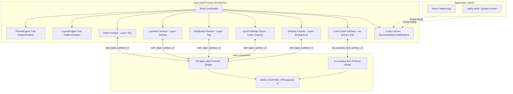

# Shell Subsystem Interfaces & Protocols Specification — NebuOS

**Status:** DRAFT  
**Purpose:** Formally specify the shell-to-compositor Wayland communication contract, layer shell surface roles, Rust trait definitions for theme and layout engines, and the FreeDesktop Desktop Notifications implementation contract.

---

## 1. Status
DRAFT — Under active architectural review. Governs user interface surface negotiations, Rust layout and theming trait abstractions, and desktop notification services in `nebu-shell`.

## 2. Purpose
This specification details the structural contracts governing `nebu-shell`. It defines how shell UI surfaces (panel, application launcher, quick settings flyout, desktop canvas, and notification banners) map to Wayland layers via `wlr-layer-shell-unstable-v1`. It establishes the internal Rust programming model for theme and spatial layout engines through concrete traits, and formalizes compliance with the FreeDesktop Desktop Notification Specification v1.2 over session D-Bus.

## 3. Scope
- Wayland surface lifecycle and configuration rules for all shell surfaces.
- Surface anchoring, layer assignments, exclusive zones, and keyboard focus policies.
- Rust trait definitions for `ThemeEngine` and `LayoutEngine`.
- D-Bus service specification for `org.freedesktop.Notifications`.
- Lock screen protocol integration via `ext-session-lock-v1`.

## 4. Non-goals
- Defining visual graphic assets, color palettes, or branding guidelines.
- Specifying application launcher search database indexing algorithms (covered in [06-database-interfaces.md](06-database-interfaces.md)).
- Direct GPU rasterization pipeline details (handled by Slint/Iced renderers).

## 5. Requirements
- **R-SHL-01 (Deterministic Layering):** Shell surfaces must strictly utilize `wlr-layer-shell-unstable-v1` to prevent window stacking ambiguity between desktop widgets and application windows.
- **R-SHL-02 (Zero Flickering Negotiation):** Shell surfaces must handle Wayland `configure` events atomically, committing matching buffer sizes without visual tearing or geometry jumps.
- **R-SHL-03 (Notification Compliance):** Must fully implement FreeDesktop Notifications v1.2 over D-Bus (`org.freedesktop.Notifications`), supporting actions, urgency levels, icons, and timeouts.
- **R-SHL-04 (Modular Theming):** The theme subsystem must decouple UI rendering from styling rules through strongly typed Rust traits, supporting dynamic theme switching without process restart in $\le 10\text{ ms}$.
- **R-SHL-05 (Latency Budget):** Application launcher toggle response from keypress to initial frame presentation must not exceed $100\text{ ms}$.

## 6. Architecture



## 7. Components

### 7.1 `nebu-shell` Core Coordinator
- Initializes the Wayland connection and binds global protocols.
- Supervises surface creation, monitor hot-plugging, and user event routing.
- Hosts the Tokio async runtime powering D-Bus services and file watchers.

### 7.2 Surface Role Modules
- **`nebu-panel`:** Anchored taskbar displaying application launcher button, running app icons, and system tray.
- **`nebu-launcher`:** Searchable modal menu for launching Windows and native applications.
- **`nebu-notifications`:** Overlay banners presenting notifications received over D-Bus.
- **`nebu-quick-settings`:** Flyout tray providing PipeWire audio, NetworkManager, and power controls.
- **`nebu-lockscreen`:** Secure lock screen surface utilizing `ext-session-lock-v1`.

### 7.3 `ThemeEngine`
- Encapsulates design tokens (colors, radii, typography, spacing).
- Loads and parses JSON/CSS theme definitions from `/usr/share/nebu/themes/` and `~/.local/share/nebu/themes/`.

### 7.4 `LayoutEngine`
- Computes multi-monitor geometry coordinates, taskbar item distribution, and flyout positioning.

## 8. Data Flow

```mermaid
sequenceDiagram
    autonumber
    participant App as External App
    participant Dbus as dbus-broker (Session)
    participant Shell as nebu-shell (Notification Server)
    participant Layout as LayoutEngine
    participant Comp as nebu-compositor

    App->>Dbus: Call org.freedesktop.Notifications.Notify("WineApp", 0, "icon", "Notice", "Task Done", [], {}, 5000)
    Dbus->>Shell: Dispatch Notify method
    Shell->>Shell: Enqueue notification; allocate Notification ID 42
    Shell->>Layout: calculate_notification_bounds(output_desc)
    Layout-->>Shell: Return SurfaceGeometry(x: 1580, y: 16, w: 320, h: 80)
    Shell->>Comp: zwlr_layer_surface_v1.set_anchor(TOP | RIGHT)
    Shell->>Comp: zwlr_layer_surface_v1.set_margin(top: 16, right: 16)
    Shell->>Comp: wl_surface.attach(buffer: rendered_banner)
    Shell->>Comp: wl_surface.commit()
    Comp->>Comp: Composite banner on screen
    Shell-->>Dbus: Return uint32 ID: 42
    Dbus-->>App: Method reply
```

## 9. Control Flow
1. **Wayland Handshake:**
   - `nebu-shell` connects to `$XDG_RUNTIME_DIR/wayland-0`.
   - Binds `wl_compositor`, `wl_shm`, `zwlr_layer_shell_v1`, `wp_fractional_scale_manager_v1`.
2. **Layer Surface Negotiation:**
   - Creates `wl_surface`.
   - Calls `zwlr_layer_shell_v1.get_layer_surface(surface, output, layer, namespace)`.
   - Configures anchor bits, desired size, and exclusive zone.
   - Waits for compositor `zwlr_layer_surface_v1.configure(serial, width, height)`.
   - Acknowledges configure with `zwlr_layer_surface_v1.ack_configure(serial)`.
   - Renders UI into buffer, attaches buffer to surface, and commits.

## 10. Interfaces

### 10.1 Layer Shell Surface Roles Contract

| Surface Name | Wayland Layer | Anchor Bits | Dimensions (1080p Base) | Exclusive Zone | Keyboard Interactivity |
| :--- | :--- | :--- | :--- | :--- | :--- |
| Desktop Canvas | `BACKGROUND` (0) | `TOP \| BOTTOM \| LEFT \| RIGHT` | Full Output ($1920 \times 1080$) | `0` (None) | `NONE` (0) |
| System Panel | `TOP` (2) | `BOTTOM \| LEFT \| RIGHT` | Width: Full, Height: $44\text{ px}$ | $44\text{ px}$ | `NONE` (0) |
| Notification Banner | `TOP` (2) | `TOP \| RIGHT` | Width: $360\text{ px}$, Height: Dynamic | `0` (None) | `NONE` (0) |
| App Launcher Modal | `OVERLAY` (3) | `BOTTOM \| LEFT` | Width: $480\text{ px}$, Height: $560\text{ px}$ | `0` (None) | `EXCLUSIVE` (1) |
| Quick Settings Flyout | `OVERLAY` (3) | `BOTTOM \| RIGHT` | Width: $380\text{ px}$, Height: $420\text{ px}$ | `0` (None) | `ON_DEMAND` (2) |
| Lock Screen Surface | `OVERLAY` via `ext-session-lock`| Fullscreen | Full Output ($1920 \times 1080$) | Full Screen | `EXCLUSIVE` (1) |

#### 10.1.1 Anchor & Margin Constants
- Margin for Notification Banner: `top: 16px`, `right: 16px`.
- Margin for App Launcher: `bottom: 48px`, `left: 8px` (clearing panel).
- Margin for Quick Settings: `bottom: 48px`, `right: 8px` (clearing panel).

### 10.2 Rust Trait: `ThemeEngine`

```rust
use std::collections::HashMap;
use std::path::Path;
use serde::{Serialize, Deserialize};

#[derive(Debug, Clone, Copy, PartialEq, Eq, Hash, Serialize, Deserialize)]
pub enum ColorToken {
    BackgroundPrimary,
    BackgroundSecondary,
    BackgroundElevated,
    SurfaceCard,
    AccentDefault,
    AccentHover,
    AccentPressed,
    TextPrimary,
    TextSecondary,
    TextDisabled,
    BorderSubtle,
    BorderStrong,
    StatusSuccess,
    StatusWarning,
    StatusError,
}

#[derive(Debug, Clone, Copy, PartialEq, Serialize, Deserialize)]
pub struct RgbaColor {
    pub r: f32, // 0.0 .. 1.0
    pub g: f32,
    pub b: f32,
    pub a: f32,
}

#[derive(Debug, Clone, Copy, PartialEq, Eq, Hash, Serialize, Deserialize)]
pub enum MetricToken {
    PanelHeight,
    LauncherWidth,
    LauncherHeight,
    NotificationWidth,
    CornerRadiusSmall,
    CornerRadiusMedium,
    CornerRadiusLarge,
    SpacingSmall,
    SpacingMedium,
    SpacingLarge,
}

#[derive(Debug, Clone, Serialize, Deserialize)]
pub struct ThemeDefinition {
    pub theme_id: String,
    pub display_name: String,
    pub is_dark: bool,
    pub colors: HashMap<ColorToken, RgbaColor>,
    pub metrics: HashMap<MetricToken, f32>,
    pub font_family: String,
    pub font_size_base: f32,
}

#[derive(thiserror::Error, Debug)]
pub enum ThemeError {
    #[error("Theme definition file not found: {path}")]
    FileNotFound { path: String },

    #[error("Failed to parse theme JSON: {reason}")]
    ParseError { reason: String },

    #[error("Missing mandatory color token: {token:?}")]
    MissingToken { token: ColorToken },
}

pub trait ThemeEngine: Send + Sync {
    /// Returns the currently active theme definition
    fn active_theme(&self) -> ThemeDefinition;

    /// Loads and applies a theme by identifier from the system or user themes directory
    fn load_theme(&mut self, theme_id: &str) -> Result<(), ThemeError>;

    /// Resolves a single color token to RGBA value with fallback
    fn resolve_color(&self, token: ColorToken) -> RgbaColor;

    /// Resolves a spatial metric token to pixel value
    fn resolve_metric(&self, token: MetricToken) -> f32;

    /// Registers a callback to be invoked when active theme updates
    fn register_change_listener(&mut self, callback: Box<dyn Fn(&ThemeDefinition) + Send>);
}
```

### 10.3 Rust Trait: `LayoutEngine`

```rust
#[derive(Debug, Clone, PartialEq)]
pub struct OutputDescriptor {
    pub name: String,
    pub width: u32,
    pub height: u32,
    pub scale_factor: f64,
    pub is_primary: bool,
}

#[derive(Debug, Clone, PartialEq)]
pub struct SurfaceGeometry {
    pub x: i32,
    pub y: i32,
    pub width: u32,
    pub height: u32,
}

#[derive(Debug, Clone)]
pub struct TaskbarItem {
    pub app_id: String,
    pub title: String,
    pub icon_path: String,
    pub is_running: bool,
    pub is_active: bool,
    pub instance_count: usize,
}

#[derive(Debug, Clone, PartialEq)]
pub struct ItemRect {
    pub item_index: usize,
    pub bounds: SurfaceGeometry,
}

pub trait LayoutEngine: Send + Sync {
    /// Computes panel surface dimensions and position for a target display output
    fn calculate_panel_bounds(&self, output: &OutputDescriptor) -> SurfaceGeometry;

    /// Computes application launcher modal geometry
    fn calculate_launcher_bounds(&self, output: &OutputDescriptor) -> SurfaceGeometry;

    /// Computes flyout quick-settings geometry
    fn calculate_settings_bounds(&self, output: &OutputDescriptor) -> SurfaceGeometry;

    /// Computes notification banner placement bounds
    fn calculate_notification_bounds(&self, output: &OutputDescriptor, count: usize) -> SurfaceGeometry;

    /// Layouts taskbar icons horizontally within available panel width
    fn layout_taskbar_items(&self, available_width: u32, items: &[TaskbarItem]) -> Vec<ItemRect>;
}
```

### 10.4 FreeDesktop Notifications D-Bus Server (`org.freedesktop.Notifications`)

```xml
<!DOCTYPE node PUBLIC "-//freedesktop//DTD D-BUS Object Introspection 1.0//EN"
 "http://www.freedesktop.org/standards/dbus/1.0/introspect.dtd">
<node name="/org/freedesktop/Notifications">
  <interface name="org.freedesktop.Notifications">

    <!-- Methods -->
    <method name="Notify">
      <arg name="app_name" type="s" direction="in"/>
      <arg name="replaces_id" type="u" direction="in"/>
      <arg name="app_icon" type="s" direction="in"/>
      <arg name="summary" type="s" direction="in"/>
      <arg name="body" type="s" direction="in"/>
      <arg name="actions" type="as" direction="in"/>
      <arg name="hints" type="a{sv}" direction="in"/>
      <arg name="expire_timeout" type="i" direction="in"/>
      <arg name="id" type="u" direction="out"/>
    </method>

    <method name="CloseNotification">
      <arg name="id" type="u" direction="in"/>
    </method>

    <method name="GetCapabilities">
      <arg name="capabilities" type="as" direction="out"/>
    </method>

    <method name="GetServerInformation">
      <arg name="name" type="s" direction="out"/>
      <arg name="vendor" type="s" direction="out"/>
      <arg name="version" type="s" direction="out"/>
      <arg name="spec_version" type="s" direction="out"/>
    </method>

    <!-- Signals -->
    <signal name="NotificationClosed">
      <arg name="id" type="u"/>
      <arg name="reason" type="u"/>
      <!-- Reason codes: 1=Expired, 2=Dismissed by User, 3=Closed via CloseNotification, 4=Undefined -->
    </signal>

    <signal name="ActionInvoked">
      <arg name="id" type="u"/>
      <arg name="action_key" type="s"/>
    </signal>

  </interface>
</node>
```

#### 10.4.1 Server Capabilities List
When `GetCapabilities` is invoked, `nebu-shell` returns:
- `"actions"`: Interactive action buttons supported.
- `"body"`: Text body formatting supported.
- `"body-markup"`: Basic XML markup (`<b>`, `<i>`, `<u>`).
- `"icon-static"`: PNG / SVG icon rendering supported.
- `"persistence"`: Notification history retention supported.

## 11. Dependencies
- **Wayland Protocols:** `wlr-layer-shell-unstable-v1`, `ext-session-lock-v1`, `wp_fractional_scale_v1`.
- **Rust Tooling:** `zbus = "4.0"`, `wayland-client = "0.31"`, `slint = "1.4"` (or `iced = "0.12"`).
- **Desktop Daemons:** `dbus-broker`, `pipewire`, `wireplumber`, `NetworkManager`.

## 12. Security
- **Notification Sanitization:** Incoming HTML/XML markup in notification body strings is sanitized using a strict parser that discards `<script>`, ``, and remote URI tags to prevent injection attacks.
- **Lock Screen Surface Integrity:** `nebu-lockscreen` binds `ext-session-lock-v1`. While locked, the compositor enforces that no other surface may receive pointer, touch, or keyboard input.
- **Layer Shell Spoofing Prevention:** Untrusted Flatpak or Wine applications cannot bind `zwlr_layer_shell_v1` because the compositor validates socket client tokens.

## 13. Resource Requirements
- **Memory Footprint:** Resident Set Size (RSS) $\le 45\text{ MB}$ at idle with panel and background mapped.
- **Notification Buffer:** Rendered banner textures allocated on-demand in shared memory, bounded to $\le 2\text{ MB}$ total.
- **CPU Utilization:** Zero CPU consumption when desktop is idle (event-driven eventfd loop).

## 14. Failure Modes
- **Compositor Disconnection:** `wayland-0` socket closed abruptly.
- **Notification Queue Flooding:** Malicious or runaway application emits thousands of notifications per second.
- **Corrupt Theme JSON:** User theme file has invalid syntax or missing color tokens.

## 15. Recovery Behavior
- **Automatic Session Reconnect:** If `nebu-compositor` restarts, `nebu-shell` catches the broken pipe, waits for the socket to reappear, rebinds layer-shell globals, and reconstructs all surfaces.
- **Notification Rate-Limiting:** If notifications exceed 20 per second, incoming notifications are queued, coalesced, or dropped with a warning.
- **Fallback Theme Cascade:** If a custom theme fails to load, `ThemeEngine` automatically reverts to the embedded static binary fallback theme (`nebu-dark-default`).

## 16. Testing Requirements
- **Headless Protocol Tests:** Automated tests binding mock Wayland layer-shell globals to verify configure acknowledgement handshakes.
- **Notification Specification Suite:** Conformance testing using `notify-send` covering action invocations, timeouts, and replacement IDs.
- **Theme Parser Fuzzing:** Fuzz testing theme JSON loaders with corrupted and oversized inputs.

## 17. Performance Requirements
- **Launcher Toggle Latency:** Keypress to initial buffer commit $\le 100\text{ ms}$.
- **Theme Hot-Reload:** Dynamic theme reload and repaint across all surfaces $\le 10\text{ ms}$.
- **Notification Dispatch:** Time from D-Bus `Notify` invocation to surface frame presentation $\le 16\text{ ms}$.

## 18. Compatibility Considerations
- **Display Hot-Plugging:** Adding or removing monitors triggers `wl_output` events; `LayoutEngine` dynamically adjusts panel bounds and repositions flyouts without restarting.
- **Touch Screen Support:** Panels and launcher respond to `wl_touch` events, increasing touch target padding from $44\text{ px}$ to $52\text{ px}$.

## 19. Open Questions
- **OPEN QUESTION: SHL-01:** Should `nebu-shell` implement custom compositor background blur protocol extensions (`org_kde_kwin_blur` or custom) for flyout translucency?
- **OPEN QUESTION: SHL-02:** Should notifications support inline text input replies (e.g. for messaging apps) via FreeDesktop Notification hints?

## 20. Related Documents
- [00-interface-overview.md](00-interface-overview.md) — Subsystem IPC Architecture
- [01-ipc-interfaces.md](01-ipc-interfaces.md) — D-Bus IPC Interface Specification
- [03-compositor-interfaces.md](03-compositor-interfaces.md) — Compositor Wayland & DRM Interfaces
- [../desktop/02-shell.md](../desktop/02-shell.md) — Desktop Shell Specification
