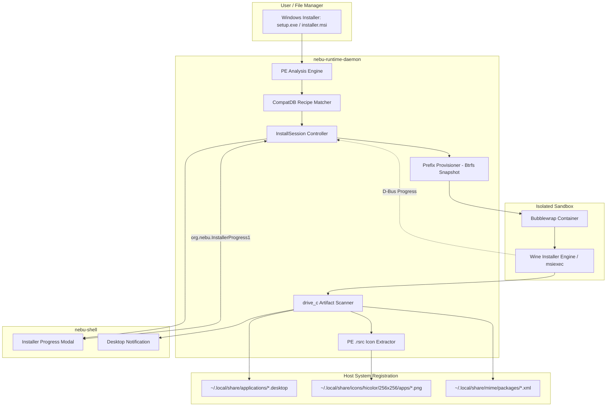

# Application Installer & Binary Analysis Interface Specification — NebuOS

**Status:** DRAFT  
**Purpose:** Formally specify the data exchange formats, protocol contracts, analysis schemas, and FreeDesktop integration rules governing Windows binary inspection, installation progress reporting, and launcher registration.

---

## 1. Status
DRAFT — Under active review. Governs PE binary analysis contracts, installation session D-Bus interfaces, application registration manifests, and FreeDesktop entry generation.

## 2. Purpose
This specification details the technical contracts utilized during Windows software onboarding in NebuOS. It defines the Portable Executable (PE32/PE32+) analysis schema, the installation progress reporting protocol exposed over D-Bus by `nebu-runtime-daemon`, the data structures for persisting installed application metadata, and the generation contract for FreeDesktop `.desktop` files, MIME associations, and desktop icons.

## 3. Scope
- PE binary inspection JSON schema and Rust data structures.
- D-Bus interface `org.nebu.InstallerProgress1` for real-time progress and stage streaming.
- Application registration data models (`ApplicationRegistration`).
- FreeDesktop Desktop Entry Specification 1.5 generation templates and icon extraction rules.

## 4. Non-goals
- Decompressing custom proprietary installer archives outside of Wine (NebuOS executes installers in Bubblewrap sandboxes).
- Bypassing digital rights management (DRM) or anti-cheat drivers.
- Packaging native Linux RPM or Flatpak applications.

## 5. Requirements
- **R-INS-01 (Deterministic PE Classification):** Must accurately identify binary bitness (x86 vs x86_64), subsystem (GUI vs Console), and installer framework (Inno Setup, NSIS, MSI, InstallShield, Wise, WiX, or Generic PE).
- **R-INS-02 (Live Progress Streaming):** Long-running installations must stream fine-grained stage and percentage updates over D-Bus to `nebu-shell` at least once per second.
- **R-INS-03 (Standard Desktop Registration):** Generated application launchers must strictly adhere to the FreeDesktop Desktop Entry Specification 1.5, including `StartupWMClass` and custom `X-Nebu-*` metadata keys.
- **R-INS-04 (Automated Icon Harvesting):** High-resolution icon resources (up to $256 \times 256$ PNG) embedded in the PE binary `.rsrc` section must be automatically extracted and installed into the user's icon theme hierarchy.
- **R-INS-05 (Atomic Installation Rollback):** If an installer aborts or exits with a failure code, the system must roll back the target prefix to a pristine state, leaving no dangling shortcuts or file associations.

## 6. Architecture



## 7. Components

### 7.1 PE Binary Analysis Engine
- Analyzes Windows Portable Executable headers without executing binary code.
- Computes cryptographic SHA-256 digests and extracts embedded XML application manifests (`requestedExecutionLevel`, `dpiAware`).
- Employs heuristic signature pattern matching against installer runtime stubs.

### 7.2 Installation Session Manager
- Maintains state machines for active installation sessions.
- Exposes `org.nebu.InstallerProgress1` on the user session D-Bus.
- Coordinates timeouts, cancel requests, and prefix snapshot rollback.

### 7.3 PE Icon Extractor (`IconExtractor`)
- Traverses the PE `.rsrc` resource tree locating `RT_GROUP_ICON` and `RT_ICON` entries.
- Selects the highest-resolution icon sub-image (preferring $256 \times 256$ PNG or uncompressed Vista BMP icons).
- Converts image data into standard PNG format and writes to FreeDesktop icon paths.

### 7.4 Desktop Registrar (`DesktopRegistrar`)
- Scans `drive_c` post-installation to locate the primary application executable.
- Generates `.desktop` files conforming to the FreeDesktop specification.
- Registers Windows file extensions into the user's MIME database.

## 8. Data Flow

```mermaid
sequenceDiagram
    autonumber
    participant Shell as nebu-shell (Wizard)
    participant Bus as dbus-broker
    participant Daemon as nebu-runtime-daemon
    participant Wine as Sandboxed Wine Installer
    participant Reg as Desktop Registrar

    Shell->>Daemon: IdentifyExecutable("/path/to/setup.exe")
    Daemon-->>Shell: Return (app_id, "InnoSetup", metadata)
    Shell->>Daemon: StartInstallSession(app_id, "/path/to/setup.exe", {})
    Daemon-->>Shell: Return session_id: "install-7819"
    Daemon->>Bus: Emit ProgressUpdated(session_id, 0, "PREPARING_PREFIX", 10, "Creating subvolume")
    Daemon->>Wine: Launch setup.exe in Bubblewrap
    loop Active Installation
        Wine-->>Daemon: Process telemetry / tick
        Daemon->>Bus: Emit ProgressUpdated(session_id, 2, "RUNNING_INSTALLER", percent, "Executing setup")
        Bus->>Shell: Forward signal to GUI
    end
    Wine-->>Daemon: Installer Exit 0
    Daemon->>Daemon: Scan drive_c for new .exe entry points
    Daemon->>Daemon: Extract 256x256 icon from acad.exe
    Daemon->>Reg: Write .desktop, install icon, update MIME
    Daemon->>Bus: Emit SessionCompleted(session_id, app_id, "/path/to/acad.exe")
    Bus->>Shell: Close wizard; show completion banner
```

## 9. Control Flow
1. **Binary Ingestion:** User opens Windows installer; daemon executes `identify_executable`.
2. **Session Initialization:** Shell invokes `StartInstallSession`. Daemon locks prefix, takes base snapshot, and begins progress broadcasting.
3. **Sandbox Execution:** Daemon executes `bwrap` with the Wine installer engine. If the installer requires GUI interaction, surfaces map to `nebu-compositor`.
4. **Post-Install Analysis:** Upon process exit code `0`, daemon scans `~/.nebu/apps/<app_id>/drive_c/` comparing filesystem state against the pre-install snapshot.
5. **Registration & Completion:** Daemon writes FreeDesktop entries, emits `SessionCompleted`, and updates application catalogs.

## 10. Interfaces

### 10.1 PE Binary Analysis Output Format

#### 10.1.1 JSON Schema

```json
{
  "$schema": "https://json-schema.org/draft/2020-12/schema",
  "title": "NebuExecutableMetadata",
  "type": "object",
  "required": [
    "format",
    "machine_type",
    "subsystem",
    "sha256_hash",
    "entry_point",
    "installer_type",
    "detection_confidence"
  ],
  "properties": {
    "format": { "type": "string", "enum": ["PE32", "PE32_PLUS"] },
    "machine_type": { "type": "string", "enum": ["x86", "x86_64", "arm64"] },
    "subsystem": { "type": "string", "enum": ["WINDOWS_GUI", "WINDOWS_CUI", "POSIX_CUI"] },
    "sha256_hash": { "type": "string", "pattern": "^[a-f0-9]{64}$" },
    "entry_point": { "type": "integer" },
    "imported_dlls": { "type": "array", "items": { "type": "string" } },
    "embedded_manifest": {
      "type": "object",
      "properties": {
        "execution_level": { "type": "string", "enum": ["asInvoker", "highestAvailable", "requireAdministrator"] },
        "dpi_aware": { "type": "boolean" }
      }
    },
    "version_info": {
      "type": "object",
      "properties": {
        "product_name": { "type": "string" },
        "company_name": { "type": "string" },
        "file_description": { "type": "string" },
        "product_version": { "type": "string" },
        "original_filename": { "type": "string" }
      }
    },
    "installer_type": {
      "type": "string",
      "enum": ["InnoSetup", "NSIS", "MSI", "InstallShield", "Wise", "WiX", "Squirrel", "GenericPE"]
    },
    "detection_confidence": { "type": "number", "minimum": 0.0, "maximum": 1.0 }
  }
}
```

#### 10.1.2 Rust Data Model

```rust
use serde::{Serialize, Deserialize};

#[derive(Debug, Clone, Serialize, Deserialize)]
pub struct ExecutableMetadata {
    pub format: PeFormat,
    pub machine_type: MachineType,
    pub subsystem: WindowsSubsystem,
    pub sha256_hash: String,
    pub entry_point: u64,
    pub imported_dlls: Vec<String>,
    pub embedded_manifest: Option<ManifestInfo>,
    pub version_info: Option<VersionInfo>,
    pub installer_type: InstallerType,
    pub detection_confidence: f32,
}

#[derive(Debug, Clone, Copy, PartialEq, Eq, Serialize, Deserialize)]
pub enum PeFormat {
    #[serde(rename = "PE32")]
    Pe32,
    #[serde(rename = "PE32_PLUS")]
    Pe32Plus,
}

#[derive(Debug, Clone, Copy, PartialEq, Eq, Serialize, Deserialize)]
pub enum MachineType {
    #[serde(rename = "x86")]
    X86,
    #[serde(rename = "x86_64")]
    X86_64,
    #[serde(rename = "arm64")]
    Arm64,
}

#[derive(Debug, Clone, Copy, PartialEq, Eq, Serialize, Deserialize)]
pub enum WindowsSubsystem {
    #[serde(rename = "WINDOWS_GUI")]
    WindowsGui,
    #[serde(rename = "WINDOWS_CUI")]
    WindowsConsole,
    #[serde(rename = "POSIX_CUI")]
    PosixConsole,
}

#[derive(Debug, Clone, Copy, PartialEq, Eq, Serialize, Deserialize)]
pub enum InstallerType {
    InnoSetup,
    NSIS,
    MSI,
    InstallShield,
    Wise,
    WiX,
    Squirrel,
    GenericPE,
}

#[derive(Debug, Clone, Serialize, Deserialize)]
pub struct ManifestInfo {
    pub execution_level: String,
    pub dpi_aware: bool,
}

#[derive(Debug, Clone, Serialize, Deserialize)]
pub struct VersionInfo {
    pub product_name: Option<String>,
    pub company_name: Option<String>,
    pub file_description: Option<String>,
    pub product_version: Option<String>,
    pub original_filename: Option<String>,
}
```

### 10.2 Installation Progress D-Bus Interface (`org.nebu.InstallerProgress1`)

```xml
<!DOCTYPE node PUBLIC "-//freedesktop//DTD D-BUS Object Introspection 1.0//EN"
 "http://www.freedesktop.org/standards/dbus/1.0/introspect.dtd">
<node name="/org/nebu/InstallerProgress1">
  <interface name="org.nebu.InstallerProgress1">

    <!-- Methods -->
    <method name="StartInstallSession">
      <arg name="app_id" type="s" direction="in"/>
      <arg name="installer_path" type="s" direction="in"/>
      <arg name="options" type="a{sv}" direction="in"/>
      <arg name="session_id" type="s" direction="out"/>
    </method>

    <method name="CancelInstallSession">
      <arg name="session_id" type="s" direction="in"/>
      <arg name="success" type="b" direction="out"/>
    </method>

    <method name="GetSessionStatus">
      <arg name="session_id" type="s" direction="in"/>
      <arg name="status" type="(usuus)" direction="out"/>
      <!-- Status tuple: (session_id, stage_code, stage_name, percent, current_message) -->
    </method>

    <!-- Signals -->
    <signal name="ProgressUpdated">
      <arg name="session_id" type="s"/>
      <arg name="stage_code" type="u"/>
      <arg name="stage_name" type="s"/>
      <arg name="percent" type="u"/>
      <arg name="current_message" type="s"/>
    </signal>

    <signal name="SessionCompleted">
      <arg name="session_id" type="s"/>
      <arg name="app_id" type="s"/>
      <arg name="entry_executable" type="s"/>
    </signal>

    <signal name="SessionFailed">
      <arg name="session_id" type="s"/>
      <arg name="error_code" type="u"/>
      <arg name="error_message" type="s"/>
      <arg name="log_path" type="s"/>
    </signal>

  </interface>
</node>
```

#### 10.2.1 Stage Codes
- `0`: `PREPARING_PREFIX` — Creating Btrfs subvolumes and basic directory structure.
- `1`: `INSTALLING_DEPENDENCIES` — Running Winetricks/Proton dependency scripts.
- `2`: `RUNNING_INSTALLER` — Active execution of setup executable.
- `3`: `SCANNING_EXECUTABLES` — Locating newly created entry points in `drive_c`.
- `4`: `EXTRACTING_ICONS` — Parsing embedded `.rsrc` sections and generating PNGs.
- `5`: `REGISTERING_DESKTOP` — Writing `.desktop` files and updating desktop caches.

### 10.3 Application Registration Data Structure

```rust
#[derive(Debug, Clone, Serialize, Deserialize)]
pub struct ApplicationRegistration {
    pub app_id: String,
    pub display_name: String,
    pub installed_version: String,
    pub vendor_name: String,
    pub executable_rel_path: String, // e.g. "Program Files/Autodesk/AutoCAD 2024/acad.exe"
    pub working_dir_rel_path: String,
    pub wine_prefix_path: PathBuf,
    pub wine_binary: PathBuf,
    pub icon_theme_name: String,     // e.g. "autodesk.autocad.2024"
    pub categories: Vec<String>,     // e.g. ["Development", "Graphics"]
    pub mime_types: Vec<String>,     // e.g. ["image/vnd.dwg"]
    pub environment_overrides: HashMap<String, String>,
    pub dll_overrides: HashMap<String, String>,
    pub registration_timestamp: chrono::DateTime<chrono::Utc>,
}
```

### 10.4 FreeDesktop Desktop Entry Generation Contract

The generated `.desktop` file must be saved to `~/.local/share/applications/<app_id>.desktop` adhering to the following exact contract:

```ini
[Desktop Entry]
Type=Application
Version=1.5
Name=Autodesk AutoCAD 2024
GenericName=CAD Design Software
Comment=Run AutoCAD 2024 via NebuOS Windows Compatibility Runtime
Exec=nebu run autodesk.autocad.2024 -- %U
Icon=autodesk.autocad.2024
Terminal=false
Categories=Graphics;Engineering;2DGraphics;
MimeType=image/vnd.dwg;image/vnd.dxf;
StartupNotify=true
StartupWMClass=acad.exe

# Custom NebuOS Runtime Metadata Keys
X-Nebu-AppID=autodesk.autocad.2024
X-Nebu-Runtime=wine-staging-9.2
X-Nebu-Prefix=~/.nebu/apps/autodesk.autocad.2024
X-Nebu-Entrypoint=Program Files/Autodesk/AutoCAD 2024/acad.exe
X-Nebu-Managed=true
```

## 11. Dependencies
- **Binary Parsing:** `goblin = "0.8"` (or `pelite = "0.10"`) for memory-mapped PE header inspection.
- **Image Conversion:** `image = "0.25"`, `ico = "0.3"` for `.ico` extraction and 256x256 PNG encoding.
- **Desktop Validation:** `desktop-file-validate` (Fedora base) during integration testing.

## 12. Security
- **Static Parser Hardening:** The PE header parser runs in safe Rust, bound by strict slice length checks to prevent buffer overflow vulnerabilities when encountering malicious or corrupted binaries.
- **Sandbox Isolation:** Installers execute with `--unshare-net` by default to prevent silent malware downloads unless the compatibility catalog explicitly declares network installer requirements.
- **Elevation Faux-Handling:** Installers requesting `requireAdministrator` in their manifest are provided with fake administrative tokens inside Wine (`wineserver` impersonation) while remaining entirely unprivileged (UID 1000) on the host Linux system.

## 13. Resource Requirements
- **PE Header Parsing Memory:** Peak RSS $\le 20\text{ MB}$ during inspection of multi-gigabyte installer files (utilizing memory mapping).
- **Icon Extraction Memory:** Peak RSS $\le 15\text{ MB}$ during PNG conversion.
- **Disk Space Overhead:** Prefix baseline template requires $\approx 600\text{ MB}$; application diff subvolume consumes only the actual bytes written by the installer.

## 14. Failure Modes
- **Corrupt / Obfuscated PE Binary:** Parser errors on invalid headers; returns `RuntimeError::InvalidPeBinary`.
- **Installer Deadlock / Hang:** Wizard process blocks indefinitely waiting for user input or unsupported Windows API.
- **Installer Non-Zero Exit:** Setup wizard crashes or user clicks cancel.
- **No Executables Generated:** Installer runs successfully but creates no `.exe` entry points in `drive_c`.

## 15. Recovery Behavior
- **Timeout Watchdog:** If an automated installer session exceeds 30 minutes with zero I/O activity, the daemon triggers `CancelInstallSession`.
- **Atomic Subvolume Reversion:** If `SessionFailed` is emitted, the daemon unmounts the sandbox and removes the newly created Btrfs subvolume, leaving the filesystem spotless.
- **Lock Cleanup:** Any lingering wineserver process associated with the failed install session is terminated with `SIGKILL`.

## 16. Testing Requirements
- **Installer Regression Suite:** Test suite consisting of 30 standard installers (NSIS, InnoSetup, MSI) verified in headless Docker containers.
- **Icon Quality Verification:** Automated assertions verifying extracted PNGs are valid $256 \times 256$ RGBA images.
- **Desktop Entry Conformance:** Automated execution of `desktop-file-validate ~/.local/share/applications/*.desktop`.

## 17. Performance Requirements
- **PE Header Inspection:** $\le 30\text{ ms}$ for a 500 MB binary.
- **Icon Extraction & Encoding:** $\le 50\text{ ms}$ from PE `.rsrc` to PNG file on disk.
- **Desktop Entry Generation:** $\le 10\text{ ms}$ to format and write the `.desktop` file and refresh MIME database.

## 18. Compatibility Considerations
- **Architecture Mapping:** 32-bit installers are automatically launched using 32-bit WoW64 Wine wrappers.
- **Registry Redirection:** 32-bit applications have their registry queries mapped to `Software\Wow6432Node` automatically by Wine.

## 19. Open Questions
- **OPEN QUESTION: INS-01:** Should `nebu-runtime-daemon` automatically detect known silent install CLI flags (`/S`, `/SILENT`, `/qn`) to offer a "One-Click Quick Install" mode in `nebu-shell`?
- **OPEN QUESTION: INS-02:** When multiple `.exe` binaries are detected post-install, what heuristic should determine the primary desktop launcher (e.g. file size vs shortcut analysis)?

## 20. Related Documents
- [00-interface-overview.md](00-interface-overview.md) — Subsystem IPC Architecture
- [01-ipc-interfaces.md](01-ipc-interfaces.md) — D-Bus IPC Specifications
- [02-runtime-interfaces.md](02-runtime-interfaces.md) — Rust Trait Definitions for Runtime Engine
- [04-shell-interfaces.md](04-shell-interfaces.md) — Desktop Shell Specification
- [../applications/01-installation.md](../applications/01-installation.md) — Application Installation Architecture
