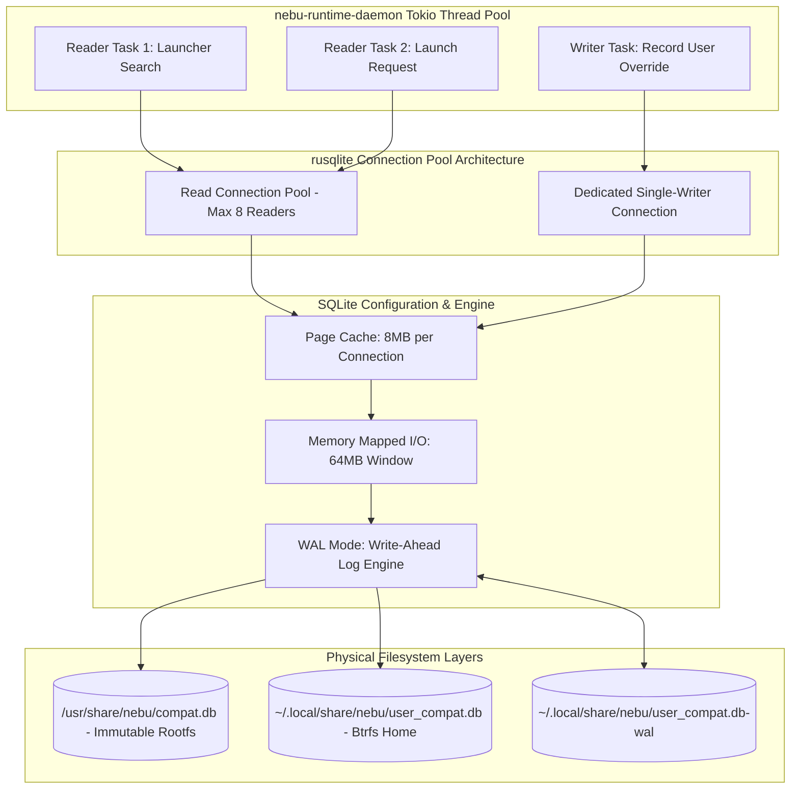
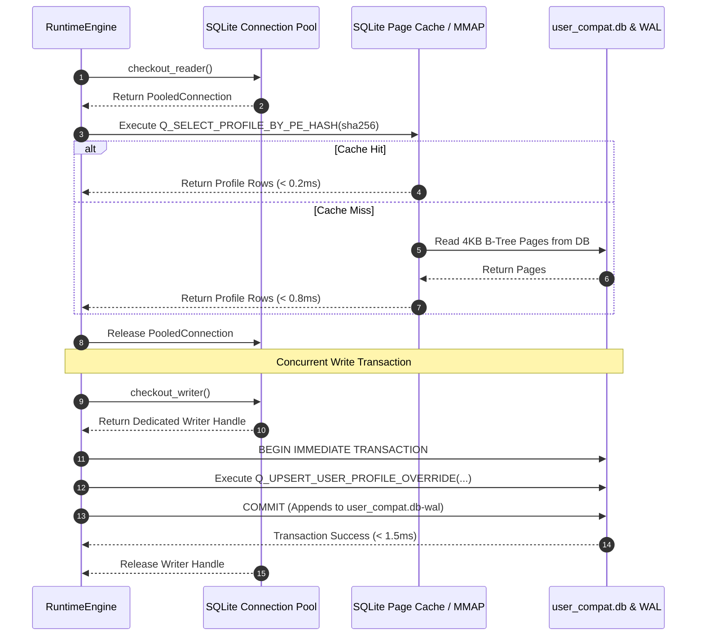

# Compatibility Database Relational Schema & Access Interface Specification — NebuOS

**Status:** DRAFT  
**Purpose:** Formally specify the SQLite relational schema, database migration framework, prepared query patterns, connection pooling strategy, and concurrency access model for NebuOS compatibility metadata.

---

## 1. Status
DRAFT — Under active architectural review. Governs relational database schemas, embedded query contracts, transaction isolation, and connection pooling across system and user compatibility stores.

## 2. Purpose
This specification defines the data persistence and query layer for NebuOS compatibility engineering. It formalizes the relational SQLite schema storing application metadata, versions, compatibility profiles, dependency recipes, declarative patches, and certification matrices. It establishes migration semantics, concrete prepared SQL query patterns, thread-safe connection pooling rules, and the Write-Ahead Logging (WAL) concurrency model utilized by `nebu-runtime-daemon` and desktop tooling.

## 3. Scope
- Dual-tier relational storage: System read-only database (`/usr/share/nebu/compat.db`) and User writable overlay database (`~/.local/share/nebu/user_compat.db`).
- Full DDL schema definitions, including indices, foreign keys, and full-text search (FTS5).
- Schema migration tracking table and forward/backward migration execution models.
- Prepared statement contracts with concrete parameter signatures and return structures.
- Connection pool configuration, PRAGMA tunables, and WAL concurrency architecture.

## 4. Non-goals
- Specifying remote cloud synchronization protocols (governed by `nebu-update-daemon` architecture).
- Storing unstructured desktop session telemetry or user application logs.
- Supporting arbitrary database backends (NebuOS standardizes strictly on SQLite3; no MySQL/PostgreSQL dependencies).

## 5. Requirements
- **R-DB-01 (Query Latency SLA):** Point lookups by binary PE SHA-256 hash must complete in $\le 0.8\text{ ms}$; complex joined profile lookups must complete in $\le 2.0\text{ ms}$.
- **R-DB-02 (ACID Reliability):** Database updates must provide full ACID transaction guarantees; sudden power failure or daemon crashes must never leave corrupted database files.
- **R-DB-03 (Non-blocking Concurrency):** Multiple concurrent reader threads (e.g. shell searches, CLI queries) must never block behind background prefix write operations.
- **R-DB-04 (Zero SQL Injection):** All SQL queries must execute via parameterized prepared statements; string formatting and concatenation in SQL commands are strictly prohibited.
- **R-DB-05 (Deterministic Migrations):** Schema migrations must be versioned, idempotent, and verified by cryptographic SHA-256 checksums before execution.

## 6. Architecture



## 7. Components

### 7.1 System Compatibility Catalog (`compat.db`)
- Shipped within the immutable OSTree / bootc operating system image at `/usr/share/nebu/compat.db`.
- Contains vendor-tested profiles, dependency recipes, and hardware certification scores.
- Opened strictly with SQLite `SQLITE_OPEN_READONLY` flag; requires zero lock files.

### 7.2 User Compatibility Catalog (`user_compat.db`)
- Located at `~/.local/share/nebu/user_compat.db` within the user's home partition.
- Stores user-defined application profiles, manually overridden Wine versions, and local patch customizations.
- Opened with `SQLITE_OPEN_READWRITE | SQLITE_OPEN_CREATE` in WAL mode.

### 7.3 Database Manager (`rusqlite` Wrapper)
- Manages connection lifecycle using `r2d2` or `deadpool-sqlite`.
- Enforces runtime PRAGMA configurations on every checked-out connection.
- Orchestrates transactional migration runs at daemon startup.

## 8. Data Flow



## 9. Control Flow
1. **Boot Initialization & Verification:**
   - Daemon verifies accessibility of system database `/usr/share/nebu/compat.db`.
   - Daemon ensures directory `~/.local/share/nebu/` exists with `0700` permissions.
   - Daemon acquires exclusive lock on user database and executes `PRAGMA integrity_check`.
2. **Schema Migration Execution:**
   - Reads applied versions from `schema_migrations`.
   - Executes pending forward migration scripts sequentially inside single transactions.
   - Validates resulting schema and commits migration records.
3. **Connection Pool Spin-Up:**
   - Pre-warms 4 reader connections and 1 dedicated writer connection with optimal PRAGMAs.
   - Transitions database engine into serving live D-Bus requests.

## 10. Interfaces

### 10.1 Complete DDL Schema

```sql
-- Schema Migration Tracking
CREATE TABLE IF NOT EXISTS schema_migrations (
    version INTEGER PRIMARY KEY,
    name TEXT NOT NULL,
    applied_at DATETIME DEFAULT CURRENT_TIMESTAMP,
    checksum TEXT NOT NULL
);

-- Master Applications Catalog
CREATE TABLE applications (
    app_id TEXT PRIMARY KEY,          -- e.g. 'autodesk.autocad'
    name TEXT NOT NULL,                -- e.g. 'Autodesk AutoCAD'
    vendor TEXT NOT NULL,              -- e.g. 'Autodesk'
    category TEXT NOT NULL,            -- 'cad', 'office', 'creative', 'game'
    created_at DATETIME DEFAULT CURRENT_TIMESTAMP
);

-- Version-Specific Executable Signatures
CREATE TABLE application_versions (
    version_id TEXT PRIMARY KEY,       -- e.g. 'autodesk.autocad.2024'
    app_id TEXT NOT NULL REFERENCES applications(app_id) ON DELETE CASCADE,
    version_string TEXT NOT NULL,      -- e.g. '2024.1.2'
    architecture TEXT NOT NULL,        -- 'x86_64', 'x86'
    pe_sha256 TEXT UNIQUE,             -- SHA256 of main setup.exe / binary
    installer_type TEXT NOT NULL       -- 'msi', 'inno', 'nsis', 'custom'
);

-- Compatibility Configuration Profiles
CREATE TABLE compat_profiles (
    profile_id TEXT PRIMARY KEY,       -- e.g. 'profile.autodesk.autocad.2024.v1'
    version_id TEXT NOT NULL REFERENCES application_versions(version_id) ON DELETE CASCADE,
    runtime_type TEXT NOT NULL,        -- 'wine', 'proton'
    runtime_version TEXT NOT NULL,     -- 'wine-staging-9.2', 'proton-9.0'
    windows_version TEXT NOT NULL,     -- 'win10', 'win11'
    env_vars_json TEXT,                -- '{"DXVK_ASYNC": "1", "DRI_PRIME": "1"}'
    dll_overrides_json TEXT,           -- '{"d3d11": "native,builtin", "dxgi": "native"}'
    registry_keys_json TEXT,           -- Array of {key, value_name, type, data}
    graphics_backend TEXT NOT NULL,    -- 'dxvk', 'vkd3d', 'wined3d', 'vulkan'
    created_at DATETIME DEFAULT CURRENT_TIMESTAMP
);

-- Ordered Profile Dependencies
CREATE TABLE profile_dependencies (
    dep_id INTEGER PRIMARY KEY AUTOINCREMENT,
    profile_id TEXT NOT NULL REFERENCES compat_profiles(profile_id) ON DELETE CASCADE,
    package_name TEXT NOT NULL,        -- 'vcrun2019', 'dotnet48', 'corefonts'
    sha256 TEXT NOT NULL,
    install_order INTEGER NOT NULL
);

-- Declarative Patches and Registry Diffs
CREATE TABLE profile_patches (
    patch_id TEXT PRIMARY KEY,         -- e.g. 'patch.autodesk.license_stub.v1'
    profile_id TEXT NOT NULL REFERENCES compat_profiles(profile_id) ON DELETE CASCADE,
    patch_tier INTEGER NOT NULL,       -- 1=env, 2=wine_cfg, 3=reg, 4=dll, 5=com
    patch_type TEXT NOT NULL,          -- 'registry_merge', 'file_replace', 'dll_shim'
    payload TEXT NOT NULL,             -- Declarative diff or script payload
    reversible BOOLEAN NOT NULL DEFAULT 1
);

-- Laboratory Certification Results
CREATE TABLE certifications (
    cert_id INTEGER PRIMARY KEY AUTOINCREMENT,
    version_id TEXT NOT NULL REFERENCES application_versions(version_id) ON DELETE CASCADE,
    status TEXT NOT NULL,              -- 'CERTIFIED', 'SUPPORTED', 'LIMITED', 'BROKEN'
    score_percentage INTEGER NOT NULL, -- 0 to 100
    tested_os_version TEXT NOT NULL,   -- 'NebuOS 1.0'
    tested_kernel TEXT NOT NULL,       -- '6.10.3'
    tested_mesa TEXT NOT NULL,         -- '24.1.5'
    tested_wine TEXT NOT NULL,         -- '9.2-staging'
    tested_gpu TEXT NOT NULL,          -- 'AMD Radeon RX 6600'
    evaluation_date DATE NOT NULL
);

-- Known Limitations & Issues
CREATE TABLE known_issues (
    issue_id INTEGER PRIMARY KEY AUTOINCREMENT,
    version_id TEXT NOT NULL REFERENCES application_versions(version_id) ON DELETE CASCADE,
    severity TEXT NOT NULL,            -- 'blocker', 'major', 'minor', 'cosmetic'
    description TEXT NOT NULL,
    workaround TEXT
);

-- FTS5 Full-Text Search Virtual Table for Application Launcher
CREATE VIRTUAL TABLE IF NOT EXISTS applications_fts USING fts5(
    app_id UNINDEXED,
    name,
    vendor,
    category,
    content='applications',
    content_rowid='rowid'
);

-- Triggers for FTS Synchronization
CREATE TRIGGER IF NOT EXISTS apps_ai AFTER INSERT ON applications BEGIN
    INSERT INTO applications_fts(rowid, app_id, name, vendor, category)
    VALUES (new.rowid, new.app_id, new.name, new.vendor, new.category);
END;

CREATE TRIGGER IF NOT EXISTS apps_ad AFTER DELETE ON applications BEGIN
    INSERT INTO applications_fts(applications_fts, rowid, app_id, name, vendor, category)
    VALUES('delete', old.rowid, old.app_id, old.name, old.vendor, old.category);
END;

CREATE TRIGGER IF NOT EXISTS apps_au AFTER UPDATE ON applications BEGIN
    INSERT INTO applications_fts(applications_fts, rowid, app_id, name, vendor, category)
    VALUES('delete', old.rowid, old.app_id, old.name, old.vendor, old.category);
    INSERT INTO applications_fts(rowid, app_id, name, vendor, category)
    VALUES (new.rowid, new.app_id, new.name, new.vendor, new.category);
END;

-- Sub-millisecond Lookup B-Tree Indices
CREATE INDEX IF NOT EXISTS idx_app_versions_pe_sha ON application_versions(pe_sha256);
CREATE INDEX IF NOT EXISTS idx_compat_profiles_version ON compat_profiles(version_id);
CREATE INDEX IF NOT EXISTS idx_profile_deps_profile ON profile_dependencies(profile_id, install_order);
CREATE INDEX IF NOT EXISTS idx_profile_patches_profile ON profile_patches(profile_id, patch_tier);
CREATE INDEX IF NOT EXISTS idx_certifications_version ON certifications(version_id);
CREATE INDEX IF NOT EXISTS idx_known_issues_version ON known_issues(version_id);
```

### 10.2 Migration Strategy

Migrations are stored as ordered SQL scripts within the codebase and embedded into the daemon binary:
- Naming format: `V<version>__<description>.sql` (e.g., `V001__initial_schema.sql`, `V002__add_fts_indexes.sql`).
- Every migration executes inside an atomic `BEGIN IMMEDIATE TRANSACTION`.
- Before applying a migration, the runner computes its SHA-256 checksum and compares it with existing records in `schema_migrations`:
  - If applied with a matching checksum: skipped.
  - If applied with an altered checksum: fatal startup error (prevents database corruption).
  - If unapplied: executed, recorded in `schema_migrations`, and committed.

```rust
pub struct Migration {
    pub version: i64,
    pub name: &'static str,
    pub sql: &'static str,
    pub checksum: &'static str,
}

pub fn run_migrations(conn: &mut rusqlite::Connection, migrations: &[Migration]) -> Result<(), DatabaseError> {
    let tx = conn.transaction()?;
    tx.execute_batch(
        "CREATE TABLE IF NOT EXISTS schema_migrations (
            version INTEGER PRIMARY KEY,
            name TEXT NOT NULL,
            applied_at DATETIME DEFAULT CURRENT_TIMESTAMP,
            checksum TEXT NOT NULL
        );"
    )?;
    
    for m in migrations {
        let mut stmt = tx.prepare("SELECT checksum FROM schema_migrations WHERE version = ?1")?;
        let existing: Option<String> = stmt.query_row([m.version], |r| r.get(0)).optional()?;
        
        match existing {
            Some(ref c) if c == m.checksum => continue,
            Some(_) => return Err(DatabaseError::MigrationFailed { 
                reason: format!("Migration {} checksum mismatch", m.name) 
            }),
            None => {
                tx.execute_batch(m.sql)?;
                tx.execute(
                    "INSERT INTO schema_migrations (version, name, checksum) VALUES (?1, ?2, ?3)",
                    rusqlite::params![m.version, m.name, m.checksum],
                )?;
            }
        }
    }
    tx.commit()?;
    Ok(())
}
```

### 10.3 Prepared Query Patterns

All queries must use pre-compiled prepared statements. String concatenation is strictly prohibited.

#### 10.3.1 Statement: `SELECT_PROFILE_BY_PE_HASH`
```sql
SELECT 
    cp.profile_id,
    cp.version_id,
    cp.runtime_type,
    cp.runtime_version,
    cp.windows_version,
    cp.env_vars_json,
    cp.dll_overrides_json,
    cp.registry_keys_json,
    cp.graphics_backend
FROM compat_profiles cp
JOIN application_versions av ON cp.version_id = av.version_id
WHERE av.pe_sha256 = ?1
LIMIT 1;
```

#### 10.3.2 Statement: `SELECT_PROFILE_DEPENDENCIES_ORDERED`
```sql
SELECT 
    package_name,
    sha256,
    install_order
FROM profile_dependencies
WHERE profile_id = ?1
ORDER BY install_order ASC;
```

#### 10.3.3 Statement: `SELECT_PROFILE_PATCHES_BY_TIER`
```sql
SELECT 
    patch_id,
    patch_tier,
    patch_type,
    payload,
    reversible
FROM profile_patches
WHERE profile_id = ?1
ORDER BY patch_tier ASC;
```

#### 10.3.4 Statement: `SEARCH_APPLICATIONS_FTS5`
```sql
SELECT 
    a.app_id,
    a.name,
    a.vendor,
    a.category,
    bm(applications_fts) AS rank
FROM applications_fts fts
JOIN applications a ON fts.app_id = a.app_id
WHERE applications_fts MATCH ?1
ORDER BY rank
LIMIT ?2 OFFSET ?3;
```

#### 10.3.5 Statement: `UPSERT_USER_PROFILE_OVERRIDE`
```sql
INSERT INTO compat_profiles (
    profile_id, version_id, runtime_type, runtime_version,
    windows_version, env_vars_json, dll_overrides_json,
    registry_keys_json, graphics_backend
) VALUES (?1, ?2, ?3, ?4, ?5, ?6, ?7, ?8, ?9)
ON CONFLICT(profile_id) DO UPDATE SET
    runtime_type = excluded.runtime_type,
    runtime_version = excluded.runtime_version,
    windows_version = excluded.windows_version,
    env_vars_json = excluded.env_vars_json,
    dll_overrides_json = excluded.dll_overrides_json,
    registry_keys_json = excluded.registry_keys_json,
    graphics_backend = excluded.graphics_backend,
    created_at = CURRENT_TIMESTAMP;
```

### 10.4 Connection Pooling Strategy & PRAGMA Configuration

To maximize throughput and prevent lock contention:
1. **Pool Architecture:**
   - Reader Pool: Up to 8 connections opened with `SQLITE_OPEN_READONLY`.
   - Writer Handle: Exactly 1 exclusive connection opened with `SQLITE_OPEN_READWRITE`.
2. **Mandatory PRAGMA Settings:**
   Every connection established by the pool executes these directives upon checkout:

```sql
PRAGMA journal_mode = WAL;          -- Multi-reader concurrency without blocking
PRAGMA synchronous = NORMAL;        -- Safe fsync on checkpoints; maximum performance
PRAGMA foreign_keys = ON;           -- Enforce relational referential integrity
PRAGMA busy_timeout = 5000;         -- 5-second automatic retry on lock contention
PRAGMA cache_size = -8000;          -- 8 MB memory page cache per connection
PRAGMA mmap_size = 67108864;        -- 64 MB memory-mapped I/O window
PRAGMA temp_store = MEMORY;         -- Store temporary tables and indices in RAM
```

### 10.5 Concurrent Access Model (WAL Mode)

NebuOS utilizes SQLite's Write-Ahead Log (WAL) architecture:
- Readers do not block writers; writers do not block readers.
- Multiple threads read concurrently from the database and the WAL index (`.db-shm`) via shared memory.
- Writes append sequentially to `user_compat.db-wal`.
- **Checkpointing Policy:**
  - Automated passive checkpointing executes during low-activity periods: `PRAGMA wal_checkpoint(PASSIVE);`.
  - When the WAL file exceeds $10\text{ MB}$, the writer initiates `PRAGMA wal_checkpoint(RESTART);`.
  - Upon clean daemon shutdown, a complete truncation checkpoint is executed: `PRAGMA wal_checkpoint(TRUNCATE);`.

## 11. Dependencies
- **Database Engine:** `sqlite3` $\ge 3.42$ with FTS5 and WAL support compiled in.
- **Rust Crates:** `rusqlite = { version = "0.31", features = ["bundled", "backup", "modern_sqlite"] }`, `r2d2 = "0.8"`, `r2d2_sqlite = "0.24"`.

## 12. Security
- **File Permissions:** `user_compat.db` is strictly provisioned with file mode `0600` (`rw-------`) and directory mode `0700` owned by UID 1000.
- **Rootfs Protection:** System database `/usr/share/nebu/compat.db` resides on an immutable read-only mount (`ro`), preventing malicious tamper even from elevated local exploits.
- **Strict Parameterization:** Zero dynamic SQL generation. All input strings are passed as positional or named parameters to prepared queries, preventing SQL injection vulnerabilities.

## 13. Resource Requirements
- **Memory Footprint:** 8 reader pools $\times$ 8 MB cache = $\approx 64\text{ MB}$ maximum virtual cache limit, typically settling around $12\text{ MB}$ resident memory.
- **Storage Consumption:** System database footprint $\approx 8\text{ MB}$ for 2,000 application profiles and recipes; user database typically $< 2\text{ MB}$.

## 14. Failure Modes
- **Lock Contention Timeout (`SQLITE_BUSY`):** A long-running write transaction blocks the writer connection beyond 5,000ms.
- **Database File Corruption (`SQLITE_CORRUPT`):** Physical filesystem corruption caused by unclean disk unmount.
- **Disk Full During WAL Flush (`SQLITE_FULL`):** User partition has zero bytes remaining.

## 15. Recovery Behavior
- **Busy Retry Cascade:** If `SQLITE_BUSY` is encountered despite the 5,000ms timeout, the operation is retried up to 3 times with exponential jitter before returning `DatabaseError::PoolExhausted`.
- **Corrupt DB Reconstruction:** If `user_compat.db` fails `PRAGMA integrity_check`, the daemon renames it to `user_compat.db.corrupt.<timestamp>`, initializes a clean database, and runs all migrations. System profiles remain 100% accessible via the read-only catalog.
- **WAL Recovery:** Upon startup, SQLite automatically checks the WAL file and recovers any uncommitted frames without user intervention.

## 16. Testing Requirements
- **In-Memory Concurrency Test:** Multi-threaded stress test with 32 parallel reader tasks executing FTS searches while 1 writer continuously inserts user overrides.
- **Crash Simulation:** Fault injection test running `sqlite3_crash()` during an active transaction to verify that no partially written profiles persist.
- **Migration Verification:** Unit tests running migrations from version 1 to current, verifying foreign key cascades and trigger operations.

## 17. Performance Requirements
- **Point Lookup SLA:** `SELECT_PROFILE_BY_PE_HASH` $\le 0.8\text{ ms}$ (p95).
- **Complex Joined Profile:** Profile + dependencies + patches $\le 2.0\text{ ms}$ (p95).
- **FTS5 Application Search:** Text search across 10,000 entries $\le 5.0\text{ ms}$ (p95).
- **Transaction Commit:** User profile upsert commit $\le 3.0\text{ ms}$ (p95).

## 18. Compatibility Considerations
- **SQLite Format Stability:** Uses SQLite File Format 3, guaranteeing forward and backward file compatibility across all future SQLite minor versions.
- **Catalog Merge Semantics:** User overrides take precedence over system catalog entries matching the same `app_id`.

## 19. Open Questions
- **OPEN QUESTION: DB-01:** Should `nebu-runtime-daemon` execute SQLite `ATTACH DATABASE` to query system and user databases in a single joined SQL statement, or query both sequentially and merge structs in Rust memory? (In-memory merge provides clearer failure isolation).
- **OPEN QUESTION: DB-02:** Should the FTS5 search index include translated descriptions in non-English locales?

## 20. Related Documents
- [00-interface-overview.md](00-interface-overview.md) — Subsystem IPC Architecture
- [01-ipc-interfaces.md](01-ipc-interfaces.md) — D-Bus Service Interfaces
- [02-runtime-interfaces.md](02-runtime-interfaces.md) — Runtime Engine Rust Trait Definitions
- [../compatibility/01-database-schema.md](../compatibility/01-database-schema.md) — Original Database Schema Baseline
