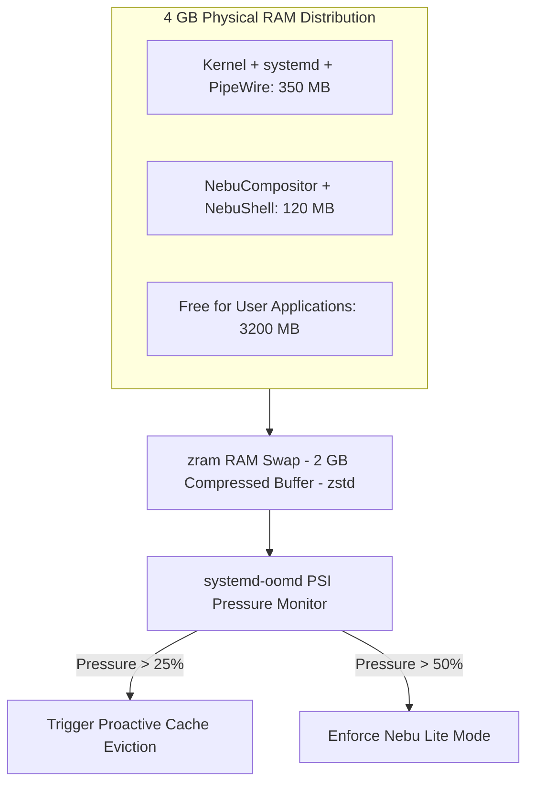

# Memory Management & Low-End Mode Specification — NebuOS

**Status:** REVIEW  
**Purpose:** Specify memory budgeting, zram swap compression, memory pressure stall mitigation, and Nebu Lite Mode on 4GB RAM hardware.

---

## 1. The 4GB RAM First-Class Citizen Rule
NebuOS treats 4GB RAM machines not as an afterthought, but as an essential engineering benchmark. On a 4GB machine:
- Base OS + Compositor + Shell MUST consume under 800 MB RSS at idle, leaving > 3.2 GB available for user applications.

## 2. Low-End Mode Architectural Adaptations
When Nebu Lite Mode is engaged:
1. **Compositor Shaders:** Window drop shadows, translucent glass blurs, and minimize/maximize scale animations are deactivated.
2. **Cache Eviction:** Unused prefix metadata, font caches, and shader pipelines are pruned from RAM immediately upon app close.
3. **Warm Runtime Unloading:** Background pre-warmed Wine instances are completely terminated.

## 3. Related Documents
- [00-performance-goals.md](00-performance-goals.md)
- [02-cpu.md](02-cpu.md)
