# Boot Optimization Specification — NebuOS

**Status:** REVIEW  
**Purpose:** Specify initramfs optimization, systemd service ordering, Plymouth reduction, and fast userspace handover.

---

## 1. Boot Latency Budget Breakdown (Target: < 5.0s NVMe)

```mermaid
gantt
    title NebuOS Boot Timeline Budget
    dateFormat X
    axisFormat %s s
    
    section Hardware
    UEFI Firmware Init :0, 1500
    
    section Kernel
    Kernel & Driver Decompression :1500, 2300
    Initramfs OSTree Pivot :2300, 2900
    
    section Userspace
    systemd Core Services :2900, 3900
    NebuCompositor KMS DRM Init :3900, 4400
    NebuShell Presentation :4400, 4800
```

## 2. Architectural Optimizations
1. **Initramfs Pruning:** Dracut profile includes only essential storage and display drivers, shrinking initramfs to < 22 MB.
2. **Parallel Daemon Startup:** NetworkManager, Bluetooth, and audio services initialize asynchronously; they do not block the graphical target.
3. **Direct Login:** The display greeter hands off the active DRM master directly to `nebu-compositor` without screen flicker or VT switching.

## 3. Related Documents
- [00-performance-goals.md](00-performance-goals.md)
- [../architecture/02-boot-and-init.md](../architecture/02-boot-and-init.md)
