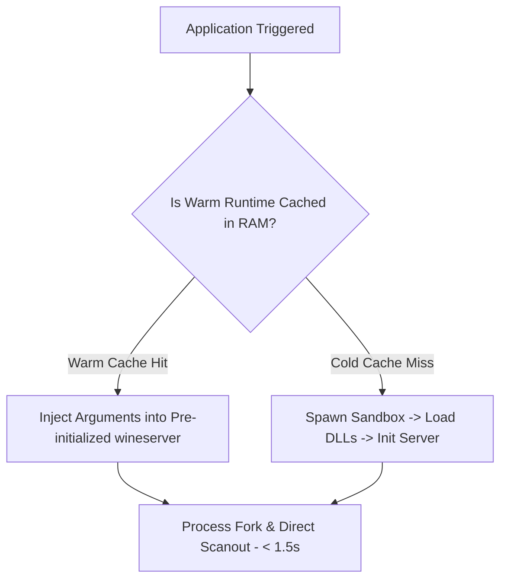

# Application Launch Optimization Specification — NebuOS

**Status:** REVIEW  
**Purpose:** Detail cold start versus warm start pipelines, SQLite indexed metadata, and warm runtime caching.

---

## 1. Cold vs Warm Launch Pipelines

## 2. Pre-Indexed Launch Architecture
When the user opens the application launcher:
- `nebu-shell` queries an in-memory SQLite table containing application names, keywords, and icon paths.
- Zero disk stat calls or directory walking occurs during the search keystroke event, ensuring sub-100ms response even under heavy disk I/O.

## 3. Related Documents
- [00-performance-goals.md](00-performance-goals.md)
- [../runtime/01-application-lifecycle.md](../runtime/01-application-lifecycle.md)
