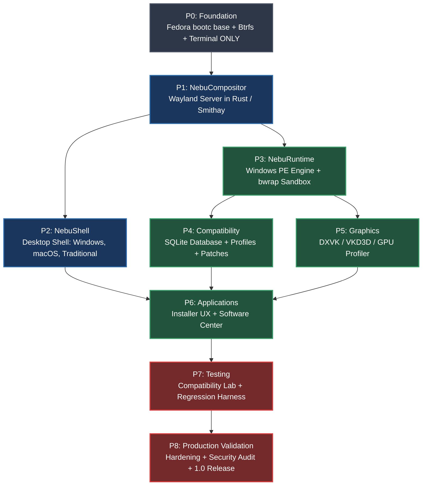
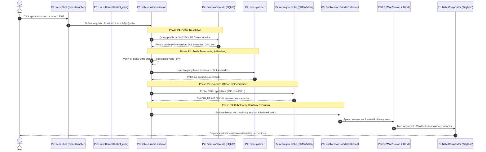

# Master Implementation Roadmap (P0–P8) — NebuOS

**Status:** STABLE  
**Purpose:** Establish the authoritative, implementation-focused engineering roadmap for NebuOS, defining the sequential progression from minimal headless base image through desktop subsystems, Windows binary runtime, graphics pipelines, and production validation.  
**Scope:** Covers all implementation phases (P0 through P8), defining concrete Rust crates, binary paths, systemd service units, upstream dependencies, anti-scope boundaries, verifiable exit criteria, and risk mitigation strategies.  
**Non-Goals:** Blueprint-level conceptual explorations, post-1.0 features (ARM64 architecture, Wayland HDR tonemapping, cloud application streaming), virtual machine (VM) hypervisor integration (strictly prohibited per [ADR-0009-no-vm.md](../decisions/ADR-0009-no-vm.md)).  
**Target Hardware:** Minimum 4 GB RAM, dual-core x86_64 CPU, 32 GB storage; idle system memory budget < 800 MB RSS.  
**Related Documents:** [00-engineering-roadmap.md](00-engineering-roadmap.md), [ADR-0002-fedora-base.md](../decisions/ADR-0002-fedora-base.md), [ADR-0005-nebu-compositor.md](../decisions/ADR-0005-nebu-compositor.md), [ADR-0009-nebushell-ui-architecture.md](../decisions/ADR-0009-nebushell-ui-architecture.md), [ADR-0010-per-application-wine-prefixes.md](../decisions/ADR-0010-per-application-wine-prefixes.md), [architecture/01-system-architecture.md](../architecture/01-system-architecture.md), [runtime/00-runtime-overview.md](../runtime/00-runtime-overview.md)

---

## 1. Architectural Principles and Execution Strategy

The NebuOS engineering lifecycle is structured into nine sequential, gated implementation phases (P0 through P8). Each phase represents a strictly testable layer of the operating system stack:

1. **Unidirectional Dependency Hierarchy:** Higher phases depend strictly on lower phases. Desktop UI never dictates runtime architecture; application wrappers never bypass sandbox primitives.
2. **Strict Component Isolation:** NebuOS custom software is written in memory-safe Rust. Base operating system state is managed as an immutable, transactional OSTree/bootc sysroot.
3. **No Virtual Machines:** Windows binary compatibility is delivered via containerized userspace translation (Wine/Proton + DXVK/VKD3D) inside Bubblewrap sandboxes. Hypervisors and nested operating systems are strictly prohibited.
4. **Verifiable Quality Gates:** No phase is marked complete until its testable exit criteria pass unattended automation on baseline physical and virtual testbeds.



---

## 2. Master Phase Summary Matrix

| Phase | Codename | Primary Focus | Key Deliverable Binary / Crate | Exit Gate |
|---|---|---|---|---|
| **P0** | **Foundation** | Minimal bootc OS, Btrfs subvolumes, terminal | `packaging/bootc/Containerfile.p0` | Boots to TTY in < 3.0s; read-only `/usr` |
| **P1** | **NebuCompositor** | Native Wayland compositor in Rust (Smithay) | `/usr/bin/nebu-compositor` | Wayland + XWayland clients @ 60 FPS |
| **P2** | **NebuShell** | Declarative desktop shell & paradigm engine | `/usr/bin/nebu-shell` | < 45 MB RSS; live layout switch < 150ms |
| **P3** | **NebuRuntime** | PE binary supervisor, bwrap sandboxing | `/usr/libexec/nebu-runtime-daemon` | PE runs in prefix; clean termination |
| **P4** | **Compatibility** | SQLite compatibility database & patch engine | `/usr/bin/nebu-compat-tool` | Profile lookup < 2ms; DLL patches verified |
| **P5** | **Graphics** | DXVK/VKD3D translation & multi-GPU router | `/usr/bin/nebu-gpu-probe` | Direct3D 11/12 renders via Vulkan >= 90% |
| **P6** | **Applications** | Graphical installer wizard & Software Center | `/usr/bin/nebu-installer-ui` | Double-click EXE installs and creates icon |
| **P7** | **Testing** | Automated Compatibility Lab & test matrix | `/usr/bin/nebu-test-runner` | 50 apps pass automated unattended tests |
| **P8** | **Validation** | Hardening, 4GB RAM optimization, 1.0 ISO | `nebuos-1.0.0-x86_64.iso` | < 800 MB idle RAM; security audit passed |

---

## 3. Phase Specifications

---

### Phase P0: Foundation (Base Image, Boot, and Terminal ONLY)

#### 3.1 Objective
Establish the minimal, bootable operating system foundation. Build a stripped-down Fedora Atomic bootc base container that boots to a virtual or serial console terminal on bare metal and QEMU, mounting an immutable Btrfs root filesystem with networking and systemd service orchestration. Phase P0 is intentionally minimal: zero graphical components, zero compatibility layers, and zero custom Rust daemons.

#### 3.2 Scope (What's IN)
- Base OCI container specification (`packaging/bootc/Containerfile.p0`) based on Fedora 44 bootc (`quay.io/fedora/fedora-bootc:44`).
- Linux kernel 6.14+ (upstream Fedora 44 kernel with standard hardware drivers).
- Btrfs filesystem configuration: subvolumes `@` (root, mounted read-only), `@var` (state, read-write), `@home` (user home directories, read-write), `@snapshots` (recovery snapshots).
- Init system: systemd 256+ configured with minimal targets (`multi-user.target`).
- Network connectivity: NetworkManager and `systemd-resolved` with DHCP auto-configuration.
- Console access: `agetty@tty1.service` (virtual console) and `agetty@ttyS0.service` (serial console).
- Update and rollback subsystem: `bootc` and `ostree` client utilities.
- Monorepo tooling: Root `Cargo.toml` workspace manifest and disk image creation scripts.

#### 3.3 Anti-Scope (What's NOT in P0)
- NO graphical display servers (no Wayland, no X11, no Mesa DRM display scanout).
- NO audio subsystems (no PipeWire, no WirePlumber, no ALSA user services).
- NO Wine, Proton, DXVK, or Windows PE execution packages.
- NO desktop shell widgets, taskbars, launchers, or settings panels.
- NO custom NebuOS compiled Rust crates or daemons.
- NO graphical OS installer (installation handled via disk flashing script).

#### 3.4 Dependencies
- Upstream base image: `quay.io/fedora/fedora-bootc:44`.
- Host build tools: Podman 5.0+, `bootc-image-builder`, QEMU 8.x.
- Target hardware: Standard x86_64 UEFI/BIOS PC with >= 2 GB RAM and >= 16 GB disk.

#### 3.5 Deliverables
- **Manifest:** `packaging/bootc/Containerfile.p0`
- **Build Script:** `scripts/build-p0-image.sh`
- **Bootable Artifacts:** `target/images/nebuos-p0.raw` and `target/images/nebuos-p0.qcow2`
- **Storage Configuration:** `packaging/btrfs/subvolumes.conf`
- **Workspace Manifest:** `/root/NebuOS/Cargo.toml` (initializing empty workspace)

#### 3.6 Exit Criteria (Testable Conditions)
1. Container image builds cleanly without warnings: `podman build -t nebuos:p0 -f packaging/bootc/Containerfile.p0 .`
2. QEMU virtual machine boots to login prompt in < 3.0 seconds:  
   `qemu-system-x86_64 -m 2048 -smp 2 -drive file=target/images/nebuos-p0.raw,format=raw -nographic`
3. Root filesystem inspection verifies immutable mount: `findmnt / -o OPTIONS` reports `ro`.
4. Network interface automatically obtains DHCP address: `ping -c 1 1.1.1.1` returns exit code 0.
5. Systemd reports healthy state: `systemctl is-system-running` returns `running` or `degraded`.

#### 3.7 Known Risks and Mitigations
- *Missing storage controller drivers in dracut initramfs causing kernel panic on baremetal.*  
  **Mitigation:** Explicitly include `storage-core` and standard NVMe/AHCI modules in dracut configuration file `packaging/bootc/dracut.conf.d/01-storage.conf`.

---

### Phase P1: NebuCompositor (Wayland Compositor in Rust)

#### 3.1 Objective
Engineer the native Wayland display server (`nebu-compositor`) in Rust using the Smithay library. The compositor directly manages KMS/DRM displays, hardware input devices via libinput, and provides hardware-accelerated OpenGL/Vulkan surface rendering for native Wayland and legacy X11 applications via XWayland.

#### 3.2 Scope (What's IN)
- Rust crate: `crates/nebu-compositor`.
- Wayland server protocols: `wayland-server`, `xdg-shell`, `wlr-layer-shell-unstable-v1`, `linux-dmabuf-unstable-v1`, `linux-drm-syncobj-v1`, `relative-pointer-unstable-v1`, `pointer-constraints-unstable-v1`.
- Display backend: Linux Direct Rendering Manager (DRM/KMS), Generic Buffer Management (GBM), and EGL/GLES2 rendering pipeline via Smithay 0.3.x.
- Multi-head monitor management: EDID probing, dynamic display hotplugging, per-monitor refresh rate scheduling (60Hz, 120Hz, 144Hz), and fractional display scaling.
- Input subsystem: libinput integration supporting keyboard layouts, multi-touch gestures, pointer acceleration, and touchpads.
- Window management: Floating window layout engine, interactive move/resize grabs, window focus management, fullscreen switching.
- XWayland integration: Automated on-demand lifecycle management of `/usr/bin/Xwayland` for legacy compatibility.

#### 3.3 Anti-Scope (What's NOT in P1)
- NO desktop shell widgets (taskbars, docks, start menus, quick settings - deferred to P2).
- NO application launcher indexing or desktop file search (deferred to P2).
- NO Windows binary execution, Wine prefixes, or binfmt_misc hooks (deferred to P3).
- NO graphical software center or system settings UI (deferred to P6).

#### 3.4 Dependencies
- P0 Foundation base image.
- Rust toolchain 1.80+ (stable).
- System libraries: `libdrm-devel`, `mesa-libgbm-devel`, `libinput-devel`, `libxkbcommon-devel`, `systemd-devel`, `wayland-devel`.
- Rust dependencies: `smithay = "0.3"`, `wayland-server = "0.31"`, `calloop = "0.13"`.

#### 3.5 Deliverables
- **Crate:** `crates/nebu-compositor/`
- **Binary:** `/usr/bin/nebu-compositor`
- **Systemd User Unit:** `packaging/systemd/user/nebu-compositor.service`
- **Default Configuration:** `/etc/nebu/compositor.toml`

#### 3.6 Exit Criteria (Testable Conditions)
1. `nebu-compositor` launches directly from TTY1 under unprivileged user session (UID 1000) and acquires DRM master without root privileges.
2. Standard Wayland terminal client (`foot` or `weston-terminal`) renders, processes keyboard input, and executes shell commands cleanly.
3. Standard X11 client (`xterm` or `glxgears`) launches via XWayland, renders without visual artifacts, and maintains smooth 60 FPS scanout.
4. Hotplugging a secondary physical monitor via HDMI/DisplayPort dynamically allocates a new CRTC and extends the desktop surface without compositor crash.
5. Compositor idle memory footprint does not exceed 35 MB RSS.

#### 3.7 Known Risks and Mitigations
- *NVIDIA proprietary driver incompatibility with standard GBM Wayland allocators.*  
  **Mitigation:** Implement dual backend fallback in Smithay supporting both standard DRM/GBM and EGLStreams/EGLDevice extensions; set `WLR_NO_HARDWARE_CURSORS=1` dynamically when NVIDIA driver is detected.

---

### Phase P2: NebuShell (Desktop Shell with Theme/Layout Engine)

#### 3.1 Objective
Implement the native declarative desktop shell (`nebu-shell`) in Rust, delivering taskbars, docks, application launchers, status trays, and notification overlays. The shell connects to `nebu-compositor` via `wlr-layer-shell` and incorporates the pluggable Theme + Layout + Behavior paradigm engine defined in [ADR-0009](../decisions/ADR-0009-nebushell-ui-architecture.md) and [ADR-0019](../decisions/ADR-0019-slint-toolkit-adoption.md), enabling instant runtime switching between Windows-like, macOS-like, and Traditional desktop workflows without user logout.

Phase P2 is structured into two gated sub-phases:
- **Phase P2.0 (Compositor Desktop Protocol Enablement & Architecture Lock):** Pre-implementation enablement gating. Ratifies Slint adoption (ADR-0019, resolving OQ-001), establishes the System API specification (`docs/interfaces/08-system-api-interfaces.md`), adds `xdg_wm_base` and `wlr-layer-shell-unstable-v1` to `nebu-compositor` as additive capabilities, and reruns the P1 regression test suite. Zero UI code is written in P2.0.
- **Phase P2.1 (NebuShell Core & UI Implementation):** Implementation of `crates/nebu-shell`, desktop panels, dock, launcher, OSD, quick settings, and theme hot-reloading.

#### 3.2 Scope (What's IN)
- **Phase P2.0 Deliverables:**
  - `ADR-0019-slint-toolkit-adoption.md` (Toolkit ratification; closes OQ-001).
  - `docs/interfaces/08-system-api-interfaces.md` (NetworkManager, UPower, logind, BlueZ, PipeWire contracts).
  - Additive protocol support in `crates/nebu-compositor`: `xdg_wm_base` and `wlr-layer-shell-unstable-v1`.
  - Headless layer shell verification harness: `nebu-layer-shell-probe`.
  - Re-run full 6-probe P1 regression suite (`--drm-probe` through `--presentation-probe`).
- **Phase P2.1 Deliverables:**
  - Rust crate `crates/nebu-shell/` (lean single crate with internal modules: `core`, `layout`, `theme`, `system_api`, `ui`).
  - UI components: Taskbar, Floating Dock, Application Launcher (`nebu-launcher`), System Tray (`StatusNotifierItem`), Quick Settings flyout (PipeWire volume, NetworkManager Wi-Fi), Notification center (`org.freedesktop.Notifications`), Session lock screen (`ext-session-lock-v1`).
  - In-memory SQLite indexing for `.desktop` application files.
  - D-Bus interface `org.nebu.Shell1` for dynamic paradigm switching.
  - Pre-packaged canonical paradigms: Windows-like, macOS-like, Traditional.

#### 3.3 Anti-Scope (What's NOT in P2)
- NO Windows binary execution or Wine prefix management (deferred to P3).
- NO graphical software center or package manager GUI (deferred to P6).
- NO arbitrary third-party compiled `.so` plugins or untrusted JavaScript/Python scripting engines.
- NO modifying locked Milestone P0 (`71d0c9e`) or P1 (`81c9791`) foundational baselines.

#### 3.4 Dependencies
- P0 Foundation base image (`quay.io/fedora/fedora-bootc:44`), P1 NebuCompositor display substrate.
- Development Environment: Dedicated VM103 (`nebuos-p2-desktop`, Fedora 44 bootc) isolated from locked VM101/VM102.
- Rust GUI framework: Slint 1.7+ ([ADR-0019](../decisions/ADR-0019-slint-toolkit-adoption.md)).
- System D-Bus daemons: PipeWire 1.0+, WirePlumber, NetworkManager, UPower, BlueZ, systemd-logind.
- Rust dependencies: `zbus = "4.2"`, `rusqlite = "0.31"`, `image = "0.25"`, `calloop = "0.14"`.

#### 3.5 Deliverables
- **Crate:** `crates/nebu-shell` (lean single crate with internal modules: `core`, `layout`, `theme`, `system_api`, `ui`)
- **Binary:** `/usr/bin/nebu-shell`
- **Systemd User Unit:** `packaging/systemd/user/nebu-shell.service`
- **Paradigm Presets:** `/usr/share/nebu/paradigms/{windows,macos,traditional}.ron`

#### 3.6 Exit Criteria (Testable Conditions)
1. `nebu-shell` starts automatically on compositor initialization and anchors primary panel via `wlr-layer-shell`.
2. Pressing the Super key opens the application launcher in < 80ms, displaying indexed desktop applications.
3. Executing `busctl --user call org.nebu.Shell1 /org/nebu/Shell1 org.nebu.Shell1 SwitchParadigm s "macos"` transitions the UI from bottom taskbar to top bar + floating dock in < 150ms without flickering or closing client windows.
4. Total idle memory footprint of NebuShell <= 45 MB RSS (Combined Compositor + Shell <= 80 MB RSS).
5. All 6 P1 regression probes continue to pass with zero regressions.

#### 3.7 Known Risks and Mitigations
- *Layer-shell protocol race condition during dynamic surface anchor mutation causing surface freeze.*  
  **Mitigation:** Implement transactional surface commitment handshake: instantiate new layer surface, confirm `configure` acknowledgement from compositor, then unmap old surface.

---

### Phase P3: NebuRuntime (Windows EXE Execution Engine)

#### 3.1 Objective
Engineer the core Windows PE binary execution supervisor and sandbox engine. Implement automatic binary interception via `binfmt_misc`, Bubblewrap filesystem and network sandboxing, automated creation of isolated per-application Wine prefixes at `~/.nebu/apps/<app_id>/`, and lifecycle monitoring via D-Bus service `org.nebu.Runtime1`.

#### 3.2 Scope (What's IN)
- Rust crates: `crates/nebu-runtime-daemon`, `crates/nebu-runtime-core`, `crates/nebu-cli`.
- Kernel interception: `/usr/lib/binfmt.d/nebu-wine.conf` mapping DOS/PE executables (`MZ` header) to `/usr/bin/nebu-launch`.
- Sandboxing: Bubblewrap (`bwrap`) profile isolation:
  - Read-only sysroot mounts (`/usr`, `/lib64`, `/etc`).
  - Strict user home isolation (app sees only virtual Windows drives: `C:\` -> isolated prefix, `Z:\` -> virtual mapped root; `X:\` -> user Documents/Downloads only).
  - Network isolation toggles per application.
- Prefix generator: Automated Btrfs reflink / template tree clone creating independent prefixes in < 1.5s per [ADR-0010](../decisions/ADR-0010-per-application-wine-prefixes.md).
- Process supervisor: `nebu-runtime-daemon` tracking Wine processes, managing wineserver lifecycles, and terminating orphaned sub-processes.
- Command-line runner: `/usr/bin/nebu-cli run <path/to/exe>`.

#### 3.3 Anti-Scope (What's NOT in P3)
- NO SQLite-driven automated compatibility database or heuristics engine (deferred to P4).
- NO 9-tier declarative registry/patch injection (deferred to P4).
- NO DXVK or VKD3D DirectX-to-Vulkan translation layers (deferred to P5 - P3 uses Wine's built-in wined3d/OpenGL).
- NO graphical installation wizard or GUI software store (deferred to P6).

#### 3.4 Dependencies
- P0 Foundation, P1 Compositor.
- Upstream Wine runtime: Wine 9.x or Proton-GE 9.x binaries located in `/usr/lib/nebu/runtime/wine/`.
- Sandbox tools: `bubblewrap` (`/usr/bin/bwrap`).
- Rust dependencies: `goblin = "0.8"` (PE parsing), `zbus = "4.2"`, `nix = "0.29"`.

#### 3.5 Deliverables
- **Crates:** `crates/nebu-runtime-daemon/`, `crates/nebu-runtime-core/`, `crates/nebu-cli/`
- **Binaries:** `/usr/libexec/nebu-runtime-daemon`, `/usr/bin/nebu-launch`, `/usr/bin/nebu-cli`
- **Systemd User Unit:** `packaging/systemd/user/nebu-runtime-daemon.service`
- **Kernel Interception:** `/usr/lib/binfmt.d/nebu-wine.conf`
- **Wine Template Tree:** `/usr/share/nebu/prefix-template/`

#### 3.6 Exit Criteria (Testable Conditions)
1. Double-clicking or executing `./NotepadPlusPlus.exe` in terminal automatically invokes `/usr/bin/nebu-launch` without prepending `wine`.
2. A new isolated prefix is generated in `~/.nebu/apps/notepad-plus-plus/` in < 1.5 seconds.
3. Notepad++ launches within the Bubblewrap sandbox, renders on XWayland, creates a new file, and saves to the user's `~/Documents` directory.
4. Force-killing Notepad++ via `kill -9` causes `nebu-runtime-daemon` to clean up the associated `wineserver` within 1.0 second, leaving zero zombie processes.

#### 3.7 Known Risks and Mitigations
- *Slow prefix creation on non-Btrfs filesystems or slow external drives.*  
  **Mitigation:** Detect underlying filesystem: use `cp --reflink=always` on Btrfs; fallback to pre-extracted lightweight hardlink/symlink directory tree on ext4/NTFS.

---

### Phase P4: Compatibility Subsystem (Database, Profiles, and Patches)

#### 3.1 Objective
Implement the relational SQLite compatibility database, declarative JSON/RON application profile indexer, and the 9-tier declarative patch engine. Automatically resolve application quirks, register DLL overrides (`WINEDLLOVERRIDES`), inject registry keys, and substitute missing Windows fonts before execution.

#### 3.2 Scope (What's IN)
- Rust crates: `crates/nebu-compat-db`, `crates/nebu-patcher`.
- Relational SQLite database (`/usr/share/nebu/compat.db`) containing indexed application definitions, SHA256 signatures, PE header characteristics, Wine version bindings, DLL override rules, and registry scripts.
- Profile indexer: Fast matching engine resolving PE checksums and metadata to profile entries in < 2ms.
- Declarative patch engine (`nebu-patcher`):
  - Tier 1: Wine environment variables (`WINEARCH`, `WINEDEBUG`).
  - Tier 2: DLL overrides (Native vs Built-in mappings).
  - Tier 3: Registry injection (`wine regedit` script generation).
  - Tier 4: Windows version masquerading (Win10, Win11, Win7).
  - Tier 5: GDI/DirectWrite font mapping and substitution.
- Seed profiles: Pre-packaged compatibility profiles for 20 common Windows productivity tools (7-Zip, Notepad++, VLC, PuTTY, IrfanView, SumatraPDF).

#### 3.3 Anti-Scope (What's NOT in P4)
- NO DXVK/VKD3D Vulkan pipeline optimizations or GPU offload rules (deferred to P5).
- NO consumer-facing graphical software center (deferred to P6).
- NO automated cloud submission portal for compatibility reports.

#### 3.4 Dependencies
- P3 NebuRuntime.
- SQLite 3.45+ (configured with Write-Ahead Logging `WAL` and memory mapping).
- Rust dependencies: `rusqlite = { version = "0.31", features = ["bundled", "modern_sqlite"] }`, `sha2 = "0.10"`.

#### 3.5 Deliverables
- **Crates:** `crates/nebu-compat-db/`, `crates/nebu-patcher/`
- **Binaries:** `/usr/bin/nebu-compat-tool`, `/usr/libexec/nebu-patch-runner`
- **System Database:** `/usr/share/nebu/compat.db`
- **Profile Repository:** `/usr/share/nebu/profiles/*.json`

#### 3.6 Exit Criteria (Testable Conditions)
1. `nebu-compat-tool inspect <path/to/installer.exe>` calculates SHA256, matches database records, and prints the resolved profile in < 2.0ms.
2. `nebu-patch-runner apply --prefix ~/.nebu/apps/test-app --profile /usr/share/nebu/profiles/notepad-plus-plus.json` injects DLL overrides and registry keys into `system.reg` without corrupting hive formatting.
3. Seed test suite of 20 popular Windows utilities launch without missing DLL or font errors.

#### 3.7 Known Risks and Mitigations
- *SQLite database lock contention during concurrent application launches.*  
  **Mitigation:** Open database in read-only shared cache mode (`PRAGMA query_only = ON; PRAGMA busy_timeout = 5000; PRAGMA journal_mode = WAL;`).

---

### Phase P5: Graphics Subsystem (DXVK, VKD3D, and GPU Profiles)

#### 3.1 Objective
Deploy hardware-accelerated DirectX-to-Vulkan translation pipelines (DXVK for Direct3D 9/10/11, VKD3D-Proton for Direct3D 12) and build the automated GPU detection and profiling crate (`nebu-gpu-probe`). Ensure 3D Windows applications and CAD viewports execute at >= 90% of native Windows performance while routing desktop UI to energy-efficient integrated GPUs.

#### 3.2 Scope (What's IN)
- Rust crate: `crates/nebu-gpu-probe`.
- DirectX translation runtimes:
  - DXVK (Direct3D 9, 10, 11 -> Vulkan 1.3).
  - VKD3D-Proton (Direct3D 12 -> Vulkan 1.3).
  - Zink (OpenGL -> Vulkan fallback).
- Hardware probing: Enumerates available GPUs (Intel, AMD, NVIDIA), identifies primary display adapter, and classifies low-power iGPU vs high-performance dGPU.
- Multi-GPU routing engine: Injects PRIME environment variables (`DRI_PRIME=1`, `__NV_PRIME_RENDER_OFFLOAD=1`, `__GLX_VENDOR_LIBRARY_NAME=nvidia`) automatically based on application profile.
- Vulkan shader cache manager: Persists compiled shader pipelines at `~/.cache/nebu/shaders/<app_id>/` to eliminate runtime stutter.

#### 3.3 Anti-Scope (What's NOT in P5)
- NO end-user graphical installer or store UI (deferred to P6).
- NO Windows kernel anti-cheat driver emulation (explicit non-goal).
- NO proprietary closed-source Wine patches.

#### 3.4 Dependencies
- P3 NebuRuntime, P4 Compatibility Subsystem.
- Vulkan 1.3 ICD loaders: `vulkan-loader`, `mesa-vulkan-drivers`, NVIDIA proprietary Vulkan driver.
- Upstream pre-compiled DXVK and VKD3D-Proton libraries.
- Rust dependencies: `ash = "0.38"` (Vulkan API inspection), `udev = "0.8"`.

#### 3.5 Deliverables
- **Crate:** `crates/nebu-gpu-probe/`
- **Binaries:** `/usr/bin/nebu-gpu-probe`, `/usr/libexec/nebu-dxvk-setup`
- **Libraries:** `/usr/lib/nebu/dxvk/{x86_64,x86}/*.dll.so`, `/usr/lib/nebu/vkd3d/{x86_64,x86}/*.dll.so`
- **GPU Routing Rules:** `/usr/share/nebu/gpu-rules.json`

#### 3.6 Exit Criteria (Testable Conditions)
1. Direct3D 11 benchmark / 3D application (e.g., Unigine Valley/Heaven or 3D test harness) runs via DXVK and achieves >= 90% framerate compared to native Windows execution on identical hardware.
2. Direct3D 12 test binary runs via VKD3D-Proton without Vulkan validation errors.
3. Running `nebu-gpu-probe` on a dual-GPU laptop (Intel iGPU + NVIDIA dGPU) correctly routes `nebu-shell` to Intel and 3D applications to NVIDIA using PRIME offload.
4. Shader pipeline cache loads from disk on second execution, reducing viewport load time by >= 60%.

#### 3.7 Known Risks and Mitigations
- *Vulkan pipeline compilation micro-stutter during initial application execution.*  
  **Mitigation:** Enable `DXVK_ASYNC=1` pipeline compiler and pre-seed generic pipeline states into `~/.cache/nebu/shaders/`.

---

### Phase P6: Application Platform & Nebu Marketplace

#### 3.1 Objective
Deliver the complete end-user application distribution and management platform for NebuOS. Establish `Flatpak` and `Flathub` as the primary packaging and discovery foundation for native Linux desktop applications, backed by Fedora repositories for complementary components, with a strict parallel compatibility pathway for Windows applications. Implement the `Nebu App Manager` abstraction daemon (`nebu-app-manager-daemon`), the native lightweight `Nebu Marketplace` UI (`nebu-marketplace`), the standalone Windows installer wizard (`nebu-installer-ui`), permission inspection policies, and application registration hooks.

#### 3.2 Subphases and Scope (What's IN)

##### Subphase P6.0: Application Runtime & App Management
- **Central Abstraction Daemon:** `crates/nebu-app-manager-daemon` exposing `org.nebu.AppManager1` over D-Bus.
- **Source Abstraction Layer (`ApplicationSource`):** Trait normalizing interactions across Flatpak, Fedora, and Wine compatibility backends.
- **Application Lifecycle State Machine:** Enforces formal states (`Discover`, `Inspect`, `Verify`, `Install`, `Register`, `Launch`, `Update`, `Disable`, `Repair`, `Uninstall`).
- **Flatpak Integration:** Communicates with `libflatpak` and Bubblewrap for unprivileged user-space (`~/.local/share/flatpak`) and system-wide (`/var/lib/flatpak`) installations.
- **Application Registration:** FreeDesktop `.desktop` emission, `.rsrc` icon extraction into standard hicolor theme directories, and MIME associations via `xdg-mime`.
- **Permission Model:** Standardizes permission inspection (Network, Audio, Camera, Mic, Filesystem, Hardware Devices, GPU, D-Bus, Portals).

##### Subphase P6.1: Nebu Marketplace
- **Native GUI Client:** `crates/nebu-marketplace-ui` built using Slint (strictly zero Electron, zero Chromium webviews, idle memory < 35 MB RSS).
- **Discovery & Navigation:** Featured banners, categories (Office, Graphics, Development, Games, Audio/Video, System), popular apps, and recently updated listings.
- **Fast Full-Text Search:** Instant offline search backed by local SQLite metadata index (`marketplace.db`).
- **Application Detail View:** Descriptions, multi-resolution screenshots, developer/publisher credentials, license tags, and changelogs.
- **Compatibility Information:** Dynamic badges displaying status (`Verified`, `Compatible`, `Partially Compatible`, `Known Issues`, `Not Tested`, `Unavailable`) and quantitative scores (0–100).
- **One-Click Transactions:** Install, update, repair, and clean removal with real-time progress signals.

##### Subphase P6.2: Application Security
- **Publisher Identity & Trust Model:** Verification tiers (Official Vendor, Community Verified, Unverified).
- **Cryptographic Verification:** Signature checks (GPG, Cosign) and SHA-256 digest validation prior to staging packages.
- **Permission Transparency:** Pre-installation dialog disclosing all requested sandbox entitlements with clear risk indicators.
- **Sandbox Containment:** Flatpak Bubblewrap containment and XDG Desktop Portals; Windows applications confined to isolated prefixes with Landlock LSM and seccomp syscall filters.
- **Malicious Package Response:** Quarantine, blacklisting, and revocation hooks for compromised software.

##### Subphase P6.3: Developer Platform
- **Publisher Registration:** Workflows and data models for developer onboarding and key enrollment.
- **Application Submission Pipeline:** Automated linting of manifests, AppStream metadata validation, and package integrity verification.
- **Automated Security & Sandbox Checks:** Headless scans for privilege escalations, unconfined filesystem access, and binary vulnerabilities.
- **Review & Approval Workflows:** Staged promotion pipeline (Draft -> Review -> Staged -> Published).

##### Subphase P6.4: Ecosystem Integration
- **Flathub Integration:** Upstream discovery, AppStream metadata ingestion, and package retrieval without claiming ownership or forking Flathub.
- **Fedora Repository Integration:** Complementary source for system packages and development toolbx environments (strictly separated from user desktop apps).
- **Future Nebu Repository Preparation:** Architectural abstractions for first-party tools and optimized system integrations (no implementation in P6).
- **Windows Application Compatibility Pathway:** Marketplace metadata routes Windows application installs through declarative recipes to the Nebu Compatibility Engine (`nebu-runtime-daemon`) in dedicated Btrfs prefixes.

#### 3.3 Anti-Scope (What's NOT in P6)
- **NO Custom Package Manager:** NebuOS does NOT invent a package manager or bespoke package archive format.
- **NO Flathub Fork / Mirror:** NebuOS does NOT fork Flathub or host private mirrors of Flathub repositories in P6.
- **NO Direct Package Manager Access from UI:** The Marketplace UI never directly spawns `flatpak`, `dnf`, or `wine` processes.
- **NO Conflation of Updates:** Application updates must NEVER trigger or depend on base OS reboots or `bootc` operations.
- **NO Payment / Monetization Backend:** Commercial billing and payment gateways are strictly out of scope for initial P6.
- **NO Electron or Webviews:** All UI components must use native Rust toolkits (Slint).

#### 3.4 Dependencies
- P0 Foundation, P1 Compositor, P2 NebuShell, P3 NebuRuntime, P4 Compatibility Subsystem, P5 Graphics.
- External libraries: `libflatpak-devel`, `shared-mime-info`, `xdg-utils`, `sqlite-devel`.
- Rust dependencies: `slint = "1.7"`, `zbus = "4.2"`, `rusqlite = "0.31"`, `pelite = "0.10"`.

#### 3.5 Deliverables
- **Crates:** `crates/nebu-app-manager-daemon/`, `crates/nebu-marketplace-ui/`, `crates/nebu-installer-ui/`
- **Binaries:** `/usr/libexec/nebu-app-manager-daemon`, `/usr/bin/nebu-marketplace`, `/usr/bin/nebu-installer-ui`
- **Systemd User Units:** `packaging/systemd/user/nebu-app-manager.service`
- **D-Bus Schemas:** `/usr/share/dbus-1/interfaces/org.nebu.AppManager1.xml`, `org.nebu.AppSource1.xml`
- **MIME Specification:** `/usr/share/mime/packages/nebu-windows-executables.xml`

#### 3.6 Exit Criteria (Testable Conditions)
1. `nebu-app-manager-daemon` starts via systemd user session and registers `org.nebu.AppManager1` on session bus with idle RSS <= 18 MB.
2. User searches for "VLC" in `nebu-marketplace`; Flathub metadata, icon, screenshots, and permission manifest render within 150ms.
3. Installing a Flatpak application (e.g. `org.videolan.VLC`) via Marketplace completes without root privileges, mounts in `~/.local/share/flatpak`, and emits a valid FreeDesktop `.desktop` shortcut into NebuShell launcher.
4. Pre-installation permission card correctly identifies all requested hardware, network, and filesystem access entitlements.
5. Updating a Flatpak application completes live in userspace with zero disruption to the running OS and without prompting for reboot.
6. Double-clicking a Windows installer executable opens `nebu-installer-ui`, isolates execution into `~/.nebu/apps/<app_id>/`, extracts icons, and registers the application without interfering with Flatpaks.
7. Triggering uninstallation completely purges application binaries, configuration caches, desktop launchers, and MIME associations with zero lingering state.

#### 3.7 Known Risks and Mitigations
- *Upstream Flathub network latency or service outage blocking application metadata searches.*  
  **Mitigation:** Cache AppStream metadata locally in SQLite (`~/.cache/nebu/marketplace.db`); serve instant cached search results and synchronize asynchronously with exponential backoff.
- *Excessive disk space consumption from redundant Flatpak runtimes.*  
  **Mitigation:** Enforce Btrfs filesystem extent sharing and zstd compression; prompt user to prune unused runtimes via `nebu-app-manager-daemon` garbage collector.

---

### Phase P7: Testing Subsystem (Compatibility Lab and Regression Harness)

#### 3.1 Objective
Construct the automated Compatibility Test Lab and regression testing harness (`nebu-test-harness`). Establish continuous automated testing across 100+ Windows applications running on multiple bare-metal and virtual hardware tiers to catch regressions in performance, memory, and compatibility.

#### 3.2 Scope (What's IN)
- Rust crate: `crates/nebu-test-harness`.
- Automated test orchestrator: Headless execution of Windows installers, UI automation (via `ydotool` and Wayland virtual input protocol), visual snapshot verification, and process exit code auditing.
- Multi-tier hardware test matrix:
  - Tier 0: Low-End Hardware (Intel Celeron/Pentium or AMD Athlon, 4 GB RAM, integrated graphics).
  - Tier 1: Mainstream Hardware (Intel Core i5 / AMD Ryzen 5, 8–16 GB RAM, Intel Iris Xe / AMD Radeon).
  - Tier 2: Performance Hardware (Intel Core i7 / Ryzen 7, 32 GB RAM, NVIDIA RTX discrete GPU).
- Golden image regression suite: Boot time tracking, compositor frame-pacing tests, memory leak detectors (AddressSanitizer, Heaptrack).
- Test reporting engine: Outputs JUnit XML and HTML dashboards detailing test pass rates, launch latencies, and FPS benchmarks.

#### 3.3 Anti-Scope (What's NOT in P7)
- NO final production ISO release signing or cryptographic key infrastructure (deferred to P8).
- NO manual customer support ticket triage.

#### 3.4 Dependencies
- Complete operating system stack (P0 through P6).
- Physical Compatibility Lab test rigs + QEMU/KVM automation clusters.
- Test frameworks: Python 3.12+, `pytest`, `ydotool`, `opencv-python` (visual comparison).

#### 3.5 Deliverables
- **Crate:** `crates/nebu-test-harness/`
- **Binary:** `/usr/bin/nebu-test-runner`
- **Automation Scripts:** `tests/compat-lab/run-all-tiers.sh`
- **Certified App Test Suites:** `tests/apps/{office,cad,productivity}/*.py`

#### 3.6 Exit Criteria (Testable Conditions)
1. Automated test suite executes 50 distinct Windows application installers completely unattended.
2. Certified application list achieves >= 90% test pass rate across all tiers.
3. Memory leak test verifies that launching and closing 20 applications consecutively leaves system idle memory within 10 MB of baseline.
4. Frame drop monitor reports < 0.1% dropped frames during active window dragging and viewport manipulation.

#### 3.7 Known Risks and Mitigations
- *Flaky UI automation tests due to varying UI render delays.*  
  **Mitigation:** Replace fixed sleep timeouts with semantic Wayland surface frame commit listeners and OCR/template visual matching before issuing simulated clicks.

---

### Phase P8: Production Validation (Performance, Security Audit, and 1.0 Release)

#### 3.1 Objective
Execute final production validation, comprehensive low-end 4GB RAM performance optimization, an independent security penetration audit, OSTree/bootc atomic update verification, and build the official signed NebuOS 1.0 General Availability (GA) ISO release image.

#### 3.2 Scope (What's IN)
- System Hardening:
  - Compiler flags: All NebuOS Rust binaries compiled with `--release`, LTO (`lto = "fat"`), `opt-level = 3`, `codegen-units = 1`, and symbol stripping.
  - Kernel & sysctl hardening: SELinux Enforcing mode with targeted policies for `nebu-runtime-daemon` and `nebu-compositor`.
- Low-End Hardware Mode (4GB RAM Optimization):
  - In-kernel zRAM compression (zstd, 50% RAM allocation).
  - Systemd memory pressure monitoring (`PSI`), proactive memory trimming, and page cache management.
  - Combined desktop idle footprint verified under 800 MB RSS.
- Atomic Update and Rollback Validation:
  - `bootc upgrade` verification with cryptographically signed container layers.
  - Automated boot failure fallback: Corrupt kernel or missing driver triggers GRUB/bootc automatic rollback to previous deployment.
- Security Audit:
  - Sandbox escape penetration testing (verifying Bubblewrap cannot access `~/.ssh`, raw disks, or unprivileged namespaces).
  - PE header fuzzer (cargo-fuzz with AFL++) verifying parsing resilience against malicious PE binaries.
- Application Platform & Marketplace Production Readiness:
  - Production code-signing infrastructure (Cosign, GPG keys, Sigstore Rekor transparency log integration).
  - High-availability CDN mirrors for application metadata, compatibility recipes, and catalog caching.
  - Marketplace moderation, publisher identity verification workflows, and automated abuse response.
  - Automated CVE monitoring and rapid remote application takedown/revocation mechanism.
  - Staged application rollouts infrastructure (canary release cohorts and instant rollback).
- Release Deliverables: Signed `nebuos-1.0.0-x86_64.iso` installer image and containerized update image.

#### 3.3 Anti-Scope (What's NOT in P8)
- NO new feature development (strict feature freeze).
- NO non-x86_64 CPU architectures (ARM64 and RISC-V deferred to 2.0).

#### 3.4 Dependencies
- Verified P0–P7 stack.
- Cryptographic code-signing infrastructure (GPG, Cosign).
- Third-party independent penetration audit report.

#### 3.5 Deliverables
- **Release ISO Image:** `nebuos-1.0.0-x86_64.iso` (signed with NebuOS Release Key)
- **OCI Container Image:** `registry.nebuos.org/nebuos:1.0.0`
- **Application Platform Infrastructure:** Production metadata mirrors, signing keys, and automated takedown pipeline
- **Security Audit Report:** `docs/security/audit-report-v1.0.pdf`
- **Release Documentation:** Final Release Notes and Hardware Compatibility Matrix

#### 3.6 Exit Criteria (Testable Conditions)
1. Complete system boots on physical 4GB RAM reference machine; total idle memory consumption with NebuCompositor and NebuShell active is < 800 MB RAM.
2. Third-party security penetration audit concludes with zero Critical and zero High vulnerabilities.
3. Simulating a power cut or kernel panic during `bootc upgrade` results in successful automatic fallback to the previous bootable image.
4. Top 10 targeted enterprise applications (Microsoft Office Suite, AutoCAD, 7-Zip, Notepad++, VLC, Acrobat Reader) install, operate, and pass validation scripts.
5. Formal sign-off by Principal Systems Architect.

#### 3.7 Known Risks and Mitigations
- *Upstream Wine or Linux zero-day discovered immediately prior to GA release.*  
  **Mitigation:** Verify rapid-response patch deployment pipeline: build container layer patch, push to registry, and trigger background client updates in < 4 hours.

---

## 4. End-to-End Inter-Subsystem Control and Data Flow

The following sequence illustrates how deliverables across all implementation phases (P0 through P6) interact during a standard end-user interaction: launching a Windows executable (`PhotoShop.exe` or `NotepadPlusPlus.exe`) via the desktop shell.



### 4.1 Subsystem Execution Pipeline Detail

1. **Invocation Phase (P0/P2):** User triggers execution via `nebu-shell` launcher or directly via terminal. In terminal execution, Linux kernel `binfmt_misc` intercepts the `MZ` DOS/PE executable header and redirects arguments to `/usr/bin/nebu-launch`.
2. **Analysis and Identification Phase (P3/P4):** `nebu-runtime-core` computes the SHA256 digest of the target executable and parses PE imports/exports using `goblin`. It queries `nebu-compat-db` over in-process SQLite. If known, application-specific quirks and Wine version requirements are resolved; if unknown, generic heuristics are generated.
3. **Prefix Isolation and Environment Preparation (P3/P4):** If the application prefix at `~/.nebu/apps/<app_id>/` does not exist, `nebu-runtime-daemon` triggers a copy-on-write clone from `/usr/share/nebu/prefix-template/` via Btrfs reflink. `nebu-patcher` applies required registry changes (`system.reg`), font aliases, and DLL override strings (`WINEDLLOVERRIDES`).
4. **Graphics Pipeline Configuration (P5):** `nebu-gpu-probe` evaluates hardware adapters and application demands. Low-intensity 2D utilities are bound to the integrated GPU (`iGPU`); 3D viewports or CAD software have `DRI_PRIME=1` or `__NV_PRIME_RENDER_OFFLOAD=1` exported. DXVK and VKD3D libraries are linked into the prefix `system32` directory.
5. **Sandbox Launch and Process Containment (P3):** `bwrap` creates a new unprivileged mount namespace:
   - Mounts `/usr`, `/lib64`, `/bin` as strictly read-only (`--ro-bind`).
   - Mounts per-app prefix as read-write (`--bind ~/.nebu/apps/<app_id> /wineprefix`).
   - Binds PipeWire socket (`/run/user/1000/pipewire-0`) and Wayland socket (`/run/user/1000/wayland-0`).
   - Masks host directories (`/etc/shadow`, `~/.ssh`, raw disk devices).
6. **Display Scanout and Window Management (P1):** Wine maps a Win32 window surface. Wine's Wayland driver or XWayland negotiates buffer allocation via `linux-dmabuf` with `nebu-compositor`. The compositor places, sizes, and decorates the window according to active shell rules.

---

## 5. Component Ownership and Classification Matrix

To maintain architectural integrity, all software components in NebuOS are strictly categorized by provenance, maintenance model, and implementation language:

| Subsystem Component | Category | Language | Maintenance Model | Upstream Origin |
|---|---|---|---|---|
| **Base OS Container** | Fedora Component | OCI / Bash | Track Upstream Stable | Fedora 44 bootc |
| **Linux Kernel & Dracut**| Linux Component | C / Shell | Fedora Kernel RPM | kernel.org / Fedora |
| **Btrfs Filesystem Layout**| Fedora Component | Config | NebuOS Curated | Linux Btrfs |
| **nebu-compositor** | NebuOS Custom | Rust | Built In-House | Smithay Library |
| **nebu-shell** (all crates)| NebuOS Custom | Rust | Built In-House | Slint / Iced / Wayland |
| **nebu-runtime-daemon** | NebuOS Custom | Rust | Built In-House | zbus / bwrap |
| **nebu-runtime-core** | NebuOS Custom | Rust | Built In-House | goblin / nix |
| **nebu-compat-db** | NebuOS Custom | Rust | Built In-House | SQLite3 / rusqlite |
| **nebu-patcher** | NebuOS Custom | Rust | Built In-House | wine regedit / DLLs |
| **nebu-gpu-probe** | NebuOS Custom | Rust | Built In-House | libdrm / Vulkan |
| **nebu-installer-ui** | NebuOS Custom | Rust | Built In-House | Native GUI |
| **nebu-software-center**| NebuOS Custom | Rust | Built In-House | Native GUI |
| **nebu-test-harness** | NebuOS Custom | Rust / Python | Built In-House | Test Automation |
| **Wine / Proton Runtime**| External Dependency| C / C++ | Vendor & Patch | Wine-GE / Proton-GE |
| **DXVK & VKD3D-Proton** | External Dependency| C++ | Vendor Pre-built | Upstream Release Tags |
| **Bubblewrap (`bwrap`)** | External Dependency| C | Fedora Package | github.com/containers/bubblewrap |
| **PipeWire & WirePlumber**| External Dependency| C | Fedora Package | pipewire.org |

---

## 6. System Resource and Performance Budgets

Every phase must strictly respect resource allocation constraints to ensure low-end 4GB hardware viability:

```text
+-----------------------------------------------------------------------------------+
|                        NEBUOS 4GB RAM SYSTEM BUDGET                               |
+-----------------------------------------------------------------------------------+
| Kernel & Core Initramfs :  180 MB                                                 |
| Systemd & System Daemons:  110 MB (NetworkManager, journald, udev)                |
| PipeWire Audio Stack    :   45 MB (PipeWire, WirePlumber)                         |
| NebuCompositor (Wayland):   35 MB (Smithay DRM backend)                           |
| NebuShell (Desktop UI)  :   45 MB (Layout, launcher, system tray)                 |
| NebuRuntime Daemon      :   25 MB (Process monitor, D-Bus)                        |
| TOTAL OS IDLE FOOTPRINT :  440 MB (Well under 800 MB maximum threshold)           |
+-----------------------------------------------------------------------------------+
| AVAILABLE FOR USER APPS : 3,560 MB (Including zRAM compressed swap expansion)     |
+-----------------------------------------------------------------------------------+
```

### Performance Gate Targets
- **Cold Boot Time:** Power-on to desktop launcher ready <= 4.5s on SATA SSD (<= 3.0s on NVMe).
- **Launcher Hotkey Latency:** Keypress to UI presentation <= 80ms.
- **Paradigm Switch Latency:** D-Bus call to new layout render <= 150ms.
- **Prefix Provisioning:** Initial prefix creation <= 1.5s via Btrfs reflink.
- **Profile Resolution:** PE header inspection to profile match <= 2.0ms.

---

## 7. Failure Modes, Detection, and Recovery Strategies

| Failure Scenario | Detection Mechanism | Automated Recovery Path |
|---|---|---|
| **Compositor Crash (SIGSEGV)** | Systemd user scope watchdog detects exit. | Auto-restart compositor; re-attach running XWayland/Wayland clients; preserve user session. |
| **Shell Crash or Layout Loop** | Systemd watchdog times out; restart counter. | Restart `nebu-shell`; if crash repeats > 3 times in 60s, revert active paradigm to embedded `windows` preset. |
| **Wine Process Freeze / Hang** | `nebu-runtime-daemon` heartbeat ping fails. | Daemon issues `SIGTERM` to sandboxed PID; escalates to `SIGKILL` after 3s; terminates lingering wineserver. |
| **Database Corruption (SQLite)**| SQLite checksum mismatch on boot. | Runtime daemon reverts `compat.db` to `/usr/share/nebu/compat.db` pristine ostree template; rebuilds indexes. |
| **Failed OS Atomic Upgrade** | systemd boot-complete target fails; watchdog triggers. | GRUB/bootc automatic rollback boots previous known-good deployment snapshot. |
| **Out-Of-Memory (OOM) Event** | Linux kernel PSI memory pressure alerts. | In-kernel zRAM compresses pages; proactive memory manager terminates least-recently-used background Wine processes. |

---

## 8. Compatibility Considerations

1. **Strict 64-bit Focus with Multi-Arch Support:**
   - The primary OS and desktop run entirely in 64-bit x86_64 space.
   - Wine prefixes include WOW64 (Windows-on-Windows 64) support to execute 32-bit Windows applications (`x86`) seamlessly alongside 64-bit binaries without requiring 32-bit Linux host binaries.
2. **File Path and Symlink Handling:**
   - Windows case-insensitive path lookups are handled via Wine's internal VFS translation.
   - User home directory symlinks are strictly controlled inside the Bubblewrap sandbox to prevent applications from writing to hidden dotfiles or configuration directories.
3. **Graphics API Compatibility:**
   - Vulkan 1.3 is the mandatory driver baseline for 3D translation.
   - Systems lacking Vulkan 1.3 hardware support automatically fall back to Wine's built-in OpenGL translation (`wined3d`) or CPU-accelerated Mesa Lavapipe/LLVMpipe.

---

## 9. Open Questions

1. *Should Phase P3 support running Windows `.bat` and `.cmd` script files directly via `binfmt_misc` or restrict automatic launch to `.exe` and `.msi`?*  
   **Recommendation:** Intercept `.exe` and `.msi` only. Shell scripts should be explicitly executed via `nebu-cli run cmd /c <script.bat>` to mitigate malicious script execution risks.
2. *Should Phase P6 include support for Flatpak applications alongside Windows applications in the Software Center?*  
   **Recommendation:** Yes, integrate Flatpak as a secondary backend for certified Linux native productivity apps (e.g., Firefox, LibreOffice) while reserving per-application Wine prefixes for Windows software.

---

## 10. Related Documents

- [Engineering Roadmap Master Overview](00-engineering-roadmap.md)
- [ADR-0001: Linux Kernel Baseline](../decisions/ADR-0001-linux-kernel.md)
- [ADR-0002: Fedora Atomic Base OS](../decisions/ADR-0002-fedora-base.md)
- [ADR-0003: Wayland Display Protocol](../decisions/ADR-0003-wayland.md)
- [ADR-0004: Rust as Primary System Language](../decisions/ADR-0004-rust.md)
- [ADR-0005: Native Rust Wayland Compositor](../decisions/ADR-0005-nebu-compositor.md)
- [ADR-0006: In-House Native NebuShell](../decisions/ADR-0006-nebu-shell.md)
- [ADR-0007: Wine Integration Model](../decisions/ADR-0007-wine.md)
- [ADR-0008: Proton Subsystem Integration](../decisions/ADR-0008-proton.md)
- [ADR-0009: Strict Prohibition of Virtual Machines](../decisions/ADR-0009-no-vm.md)
- [ADR-0009: NebuShell UI Architecture — Pluggable Paradigm Engine](../decisions/ADR-0009-nebushell-ui-architecture.md)
- [ADR-0010: Per-Application Wine Prefixes](../decisions/ADR-0010-per-application-wine-prefixes.md)
- [ADR-0011: SQLite Compatibility Database](../decisions/ADR-0011-sqlite.md)
- [ADR-0012: Btrfs Subvolume Management](../decisions/ADR-0012-btrfs.md)
- [ADR-0013: Atomic Upgrades via Bootc](../decisions/ADR-0013-atomic-updates.md)
- [NebuShell Specification](../desktop/02-shell.md)
- [NebuCompositor Specification](../desktop/01-compositor.md)
- [Runtime Subsystem Architecture](../runtime/00-runtime-overview.md)
- [Memory Budget and Optimization](../performance/01-memory.md)
