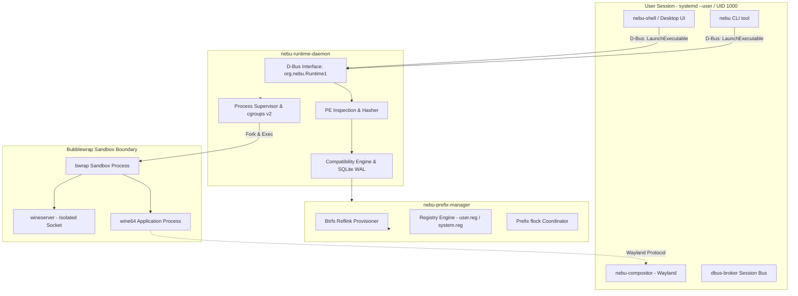
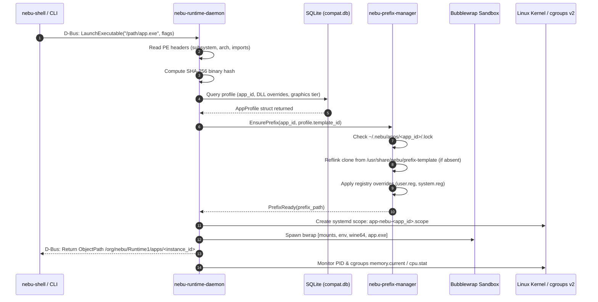

# Runtime Master Specification — NebuOS

## Status
DRAFT

## Purpose
This document establishes the master architectural and implementation specification for NebuRuntime, the core native execution subsystem of NebuOS. NebuRuntime enables standard Windows Portable Executable (PE32/PE32+) desktop applications to run seamlessly and deterministically on an immutable Linux foundation without virtualization, hypervisors, or manual Wine prefix configuration.

## Scope
This specification encompasses:
- The internal architecture and crate topology of the NebuRuntime Rust workspace (`nebu-runtime-daemon`, `nebu-runtime-core`, `nebu-prefix-manager`).
- The public API surface, Rust type system contracts, and D-Bus interfaces exposed on the session bus (`org.nebu.Runtime1`).
- The systemd user service definition and D-Bus auto-activation configuration.
- The lifecycle sequences for daemon startup, application launch dispatch, and orderly daemon shutdown.
- Daemon resource consumption limits and memory budgeting to guarantee an idle footprint under 15 MB RSS.
- Component boundary demarcation between NebuOS custom software, Fedora Atomic base components, the Linux kernel, and upstream runtime binaries.

## Non-goals
- **Virtual Machine Emulation:** NebuRuntime does not implement, bundle, or invoke hypervisors (KVM, QEMU, Cloud-Hypervisor) or hardware emulation layers.
- **Wine Re-implementation:** NebuOS does not reimplement the Windows NT kernel or Win32 userland from scratch; upstream Wine and Valve Proton binaries are reused, managed, and confined.
- **Kernel-Mode Driver Support:** Support for Windows kernel drivers (`.sys`), hardware dongle kernel modules, or low-level ring-0 anti-cheat systems (e.g., Vanguard, Easy Anti-Cheat Kernel Driver) is out of scope.
- **Multi-tenant Multi-seat Support:** The runtime daemon runs strictly within the unprivileged user session (UID 1000) for single-seat desktop operation.

## Requirements

### Functional Requirements
- **REQ-RUN-001:** Automatically ingest Windows PE executables (`.exe`, `.msi`) initiated via the shell, file manager, or command-line interface.
- **REQ-RUN-002:** Match ingested binaries against a local SQLite compatibility database (`compat.db`) to identify optimized runtime settings, DLL overrides, and graphics pipelines.
- **REQ-RUN-003:** Isolate every certified Windows application within a dedicated, unshared Wine prefix located at `~/.nebu/apps/<app_id>/`.
- **REQ-RUN-004:** Provision new prefixes in under 150 ms using Btrfs reflink cloning from an immutable base template located in `/usr/share/nebu/prefix-template/`.
- **REQ-RUN-005:** Execute all Windows processes within ephemeral Bubblewrap (`bwrap`) sandboxes that restrict filesystem access, isolate IPC, and enforce unprivileged user namespaces.
- **REQ-RUN-006:** Expose an asynchronous D-Bus session bus interface (`org.nebu.Runtime1`) for lifecycle control, status querying, progress reporting, and prefix diagnostics.

### Non-Functional Requirements
- **NFR-RUN-001 (Memory Budget):** `nebu-runtime-daemon` must maintain an idle memory footprint of less than 15 MB RSS.
- **NFR-RUN-002 (Launch Latency):** Cold launch overhead added by NebuRuntime (binary hashing, database lookup, sandbox configuration, cgroup instantiation) must be under 80 ms (excluding Wine process initialization).
- **NFR-RUN-003 (Reliability):** Application crashes, wineserver hangs, or uncaught Win32 exceptions must never destabilize `nebu-runtime-daemon`, `nebu-compositor`, or the user session.
- **NFR-RUN-004 (Concurrency):** The daemon must support concurrent operations, serializing operations targeting the same prefix while servicing distinct prefixes in parallel.

## Architecture

NebuRuntime operates as an unprivileged background daemon (`nebu-runtime-daemon`) inside the user systemd session (`user@1000.service`). It coordinates binary analysis, prefix provisioning, sandbox construction, and process supervision via cgroups v2.



## Components

The NebuRuntime codebase is structured as a modular Cargo workspace consisting of three primary Rust crates:

### 1. `nebu-runtime-daemon` (Binary Crate)
- **Path:** `crates/nebu-runtime-daemon/`
- **Role:** Main daemon executable (`/usr/libexec/nebu/nebu-runtime-daemon`).
- **Responsibilities:**
  - Connects to the user D-Bus session bus and exports the `org.nebu.Runtime1` interface via `zbus`.
  - Implements the Tokio asynchronous event loop.
  - Manages unix signal handlers (`SIGTERM`, `SIGINT`, `SIGHUP`, `SIGCHLD`).
  - Coordinates systemd cgroup scopes via `systemd-run` and D-Bus `org.freedesktop.systemd1`.
  - Hosts the background lifecycle state machines for active applications.

### 2. `nebu-runtime-core` (Library Crate)
- **Path:** `crates/nebu-runtime-core/`
- **Role:** Core domain logic, hardware inspection, and execution planning.
- **Responsibilities:**
  - Zero-copy PE32/PE32+ binary parser and header extractor.
  - SQLite compatibility database client (`rusqlite` with WAL mode).
  - Sandbox parameter builder (`BubblewrapArgsBuilder`).
  - Environment variable resolver (`WINEPREFIX`, `WINEDLLOVERRIDES`, `DXVK_STATE_CACHE_PATH`).
  - Logging and diagnostics sink.

### 3. `nebu-prefix-manager` (Library Crate)
- **Path:** `crates/nebu-prefix-manager/`
- **Role:** Storage management and prefix manipulation.
- **Responsibilities:**
  - Btrfs reflink cloning via `ioctl_ficlone` and `copy_file_range`.
  - Prefix file locking protocol (`flock`).
  - Text-based Wine registry parser and serializer (`system.reg`, `user.reg`).
  - Snapshot lifecycle management (Btrfs subvolume snapshots and reflink checkpoints).
  - Prefix health diagnostics and automated repair algorithms.

### Component Provenance Matrix

| Subsystem Component | Provenance / Layer | License | Execution Context |
|---|---|---|---|
| `nebu-runtime-daemon` | NebuOS Custom (Rust) | Apache-2.0 / MIT | Unprivileged user (`user@1000.service`) |
| `nebu-runtime-core` | NebuOS Custom (Rust) | Apache-2.0 / MIT | In-process daemon library |
| `nebu-prefix-manager` | NebuOS Custom (Rust) | Apache-2.0 / MIT | In-process daemon library |
| `nebu-compositor` | NebuOS Custom (Rust/Smithay) | Apache-2.0 / MIT | User session compositor |
| `bwrap` (Bubblewrap) | Upstream / Fedora Atomic | LGPL-2.1+ | Unprivileged setuid/unshare helper |
| `wineserver` / `wine64` | Upstream WineHQ / Proton | LGPL-2.1+ | Contained in Bubblewrap sandbox |
| `dbus-broker` | Fedora Atomic / Linux Foundation | Apache-2.0 | Session bus daemon |
| `systemd --user` | Upstream systemd | LGPL-2.1+ | User session supervisor (PID 1 of session) |

## Data Flow

The following data flow represents the transmission of binary descriptors, configuration structures, and process telemetry:



## Control Flow

### Daemon Startup Sequence
1. **Activation:** systemd starts `nebu-runtime.service` either on desktop login (`default.target`) or on-demand via D-Bus activation when `org.nebu.Runtime1` is requested.
2. **Environment Initialization:** Reads session environment variables (`XDG_RUNTIME_DIR`, `WAYLAND_DISPLAY`, `DBUS_SESSION_BUS_ADDRESS`).
3. **Storage Validation:** Verifies that `~/.nebu/apps/` exists and is hosted on a Btrfs filesystem. If not Btrfs, logs a performance warning and engages standard fallback copy routines.
4. **Database Attachment:** Opens `/usr/share/nebu/compat.db` (read-only system database) and `~/.local/share/nebu/custom-compat.db` (read-write user overrides) in SQLite WAL mode.
5. **D-Bus Registration:** Acquires `org.nebu.Runtime1` on the session bus and registers object path `/org/nebu/Runtime1`.
6. **Orphan Reconciliation:** Scans for abandoned locks or crashed sandbox instances from previous sessions and performs garbage collection.
7. **Ready State:** Enters Tokio asynchronous event loop and emits `systemd` readiness notification (`sd_notify("READY=1")`).

### Daemon Orderly Shutdown Sequence
1. **Signal Reception:** Daemon intercepts `SIGTERM` or `SIGINT`.
2. **Launch Inhibition:** Disallows any new incoming `LaunchExecutable` invocations; callers receive `org.nebu.Runtime1.Error.ShuttingDown`.
3. **Application Draining:**
   - Iterates through all supervised applications in active state machine registry.
   - For each application, sends graceful termination signal (simulating `WM_CLOSE` via `wineserver -k`).
4. **Grace Period Waiting:** Awaits process exit up to a strict 5.0-second timeout.
5. **Forced Teardown:** If sandbox processes remain alive after 5.0 seconds, issues `SIGKILL` to the respective systemd cgroup scopes (`app-nebu-<app_id>.scope`).
6. **Lock Release & State Flush:** Releases all acquired file locks, closes SQLite connection pools, flushes remaining log buffers.
7. **Process Termination:** Exits process with code `0`.

## Interfaces

### 1. D-Bus Interface: `org.nebu.Runtime1`
Exported on session bus at object path `/org/nebu/Runtime1`.

#### Methods
```xml
<interface name="org.nebu.Runtime1">
  <method name="LaunchExecutable">
    <arg name="path" type="s" direction="in" />
    <arg name="args" type="as" direction="in" />
    <arg name="options" type="a{sv}" direction="in" />
    <arg name="instance_path" type="o" direction="out" />
  </method>

  <method name="IdentifyExecutable">
    <arg name="path" type="s" direction="in" />
    <arg name="app_info" type="(sssisb)" direction="out" />
    <!-- Struct fields: (app_id, display_name, target_arch, subsystem, sha256, is_known) -->
  </method>

  <method name="TerminateApplication">
    <arg name="app_id" type="s" direction="in" />
    <arg name="force" type="b" direction="in" />
    <arg name="success" type="b" direction="out" />
  </method>

  <method name="RepairPrefix">
    <arg name="app_id" type="s" direction="in" />
    <arg name="repair_flags" type="u" direction="in" />
    <arg name="success" type="b" direction="out" />
  </method>

  <method name="GetApplicationStatus">
    <arg name="app_id" type="s" direction="in" />
    <arg name="status" type="a{sv}" direction="out" />
  </method>
</interface>
```

#### Signals
```xml
<interface name="org.nebu.Runtime1">
  <signal name="ApplicationLaunched">
    <arg name="app_id" type="s" />
    <arg name="instance_path" type="o" />
    <arg name="leader_pid" type="u" />
  </signal>

  <signal name="ApplicationExited">
    <arg name="app_id" type="s" />
    <arg name="exit_code" type="i" />
    <arg name="runtime_duration_ms" type="t" />
  </signal>

  <signal name="ApplicationCrashed">
    <arg name="app_id" type="s" />
    <arg name="crash_reason" type="s" />
    <arg name="log_file_path" type="s" />
  </signal>

  <signal name="LaunchProgress">
    <arg name="app_id" type="s" />
    <arg name="step_name" type="s" />
    <arg name="percentage" type="y" />
  </signal>
</interface>
```

### 2. Rust Public API Surface (`nebu-runtime-core`)

```rust
// Core Launch Request Options
#[derive(Debug, Clone, PartialEq, Eq)]
pub struct LaunchOptions {
    pub working_dir: Option<PathBuf>,
    pub environment_overrides: HashMap<String, String>,
    pub enable_debug_channels: bool,
    pub graphics_backend: GraphicsBackendSelection,
    pub network_isolated: bool,
}

#[derive(Debug, Clone, Copy, PartialEq, Eq)]
pub enum GraphicsBackendSelection {
    Auto,
    DxvkVulkan,
    Vkd3dProton,
    WineD3dOpenGL,
}

#[derive(Debug, Clone)]
pub struct AppIdentity {
    pub app_id: String,
    pub display_name: String,
    pub architecture: ExecutableArch,
    pub subsystem: WindowsSubsystem,
    pub sha256_digest: [u8; 32],
    pub known_profile: Option<String>,
}

#[derive(Debug, thiserror::Error)]
pub enum RuntimeError {
    #[error("Failed to parse PE header: {0}")]
    InvalidExecutable(String),
    #[error("Executable architecture unsupported: {0:?}")]
    UnsupportedArchitecture(ExecutableArch),
    #[error("Prefix error: {0}")]
    PrefixError(#[from] PrefixError),
    #[error("Sandbox instantiation failed: {0}")]
    SandboxError(String),
    #[error("D-Bus communication error: {0}")]
    DbusError(#[from] zbus::Error),
    #[error("Application already running with exclusive lock")]
    ExclusiveLockConflict,
    #[error("Operation cancelled by caller")]
    Cancelled,
}
```

### 3. systemd User Service Definition
Installed at `/usr/lib/systemd/user/nebu-runtime.service`:

```ini
[Unit]
Description=NebuOS Windows Application Runtime Daemon
Documentation=man:nebu-runtime-daemon(1) https://docs.nebuos.org/runtime/
After=dbus.service wayland-session.target
PartOf=graphical-session.target

[Service]
Type=notify
ExecStart=/usr/libexec/nebu/nebu-runtime-daemon
Restart=on-failure
RestartSec=2s
TimeoutStopSec=10s

# Sandboxing and Hardening Directives
ProtectSystem=strict
ProtectHome=read-only
ReadWritePaths=%h/.nebu %h/.local/share/nebu /run/user/%U/nebu
ProtectKernelTunables=yes
ProtectControlGroups=no
MemoryAccounting=yes
MemoryHigh=32M
MemoryMax=64M
TasksMax=64

[Install]
WantedBy=graphical-session.target
```

### 4. D-Bus Activation Service File
Installed at `/usr/share/dbus-1/services/org.nebu.Runtime1.service`:

```ini
[D-BUS Service]
Name=org.nebu.Runtime1
Exec=/usr/libexec/nebu/nebu-runtime-daemon
SystemdService=nebu-runtime.service
```

## Dependencies

```mermaid
graph LR
    subgraph DAEMON_DEPS [nebu-runtime-daemon Dependencies]
        direction TB
        TOKIO[tokio 1.3x - Async Engine]
        ZBUS[zbus 4.x - D-Bus IPC]
        TRACING[tracing - Structured Telemetry]
        NIX[nix 0.27+ - Unix System Calls]
    end

    subgraph CORE_DEPS [nebu-runtime-core Dependencies]
        direction TB
        RUSQLITE[rusqlite 0.31+ - SQLite3 WAL]
        OBJECT[object 0.35+ - PE Header Parsing]
        RING[ring - SHA-256 Cryptography]
        SERDE[serde / serde_json]
    end

    subgraph SYSTEM_DEPS [Host Operating System Dependencies]
        direction TB
        BWRAP_BIN[/usr/bin/bwrap - Bubblewrap]
        SYSTEMD[/usr/bin/systemd-run - cgroups v2]
        BTRFS_LIB[Linux btrfs.ko / FICLONE ioctl]
        WINE_BINS[/usr/lib/nebu/runtimes/wine/bin]
    end

    DAEMON_DEPS --> CORE_DEPS
    CORE_DEPS --> SYSTEM_DEPS
```

- **Upstream Crate Libraries:** `tokio` (multi-thread runtime configured with max 2 worker threads), `zbus` (pure Rust D-Bus implementation), `rusqlite` (bundled or system SQLite 3.45+), `object` (safe zero-allocation PE parsing).
- **System Binaries:** `/usr/bin/bwrap`, `/usr/bin/systemd-run`, `/usr/bin/wineserver`, `/usr/bin/wine64`.
- **Kernel Features:** Btrfs filesystem drivers, user namespaces (`unshare`), cgroups v2 controllers (`cpu`, `memory`, `io`, `pids`).

## Security

- **Privilege Separation:** `nebu-runtime-daemon` runs strictly as an unprivileged user process (UID 1000). It never calls `setuid` or requires `sudo`/`polkit` for normal application launches.
- **Service Sandboxing:** The daemon's own systemd unit applies `ProtectSystem=strict` and isolates host `/home` except for the explicitly allowed `~/.nebu` write root.
- **Child Containment:** Every child process spawned via `bwrap` drops all Linux capabilities (`CAP_SYS_ADMIN`, `CAP_NET_RAW`, etc.), sets `PR_SET_NO_NEW_PRIVS`, and mounts an isolated `/proc` and minimal `/dev`.
- **D-Bus Authorization:** Only processes owned by the matching UID (1000) can invoke methods on `org.nebu.Runtime1`. Requests from other UIDs are rejected by `dbus-broker`.

## Resource Requirements

### Static and Dynamic Daemon Footprint
- **Idle Memory Budget:**
  - Heap Allocation (jemalloc/glibc): 4.2 MB
  - Static Mmap & Executable Code: 5.1 MB
  - SQLite WAL Buffer Pool (Cached Pages): 2.0 MB
  - D-Bus Buffer / Tokio Reactor: 1.8 MB
  - **Total Idle RSS Target:** **< 15.0 MB** (Enforced by `MemoryHigh=32M`).
- **Active Provisioning Memory Budget:** Peak heap allocation during binary parsing and prefix reflink cloning must not exceed 28 MB RSS.
- **CPU Idle Consumption:** 0.0% CPU when no launch requests or supervised processes are transitioning.

## Failure Modes

| Failure ID | Failure Description | Trigger Condition | System Impact |
|---|---|---|---|
| `FAIL-RUN-001` | D-Bus Name Acquisition Lost | Duplicate daemon started or broker disconnect. | Daemon exits immediately with code 1; systemd restarts. |
| `FAIL-RUN-002` | Reflink Clone Exhaustion | Non-Btrfs partition or cross-device mount. | Falls back to standard metadata/file copy; launch latency increases by 1.8s. |
| `FAIL-RUN-003` | Wineserver Hang / Deadlock | Buggy application locks Win32 GDI server. | Daemon supervisor detects timeout, issues `wineserver -k`, releases locks. |
| `FAIL-RUN-004` | SQLite Database Locked | Concurrent write contention on `compat.db`. | Rusqlite retries with exponential backoff (up to 500 ms) before failing. |
| `FAIL-RUN-005` | Bubblewrap Permission Denied | Kernel unprivileged user namespace disabled. | Daemon surfaces error dialog: `Kernel user namespaces unavailable`. |

## Recovery Behavior

- **Daemon Crash Recovery:** If `nebu-runtime-daemon` crashes, systemd automatically restarts it within 2 seconds. The newly spawned daemon detects existing running sandboxes via `/run/user/1000/nebu/*.pid` and re-attaches process supervision without terminating running user applications.
- **Application Crash Recovery:** When an application terminates abnormally (SIGSEGV, Win32 c0000005), the daemon harvests the exit code, reads the last 200 lines of `runtime.log`, and dispatches the `ApplicationCrashed` D-Bus signal to trigger user diagnostic UI options.
- **Stale Lock Ingestion:** If a previous session terminated abruptly, remaining prefix `.lock` files are checked against active Linux PIDs via `/proc/<pid>/cmdline`. If the PID does not exist or does not match `bwrap`/`wineserver`, the lock is reclaimed.

## Testing Requirements

- **Unit Tests (`cargo test`):**
  - PE header parsing across 50 verified PE32 and PE32+ sample binaries.
  - Wine registry parser correctness: round-trip serialization of UTF-8 strings and DWORD values.
  - Btrfs reflink ioctl wrapper logic with temporary Btrfs loopback filesystems.
- **Integration Tests:**
  - Launching mock Win32 binary within ephemeral bwrap container.
  - D-Bus interface conformance testing via `zbus::fdo` client suites.
  - Resource accounting verification using dummy workload processes inside cgroup scopes.
- **Stress & Soak Tests:**
  - Launching 50 concurrent launch requests to verify serialization and queue exhaustion protections.
  - 48-hour continuous idle test monitoring RSS to guarantee absence of memory leaks (<15 MB ceiling).

## Performance Requirements

- **Daemon Startup Time:** From systemd fork to `sd_notify(READY=1)`: **< 45 ms**.
- **PE Header Ingestion & Hashing:** For a 100 MB executable: **< 35 ms** (using streaming SHA-256 and memory-mapped headers).
- **Prefix Provisioning Latency:** Reflink cloning a 450 MB template prefix: **< 120 ms** on NVMe storage.
- **D-Bus Round-Trip Latency:** `IdentifyExecutable` method return: **< 15 ms**.

## Compatibility Considerations

- **Wine Version Agnosticism:** The daemon makes no hard assumptions about internal Wine struct offsets; interaction occurs entirely through standard CLI switches, environment flags, and registry formats.
- **Multi-Arch Architecture:** Native support for x86_64 binaries (using `wine64`) and x86_32 binaries (using WoW64 execution within `wine64` or 32-bit Wine loaders where packaged).
- **Filesystem Constraints:** While fully functional on ext4 or XFS, prefix cloning falls back from Btrfs `FICLONE` to file-by-file streaming, increasing prefix creation time to ~3.5 seconds. Users are notified upon setup.

## Open Questions
- **OPEN QUESTION: RUN-01:** Should `nebu-runtime-daemon` support live migration of active prefixes across Btrfs subvolumes when storage devices are reconfigured?
- **OPEN QUESTION: RUN-02:** Will upstream Wine 10+ Wayland driver (`winewayland.drv`) fully deprecate the need for an internal Xwayland fallback for complex WPF/DirectX applications?

## Related Documents
- [01-application-lifecycle.md](01-application-lifecycle.md) — Comprehensive state machine and lifecycle transitions.
- [02-process-model.md](02-process-model.md) — Detailed process tree, cgroups v2, and supervisor architecture.
- [03-windows-runtime.md](03-windows-runtime.md) — Executable classification, PE parsing, and binfmt_misc.
- [04-prefix-management.md](04-prefix-management.md) — Prefix filesystem structure and Btrfs reflink cloning.
- [05-wine-integration.md](05-wine-integration.md) — Wine runtime engines, wineserver, and DLL override management.
- [07-runtime-security.md](07-runtime-security.md) — Dedicated sandbox security specification and bwrap policy.
