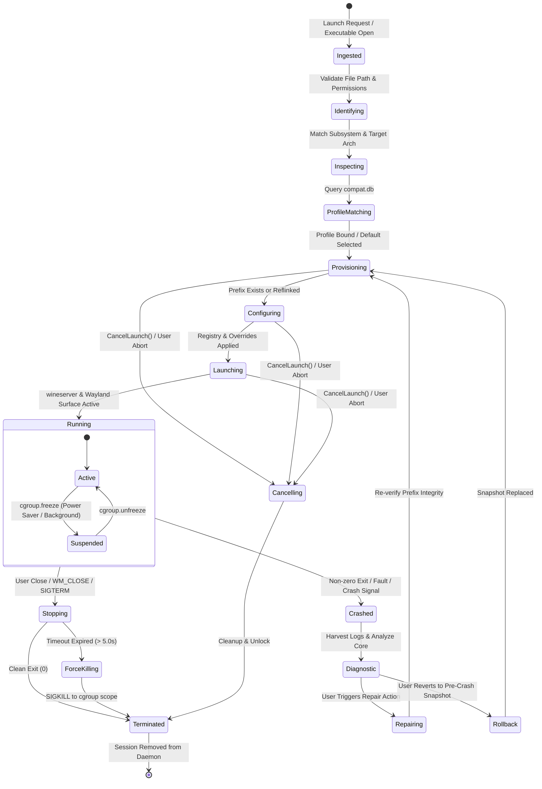
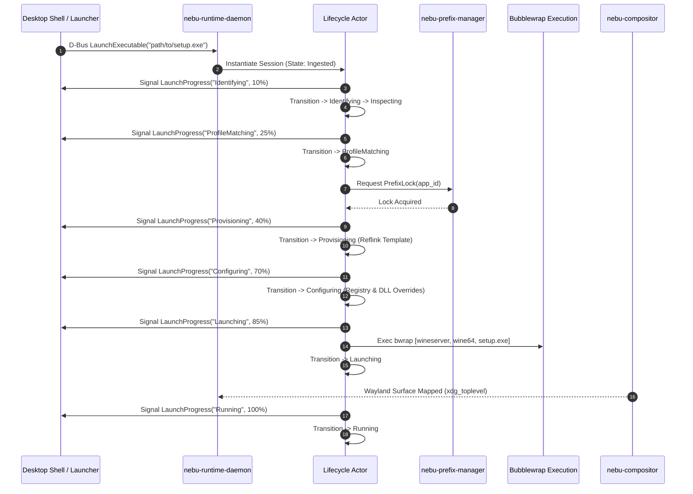
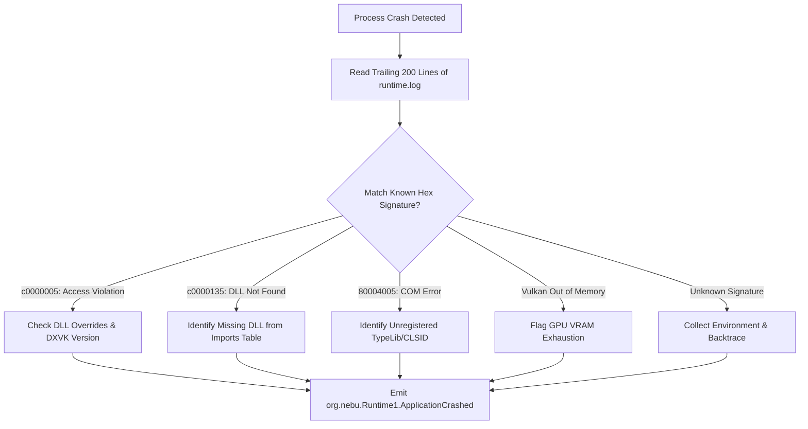

# Application Lifecycle Specification — NebuOS

## Status
DRAFT

## Purpose
This specification formalizes the end-to-end lifecycle state machine of Windows applications within NebuOS. It details all lifecycle phases—from binary ingestion, identification, and prefix provisioning through active execution, suspension, crash isolation, diagnostics, and graceful termination. It defines exact timing budgets, error transition paths, cancellation semantics, and progress telemetry.

## Scope
This document covers:
- The finite state machine (FSM) governing Windows application instances managed by `nebu-runtime-daemon`.
- Exhaustive state transition rules, event triggers, and boolean guard conditions across 16 distinct operational states.
- Strict timeout ceilings for all transition and waiting phases.
- Error handling paths, crash diagnostics, automated rollback, and repair workflows.
- User cancellation and interrupt handling protocol during asynchronous provisioning.
- Real-time progress reporting protocol over the session D-Bus.
- Concurrency policies, prefix serialization locks, queue management, and memory-aware throttling.

## Non-goals
- **Linux Native Lifecycle:** Lifecycle management for native Flatpak or RPM-OSTree system binaries (handled directly by systemd and Bubblewrap via standard desktop portals).
- **In-App Win32 State Serialization:** Hibernating internal Win32 process memory state across reboots is not implemented; lifecycle suspension uses standard Linux cgroup freezer primitives.
- **Remote Application Streaming:** Orchestration of remote network displays or VNC-style frame streaming.

## Requirements

### Functional Requirements
- **REQ-LC-001:** Enforce a deterministic finite state machine with 16 distinct states covering initial ingestion to final cleanup.
- **REQ-LC-002:** Emit real-time progress updates via D-Bus signal `org.nebu.Runtime1.LaunchProgress` during all states requiring more than 200 ms.
- **REQ-LC-003:** Support cancellation of in-flight launches via D-Bus method `CancelLaunch(String transaction_id)`, immediately rolling back partial filesystem changes and releasing resources.
- **REQ-LC-004:** Prevent concurrent execution of multiple application instances against the same Wine prefix unless explicitly flagged as multi-instance capable in the compatibility profile.
- **REQ-LC-005:** Detect abnormal termination (SIGSEGV, Win32 `0xC0000005`, internal wineserver crash) and transition the instance to an actionable diagnostic state rather than silently closing.
- **REQ-LC-006:** Implement memory pressure throttling: queue or reject new launches when host available memory drops below 15% (or PSI memory pressure exceeds 60% saturation over a 10-second window).

### Non-Functional Requirements
- **NFR-LC-001 (State Transition Overhead):** Pure daemon-internal state machine evaluation must consume less than 1.5 ms per state transition.
- **NFR-LC-002 (Cancellation Responsiveness):** Cancellation requests must complete all file handle releases and lock removals within 250 ms.
- **NFR-LC-003 (Deterministic Timeouts):** Every asynchronous stage must enforce a non-negotiable timeout to prevent zombie processes or hung desktop sessions.
- **NFR-LC-004 (Diagnostic Latency):** Post-crash log harvesting and D-Bus diagnostic notification dispatch must complete within 40 ms of process termination.

## Architecture

The lifecycle engine lives inside `nebu-runtime-daemon` as an asynchronous actor model implemented in Tokio. Each launching or running application is tracked via a dedicated `ApplicationSession` actor holding an atomic state register, a transactional lock guard, a cgroup scope handle, and a D-Bus telemetry channel.



## Components

The lifecycle management subsystem consists of four synchronized layers:

1. **`LifecycleSupervisor` (`nebu-runtime-daemon`):**
   - Registry maintaining all active `ApplicationSession` handles keyed by `app_id` and unique `instance_uuid`.
   - Dispatches incoming D-Bus commands to specific instance state actors.
   - Monitors system memory pressure via Linux PSI (`/proc/pressure/memory`) to throttle new launches if memory exceeds 85% utilization.
   - Manages the FIFO launch queue for throttled or serialized application requests.

2. **`StateMachineInstance` (`nebu-runtime-core`):**
   - Pure state transition struct implementing strict Rust `enum` transitions.
   - Rejects illegal transitions at compile-time and runtime.
   - Manages state entry timestamps to enforce timeout policies.
   - Tracks transient state metadata including active transaction IDs and temporary mount paths.

3. **`PrefixGuard` (`nebu-prefix-manager`):**
   - Holds the kernel `flock` descriptor for the target prefix directory (`~/.nebu/apps/<app_id>/.lock`).
   - Manages transactional filesystem rollback if cancellation or provisioning failure occurs.
   - Enforces exclusive lock semantics across multi-process callers.

4. **`ProcessMonitor` (`nebu-runtime-daemon`):**
   - Integrates with Tokio's `process::Child` and systemd's D-Bus signal `JobRemoved` / `UnitNew`.
   - Listens on the process PID file and Wayland compositor window creation events to detect true application window emergence.
   - Intercepts POSIX process death signals via `pidfd_open` and `waitid`.

## Data Flow



## Control Flow

### Exhaustive State Transition Matrix

| Source State | Trigger / Event | Guard Condition | Target State | Action / Output |
|---|---|---|---|---|
| `Ingested` | Executable path received | File exists, is readable | `Identifying` | Open file, read first 4096 bytes |
| `Ingested` | Executable path received | File missing or EACCES | `Terminated` | Emit error: `InvalidExecutablePath` |
| `Identifying` | Header magic validated | PE `MZ` and `PE\0\0` match | `Inspecting` | Extract Machine, Subsystem, EntryPoint |
| `Identifying` | Header invalid | Not PE / Corrupted | `Terminated` | Emit error: `NotPortableExecutable` |
| `Identifying` | Timeout exceeded | Elapsed > 3.0s | `Terminated` | Abort I/O, emit error: `IdentifyTimeout` |
| `Inspecting` | Arch supported (x86/x64) | Subsystem GUI (2) or CUI (3) | `ProfileMatching` | Generate binary hash (SHA-256) |
| `Inspecting` | Subsystem unsupported | Subsystem Driver/Native/ARM | `Terminated` | Emit error: `UnsupportedSubsystem` |
| `ProfileMatching` | Lookup completes | Profile found in DB | `Provisioning` | Load overrides & redist dependencies |
| `ProfileMatching` | Lookup completes | Unknown binary | `Provisioning` | Load default generic desktop profile |
| `Provisioning` | Acquire prefix lock | `flock` succeeds | `Configuring` | Verify prefix health / Reflink template |
| `Provisioning` | Acquire prefix lock | Prefix locked by running app | `Terminated` | Emit error: `PrefixAlreadyActive` |
| `Provisioning` | Disk full / EIO | Reflink fails | `Diagnostic` | Emit error: `PrefixProvisionFailed` |
| `Provisioning` | `CancelLaunch` received | User cancelled | `Cancelling` | Release lock, remove partial files |
| `Configuring` | Apply registry / DLLs | All edits succeed | `Launching` | Build bwrap args, configure cgroup |
| `Configuring` | Registry corrupt | Parser error | `Repairing` | Trigger automated registry restore |
| `Configuring` | `CancelLaunch` received | User cancelled | `Cancelling` | Revert configuration changes |
| `Launching` | Child process forked | `bwrap` PID returned | `Running` | Attach systemd scope, start watchdog |
| `Launching` | Sandbox fork fails | Kernel namespace error | `Terminated` | Emit error: `SandboxSpawnFailed` |
| `Launching` | Surface unmapped timeout | Elapsed > 15.0s | `Diagnostic` | Check for invisible/crashed wineserver |
| `Running` | Clean exit | Wine exit code == 0 | `Stopping` | Initiate prefix flush |
| `Running` | Fault exit | Wine exit code != 0 or SEGV | `Crashed` | Preserve last logs, dump backtrace |
| `Running` | User close requested | Shell issues `Terminate` | `Stopping` | Send `WM_CLOSE` to Windows window |
| `Running` | Freeze signal received | System entering idle sleep | `Suspended` | Freeze cgroup v2 controller |
| `Suspended` | Thaw signal received | System awake / window active | `Running` | Unfreeze cgroup v2 controller |
| `Stopping` | Wine process terminates | Elapsed <= 5.0s | `Terminated` | Release prefix locks, flush caches |
| `Stopping` | Process hung | Elapsed > 5.0s | `ForceKilling` | Send `SIGKILL` to cgroup tasks |
| `ForceKilling` | All PIDs reaped | Immediate | `Terminated` | Log ungraceful termination warning |
| `Crashed` | Diagnostic requested | User selects "Repair" | `Repairing` | Run prefix integrity rebuild |
| `Crashed` | Rollback requested | User selects "Restore Snap" | `Rollback` | Restore Btrfs snapshot |
| `Repairing` | Repair completes | Return code 0 | `Provisioning` | Re-enter pipeline at Provisioning |
| `Rollback` | Restore completes | Snapshot swapped | `Provisioning` | Re-enter pipeline at Provisioning |
| `Cancelling` | Cleanup completed | Locks freed, fs clean | `Terminated` | Finalize cancellation response |
| `Terminated` | Final disposal | Session reference == 0 | `[*]` | Remove from daemon session table |

### Precise State Timeouts

| Lifecycle Phase | State Name | Strict Timeout Limit | Expiry Action |
|---|---|---|---|
| Binary Ingestion | `Identifying` | 3.0 seconds | Abort parsing, emit `IdentifyTimeout` |
| Deep Inspection | `Inspecting` | 3.0 seconds | Cancel stream, emit `InspectTimeout` |
| Database Lookup | `ProfileMatching` | 2.0 seconds | Fall back immediately to generic profile |
| Prefix Reflink | `Provisioning` | 5.0 seconds | Abort reflink, clean directory, error |
| Registry Injection | `Configuring` | 5.0 seconds | Mark registry corrupt, offer repair |
| Process Bootstrap | `Launching` | 10.0 seconds | Verify wineserver socket existence |
| Window Emergence | `Launching` -> `Running` | 15.0 seconds | Notify user of slow launch / prompt wait |
| Graceful Teardown | `Stopping` | 5.0 seconds | Escalate to `SIGKILL` via `ForceKilling` |
| Forced Termination | `ForceKilling` | 2.0 seconds | Kernel cgroup kill; panic daemon actor |
| Snapshot Revert | `Rollback` | 3.0 seconds | Abort snapshot swap if storage hung |

### Detailed Cancellation Handling
When a cancellation request is received (via D-Bus `CancelLaunch(tx_id)` or CLI `SIGINT`), the daemon executes an atomic unwind sequence:
1. **Interrupt Active Async Task:** The Tokio cancellation token associated with `tx_id` is triggered, aborting in-flight I/O or child subprocess spawning.
2. **Subprocess Termination:** If `bwrap` or `wineserver` has already forked, the supervisor immediately issues `SIGKILL` to the process group.
3. **Reflink Cleanup:** If cancellation occurred during `Provisioning`, any partially copied directory tree at `~/.nebu/apps/<app_id>.tmp.<tx_id>` is synchronously deleted via `std::fs::remove_dir_all`.
4. **Lock Release:** The exclusive `flock` descriptor is closed, allowing subsequent launch attempts to proceed immediately.
5. **State Finalization:** The session actor transitions directly to `Cancelling` -> `Terminated`, emitting `LaunchCancelled(tx_id)` over D-Bus.

### Detailed Concurrent Launch Handling
The `LifecycleSupervisor` enforces strict concurrency rules to prevent data corruption and resource starvation:

```text
Concurrent Launch Logic:
1. Incoming LaunchRequest(app_id)
2. Check ActiveSessionTable:
   a. If app_id active AND profile.allow_multiple_instances == false:
      - Reject with error: org.nebu.Runtime1.Error.PrefixAlreadyActive
      - Raise active window to focus via org.nebu.Compositor1.ActivateWindow
   b. If app_id active AND profile.allow_multiple_instances == true:
      - Fork secondary wine process within EXISTING Bubblewrap sandbox
      - Connect to existing wineserver socket
   c. If app_id NOT active:
      - Check System Memory Pressure (PSI /proc/pressure/memory):
        * If some avg10 > 60.0 OR Available RAM < 512 MB:
          Enqueue request in pending FIFO launch queue (max depth: 10)
          Emit LaunchProgress("Queued - System Memory Constrained", 0%)
        * Else:
          Instantiate ApplicationSession actor and execute FSM
```

### Diagnostic State Sub-Flow and Crash Signature Classification
When an application transitions to `Crashed` or `Diagnostic`, the lifecycle supervisor performs automated triage on `~/.nebu/apps/<app_id>/logs/runtime.log` before alerting the user:



1. **Access Violation (`0xC0000005`):** If occurring in `d3d11.dll` or `dxgi.dll`, indicates DXVK incompatibility. Suggests switching graphics backend to builtin `wined3d`.
2. **Missing Dependency (`0xC0000135`):** Extracts missing DLL name from log line `err:module:import_dll Library FOO.dll not found`. Cross-references against `compat.db` redistributable table and offers one-click installation.
3. **Wineserver Assertion / Hang:** If wineserver dies with `SIGABRT`, detects assertion line, invalidates corrupted shared memory segment, and forces clean prefix remount.

## Interfaces

### 1. D-Bus Lifecycle Methods (`org.nebu.Runtime1`)

```rust
// D-Bus method signatures handled by the Lifecycle Supervisor
pub trait RuntimeLifecycleDbus {
    // Launch an application with tracking
    async fn launch_executable(
        &self,
        path: String,
        args: Vec<String>,
        options: HashMap<String, zvariant::Value<'_>>,
    ) -> zbus::Result<zvariant::OwnedObjectPath>;

    // Cancel an in-flight launch operation
    async fn cancel_launch(&self, transaction_id: String) -> zbus::Result<bool>;

    // Request graceful or forced shutdown
    async fn terminate_application(&self, app_id: String, force: bool) -> zbus::Result<bool>;

    // Suspend (freeze) application cgroup
    async fn suspend_application(&self, app_id: String) -> zbus::Result<bool>;

    // Resume (thaw) application cgroup
    async fn resume_application(&self, app_id: String) -> zbus::Result<bool>;
}
```

### 2. Progress Reporting Protocol: Wire Format
The `LaunchProgress` signal transmits real-time telemetry from the daemon to UI shells (`nebu-shell`, task manager, notification daemon):

```xml
<signal name="LaunchProgress">
  <arg name="transaction_id" type="s" />
  <arg name="app_id" type="s" />
  <arg name="step_name" type="s" />
  <arg name="progress_percent" type="y" />
  <arg name="eta_ms" type="t" />
  <arg name="error_details" type="as" />
</signal>
```

#### Progress Step Mapping
| State | `step_name` | `progress_percent` | Expected Duration |
|---|---|---|---|
| `Identifying` | `"Analyzing Executable Header"` | 10% | < 30 ms |
| `Inspecting` | `"Parsing Dependencies & Imports"` | 20% | < 50 ms |
| `ProfileMatching` | `"Loading Compatibility Profile"` | 30% | < 15 ms |
| `Provisioning` | `"Reflink Cloning Application Prefix"` | 50% | < 120 ms |
| `Configuring` | `"Applying Registry Settings & Overrides"` | 70% | < 60 ms |
| `Launching` | `"Starting Isolated Sandbox & Wine Engine"` | 85% | < 800 ms |
| `Running` | `"Window Emerged - Application Active"` | 100% | Steady State |

### 3. Rust State Representation & Actor Event Loop (`nebu-runtime-core`)

```rust
#[derive(Debug, Clone, PartialEq, Eq)]
pub enum ApplicationState {
    Ingested { received_at: Instant },
    Identifying { path: PathBuf, deadline: Instant },
    Inspecting { path: PathBuf, deadline: Instant },
    ProfileMatching { hash: [u8; 32], deadline: Instant },
    Provisioning { app_id: String, deadline: Instant },
    Configuring { prefix_path: PathBuf, deadline: Instant },
    Launching { pid: Option<u32>, deadline: Instant },
    Running { pid: u32, started_at: Instant },
    Suspended { pid: u32, frozen_at: Instant },
    Stopping { pid: u32, kill_deadline: Instant },
    ForceKilling { pid: u32 },
    Crashed { exit_code: i32, crash_report: PathBuf },
    Diagnostic { app_id: String, fault_code: u32 },
    Repairing { app_id: String, mode: u32 },
    Rollback { app_id: String, target_snap: String },
    Cancelling { rollback_fs: bool },
    Terminated { exit_code: i32, duration: Duration },
}

pub struct ApplicationActor {
    pub session_id: Uuid,
    pub app_id: String,
    pub state: ApplicationState,
    pub cancellation_token: CancellationToken,
    pub command_rx: mpsc::Receiver<SessionCommand>,
}

impl ApplicationActor {
    pub async fn run_event_loop(&mut self) {
        loop {
            tokio::select! {
                _ = self.cancellation_token.cancelled() => {
                    self.transition_to(ApplicationState::Cancelling { rollback_fs: true }).await;
                    break;
                }
                cmd = self.command_rx.recv() => {
                    match cmd {
                        Some(SessionCommand::Terminate { force }) => {
                            self.handle_termination(force).await;
                        }
                        Some(SessionCommand::Suspend) => {
                            self.freeze_cgroup().await;
                        }
                        Some(SessionCommand::Resume) => {
                            self.thaw_cgroup().await;
                        }
                        None => break,
                    }
                }
            }
        }
    }
}
```

## Dependencies

- **Tokio (`tokio`):** Asynchronous timer primitives (`tokio::time::timeout`), process supervision (`tokio::process::Command`), and actor message channels (`mpsc`).
- **systemd D-Bus API (`org.freedesktop.systemd1`):** Dynamic creation and control of transient cgroup scopes (`StartTransientUnit`, `StopUnit`, `FreezeUnit`).
- **Wayland Compositor (`nebu-compositor`):** Notifies daemon when an `xdg_toplevel` surface with matching PID/app_id is presented, triggering the `Launching` -> `Running` transition.
- **Prefix File Lock (`flock`):** Kernel file locking on prefix root directory preventing dual instance execution.

## Security

- **Atomic Lock Encasement:** All state transitions requiring filesystem manipulation run under an exclusive Linux `flock` on `~/.nebu/apps/<app_id>/.lock`. Stale locks from crashed processes are sanitized only after verifying the owning PID has ceased to exist in `/proc`.
- **Cancellation Safety:** If a user cancels during `Provisioning` or `Configuring`, temporary directories are atomically discarded before releasing locks, preventing corrupted partial prefixes from being executed on subsequent attempts.
- **Sanitized Diagnostics:** The `Crashed` state isolates memory dumps and stderr logs within the user's private `~/.nebu/apps/<app_id>/logs/` tree with `0600` permissions, ensuring user documents or credential remnants are not world-readable.

## Resource Requirements

- **Actor Memory Footprint:** Each active application session in the daemon consumes **< 64 KB** of heap memory for state tracking, channel buffers, and timers.
- **CPU Overhead:** During the steady `Running` state, the lifecycle actor consumes **0.0% CPU**, remaining parked on an asynchronous Unix signal / waitpid channel.
- **Disk I/O During Transitions:**
  - `Provisioning` (Btrfs reflink): Zero new data blocks written initially; metadata allocation **< 256 KB**.
  - `Configuring` (Registry sync): **< 2.0 MB** disk write.

## Failure Modes

| Failure ID | Triggering State | Condition | Consequence |
|---|---|---|---|
| `FAIL-LC-001` | `Provisioning` | `flock` acquisition times out (> 5.0s) | Prefix locked by zombie process; launch rejected. |
| `FAIL-LC-002` | `Provisioning` | Host filesystem is read-only or full | Btrfs reflink fails with `ENOSPC` or `EROFS`. |
| `FAIL-LC-003` | `Launching` | Executable missing inside prefix `drive_c` | Wine exits immediately with error `0xC0000135`. |
| `FAIL-LC-004` | `Launching` | Compositor never receives surface (headless crash) | Launching times out after 15.0s; transitions to `Diagnostic`. |
| `FAIL-LC-005` | `Stopping` | Wine ignores `WM_CLOSE` and blocks SIGTERM | Daemon escalates to `ForceKilling` after 5.0s. |
| `FAIL-LC-006` | `Configuring` | Registry hive header invalid (`regf` missing) | Registry parsing fails; transitions to `Repairing`. |

## Recovery Behavior

- **Specific Error Recovery Transitions:**
  - **`PrefixLockFailed`:** Check `/proc/<pid>/cmdline` for stale PID recorded in `.lock`. If dead, unlink lock and re-attempt transition; if alive, notify user that application is already running.
  - **`ReflinkFailed`:** If Btrfs cloning fails due to filesystem boundaries, fall back to sequential userland copy into temporary folder, then atomically rename into target location.
  - **`RegistryCorrupt`:** Discard modified `user.reg` / `system.reg` and restore from pre-launch snapshot (`snapshots/last-known-good.reg`).
  - **`WineServerCrash`:** If `wineserver` dies unexpectedly with SIGABRT/SIGSEGV, harvest socket core dump, terminate all orphaned Wine child processes via cgroup freeze & kill, and surface crash dialog.
  - **`DXVKInitFailed`:** If Vulkan device creation fails, rewrite `WINEDLLOVERRIDES` to replace DXVK with Wine's builtin OpenGL-based `wined3d` and prompt for relaunch.
  - **`WaylandSocketUnreachable`:** If `$XDG_RUNTIME_DIR/wayland-0` is closed or missing, abort launch immediately with explicit error before spawning Wine.

## Testing Requirements

- **State Machine Exhaustion Test:** Automated test verifying that all 32 combinations of state transitions either succeed cleanly or fail with the specified error code without panicking.
- **Timeout Validation Test:** Mock tests simulating delayed I/O to ensure each state timeout triggers within ±10 ms of its specified deadline.
- **Cancellation Concurrency Test:** Rapidly sending `CancelLaunch` during random intervals of the `Provisioning` stage across 100 iterations; verifying zero orphaned files, zero leaked locks, and zero dangling child processes.
- **Crash Harvesting Test:** Injecting synthetic `SIGSEGV` and `SIGABRT` into running Wine test harnesses to verify correct signal trapping and D-Bus crash signal emission.
- **Queue Saturation Test:** Submitting 20 rapid launch requests under simulated memory pressure to verify FIFO queue order, proper throttling, and lack of daemon thread exhaustion.

## Performance Requirements

- **Cold Launch Pipeline Duration:** Total time through `Ingested` -> `Identifying` -> `Inspecting` -> `ProfileMatching` -> `Provisioning` -> `Configuring` -> `Launching` (excluding Wine executable start): **< 160 ms**.
- **Warm Launch Pipeline Duration:** For existing, healthy prefix: **< 35 ms** to `Launching`.
- **Cancellation Teardown:** From `CancelLaunch` call to complete resource release: **< 150 ms**.
- **Diagnostic Log Harvest Latency:** From process crash to D-Bus `ApplicationCrashed` emission: **< 40 ms**.

## Compatibility Considerations

- **Single-Instance Win32 Apps:** Many legacy Windows applications (e.g., Winamp, specific accounting tools) use named Win32 mutexes (`CreateMutexA`) to enforce single-instance operation. NebuOS enforces single-instance at the prefix level by default via `flock`.
- **Multi-Window Applications:** Applications spawning multiple top-level windows (e.g. GIMP, AutoCAD child palettes) do not trigger new lifecycle instances; all windows map to the single active running session.
- **Long-Running Installers:** Installers that spawn child processes and immediately exit the parent process are tracked using cgroup process accounting rather than single PID polling.

## Open Questions
- **OPEN QUESTION: LC-01:** Should NebuOS support an automated "deep freeze" mode that migrates suspended applications to compressed zRAM or swap after 30 minutes of user inactivity?
- **OPEN QUESTION: LC-02:** If an installer executable spawns a secondary child installer (common in Visual C++ redistributable chaining), how should the lifecycle monitor distinguish between installer completion and child handoff?

## Related Documents
- [00-runtime-specification.md](00-runtime-specification.md) — Master runtime daemon architecture.
- [02-process-model.md](02-process-model.md) — cgroups v2 hierarchy and process supervision.
- [03-windows-runtime.md](03-windows-runtime.md) — Executable classification and PE header inspection.
- [04-prefix-management.md](04-prefix-management.md) — Btrfs reflink cloning and snapshot management.
- [05-wine-integration.md](05-wine-integration.md) — Wineserver orchestration and environment variables.
- [07-runtime-security.md](07-runtime-security.md) — Bubblewrap sandbox boundaries.

