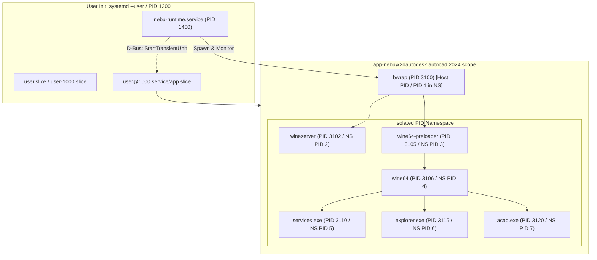
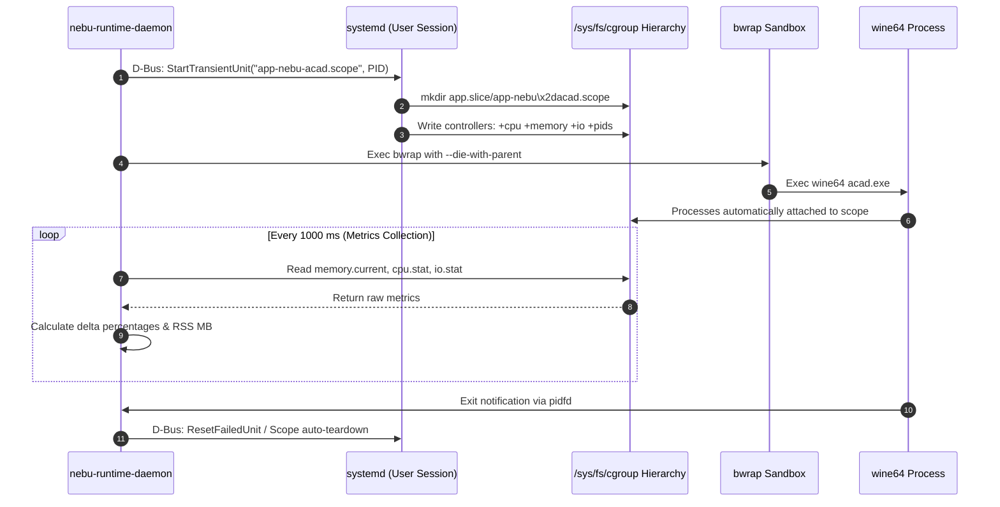
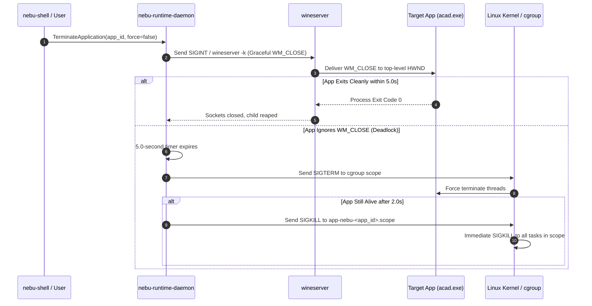

# Process Supervision and Cgroups Model — NebuOS

## Status
DRAFT

## Purpose
This document specifies the process execution, hierarchy, isolation, resource accounting, and lifecycle supervision model for Windows applications running on NebuOS. It defines how `nebu-runtime-daemon` supervises complex multi-process Windows runtimes through Linux cgroups v2, systemd transient scopes, Bubblewrap namespace boundaries, and fine-grained OOM (Out-Of-Memory) priority adjustments.

## Scope
This specification encompasses:
- The exact process tree and hierarchy for running Windows applications (from `systemd --user` down to target Windows executables).
- The Linux cgroups v2 slice and scope hierarchy under `user.slice`.
- Resource accounting mechanisms and metrics collection (`cpu.stat`, `memory.current`, `io.stat`, `pids.current`).
- Linux namespace topology (`CLONE_NEWPID`, `CLONE_NEWNS`, `CLONE_NEWUTS`, `CLONE_NEWIPC`, `CLONE_NEWNET`).
- Signal routing, POSIX process group handling, and graceful Wine shutdown (`wineserver -k`).
- Orphan process cleanup protocols and death signal bindings (`PR_SET_PDEATHSIG`, `--die-with-parent`).
- Kernel OOM score adjustment policies (`/proc/<pid>/oom_score_adj`).

## Non-goals
- **Kernel PID 1 Implementation:** `nebu-runtime-daemon` is not a replacement for systemd or an init system; it leverages systemd user session facilities.
- **Hardware Virtualization / KVM:** No virtual machine monitor or guest OS kernel processes exist in this model.
- **Multi-Seat / Multi-User Isolation:** Application process isolation is scoped within the single desktop user session (UID 1000).

## Requirements

### Functional Requirements
- **REQ-PROC-001:** Enclose every running Windows application instance in a dedicated systemd transient cgroup v2 scope named `app-nebu\x2d<app_id>.scope` under `app.slice`.
- **REQ-PROC-002:** Activate and configure the `cpu`, `memory`, `io`, and `pids` cgroup v2 controllers for each application scope.
- **REQ-PROC-003:** Guarantee complete orphan process elimination upon application termination: when the root sandbox exits, all child processes (wineserver, services.exe, explorer.exe, and child executables) must be reaped within 2.0 seconds.
- **REQ-PROC-004:** Protect `nebu-runtime-daemon` from OOM termination while ensuring background or leaking Windows applications are prioritized for kernel termination.
- **REQ-PROC-005:** Expose real-time per-application resource metrics (CPU usage, RSS memory, I/O read/write bytes, task count) over D-Bus via polling and PSI events.

### Non-Functional Requirements
- **NFR-PROC-001 (Supervisor Overhead):** The background process supervision loop must consume less than 0.05% CPU per supervised application during idle steady state.
- **NFR-PROC-002 (Scope Creation Latency):** Instantiating a transient systemd scope via D-Bus (`StartTransientUnit`) must complete within 25 ms.
- **NFR-PROC-003 (Termination Deadlines):** Force killing an unresponsive process group (`systemd-run --scope` or direct SIGKILL to cgroup) must conclude in under 500 ms.

## Architecture

In NebuOS, process supervision is split between the kernel cgroups v2 hierarchy, systemd user session manager, `nebu-runtime-daemon`, and Bubblewrap:



### Process Tree Topology

1. **Host PID View:**
   - `PID 1` -> `systemd` (Host init)
   - `PID 1200` -> `systemd --user` (Session manager)
   - `PID 1450` -> `/usr/libexec/nebu/nebu-runtime-daemon`
   - `PID 3100` -> `/usr/bin/bwrap ...`
   - `PID 3102` -> `/usr/lib/nebu/runtimes/wine/bin/wineserver`
   - `PID 3105` -> `/usr/lib/nebu/runtimes/wine/bin/wine64-preloader`
   - `PID 3110` -> `C:\windows\system32\services.exe`
   - `PID 3115` -> `C:\windows\system32\explorer.exe /desktop`
   - `PID 3120` -> `C:\Program Files\Autodesk\AutoCAD 2024\acad.exe`

2. **Sandbox PID Namespace View (`CLONE_NEWPID`):**
   - Inside the Bubblewrap container, `bwrap` acts as **PID 1**.
   - Because `bwrap` is PID 1 in the new namespace, the death of `bwrap` automatically induces the Linux kernel to send `SIGKILL` to all remaining processes inside that namespace.
   - `wineserver` runs as **PID 2**.
   - `wine64-preloader` executes as **PID 3**, initializing memory maps, GDT descriptors, and loading `wine64`.
   - The Windows core subsystem daemons (`services.exe`, `winedevice.exe`, `plugplay.exe`) run as unprivileged child tasks.
   - The user application (`acad.exe`) runs as a child of the Wine loader.

## Components

The process supervision model relies on four interacting components:

1. **`ProcessSupervisor` (`nebu-runtime-daemon`):**
   - Uses `tokio::process::Command` to invoke `bwrap` within a transient systemd scope.
   - Uses Linux `pidfd_open` (introduced in Linux 5.3) to monitor process termination without race conditions inherent to POSIX signal handling.
   - Interfaces with `/sys/fs/cgroup` to query resource counters and set runtime throttles.

2. **`systemd-run` & Session Manager (`systemd --user`):**
   - Allocates the cgroup v2 directory under `app.slice`.
   - Enforces default delegation rules (`Delegate=yes` on user manager).
   - Manages process tracking across user logouts.

3. **`Bubblewrap` (`bwrap`):**
   - Configures Linux namespace boundaries (`CLONE_NEWPID`, `CLONE_NEWNS`, `CLONE_NEWUTS`, `CLONE_NEWIPC`, `CLONE_NEWNET`).
   - Uses `PR_SET_PDEATHSIG` to bind child lifetime to parent lifetime.
   - Employs `--die-with-parent` to ensure that if `nebu-runtime-daemon` terminates, `bwrap` and all child processes exit instantly.

4. **`wineserver` (Wine Process Coordinator):**
   - Coordinates Win32 handles, threads, atomic primitives, and window messaging between Win32 processes.
   - Communicates with Win32 client processes via dedicated UNIX domain sockets and shared memory (`memfd_create`).

## Data Flow



## Control Flow

### Cgroups v2 Slice Hierarchy and Configuration
All NebuOS user workloads reside within the standard systemd cgroup v2 tree:

```text
/sys/fs/cgroup/
└── user.slice/
    └── user-1000.slice/
        └── user@1000.service/
            ├── session.slice/           # Desktop shell, compositor, daemons
            │   ├── nebu-compositor.service
            │   ├── nebu-shell.service
            │   └── nebu-runtime.service
            └── app.slice/               # Isolated application workloads
                ├── app-nebu\x2dautodesk.autocad.2024.scope/
                ├── app-nebu\x2dmicrosoft.office.word.scope/
                └── app-nebu\x2dsteam.game.1245620.scope/
```

#### Controller Limits per Scope
For each application scope, `nebu-runtime-daemon` configures resource controls based on profile definitions:

1. **Memory Controller (`memory.*`):**
   - `memory.high`: Throttling threshold. Set to 85% of total system RAM or profile cap (e.g. `12G`). When exceeded, the kernel throttles process execution and aggressively reclaims page cache without killing processes.
   - `memory.max`: Hard limit. Set to 95% of system RAM or profile hard cap. Exceeding this invokes the Linux in-kernel OOM killer.
   - `memory.oom.group`: Set to `1`. **Critical setting:** When the OOM killer strikes, this guarantees that *all* processes within the scope (wine, wineserver, explorer) are killed simultaneously, preventing zombie states where wineserver survives without its client.

2. **Task / PID Controller (`pids.*`):**
   - `pids.max`: Set to `1024` for desktop applications; `4096` for multi-threaded compilers or CAD tools. Prevents fork bombs from crashing the user session.

3. **I/O Controller (`io.*`):**
   - `io.weight`: Set to `100` (default) for foreground apps; dropped to `20` when the application is backgrounded or minimized.

4. **CPU Controller (`cpu.*`):**
   - `cpu.weight`: Set to `100` for normal execution; boosted to `150` for gaming profiles; dropped to `20` for suspended/idle background apps.

### Process Teardown & Signal Handling
When an application is closed or killed:



### OOM Score Adjustment Architecture
To ensure system stability under extreme memory pressure, `nebu-runtime-daemon` configures `/proc/<pid>/oom_score_adj`:

| Process Entity | `oom_score_adj` | Rationale |
|---|---|---|
| `systemd --user` (PID 1200) | `-1000` | Protected init process; must never be killed. |
| `nebu-compositor` | `-500` | Display server; killing drops entire GUI session. |
| `nebu-runtime-daemon` | `-200` | Supervisor daemon; must survive to harvest crash state. |
| Foreground Windows Application | `+100` | User currently typing or interacting; low kill priority. |
| Background Windows Application | `+500` | Minimized or hidden; preferred target for OOM reclamation. |
| Leaking / Unresponsive App | `+800` | Exceeded `memory.high` repeatedly; prime candidate for OOM. |

## Interfaces

### 1. D-Bus Resource Query Interface: `org.nebu.Runtime1.Process`
Exported per active instance at `/org/nebu/Runtime1/apps/<instance_id>`:

```xml
<interface name="org.nebu.Runtime1.Process">
  <!-- Query instantaneous resource metrics -->
  <method name="GetResourceUsage">
    <arg name="metrics" type="(ttttt)" direction="out" />
    <!-- Struct: (cpu_usage_usec, memory_rss_bytes, io_read_bytes, io_write_bytes, pids_count) -->
  </method>

  <!-- Dynamically adjust execution priorities -->
  <method name="SetPriority">
    <arg name="mode" type="s" direction="in" /> <!-- "Foreground", "Background", "Throttled" -->
  </method>

  <!-- Force kill entire cgroup scope -->
  <method name="KillAll">
    <arg name="signal" type="u" direction="in" /> <!-- 15=SIGTERM, 9=SIGKILL -->
  </method>
</interface>
```

### 2. Rust Metrics Collection Struct (`nebu-runtime-core`)

```rust
#[derive(Debug, Clone, Copy, Default, PartialEq, Eq, Serialize, Deserialize)]
pub struct AppResourceMetrics {
    pub cpu_usage_usec: u64,
    pub memory_rss_bytes: u64,
    pub memory_peak_bytes: u64,
    pub io_read_bytes: u64,
    pub io_write_bytes: u64,
    pub active_threads: u32,
    pub active_processes: u32,
}

impl AppResourceMetrics {
    pub fn read_from_cgroup(cgroup_path: &Path) -> std::io::Result<Self> {
        let memory_str = std::fs::read_to_string(cgroup_path.join("memory.current"))?;
        let memory_rss_bytes = memory_str.trim().parse::<u64>().unwrap_or(0);

        let pids_str = std::fs::read_to_string(cgroup_path.join("pids.current"))?;
        let active_processes = pids_str.trim().parse::<u32>().unwrap_or(0);

        // Parse cpu.stat: "usage_usec 1234567"
        let cpu_stat = std::fs::read_to_string(cgroup_path.join("cpu.stat"))?;
        let cpu_usage_usec = parse_cgroup_key(&cpu_stat, "usage_usec").unwrap_or(0);

        Ok(Self {
            memory_rss_bytes,
            active_processes,
            cpu_usage_usec,
            ..Default::default()
        })
    }
}
```

## Dependencies

- **Linux Kernel v5.15+:** cgroups v2 unified hierarchy, `pidfd_open(2)`, `pidfd_send_signal(2)`, `CLONE_NEWPID`, `PR_SET_PDEATHSIG`.
- **systemd v250+:** D-Bus transient scope creation (`org.freedesktop.systemd1.Manager.StartTransientUnit`).
- **Bubblewrap (`bwrap` v0.8+):** Containerization launcher supporting `--die-with-parent`, `--unshare-all`, `--dev`, and `--proc`.
- **Wine / Valve Proton:** Upstream `wineserver` process management interface.

## Security

- **Namespace Boundary Enforcement:** All application processes are confined to private PID and Mount namespaces. Processes cannot inspect or signal any processes belonging to the host, other applications, or the desktop shell.
- **Setuid / Privilege Escalation Defense:** Bubblewrap automatically sets the `PR_SET_NO_NEW_PRIVS` bit on process creation. Even if a setuid binary exists in `drive_c`, execution privileges cannot be escalated.
- **Device Access Restrictions:** Direct hardware interaction is restricted: raw block devices and master GPU nodes (`/dev/dri/card0`) are forbidden. Only DRM render nodes (`/dev/dri/renderD128`) are mounted.
- **Scoped Signal Isolation:** A malicious or compromised Windows PE executable cannot issue `kill` or `ptrace` system calls to any process outside its private sandbox namespace.

## Resource Requirements

- **Supervision Daemon Memory:** Monitoring a cgroup scope requires less than **8 KB** of memory in `nebu-runtime-daemon` (one open `pidfd` and file path buffer).
- **CPU Overhead of Polling:** When reading `/sys/fs/cgroup/...` counters at 1 Hz for active applications, CPU usage is under **0.01%** per core.
- **Kernel File Descriptors:** Exactly 2 file descriptors consumed per supervised application (`pidfd` handle and scope eventfd).

## Failure Modes

| Failure ID | Failure Description | Root Cause | System Consequence |
|---|---|---|---|
| `FAIL-PROC-001` | Scope Unit Creation Fails | systemd D-Bus connection drops or timed out. | Fallback: Spawn bwrap directly in daemon slice; log warning. |
| `FAIL-PROC-002` | Zombie Wineserver Leak | Application crashed without closing client pipes. | Daemon watchdog detects zero active Win32 PIDs; issues `SIGKILL`. |
| `FAIL-PROC-003` | Cgroup Fork Bomb | Application creates threads in infinite loop. | Kernel hits `pids.max` limit; rejects `clone` with `EAGAIN`. |
| `FAIL-PROC-004` | Kernel OOM Group Trigger | Scope memory exceeds `memory.max`. | Entire scope terminated; `ApplicationCrashed(OOM)` emitted. |

## Recovery Behavior

- **Automatic Scope Cleanup on Restart:** If `nebu-runtime-daemon` crashes or restarts unexpectedly, the initialization routine queries systemd for any active units matching `app-nebu-*.scope`. It checks whether child processes exist and immediately reconciles state without interrupting the running user applications.
- **Orphan Sweeper Watchdog:** A lightweight background sweep (running every 30 seconds) inspects `/run/user/1000/nebu/` for socket directories without a corresponding active PID. Stale sockets and lock files are pruned automatically.

## Testing Requirements

- **Orphan Process Cleanup Test:** Launch a test application that deliberately forks child processes, closes file handles, and enters an infinite sleep loop. Issue `TerminateApplication` and assert that all child PIDs are dead within 1.0 second.
- **PID Namespace Leak Test:** Verify that processes inside `bwrap` cannot view host PIDs via `/proc` and cannot send `kill(2)` to PID 1 or the daemon.
- **Cgroups Controller Enforcement Test:** Set `memory.max = 256M` on a memory-leaking test executable; verify that `memory.oom.group=1` kills all sandbox processes simultaneously rather than leaving wineserver dangling.
- **OOM Score Adjustment Test:** Inspect `/proc/<pid>/oom_score_adj` on live instances to verify exact assignment across foreground, background, and daemon processes.

## Performance Requirements

- **Transient Scope Instantiation:** Systemd D-Bus invocation (`StartTransientUnit`): **< 25 ms**.
- **Process Teardown Overhead:** From termination signal to complete removal of cgroup scope: **< 120 ms**.
- **Resource Metric Read Latency:** Parsing `cpu.stat`, `memory.current`, and `pids.current`: **< 0.8 ms** per query.

## Compatibility Considerations

- **Multi-Process Windows Architectures:** Modern Windows applications (e.g. Google Chrome, Microsoft Edge, Autodesk Desktop Licensing Service) launch multiple sub-processes communicating via Windows named pipes. The cgroups v2 tree naturally accounts for and binds all child processes within the same scope.
- **32-bit WoW64 Processes:** 32-bit executables running inside `wine64` WoW64 mode operate identically within the cgroup hierarchy and are bounded by the same controller limits.

## Open Questions
- **OPEN QUESTION: PROC-01:** Should NebuOS implement dynamic cgroup throttling (`cpu.max`) during high battery drain or thermal events on portable laptops?
- **OPEN QUESTION: PROC-02:** Should games running under Proton be placed in a dedicated high-priority slice (`game.slice`) with preemptive scheduling privileges?

## Related Documents
- [00-runtime-specification.md](00-runtime-specification.md) — Master runtime daemon architecture.
- [01-application-lifecycle.md](01-application-lifecycle.md) — Finite state machine and lifecycle transitions.
- [03-windows-runtime.md](03-windows-runtime.md) — Windows PE execution and binfmt_misc.
- [04-prefix-management.md](04-prefix-management.md) — Prefix filesystem structure and Btrfs reflink.
- [05-wine-integration.md](05-wine-integration.md) — Wineserver orchestration and DLL overrides.
- [07-runtime-security.md](07-runtime-security.md) — Dedicated sandbox security specification.
