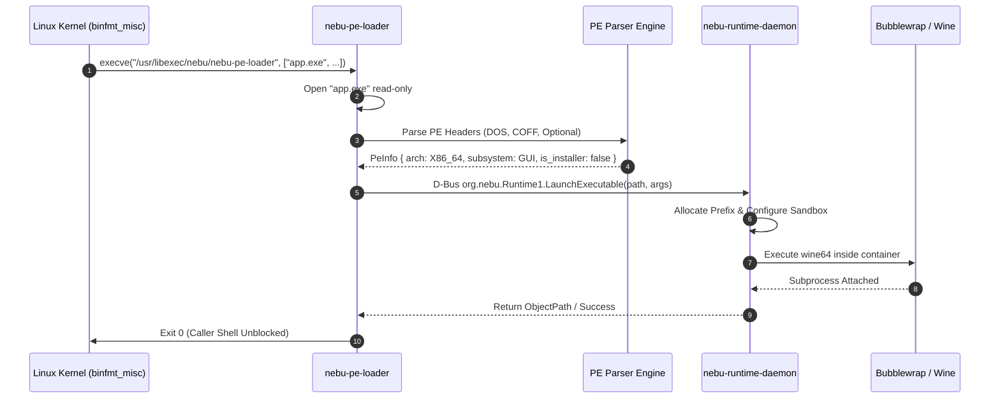
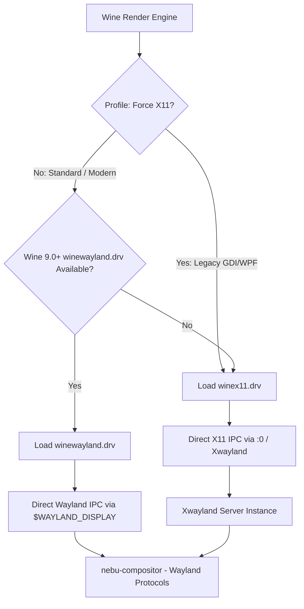

# Windows Runtime Execution Specification — NebuOS

## Status
DRAFT

## Purpose
This document specifies the binary analysis, format classification, kernel registration, and display server integration layers of NebuRuntime. It defines how NebuOS inspects Portable Executable (PE32/PE32+) binaries, classifies installers versus standalone applications, registers execution hooks with the Linux kernel via `binfmt_misc`, resolves desktop MIME associations, and maps Win32 surfaces onto Wayland via native Wayland drivers and Xwayland.

## Scope
This specification encompasses:
- Low-level PE32 and PE32+ header parsing structures and sanity verification algorithms.
- Classification heuristics for standalone executables and installer packages (MSI, InnoSetup, NSIS, InstallShield).
- Kernel `binfmt_misc` registration configuration and the `/usr/libexec/nebu/nebu-pe-loader` dispatcher.
- FreeDesktop MIME type integration and `.desktop` entry generation.
- Display server rendering and window management under Wayland, including upstream `winewayland.drv`, legacy `winex11.drv` / Xwayland fallback, HiDPI scaling, clipboard synchronization, and pointer confinement.

## Non-goals
- **Kernel-Mode Driver Emulation:** Emulating Windows ring-0 architecture, WDM/KMDF driver loading, or arbitrary kernel hardware calls.
- **DirectX API Reimplementation:** Implementing Direct3D in-tree; translation is delegated to DXVK, VKD3D-Proton, or Mesa Gallium.
- **ARM64 Translation:** Emulating x86/x64 instructions on ARM hardware (future roadmap item; current focus is native x86_64 host execution).

## Requirements

### Functional Requirements
- **REQ-WIN-001:** Provide zero-allocation PE header parsing capable of extracting target architecture, Win32 subsystem, entry point address, and CLR (.NET) runtime indicators from the first 4096 bytes of any binary.
- **REQ-WIN-002:** Differentiate application payloads from installers with >98% accuracy across MSI, InnoSetup, NSIS, and InstallShield formats, applying appropriate unattended switches or sandbox mount profiles.
- **REQ-WIN-003:** Register kernel-level `binfmt_misc` handlers enabling direct execution of Windows binaries from terminal shells (`./app.exe`) and POSIX `execve(2)` calls.
- **REQ-WIN-004:** Handle FreeDesktop MIME types (`application/vnd.microsoft.portable-executable`, `application/x-msi`) to support double-click launches in the graphical shell.
- **REQ-WIN-005:** Provide seamless window integration under `nebu-compositor`, prioritizing Wine's native Wayland driver (`winewayland.drv`) with seamless fallback to Xwayland for legacy applications.

### Non-Functional Requirements
- **NFR-WIN-001 (Parsing Latency):** PE header analysis and installer classification must execute in less than 8 ms for files under 1 GB.
- **NFR-WIN-002 (Display Synchronization):** Wayland surface frame presentation latency under `winewayland.drv` must not exceed 1 frame interval (<= 16.6 ms at 60 Hz, <= 6.9 ms at 144 Hz).
- **NFR-WIN-003 (Input Fidelity):** Mouse pointer lock and confinement for 3D viewports (CAD, games) must maintain sub-millisecond motion event latency without cursor drift.

## Architecture

NebuRuntime's Windows execution layer connects kernel binary invocation, userspace dispatching, binary classification, and display server surface management:

```mermaid
graph TD
    subgraph INGESTION [Binary Ingestion Paths]
        CLI[Shell CLI: ./setup.exe]
        SHELL_MIME[File Manager / MIME Double Click]
    end

    subgraph KERNEL [Linux Kernel Layer]
        BINFMT[binfmt_misc Handler]
    end

    subgraph DISPATCHER [Nebu Loader Tier]
        LOADER[/usr/libexec/nebu/nebu-pe-loader]
        PE_PARSER[PE32/PE32+ Header Parser]
        INSTALLER_DET[Installer Classification Engine]
        DBUS_CLIENT[org.nebu.Runtime1 D-Bus Client]
    end

    subgraph RUNTIME_DAEMON [nebu-runtime-daemon]
        DAEMON_CORE[Session & Prefix Allocator]
    end

    subgraph DISPLAY_TIER [Display Server Architecture]
        WINE_PROC[Wine Application Process]
        DRV_ROUTER{Driver Router}
        WINEWAYLAND[winewayland.drv]
        WINEX11[winex11.drv]
        XWAYLAND[Xwayland Server]
        COMPOSITOR[nebu-compositor - Wayland Native]
    end

    CLI --> BINFMT
    BINFMT --> LOADER
    SHELL_MIME --> LOADER
    LOADER --> PE_PARSER
    PE_PARSER --> INSTALLER_DET
    INSTALLER_DET --> DBUS_CLIENT
    DBUS_CLIENT -->|D-Bus: LaunchExecutable| DAEMON_CORE
    DAEMON_CORE -->|Spawn bwrap| WINE_PROC
    WINE_PROC --> DRV_ROUTER
    DRV_ROUTER -->|Primary| WINEWAYLAND
    DRV_ROUTER -->|Fallback| WINEX11
    WINEX11 --> XWAYLAND
    XWAYLAND --> COMPOSITOR
    WINEWAYLAND --> COMPOSITOR
```

## Components

The Windows runtime stack consists of four primary software subsystems:

1. **`nebu-pe-loader` (`crates/nebu-runtime-core`):**
   - Lightweight C/Rust trampoline executable installed at `/usr/libexec/nebu/nebu-pe-loader`.
   - Invoked directly by the Linux kernel `binfmt_misc` mechanism or MIME desktop launchers.
   - Inspects the executable, normalizes absolute POSIX paths, and issues the `LaunchExecutable` method call to `nebu-runtime-daemon` over the session D-Bus.

2. **PE Inspection Engine (`nebu-runtime-core::pe`):**
   - High-performance, zero-copy PE format parser based on safe Rust slices.
   - Validates DOS headers, COFF file headers, and Optional headers.
   - Inspects the Data Directory array to determine import libraries (Direct3D, OpenGL, Vulkan, .NET CLR, WinSock).

3. **Installer Heuristics Classifier (`nebu-runtime-core::classifiers`):**
   - Identifies whether an incoming `.exe` is an installer script wrapper or a persistent application binary.
   - Detects InnoSetup, Nullsoft Scriptable Install System (NSIS), Microsoft Installer (MSI), and InstallShield wrappers.

4. **Display Driver Abstraction (`nebu-runtime-daemon::graphics`):**
   - Configures the runtime driver registry: `HKCU\Software\Wine\Drivers`.
   - Directs modern applications to `winewayland.drv` (enabling native Wayland surfaces, fractional scaling, and direct buffer sharing via `linux-dmabuf`).
   - Directs legacy or incompatible Win32 GDI applications to `winex11.drv` communicating via internal `Xwayland`.

## Data Flow



## Control Flow

### 1. PE Header Parsing Details

The parser reads the binary beginning at byte offset `0x00` and extracts exact structural fields:

```text
+-------------------------------------------------------------+
| DOS Header: 'MZ' (0x5A4D)                                    |
| Offset 0x3C -> e_lfanew (Pointer to PE Signature)            |
+-------------------------------------------------------------+
                              |
                              v
+-------------------------------------------------------------+
| PE Signature: 'PE\0\0' (0x00004550)                          |
+-------------------------------------------------------------+
| COFF File Header (20 bytes):                                 |
| - Machine: 0x014C (x86), 0x8664 (x86_64), 0xAA64 (ARM64)     |
| - NumberOfSections                                          |
| - Characteristics: IMAGE_FILE_EXECUTABLE_IMAGE, DLL, etc.    |
+-------------------------------------------------------------+
| Optional Header (PE32: 96 bytes / PE32+: 112 bytes):         |
| - Magic: 0x010B (PE32 / 32-bit), 0x020B (PE32+ / 64-bit)    |
| - AddressOfEntryPoint & ImageBase                           |
| - Subsystem:                                                |
|     * 0x0002 -> IMAGE_SUBSYSTEM_WINDOWS_GUI (Windowed app)  |
|     * 0x0003 -> IMAGE_SUBSYSTEM_WINDOWS_CUI (Console app)   |
| - DllCharacteristics: ASLR, DEP, HighEntropyVA             |
| - DataDirectory[16]:                                         |
|     * Index 1: Import Table (Check for D3D, Vulkan, OLE)    |
|     * Index 14: CLR Runtime Header (Detect .NET binaries)   |
+-------------------------------------------------------------+
```

#### Detailed Field Verification Logic
1. **DOS Header:** Verifies `e_magic == 0x5A4D`. If false, rejects immediately. Verifies `e_lfanew < file_len - 256` to prevent out-of-bounds pointer exploits.
2. **COFF Header:** Verifies `Machine`. NebuOS natively executes `0x8664` (AMD64) and `0x014C` (i386 WoW64). Rejects `0xAA64` (ARM64) with `UnsupportedArchitecture`.
3. **Optional Header:** Inspects `Subsystem`:
   - `IMAGE_SUBSYSTEM_WINDOWS_GUI`: Launches application detached from terminal, binding to graphical session.
   - `IMAGE_SUBSYSTEM_WINDOWS_CUI`: Connects application stdin/stdout/stderr to active Linux terminal, executing Wine in console mode.
4. **CLR Header Inspection:** If `DataDirectory[14].VirtualAddress != 0`, flags application as `.NET Managed Assembly`. Engages `wine-mono` or native .NET runtime dependencies based on profile.

### 2. Installer Detection Heuristics

NebuRuntime distinguishes between standalone software and installation packages:

| Installer Family | Binary Signature / Heuristic Marker | Extraction / Execution Strategy |
|---|---|---|
| **Microsoft Installer (MSI)** | Magic bytes `\xD0\xCF\x11\xE0\xA1\xB1\x1A\xE1` (OLE Compound Doc). | Wrap invocation: `wine64 msiexec.exe /i <payload.msi>`. |
| **InnoSetup** | Overlay string `"Inno Setup Setup Data"` in resources or section headers. | Add flags `/SILENT /VERYSILENT /SUPPRESSMSGBOXES /NORESTART` for unattended setup. |
| **Nullsoft (NSIS)** | Nullsoft header `0xDEADBEEF` at offset `0x20` or string `"Nullsoft.NSIS.exehead"`. | Append `/S` flag for unattended installation where supported. |
| **InstallShield** | String `"InstallShield"` in StringTable resource or `_ISDel.exe` helper. | Run with temporary writeable directory mount; disable reboot traps. |
| **Standalone Portable** | Absence of setup strings; contains localized UI assets and persistent data paths. | Provision isolated application prefix; create persistent desktop launcher. |

### 3. Kernel `binfmt_misc` Registration
NebuOS registers Windows executables directly with the Linux kernel during system boot.

Configuration file installed at `/etc/binfmt.d/nebu-wine.conf`:
```ini
# NebuOS binfmt_misc configuration for Windows PE binaries
# Format: :name:type:offset:magic:mask:interpreter:flags
:DOSWin:M::MZ::/usr/libexec/nebu/nebu-pe-loader:POC
```

#### Flags Explanation
- `P` (Preserve argv[0]): Preserves original executable path in argument list.
- `O` (Open binary): Kernel opens binary and passes file descriptor, avoiding race conditions.
- `C` (Credentials): Checks permissions against original binary rather than the interpreter.

### 4. MIME Type Registration
Installed at `/usr/share/mime/packages/nebu-wine.xml`:

```xml
<?xml version="1.0" encoding="UTF-8"?>
<mime-info xmlns="http://www.freedesktop.org/standards/shared-mime-info">
  <mime-type type="application/vnd.microsoft.portable-executable">
    <comment>Windows Executable</comment>
    <glob pattern="*.exe"/>
    <magic priority="60">
      <match type="string" offset="0" value="MZ"/>
    </magic>
  </mime-type>
  <mime-type type="application/x-msi">
    <comment>Windows Installer Package</comment>
    <glob pattern="*.msi"/>
  </mime-type>
</mime-info>
```

Associated desktop launcher installed at `/usr/share/applications/nebu-wine-runner.desktop`:
```ini
[Desktop Entry]
Type=Application
Name=Nebu Windows Application Runner
Exec=/usr/libexec/nebu/nebu-pe-loader %f
MimeType=application/vnd.microsoft.portable-executable;application/x-msi;
NoDisplay=true
Terminal=false
StartupNotify=true
```

### 5. Wayland and Xwayland Interaction Model



#### Display Protocol Specifications
1. **Native Wayland Driver (`winewayland.drv`):**
   - Implements native Wayland protocols: `xdg_shell`, `linux_dmabuf_v1`, `wp_viewporter`, `wp_fractional_scale_v1`.
   - Zero-copy buffer exchange between Vulkan/DXVK swapchain and `nebu-compositor`.
   - Eliminates window flickering, tearing, and input lag common to X11 bridges.
2. **Xwayland Fallback (`winex11.drv`):**
   - Active for applications utilizing custom layered Win32 window styles or legacy DirectX 8/DirectDraw.
   - Communicates with rootless Xwayland server spawned on demand.
3. **DPI and HiDPI Scaling:**
   - Wayland Fractional Scaling (`wp_fractional_scale_v1`) scales surfaces natively.
   - For legacy apps under Xwayland, `nebu-runtime-daemon` injects virtual DPI settings into `user.reg`:
     `HKCU\Control Panel\Desktop\LogPixels = dword:00000060` (96 DPI = 100%), `dword:00000090` (144 DPI = 150%), `dword:000000C0` (192 DPI = 200%).
4. **Clipboard Synchronization:**
   - Synchronizes Win32 standard formats (`CF_TEXT`, `CF_UNICODETEXT`, `CF_DIB`) with Wayland mime types (`text/plain;charset=utf-8`, `image/png`).
5. **Pointer Lock and Confinement:**
   - Implements `zwp_pointer_constraints_v1` (`lock_pointer` and `confine_pointer`).
   - Ensures mouse capture in 3D CAD viewports (e.g. AutoCAD Orbit, SolidWorks) prevents cursor escaping to adjacent monitors.

## Interfaces

### 1. PE Inspection API (`nebu-runtime-core`)

```rust
#[derive(Debug, Clone, PartialEq, Eq)]
pub struct PeMetadata {
    pub architecture: ExecutableArch,
    pub subsystem: WindowsSubsystem,
    pub is_64bit: bool,
    pub is_clr_dotnet: bool,
    pub entry_point_rva: u32,
    pub image_base: u64,
    pub imported_dlls: Vec<String>,
    pub installer_type: Option<InstallerType>,
}

#[derive(Debug, Clone, Copy, PartialEq, Eq)]
pub enum InstallerType {
    Msi,
    InnoSetup,
    Nsis,
    InstallShield,
}

#[derive(Debug, Clone, Copy, PartialEq, Eq)]
pub enum WindowsSubsystem {
    Gui,     // IMAGE_SUBSYSTEM_WINDOWS_GUI
    Console, // IMAGE_SUBSYSTEM_WINDOWS_CUI
    Unknown(u16),
}

pub fn inspect_pe_binary(file_path: &Path) -> Result<PeMetadata, PeParseError>;
```

### 2. Trampoline Dispatcher Interface (`nebu-pe-loader`)
Invoked via command line:
```bash
/usr/libexec/nebu/nebu-pe-loader [--debug] <path-to-binary> [arg1 arg2 ...]
```
Returns:
- `0`: Handled successfully by `nebu-runtime-daemon`.
- `1`: Invalid binary format or unreadable file.
- `2`: Daemon unreachable over session bus.
- `3`: User rejected execution or security denial.

## Dependencies

- **Linux Kernel v5.15+:** `binfmt_misc` module (`CONFIG_BINFMT_MISC`).
- **Shared MIME Info:** FreeDesktop MIME database standard (`update-mime-database`).
- **Wine 9.0+:** Provides native `winewayland.drv` display driver.
- **Xwayland v23+:** Rootless X11 server for fallback compatibility.
- **Wayland Protocols:** `wayland-protocols` 1.32+ including `pointer-constraints-unstable-v1` and `fractional-scale-v1`.

## Security

- **Safe Parsing Guarantee:** The PE parser is implemented in memory-safe Rust with explicit bounds checking on all offsets (`e_lfanew`, section tables, data directories). Panics are caught at the FFI/module boundary.
- **Malicious Payload Mitigation:** Executables invoked via `binfmt_misc` or MIME cannot run directly on the host OS; execution is strictly intercepted by `nebu-pe-loader` and diverted into the Bubblewrap sandbox.
- **MIME Hijack Resistance:** Application `.desktop` files generated for Windows applications inside prefixes cannot register protocol handlers for sensitive URL schemes (`file://`, `bash:`, `ssh://`).

## Resource Requirements

- **PE Header Parser Execution Footprint:**
  - Peak Memory: **< 1.2 MB** heap allocation.
  - CPU Time: **< 5 ms** on modern x86_64 cores.
- **Xwayland Server Overhead (When Engaged):**
  - RSS Footprint: ~22 MB memory.
  - Idle CPU: 0.0%.

## Failure Modes

| Failure ID | Failure Description | Cause | Fallback Behavior |
|---|---|---|---|
| `FAIL-WIN-001` | Broken `binfmt_misc` Registration | Kernel module unloaded or configuration missing. | Fall back to file manager MIME association or `nebu run <path>`. |
| `FAIL-WIN-002` | Truncated PE Binary | File download incomplete or corrupted. | Emit error: `ExecutableCorrupted(UnexpectedEOF)`; abort launch. |
| `FAIL-WIN-003` | Wayland Driver Crash | GPU driver failure or compositor protocol error. | Automatically restart application within Xwayland fallback mode. |
| `FAIL-WIN-004` | Unsupported Subsystem | Driver binary (`.sys`) or Xbox console payload. | Reject execution cleanly: `UnsupportedSubsystemType`. |

## Recovery Behavior

- **Wayland to Xwayland Automatic Failover:** If an application crashes during surface negotiation with `winewayland.drv` within the first 3.0 seconds, `nebu-runtime-daemon` records the failure in the application's local profile (`force_x11 = true`) and prompts to relaunch seamlessly via Xwayland.
- **Corrupted MIME Cache Healing:** If desktop double-clicking stops working, `nebu repair --mime` triggers automated re-registration of `/etc/binfmt.d/nebu-wine.conf` and rebuilds the FreeDesktop MIME cache (`update-mime-database`).

## Testing Requirements

- **PE Parser Test Corpus:** Automated test suite validating parser accuracy across 200 real-world PE binaries (32-bit, 64-bit, .NET assemblies, truncated headers, corrupted offsets).
- **Installer Heuristic Verification:** Testing classifier against 20 known MSI, InnoSetup, NSIS, and InstallShield installer files to ensure 100% detection accuracy.
- **Binfmt Trampoline Invocation Test:** Executing `./test.exe` directly from a Bash shell and verifying proper interception by `nebu-pe-loader`.
- **Wayland Display Compliance Test:** Validating smooth buffer presentation, HiDPI scaling factors (100%, 150%, 200%), and pointer confinement under `nebu-compositor`.

## Performance Requirements

- **PE Header Ingestion Latency:** Parse headers and detect installer type: **< 8 ms**.
- **Kernel Trampoline Hand-off:** Time from `execve` to D-Bus message dispatch in `nebu-pe-loader`: **< 18 ms**.
- **Wayland Surface Presentation:** Zero-copy buffer exchange overhead: **< 0.5 ms** per frame.

## Compatibility Considerations

- **Legacy 16-bit Windows Binaries (NE / LE):** Explicitly rejected. NebuOS does not include NTVDM or DOSBox in the runtime pipeline.
- **Packed Executables (UPX, Themida, VMProtect):** The PE parser extracts raw section headers even if compressed. If runtime unpacking crashes in Wine, the diagnostic system reports potential anti-cheat/packer incompatibility.

## Open Questions
- **OPEN QUESTION: WIN-01:** Should `nebu-pe-loader` automatically prompt the user with a security dialog before launching any executable downloaded from the web (zone identifier / `user.xdg.origin.url`)?
- **OPEN QUESTION: WIN-02:** Will Valve's upcoming Wayland driver enhancements in Proton fully replace `winewayland.drv` across all desktop workflows?

## Related Documents
- [00-runtime-specification.md](00-runtime-specification.md) — Master runtime daemon architecture.
- [01-application-lifecycle.md](01-application-lifecycle.md) — Application lifecycle state machine.
- [02-process-model.md](02-process-model.md) — Process supervision and cgroups v2 hierarchy.
- [04-prefix-management.md](04-prefix-management.md) — Prefix layout and Btrfs reflink snapshotting.
- [05-wine-integration.md](05-wine-integration.md) — Wine runtime engines and DLL overrides.
- [07-runtime-security.md](07-runtime-security.md) — Dedicated sandbox security specification.
