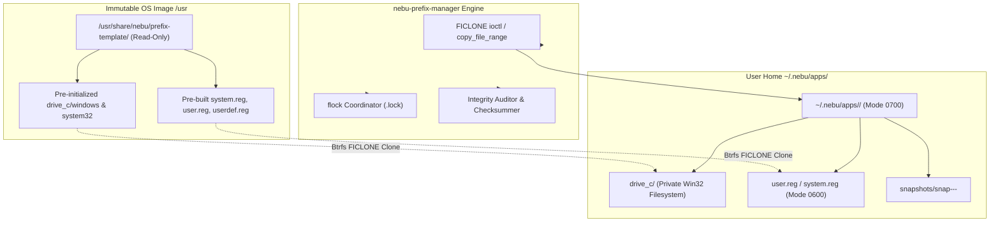
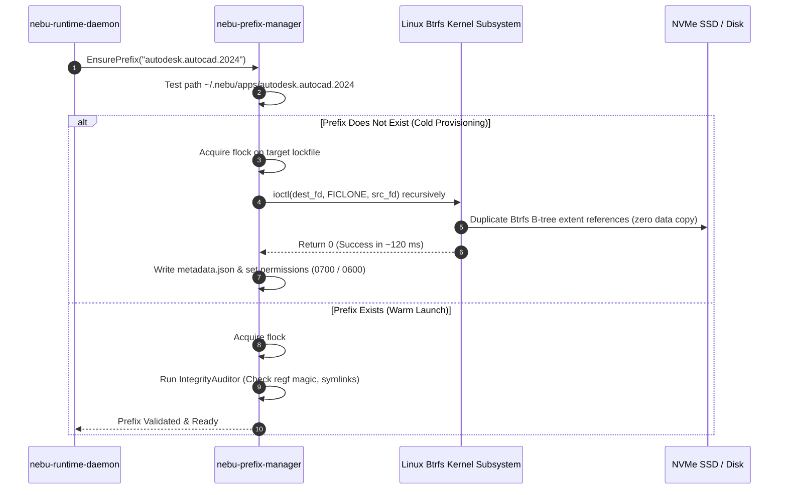
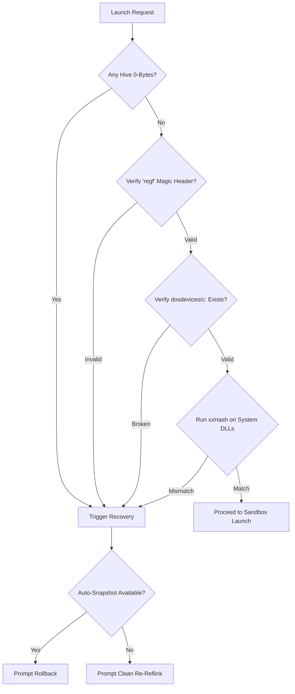

# Prefix Management and Reflink Snapshot Specification — NebuOS

## Status
DRAFT

## Purpose
This specification establishes the storage architecture, filesystem layout, instant provisioning mechanisms, snapshot semantics, and corruption recovery protocols for isolated Wine application prefixes in NebuOS. It specifies how NebuOS leverages Btrfs copy-on-write (`reflink`) capabilities to provision fully functioning 64-bit prefixes in under 150 ms, enforce multi-process locking, and ensure transactional rollbacks.

## Scope
This document encompasses:
- Exact directory hierarchy, POSIX ownership, and file permission masks for prefixes located under `~/.nebu/apps/<app_id>/`.
- Btrfs reflink cloning implementation via Linux `FICLONE` ioctls and userland fallback routines.
- Snapshot hierarchy, retention policies, and naming conventions.
- Multi-tier corruption detection heuristics, cryptographic checksumming (SHA-256 and xxHash64), and verification cadences.
- Concurrency management and mutual exclusion protocols using Linux `flock`.
- Base template generation during the Fedora Atomic OS container build pipeline.

## Non-goals
- **Shared Monolithic Prefixes:** Running multiple distinct Windows applications inside a shared `~/.wine` default prefix is strictly forbidden.
- **Cross-Host Prefix Migration:** Live migration of prefix state between differing physical hardware architectures without driver re-configuration.
- **Full-Disk Backup:** Prefix snapshotting is localized to application state; general user document backup is handled by desktop backup services.

## Requirements

### Functional Requirements
- **REQ-PFX-001:** Isolate each installed Windows application within a self-contained prefix directory at `~/.nebu/apps/<app_id>/` with restricted user-only permissions (`0700`).
- **REQ-PFX-002:** Provision fresh prefixes via Btrfs reflink cloning (`FICLONE`) from the system master template (`/usr/share/nebu/prefix-template/`) in under 150 ms without consuming duplicate disk blocks.
- **REQ-PFX-003:** Support automatic pre-update, pre-patch, and on-demand user snapshots stored under `~/.nebu/apps/<app_id>/snapshots/` with single-click instant rollback.
- **REQ-PFX-004:** Prevent concurrent runtime write collisions across multiple processes through non-blocking `flock` mutual exclusion.
- **REQ-PFX-005:** Perform pre-flight corruption checks on registry hives (`system.reg`, `user.reg`), symlinks (`dosdevices/c:`), and critical PE DLLs prior to spawning Wine processes.

### Non-Functional Requirements
- **NFR-PFX-001 (Provisioning Speed):** Cloning a 450 MB master prefix template to a new target directory on Btrfs must complete in < 150 ms.
- **NFR-PFX-002 (Rollback Speed):** Restoring a prefix from a local reflink snapshot checkpoint must take < 50 ms.
- **NFR-PFX-003 (Storage Efficiency):** A fresh application prefix must consume zero additional physical data blocks upon creation, utilizing Copy-on-Write (CoW) page sharing.

## Architecture

Prefix management operates as a core library (`nebu-prefix-manager`) embedded inside `nebu-runtime-daemon` and accessible via the `nebu` CLI:



## Components

The prefix management subsystem is composed of five distinct modules:

1. **`ReflinkCloner` (`nebu-prefix-manager::reflink`):**
   - Implements recursive reflink copying by traversing source directories and issuing the Linux `FICLONE` ioctl (`ioctl(dest_fd, FICLONE, src_fd)`) on every file.
   - Preserves directory structures, POSIX file permissions, extended attributes (xattrs), and symlinks.
   - Detects non-Btrfs mounts and provides an atomic streaming fallback.

2. **`LockManager` (`nebu-prefix-manager::lock`):**
   - Coordinates multi-process mutual exclusion via an advisory kernel file lock (`.lock` file in the prefix root).
   - Manages non-blocking exclusive locks (`LOCK_EX | LOCK_NB`) for write/execute operations and shared locks (`LOCK_SH`) for read-only inspection tools.
   - Inspects Linux `/proc/<pid>/stat` to automatically prune stale locks left by ungraceful crashes.

3. **`SnapshotEngine` (`nebu-prefix-manager::snapshot`):**
   - Generates point-in-time reflink checkpoints under the `snapshots/` directory.
   - Maintains a rotation ring retaining the last 5 automatic snapshots and unlimited user-tagged manual snapshots.
   - Executes atomic rollbacks by replacing active hives and modified trees within temporary swap directories.

4. **`IntegrityAuditor` (`nebu-prefix-manager::audit`):**
   - Validates prefix health prior to process launches.
   - Verifies NT registry hive signatures (`regf` header magic), checks for 0-byte truncations, and compares DLL checksums against cached baselines.

5. **`TemplateBuilder` (Build-Time Pipeline):**
   - Embedded script executed during Fedora Atomic container image generation.
   - Runs a headless, minimal `wineboot --init` within a virtual framebuffer, configures clean standard registries, strips transient caches, and stages the immutable template at `/usr/share/nebu/prefix-template/`.

## Data Flow



## Control Flow

### 1. Prefix Directory Hierarchy and Permission Specification
Every managed application prefix resides in an isolated directory subtree:

```text
~/.nebu/apps/<app_id>/                      [drwx------ 0700 nebu:nebu]
├── .lock                                   [-rw------- 0600 nebu:nebu]  (flock descriptor)
├── metadata.json                           [-rw-r--r-- 0644 nebu:nebu]  (App manifest)
├── integrity.db                            [-rw-r--r-- 0644 nebu:nebu]  (xxHash checksum cache)
├── system.reg                              [-rw------- 0600 nebu:nebu]  (HKLM registry hive)
├── user.reg                                [-rw------- 0600 nebu:nebu]  (HKCU registry hive)
├── userdef.reg                             [-rw------- 0600 nebu:nebu]  (Default user hive)
├── dosdevices/                             [drwx------ 0700 nebu:nebu]
│   ├── c: -> ../drive_c                    [lrwxrwxrwx 0777 nebu:nebu]  (Standard Win32 root)
│   ├── d: -> /var/media/iso                [lrwxrwxrwx 0777 nebu:nebu]  (Optional optical mount)
│   └── z: -> /home/nebu/Documents          [lrwxrwxrwx 0777 nebu:nebu]  (Restricted user doc bridge)
├── drive_c/                                [drwxr-xr-x 0755 nebu:nebu]
│   ├── Program Files/                      [drwxr-xr-x 0755 nebu:nebu]
│   ├── Program Files (x86)/                [drwxr-xr-x 0755 nebu:nebu]
│   ├── ProgramData/                        [drwxr-xr-x 0755 nebu:nebu]
│   ├── users/                              [drwxr-xr-x 0755 nebu:nebu]
│   │   └── nebu/                           [drwx------ 0700 nebu:nebu]
│   │       ├── AppData/                    [drwx------ 0700 nebu:nebu]
│   │       │   ├── Local/                  [drwx------ 0700 nebu:nebu]
│   │       │   └── Roaming/                [drwx------ 0700 nebu:nebu]
│   │       ├── Desktop/                    [drwx------ 0700 nebu:nebu]
│   │       └── Documents/ -> /home/nebu/Documents [lrwxrwxrwx 0777]
│   └── windows/                            [drwxr-xr-x 0755 nebu:nebu]
│       ├── system32/                       [drwxr-xr-x 0755 nebu:nebu]
│       ├── syswow64/                       [drwxr-xr-x 0755 nebu:nebu]
│       └── Fonts/                          [drwxr-xr-x 0755 nebu:nebu]
├── logs/                                   [drwx------ 0700 nebu:nebu]
│   ├── runtime.log                         [-rw------- 0600 nebu:nebu]
│   └── wine.log                            [-rw------- 0600 nebu:nebu]
└── snapshots/                              [drwx------ 0700 nebu:nebu]
    ├── snap-20260904-101500-pre-install-01/
    └── snap-20260904-113000-auto-recovery-02/
```

### 2. Btrfs Reflink Implementation Details

NebuOS performs instant cloning using Linux copy-on-write ioctls. The implementation in `nebu-prefix-manager` operates as follows:

```rust
// Core reflink copy primitive using libc ioctl
pub fn reflink_file(src_path: &Path, dst_path: &Path) -> std::io::Result<()> {
    let src_file = std::fs::File::open(src_path)?;
    let dst_file = std::fs::OpenOptions::new()
        .write(true)
        .create_new(true)
        .open(dst_path)?;

    let src_fd = src_file.as_raw_fd();
    let dst_fd = dst_file.as_raw_fd();

    // Invoke FICLONE ioctl (0x40049409)
    let ret = unsafe { libc::ioctl(dst_fd, libc::FICLONE, src_fd) };
    if ret != 0 {
        return Err(std::io::Error::last_os_error());
    }

    // Preserve permissions and timestamps
    let metadata = src_file.metadata()?;
    dst_file.set_permissions(metadata.permissions())?;
    Ok(())
}
```

#### Reflink vs Subvolume Snapshots Rationale
- **Why File-Level Reflink?** Standard Btrfs subvolume snapshots require subvolumes to be explicitly created via root or delegated privileges (`btrfs subvolume create`). In contrast, file-level `FICLONE` reflink operations run completely unprivileged inside user home directories, operate across standard directory boundaries within the same Btrfs filesystem, and allow selective snapshotting of specific files (e.g. cloning only `system.reg` and `user.reg` for lightweight registry snapshots).
- **Fallback Behavior:** If the underlying filesystem returns `EOPNOTSUPP` or `EXDEV` (non-Btrfs partition such as ext4 or NFS), `nebu-prefix-manager` switches to streaming `copy_file_range` or standard userland buffered copies. A non-blocking telemetry event is emitted informing the user of degraded launch performance.

### 3. Snapshot Naming Conventions and Retention
Snapshots are structured with deterministic, sortable metadata:
- **Format:** `snap-<YYYYMMDD>-<HHMMSS>-<reason>-<sequence_id>`
- **Standard Reasons:**
  - `pre-install`: Captured immediately before executing a setup wizard or MSI installer.
  - `pre-update`: Captured prior to applying a NebuOS compatibility profile patch.
  - `pre-patch`: Captured before executing winetricks redistributable scripts.
  - `manual`: User-initiated snapshot via CLI (`nebu prefix snapshot create`).
  - `auto-recovery`: Captured prior to automated registry repair attempts.
- **Retention Policy:**
  - `auto-*` snapshots: Retained on a FIFO ring buffer of maximum 5 snapshots per prefix.
  - `manual` snapshots: Retained indefinitely until explicitly deleted by the user.

### 4. Multi-Tier Corruption Detection

Corruption checks occur across three deterministic phases:



1. **Zero-Byte File Audit:** A crashed wine process often truncates `system.reg` or `user.reg` to 0 bytes if power fails during sync. Any hive file with `size == 0` is instantly rejected.
2. **NT Registry Magic Validation:** The first 4 bytes of each registry hive must match the ASCII string `"regf"` (binary registry) or `"WINE"` (Wine text registry format).
3. **Symlink Integrity:** Ensures `dosdevices/c:` points to a valid local directory and has not been deleted or altered to point to host root (`/`).
4. **DLL xxHash Verification:** Compares hashes of core Wine builtin libraries in `windows/system32/` against `integrity.db` to catch accidental overwrites by rogue Windows installers.

### 5. Concurrent Prefix Access Locking via `flock`

To prevent two applications or multiple CLI instances from modifying the same prefix concurrently:

```rust
pub struct PrefixLockGuard {
    lock_file: std::fs::File,
    prefix_path: PathBuf,
}

impl PrefixLockGuard {
    pub fn acquire_exclusive(prefix_path: &Path) -> Result<Self, PrefixError> {
        let lock_path = prefix_path.join(".lock");
        let file = std::fs::OpenOptions::new()
            .read(true)
            .write(true)
            .create(true)
            .open(&lock_path)?;

        // Non-blocking exclusive lock
        let ret = unsafe { libc::flock(file.as_raw_fd(), libc::LOCK_EX | libc::LOCK_NB) };
        if ret != 0 {
            let err = std::io::Error::last_os_error();
            if err.raw_os_error() == Some(libc::EWOULDBLOCK) {
                return Err(PrefixError::AlreadyLockedByProcess);
            }
            return Err(PrefixError::Io(err));
        }

        // Record current PID into lock file for stale detection
        let pid = std::process::id();
        let _ = file.set_len(0);
        let _ = std::io::Write::write_all(&mut &file, format!("{}\n", pid).as_bytes());

        Ok(Self { lock_file: file, prefix_path: prefix_path.to_path_buf() })
    }
}
```

### 6. Template Generation During Image Build
The base prefix template (`/usr/share/nebu/prefix-template/`) is pre-computed during the Fedora Atomic `bootc` container build pipeline:
1. **Container Build Step:** A headless container runs `xvfb-run wineboot --init`.
2. **Standardization:** Generates standard `system.reg` and `user.reg` containing default Windows 10 build 19045 identification keys.
3. **Asset Stripping:** Deletes temporary Wine cache directories (`~/.cache/wine/`), winemenubuilder logs, and volatile UNIX socket symlinks.
4. **Permissions Freezing:** Sets standard permissions (`0755` for directories, `0644` for files, `0600` for registries) and stages the tree in `/usr/share/nebu/prefix-template/`.

## Interfaces

### 1. Rust Prefix Management API (`nebu-prefix-manager`)

```rust
pub trait PrefixManager {
    // Provision a new prefix using Btrfs reflink
    fn provision_prefix(&self, app_id: &str, template_path: &Path) -> Result<PathBuf, PrefixError>;

    // Acquire mutual exclusion lock
    fn acquire_lock(&self, app_id: &str) -> Result<PrefixLockGuard, PrefixError>;

    // Create a point-in-time snapshot
    fn create_snapshot(&self, app_id: &str, reason: &str) -> Result<String, PrefixError>;

    // Restore prefix from a snapshot
    fn restore_snapshot(&self, app_id: &str, snapshot_name: &str) -> Result<(), PrefixError>;

    // Run integrity audit
    fn audit_prefix(&self, app_id: &str) -> Result<AuditReport, PrefixError>;

    // Delete prefix and all associated snapshots
    fn purge_prefix(&self, app_id: &str) -> Result<(), PrefixError>;
}
```

### 2. CLI Tooling Commands (`nebu prefix`)

```bash
# List all active prefixes and disk consumption
nebu prefix list

# Inspect prefix health and integrity
nebu prefix audit autodesk.autocad.2024

# Create an on-demand snapshot
nebu prefix snapshot create autodesk.autocad.2024 --reason "pre-update"

# Rollback to an existing snapshot
nebu prefix snapshot rollback autodesk.autocad.2024 --name "snap-20260904-pre-update-01"

# Completely reset prefix back to base template
nebu prefix reset autodesk.autocad.2024 --preserve-user-data
```

## Dependencies

- **Btrfs Kernel Subsystem:** Provides `FICLONE` and `copy_file_range` copy-on-write primitives.
- **POSIX libc:** `flock(2)` for advisory file locking, `ioctl(2)` for filesystem commands.
- **xxHash (`twox-hash` / `xxhash-rust`):** Ultra-fast 64-bit non-cryptographic checksumming for file validation.
- **Winehq Wine 9.x:** Upstream `wineboot` binary used for build-time template generation.

## Security

- **Strict Access Control (0700/0600):** Prefixes contain private application configuration, cached browser credentials, and document drafts. Permissions are strictly locked to `0700` for directories and `0600` for registry hives.
- **Restricted Drive Z Mappings:** Standard Wine maps `Z:\` to host root (`/`). NebuOS overrides this mapping: `dosdevices/z:` is explicitly restricted to `~/.nebu/apps/<app_id>/drive_c/users/nebu/Documents` or bounded to the user's `~/Documents` directory via Bubblewrap bind mounts. Host system root is never exposed as a Win32 drive.
- **Setuid & Executable Invalidation:** Prefix directories are mounted inside Bubblewrap with `nodev` and `nosuid`.

## Resource Requirements

- **Disk Space per New Prefix:** Initial disk allocation is **0 bytes** (excluding standard Btrfs metadata tree updates of ~64 KB).
- **Snapshot Storage Overhead:** Initial snapshot creation consumes **0 bytes** of physical disk blocks, growing proportionally only as files are modified.
- **Memory Consumption of Prefix Auditor:** Audit phase consumes **< 3.5 MB** RSS heap memory during launch validation.

## Failure Modes

| Failure ID | Failure Description | Root Cause | Fallback / Resolution |
|---|---|---|---|
| `FAIL-PFX-001` | Reflink Clone Cross-Device (`EXDEV`) | Prefix directory and template reside on separate mounts. | Fall back to streaming file copy; log performance notice. |
| `FAIL-PFX-002` | Reflink Disk Full (`ENOSPC`) | Btrfs metadata or data chunk allocation exhausted. | Abort launch; notify user with disk cleanup dialog. |
| `FAIL-PFX-003` | Stale Lock Contention | Application crashed without executing lock cleanup. | Inspect `/proc/<pid>`; reclaim lock if PID is nonexistent. |
| `FAIL-PFX-004` | Registry Truncation (`0 bytes`) | Sudden system power loss during registry write. | Restore registry from last auto-snapshot automatically. |

## Recovery Behavior

- **Automated Registry Healing:** When `system.reg` or `user.reg` fails the `regf` header check or is 0 bytes, `nebu-prefix-manager` automatically checks `snapshots/` for the latest clean snapshot. If found, it swaps in the healthy registry files in < 50 ms.
- **Safe Stale Lock Reclamation:** When acquiring `flock` fails with `EWOULDBLOCK`, the manager reads the ASCII PID stored in `.lock`. It verifies `/proc/<pid>/cmdline`. If the PID does not exist or the process is an unrelated recycled PID, the lock is forcibly broken and re-acquired.

## Testing Requirements

- **Reflink Correctness Test:** Verify that modifying files in cloned prefixes does not alter the master template in `/usr/share/nebu/prefix-template/`.
- **Snapshot Rollback Verification:** Generate test files in `drive_c`, capture snapshot, delete files, execute rollback, and assert complete bit-for-bit file restoration.
- **Concurrent Lock Test:** Spawn 10 parallel threads attempting to acquire exclusive lock on the same prefix; assert exactly 1 thread succeeds and 9 threads receive `AlreadyLockedByProcess`.
- **Corruption Recovery Drill:** Deliberately overwrite `system.reg` with random bytes; execute `nebu prefix audit` and verify automated restoration from snapshot.

## Performance Requirements

- **Fresh Prefix Provisioning:** Cloning full template prefix via Btrfs reflink: **< 150 ms**.
- **Snapshot Checkpoint Creation:** Creating a point-in-time snapshot: **< 45 ms**.
- **Integrity Pre-Flight Audit:** Checking headers, 0-byte state, and critical symlinks: **< 12 ms**.
- **Snapshot Rollback Duration:** Restoring a prefix to a prior state: **< 50 ms**.

## Compatibility Considerations

- **Case-Insensitive Filesystems:** Windows applications expect case-insensitive file lookups. Wine handles case folding in software; however, NebuOS can leverage Btrfs case-folding flags (`chattr +F`) on `drive_c` where supported to accelerate filesystem operations.
- **Hardlink Compatibility:** Windows installers using hardlinks for shared components operate transparently within the Btrfs subvolume.

## Open Questions
- **OPEN QUESTION: PFX-01:** Should NebuOS enable Btrfs transparent ZSTD:1 compression by default across the `~/.nebu/apps/` subvolume to reduce disk footprint for large 50+ GB installations?
- **OPEN QUESTION: PFX-02:** Should the snapshot engine automatically capture a snapshot immediately prior to every system-wide OS update?

## Related Documents
- [00-runtime-specification.md](00-runtime-specification.md) — Master runtime daemon architecture.
- [01-application-lifecycle.md](01-application-lifecycle.md) — Lifecycle state machine.
- [02-process-model.md](02-process-model.md) — Process hierarchy and cgroups supervision.
- [03-windows-runtime.md](03-windows-runtime.md) — Executable classification and PE headers.
- [05-wine-integration.md](05-wine-integration.md) — Wineserver orchestration and registry hives.
- [07-runtime-security.md](07-runtime-security.md) — Bubblewrap sandbox security boundaries.
