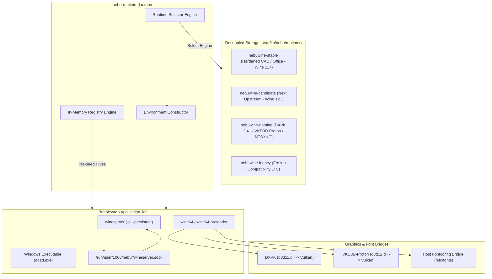
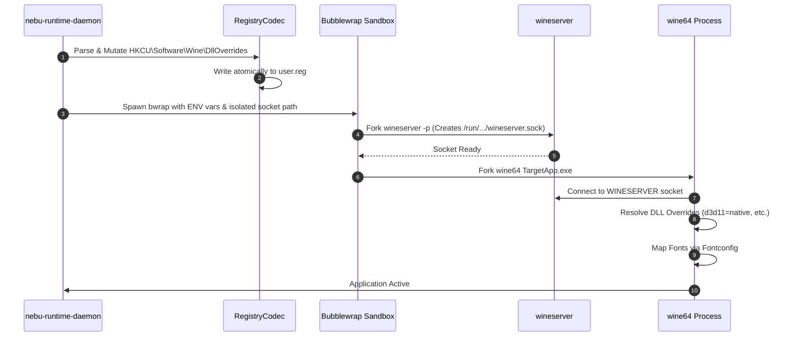
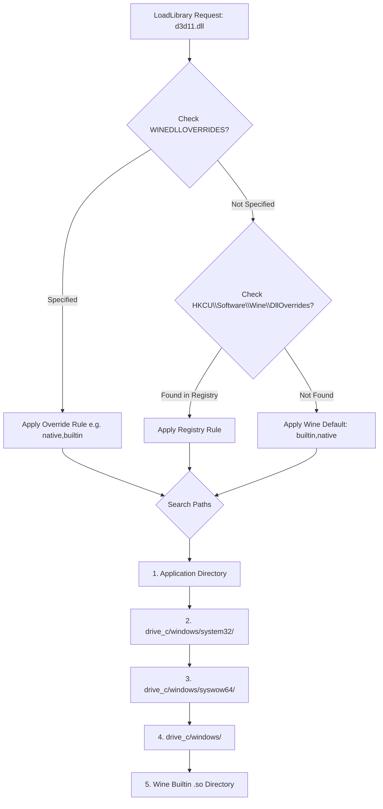

# Wine and Proton Integration Specification — NebuOS

## Status
APPROVED (Updated for Wine 11..16+ and Decoupled Storage)

## Purpose
This specification defines how NebuOS packages, selects, isolates, and configures NebuWine and companion runtimes. It details the decoupled runtime filesystem layout on `/var/lib/nebu/runtimes/`, the lifecycle and IPC isolation of `wineserver`, dynamic Win32 DLL override evaluation hierarchies, programmatic registry hive manipulation without external tools, system font bridging, native Rust winetricks verb execution, runtime environment injection, and debug channel log rotation.

## Scope
This document encompasses:
- Packaging, version progression, and dynamic selection of Wine runtimes (`nebuwine-stable`, `nebuwine-candidate`, `nebuwine-gaming`, `nebuwine-legacy`) located under `/var/lib/nebu/runtimes/stores/` (per [ADR-0017](file:///root/NebuOS/docs/decisions/ADR-0017-decoupled-runtime-packaging-and-storage.md)).
- Multi-generation Wine tracking across Wine 11, 12, 13, 14, 15, 16, and beyond (per [ADR-0016](file:///root/NebuOS/docs/decisions/ADR-0016-nebuwine-architecture.md)).
- The exact lifecycle, socket pathing, and process cleanup of per-prefix `wineserver` instances.
- Win32 dynamic-link library override syntax, precedence, and lookup paths.
- Low-level specification of the Wine text-based registry hive format (`WINE REGISTRY Version 2`) and atomic manipulation algorithms in Rust.
- Fontconfig bridging, TrueType font installation in `drive_c/windows/Fonts`, and font substitution tables.
- Automated native Rust execution of redistributable dependencies (Visual C++, .NET, DirectX) replacing legacy bash winetricks.
- Complete execution environment variables (`WINEPREFIX`, `WINEDLLOVERRIDES`, `WINESERVER`, `WINEDEBUG`, `DXVK_STATE_CACHE_PATH`).
- Debug channel syntax, diagnostic levels, and log rotation policies.

## Non-goals
- **Forking Wine / Proton Core:** NebuOS does not maintain a private, permanently divergent fork of Wine; official WineHQ upstream releases with minimal rebaseable downstream patch deltas are packaged directly per [ADR-0016](file:///root/NebuOS/docs/decisions/ADR-0016-nebuwine-architecture.md).
- **Wine Source Compilation at Runtime:** No just-in-time compilation or build toolchains are invoked on the user desktop; all runtimes are pre-compiled and signed.
- **Multi-Prefix Shared Wineservers:** Running a single wineserver instance across multiple distinct prefixes is strictly prohibited.
- **In-Tree Base OS Coupling:** Runtimes are not packaged inside the immutable `/usr` rootfs of the base container image.

## Requirements

### Functional Requirements
- **REQ-WINE-001:** Support modular, side-by-side installations of multiple Wine and gaming runtime trees under `/var/lib/nebu/runtimes/stores/` with symlinks in `/var/lib/nebu/runtimes/active/`.
- **REQ-WINE-002:** Automatically route applications to the appropriate runtime engine based on compatibility profile declarations, binary analysis, or user selection.
- **REQ-WINE-003:** Guarantee total wineserver socket isolation by allocating unique, private UNIX domain sockets at `/run/user/1000/nebu/<app_id>/wineserver.sock`.
- **REQ-WINE-004:** Implement programmatic registry hive editing (`system.reg`, `user.reg`) in memory without spawning `reg.exe` or `regedit.exe`.
- **REQ-WINE-005:** Bridge host Linux Fontconfig TrueType and OpenType fonts into the Wine prefix dynamically without copying gigabytes of font files.
- **REQ-WINE-006:** Implement native Rust-based execution for common winetricks verbs (`vcrun2015_2022`, `dotnet48`, `d3dcompiler_47`) via CAB extraction.
- **REQ-WINE-007:** Dynamically support multi-generation Wine releases (Wine 11 through Wine 16+) without architectural breaking changes.

### Non-Functional Requirements
- **NFR-WINE-001 (Startup Overhead):** Wineserver initialization and socket availability must occur in < 400 ms.
- **NFR-WINE-002 (Registry Edit Latency):** In-memory parsing, modification, and atomic disk flush of a 4 MB `system.reg` hive must complete in < 25 ms.
- **NFR-WINE-003 (I/O Logging Floor):** Production debug settings (`WINEDEBUG="-all,err+all,fixme-all"`) must produce zero steady-state disk I/O during normal execution.

## Architecture

The Wine integration architecture manages execution binaries, background coordination servers, configuration hives, and graphics bridges:



## Components

The Wine integration layer contains four primary modules:

1. **`RuntimeSelector` (`nebu-runtime-core::runtimes`):**
   - Scans `/var/lib/nebu/runtimes/stores/` for valid runtime manifests (`metadata.json` / `runtime.json`).
   - Resolves application runtime requirements based on profile ID, falling back to `nebuwine-stable` for general software and `nebuwine-gaming` for games.

2. **`WineserverController` (`nebu-runtime-daemon::wineserver`):**
   - Spawns and supervises the private `wineserver` binary.
   - Passes explicit command flags: `wineserver -p` (persistent mode) during active sessions, and `wineserver -k` (kill) or `wineserver -w` (wait) during shutdown.
   - Monitors the UNIX domain socket handle for abnormal disconnection.

3. **`RegistryCodec` (`nebu-prefix-manager::registry`):**
   - Custom parser and serializer for the Wine registry syntax.
   - Reads raw text into structured Rust ASTs (`RegistryKey`, `RegistryValue`, `RegistryType`).
   - Performs atomic file replacement using temporary sibling files (`system.reg.tmp.<uuid>`) followed by `rename(2)`.

4. **`DependencyEngine` (`nebu-runtime-core::redist`):**
   - Pure Rust automation engine replacing shell-based `winetricks`.
   - Downloads redistributable installers into `/var/cache/nebu/redist/`.
   - Extracts Microsoft Cabinet (`.cab`) files using native Rust LZSS/MS-ZIP decompressors.
   - Injects required registry keys and DLL overrides directly.

## Data Flow



## Control Flow

### 1. Wine Binary Packaging and Selection
Runtimes are deployed into decoupled, versioned directories on the `@runtimes` subvolume (per [ADR-0017](file:///root/NebuOS/docs/decisions/ADR-0017-decoupled-runtime-packaging-and-storage.md)):

```text
/var/lib/nebu/runtimes/
├── active/
│   ├── default -> ../stores/nebuwine-11.4.0-stable/
│   ├── candidate -> ../stores/nebuwine-12.0.0-rc1-candidate/
│   └── gaming -> ../stores/nebuwine-gaming-11.4.0-dxvk2.4/
└── stores/
    ├── nebuwine-11.4.0-stable/
    │   ├── metadata.json
    │   ├── bin/ (wine, wine64, wineserver, wineboot, regsvr32)
    │   ├── lib/ & lib64/ (winewayland.drv, ntdll, wine builtin PE DLLs)
    │   └── share/wine/ (generic registry templates, nls tables)
    ├── nebuwine-12.0.0-rc1-candidate/
    │   ├── metadata.json
    │   ├── bin/
    │   └── lib64/
    └── nebuwine-gaming-11.4.0-dxvk2.4/
        ├── metadata.json
        ├── bin/
        ├── lib64/
        └── files/ (dxvk, vkd3d-proton)
```

#### Selection Algorithm
1. Check compatibility profile (`compat.db`): If profile specifies `"runtime_id": "nebuwine-gaming-11.4.0-dxvk2.4"` (or channel `"gaming"`), use NebuWine Gaming.
2. If profile unspecified, inspect PE headers:
   - Contains Direct3D 9/10/11/12 imports, DirectInput or XInput game controller dependencies -> Select `nebuwine-gaming`.
   - Requires modern bleeding-edge stubs -> Select `nebuwine-candidate`.
   - Standard desktop tools and CAD suites -> Select `nebuwine-stable`.
3. Allow user override via environment variable `NEBU_RUNTIME_OVERRIDE=<runtime_id>`.

### 2. Wineserver Lifecycle per Prefix
A dedicated `wineserver` instance is allocated per running application:
- **Socket Path:** Configured via `WINESERVER` environment variable:
  `export WINESERVER=/run/user/1000/nebu/<app_id>/wineserver.sock`
- **Startup:** Launched with `wineserver -p` (persistent). This prevents wineserver from auto-terminating between rapid child process invocations during multi-stage installers.
- **Monitoring:** Daemon tracks the wineserver process ID via Linux `pidfd`.
- **Orderly Teardown:**
  1. Daemon signals application close (`WM_CLOSE`).
  2. Awaits process exit for 5.0 seconds.
  3. If processes linger, issues `wineserver -k` (sends SIGTERM to all Win32 threads).
  4. Waits 2.0 seconds; if socket remains active, sends `SIGKILL` to wineserver PID.

### 3. DLL Override Resolution Order
When a Windows executable requests a DLL via `LoadLibrary` or imports, Wine resolves the library in strict hierarchical order:



#### Syntax and Priority
- Syntax: `WINEDLLOVERRIDES="entry1=mode1;entry2=mode2"`
- Modes:
  - `n` or `native`: Prefer native Windows DLL located in `drive_c`.
  - `b` or `builtin`: Prefer Wine's internal implementation.
  - `n,b`: Try native first; if missing or invalid, fall back to builtin.
  - `b,n`: Try builtin first; fall back to native.
  - `""` (empty): Disable loading of the DLL entirely.

### 4. Wine Registry Hive Format and Manipulation
Wine uses an ASCII/UTF-8 structured text format (`WINE REGISTRY Version 2`):

```text
WINE REGISTRY Version 2
;; All keys relative to \\User\\S-1-5-21-0-0-0-1000

[Software\\Wine\\DllOverrides] 1725441600
"d3d11"="native,builtin"
"dxgi"="native,builtin"
"mso40i"="native"

[Control Panel\\Desktop] 1725441600
"LogPixels"=dword:00000090
"FontSmoothing"="2"
```

#### Parsing & Atomic Serialization in `nebu-prefix-manager`
- **In-Memory AST:** The registry is loaded into a B-Tree map (`BTreeMap<String, KeyNode>`) supporting fast key lookups and insertions.
- **Escape Handling:** Backslashes and control characters are escaped using standard C-style octal or hexadecimal formatting (`hex(2):` for expandable strings, `hex(7):` for multi-strings).
- **Atomic Disk Commits:** Modifications are written to a temporary sibling file (`user.reg.tmp.<pid>`), followed by `fdatasync`, and atomically swapped into place via `rename(2)` to ensure zero corruption on power interruption.

### 5. Font Installation and Fontconfig Bridging
Wine applications often fail or render unreadable interfaces if core Windows fonts (Arial, Tahoma, Segoe UI) are absent:
1. **Dynamic Fontconfig Bridging:**
   - Host fonts located in `/usr/share/fonts/` are mapped read-only into `/usr/share/fonts/` inside the sandbox.
   - Wine's GDI engine automatically queries Fontconfig via `libfontconfig.so.1` to match requested Windows font families against open-source metric-compatible alternatives:
     - `Arial` -> `Liberation Sans` / `Arimo`
     - `Times New Roman` -> `Liberation Serif` / `Tinos`
     - `Courier New` -> `Liberation Mono` / `Cousine`
2. **TrueType Installation:**
   - Proprietary fonts licensed by the user are extracted directly into `drive_c/windows/Fonts/`.
3. **Font Substitutions:**
   - Injected into `system.reg`: `HKLM\Software\Microsoft\Windows NT\CurrentVersion\FontSubstitutes`.
   - Forces `MS Shell Dlg` and `MS Shell Dlg 2` to resolve to `Tahoma` or `Segoe UI`.

### 6. Native Rust Winetricks Automation
Instead of bundling a 30,000-line monolithic Bash script (`winetricks`), `nebu-runtime-core` implements declarative recipes in Rust:

```rust
pub struct RedistRecipe {
    pub name: &'static str,
    pub download_url: &'static str,
    pub sha256: &'static str,
    pub silent_args: &'static [&'static str],
    pub dll_overrides: &'static [(&'static str, &'static str)],
}

pub static VCRUN2022_RECIPE: RedistRecipe = RedistRecipe {
    name: "vcrun2022",
    download_url: "https://aka.ms/vs/17/release/vc_redist.x64.exe",
    sha256: "b4d7...41e2",
    silent_args: &["/install", "/quiet", "/norestart"],
    dll_overrides: &[("msvcp140", "native,builtin"), ("vcruntime140", "native,builtin")],
};
```
1. Checks cache at `/var/cache/nebu/redist/<sha256>`.
2. Downloads securely if missing, validating the SHA-256 hash.
3. Invokes the installer inside the target prefix in silent mode, or extracts files directly using `libmspack` FFI bindings.

### 7. WINEPREFIX Environment Variable Injection
When spawning the application container, `nebu-runtime-daemon` injects a strictly sanitised environment:

| Environment Variable | Injected Value | Purpose |
|---|---|---|
| `WINEPREFIX` | `/home/nebu/.nebu/apps/<app_id>` | Directs Wine to private prefix root. |
| `WINESERVER` | `/run/user/1000/nebu/<app_id>/wineserver.sock` | Binds processes to isolated server socket. |
| `WINEDLLOVERRIDES` | Profile-defined string | Enforces native/builtin DLL loading rules. |
| `WINEDEBUG` | `"-all,err+all,fixme-all"` | Suppresses debug spew; captures critical errors. |
| `WINEARCH` | `"win64"` | Enforces 64-bit WoW64 prefix architecture. |
| `DXVK_STATE_CACHE_PATH` | `/home/nebu/.nebu/apps/<app_id>/cache/dxvk` | Persists compiled Vulkan shader pipelines. |
| `VKD3D_CONFIG` | `"dxr11,dxr"` | Enables DirectX Raytracing translation. |
| `WINE_LARGE_ADDRESS_AWARE` | `"1"` | Enables 4GB virtual address space for 32-bit binaries. |

### 8. Wine Debug Channels Configuration
- **Production Mode:** `WINEDEBUG="-all,err+all,fixme-all"`
  - Silences all informational trace messages.
  - Logs unhandled hardware exceptions and missing DLL crashes to `runtime.log`.
- **Diagnostic / Triage Mode:** `WINEDEBUG="warn+all,err+all"`
  - Enabled when user selects "Launch in Diagnostic Mode" from the desktop.
- **Targeted Graphics Debugging:** `WINEDEBUG="+d3d11,+dxgi,+vulkan"`
  - Used for identifying GPU driver stalls and shader compilation faults.
- **Log Cap & Rotation:** The daemon tails stdout/stderr via an asynchronous pipe; if `runtime.log` exceeds 20 MB, it rotates to `runtime.log.1` and truncates older records.

## Interfaces

### 1. Rust Registry Mutation Interface (`nebu-prefix-manager`)

```rust
pub trait WineRegistryEditor {
    fn load_hive(hive_path: &Path) -> Result<RegistryHive, RegistryError>;
    fn set_string_value(&mut self, key_path: &str, value_name: &str, value: &str);
    fn set_dword_value(&mut self, key_path: &str, value_name: &str, value: u32);
    fn set_dll_override(&mut self, dll_name: &str, mode: DllOverrideMode);
    fn save_atomic(&self, hive_path: &Path) -> Result<(), RegistryError>;
}
```

### 2. Runtime Environment Builder (`nebu-runtime-core`)

```rust
pub struct WineEnvironmentBuilder {
    pub prefix_path: PathBuf,
    pub socket_path: PathBuf,
    pub dll_overrides: Vec<(String, String)>,
    pub debug_channels: String,
}

impl WineEnvironmentBuilder {
    pub fn build_environment_map(&self) -> HashMap<String, String> {
        let mut env = HashMap::new();
        env.insert("WINEPREFIX".into(), self.prefix_path.to_string_lossy().into());
        env.insert("WINESERVER".into(), self.socket_path.to_string_lossy().into());
        env.insert("WINEARCH".into(), "win64".into());
        env.insert("WINEDEBUG".into(), self.debug_channels.clone());
        // ... format and append WINEDLLOVERRIDES
        env
    }
}
```

## Dependencies

- **Winehq Wine 9.x / Valve Proton:** Upstream binaries (`wine64`, `wineserver`, `wineboot`).
- **DXVK & VKD3D-Proton:** Vulkan translation dynamic libraries.
- **Fontconfig (`fontconfig`):** Linux host typography configuration library.
- **libmspack:** Microsoft cabinet format decompression library.

## Security

- **Socket Access Hardening:** Wineserver sockets are located inside the user's `$XDG_RUNTIME_DIR/nebu/` directory with file permissions `0600`. Other user accounts or sandboxed applications cannot connect to or spoof Win32 messages.
- **DLL Hijack Prevention:** System directories (`drive_c/windows/system32/`) take precedence over current working directories when resolving critical core DLLs, neutralizing common Windows DLL side-loading attacks.
- **Debug Log Redaction:** Automated crash log analyzers sanitize user home paths, usernames, and environment tokens before presenting logs in the diagnostic viewer.

## Resource Requirements

- **Wineserver Resident Memory:** ~12 MB RSS per active prefix.
- **Registry Engine Heap Allocation:** < 8 MB during parsing of large 10 MB system registries.
- **Log Disk Ceiling:** Strictly capped at 20 MB per application via active log rotation.

## Failure Modes

| Failure ID | Failure Description | Cause | Mitigation / Recovery |
|---|---|---|---|
| `FAIL-WINE-001` | Wineserver Socket Deadlock | Win32 lock inversion or driver deadlock. | Daemon watchdog terminates socket via SIGKILL after 5.0s. |
| `FAIL-WINE-002` | Corrupted Registry Syntax | Improper text formatting or missing closing bracket. | In-memory parser flags syntax error; restores previous hive snapshot. |
| `FAIL-WINE-003` | Missing Font Substitution | Requested font absent; application renders tofu glyphs. | Injects automatic Fontconfig fallback substitution rules. |
| `FAIL-WINE-004` | DXVK Initialization Rejection | Host GPU lacks required Vulkan extensions. | Automatically rewrites DLL overrides to `d3d11=builtin` (OpenGL wined3d). |

## Recovery Behavior

- **Automated DXVK Fallback:** If Vulkan initialization crashes inside `d3d11.dll` on first launch, `nebu-runtime-daemon` automatically reconfigures `WINEDLLOVERRIDES="d3d11=builtin;dxgi=builtin"` to use Mesa OpenGL Gallium Nine or wined3d and relaunches the binary.
- **Wineserver Socket Sanitation:** If wineserver terminates abruptly, the daemon removes the dangling `.sock` file before attempting any subsequent launch against that prefix.

## Testing Requirements

- **Registry Codec Roundtrip Test:** Parse `system.reg` from real-world installation, serialize to text, re-parse, and assert bit-for-bit equivalence.
- **DLL Override Precedence Test:** Launch test binary requesting dummy DLL with conflicting registry, environment, and file placements; verify exact override resolution order.
- **Winetricks Recipe Automated Drill:** Execute `vcrun2022` recipe on clean prefix; verify DLL registration and registry keys without human intervention.
- **Log Rotation Boundary Test:** Feed 50 MB of synthetic debug output into stdout pipe; verify `runtime.log` never exceeds 20 MB on disk.

## Performance Requirements

- **Wineserver Startup Latency:** Cold wineserver spawn to socket bind: **< 380 ms**.
- **In-Memory Registry Edit & Flush:** Modify keys and save to disk: **< 25 ms**.
- **Fontconfig Resolution Time:** Initial Win32 font table enumeration: **< 45 ms**.

## Compatibility Considerations

- **32-Bit WoW64 Compatibility:** 64-bit prefixes support 32-bit Win32 binaries natively using the upstream Wine 9.x WoW64 architecture without requiring multi-arch Linux host libraries.
- **DirectX 9/10/11/12 Support:** Complete hardware-accelerated coverage via DXVK (DX9-DX11) and VKD3D-Proton (DX12) mapped directly to host Mesa Vulkan drivers.

## Open Questions
- **OPEN QUESTION: WINE-01:** Should NebuOS bundle an automated shader pre-caching daemon to eliminate micro-stutter during initial DirectX application launches?
- **OPEN QUESTION: WINE-02:** Will Wine's internal Wayland driver completely eliminate the necessity of maintaining `winex11.drv` within the next two OS release cycles?

## Related Documents
- [00-runtime-specification.md](00-runtime-specification.md) — Master runtime daemon architecture.
- [01-application-lifecycle.md](01-application-lifecycle.md) — Application lifecycle state machine.
- [02-process-model.md](02-process-model.md) — Process supervision and cgroups model.
- [03-windows-runtime.md](03-windows-runtime.md) — Executable classification and PE headers.
- [04-prefix-management.md](04-prefix-management.md) — Prefix layout and Btrfs reflink snapshotting.
- [07-runtime-security.md](07-runtime-security.md) — Bubblewrap sandbox boundaries.
