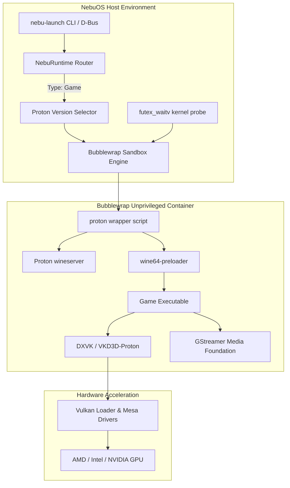
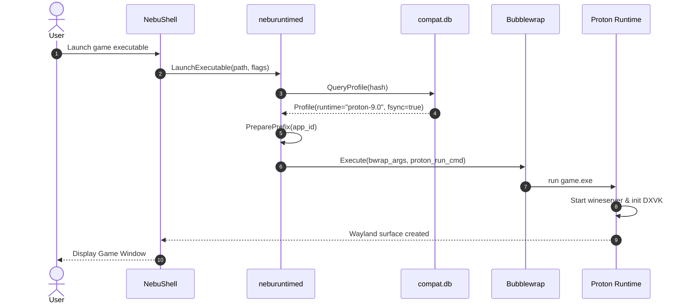

# Proton Integration Specification — NebuOS

**Status:** DRAFT  
**Purpose:** Define the architectural integration, runtime selection, prefix configuration, gaming runtime environment, and container execution model for Valve Proton within NebuOS.

---

## 1. Status
DRAFT — Architectural specification awaiting lab validation against Valve Proton 8.0/9.0 and Proton-GE release builds.

## 2. Purpose
NebuOS provides first-class support for Windows games without requiring a virtual machine or a complete Steam client installation. This specification defines how NebuOS integrates Proton as a specialized compatibility runtime alongside upstream Wine, orchestrating DXVK, VKD3D-Proton, Esync/Fsync, OpenVR stubs, and media foundation decoders.

## 3. Scope
- Packaging and version management of Proton runtimes in `/usr/lib/nebu/runtimes/proton/`.
- Detection of gaming vs. productivity executables and automatic runtime routing.
- Environment variables and prefix specialization for Proton prefixes.
- Integration of `proton-ge-custom` and official Valve Proton releases.
- Audio and gamepad mapping (PipeWire, evdev, SDL2 gamepad database).
- Fsync (`futex_waitv`) kernel interface utilization.

## 4. Non-goals
- Recompiling or maintaining an out-of-tree Proton fork.
- Emulating the Steam store, Steam Cloud, or proprietary Steamworks DRM.
- Bypassing kernel-level anti-cheat systems (Vanguard, Easy Anti-Cheat kernel mode).
- Bundling copyrighted Windows system DLLs or proprietary video codecs.

## 5. Requirements
1. **R-PRT-01:** Support automated deployment of Proton releases into isolated read-only runtime directories.
2. **R-PRT-02:** Provision gaming prefixes at `~/.nebu/apps/<app_id>/` with Proton-specific directory structures and registry layouts.
3. **R-PRT-03:** Enable Linux `fsync` (`futex_waitv`) by default on Linux kernel 6.6+; gracefully fall back to `esync` (eventfd) or standard Wine server IPC.
4. **R-PRT-04:** Enforce strict Bubblewrap sandboxing while granting direct access to `/dev/dri/renderD128` (Vulkan) and `/dev/input/` (gamepads).
5. **R-PRT-05:** Map Windows D3D9/10/11/12 API calls to Vulkan via DXVK and VKD3D-Proton bundles packaged with Proton.

## 6. Architecture
NebuOS treats Proton as an autonomous, self-contained runtime bundle containing its own customized Wine build, DXVK/VKD3D libraries, OpenAL audio, and GStreamer plugins.



## 7. Components
1. **Proton Runtime Store (`/usr/lib/nebu/runtimes/proton/`):** Immutable directories containing Proton releases (e.g. `proton-9.0-2`, `proton-ge-custom`).
2. **NebuRuntime Router:** Evaluates executable metadata, Compatibility Database tags, and user overrides to select between Wine and Proton.
3. **Fsync Manager:** Probes `/sys/kernel/debug/` or syscall availability for `__NR_futex_waitv` (syscall 449 on x86_64) and injects `PROTON_NO_FSYNC=0` or `1`.
4. **Gamepad Subsystem Bridge:** Ensures `/dev/input/js*` and `/dev/input/event*` devices are exposed inside the container with proper permissions.
5. **Media Foundation Bridge:** Configures Proton's bundled GStreamer plugins for in-game video playback (WMV, MP4, Bink).

## 8. Data Flow
1. User or application launcher initiates execution of a game executable `game.exe`.
2. `neburuntimed` inspects `compat.db` and identifies game classification (`is_game = 1`).
3. Profile specifies Proton target (e.g., `proton-9.0`).
4. Runtime copies/reflinks gaming prefix template from `/usr/share/nebu/prefix-template-proton/`.
5. Environment variables generated:
   ```bash
   STEAM_COMPAT_DATA_PATH="~/.nebu/apps/<app_id>"
   STEAM_COMPAT_CLIENT_INSTALL_PATH="/usr/lib/nebu/runtimes/proton/stubs"
   PROTON_USE_SECCOMP=1
   PROTON_ENABLE_NVAPI=1
   DXVK_ENABLE_NVAPI=1
   WINEFSYNC=1
   ```
6. Bubblewrap isolates the execution namespace, mounting only necessary host paths and DRM devices.
7. Game process spawns; graphics frames route through Vulkan directly to Wayland surfaces via DMA-BUF.

## 9. Control Flow


## 10. Interfaces
- **Filesystem Paths:**
  - Runtime Root: `/usr/lib/nebu/runtimes/proton/<version>/`
  - User Custom Runtimes: `~/.local/share/nebu/runtimes/proton/<version>/`
  - Per-App Prefix: `~/.nebu/apps/<app_id>/pfx/`
- **D-Bus Interface Integration:** Methods on `org.nebu.Runtime1` accept `runtime_override: "proton-latest"` in property maps.
- **Environment Invariants:** Standardizes `WINEPREFIX`, `WINEDEBUG=-all`, `DXVK_LOG_LEVEL=none`, `WINEFSYNC=1`.

## 11. Dependencies
- Upstream Valve Proton releases or Proton-GE binaries.
- Linux Kernel >= 6.6 with `CONFIG_FUTEX=y` and `CONFIG_FUTEX2=y`.
- Mesa Drivers >= 24.0 with Vulkan 1.3 support.
- Bubblewrap (`bwrap`) >= 0.8.0.
- PipeWire >= 1.0 for low-latency audio.

## 12. Security
- Proton binaries execute exclusively within unprivileged user namespaces (`bwrap`).
- Host network is disabled by default unless game profile explicitly specifies multiplayer networking (`network_allowed = true`).
- Access to root filesystems (`/etc`, `/usr`) is mounted strictly read-only (`--ro-bind`).
- Access to user personal files is strictly confined to `drive_c/users/nebu/` and whitelisted folders.
- Ptrace and dangerous syscalls are blocked via seccomp filters.

## 13. Resource Requirements
- **Disk Footprint:** ~1.8 GB per Proton runtime version in `/usr/lib/nebu/runtimes/`. Shared across all gaming prefixes.
- **Prefix Storage:** ~150 MB initial reflink footprint per gaming prefix on Btrfs.
- **RAM Overhead:** Proton wineserver: 18–35 MB RSS; game memory determined by target title.
- **CPU Scheduling:** `SCHED_OTHER` with `nice=-2` or `SCHED_BATCH` based on priority mode.

## 14. Failure Modes
1. **Fsync Kernel Incompatibility:** Kernel lacks `futex_waitv` support.
2. **Vulkan 1.3 Missing:** Host GPU driver lacks mandatory Vulkan extensions (e.g. dynamic state 3).
3. **Prefix Version Collision:** Prefix initialized with Proton 8 attempted to run under Proton 9 with conflicting registry structures.
4. **Media Foundation Missing Codec:** Video cutscenes hang on proprietary H.264/AAC streams.

## 15. Recovery Behavior
- When `fsync` fails initialization, runtime immediately logs warning and sets `WINEFSYNC=0 WINEESYNC=1` before retrying.
- In version collision, runtime takes an automated Btrfs snapshot (`snap-pre-upgrade`), runs `proton run wineboot -u`, and if failure occurs, restores the snapshot within 400ms.
- If Vulkan 1.3 is missing, runtime alerts user via notification that GPU acceleration requires Mesa 24+ and blocks launch gracefully instead of hard crashing.

## 16. Testing Requirements
- Test suite verifying `futex_waitv` detection on 6.6 LTS and 6.10+ kernels.
- Automated headless launch test using `dxvk-cube` and VKD3D test binaries.
- Gamepad input polling test using simulated evdev devices.
- Prefix reflink provisioning latency verification (< 250ms).

## 17. Performance Requirements
- Proton launch overhead from click to process execution: <= 600ms (warm cache).
- Game framerate overhead vs. native Windows: <= 7% on Vulkan/D3D11 workloads, <= 10% on D3D12 workloads.
- Input latency overhead added by Proton layer: <= 1.5ms.

## 18. Compatibility Considerations
- Certain legacy games require 32-bit Proton runtime components (`wine` 32-bit loader). NebuOS packages multiarch sysroot layers to support WoW64.
- Games demanding Steamworks DRM stubs must use mock DLLs (`steam_api.dll` stubs) to prevent instant exit.
- Games bundling invasive anti-cheat must be detected and rejected at launch with informative error dialogs.

## 19. Open Questions
- **OQ-PRT-01:** Should NebuOS bundle Proton-GE by default or strictly stick to Valve's official Proton releases for stability?
- **OQ-PRT-02:** What is the optimal automated prune policy for unused Proton runtime versions on storage-constrained devices?

## 20. Related Documents
- [00-runtime-specification.md](00-runtime-specification.md)
- [04-prefix-management.md](04-prefix-management.md)
- [05-wine-integration.md](05-wine-integration.md)
- [07-runtime-security.md](07-runtime-security.md)
- [../graphics/04-dxvk-vkd3d.md](../graphics/04-dxvk-vkd3d.md)
