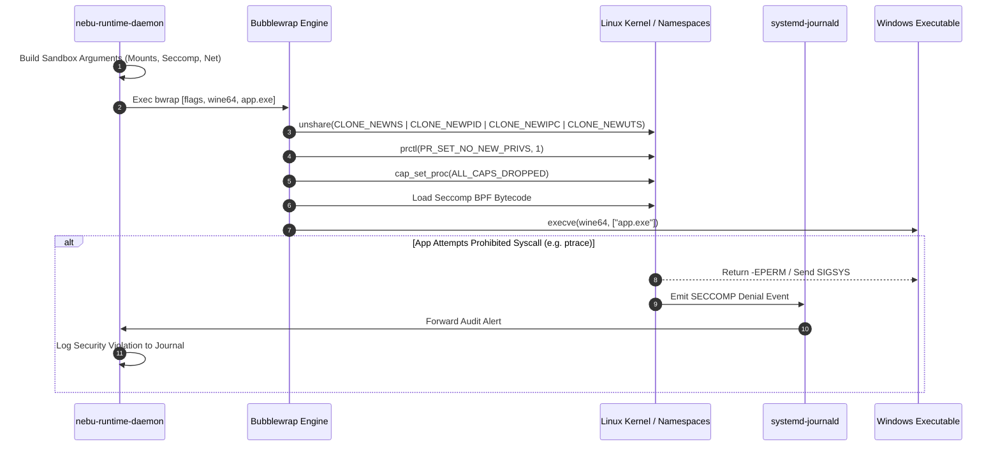

# Runtime Sandboxing and Security Specification — NebuOS

## Status
APPROVED

## Purpose
This specification formalizes the sandboxing, privilege containment, network access, IPC isolation, and auditing architecture enforced upon Windows applications executing under NebuRuntime. It defines how NebuOS leverages Bubblewrap (`bwrap`), Linux namespaces, Seccomp-BPF filters, and systemd journal audit logging to ensure that untrusted or vulnerable Windows software cannot compromise the immutable host OS, exfiltrate personal user data, or escape execution boundaries.

## Scope
This document covers:
- The complete Bubblewrap argument vector and execution invocation for Windows applications.
- A comprehensive filesystem visibility matrix detailing every host and sandbox mount mapping.
- Network policy enforcement (offline default vs opt-in networked profiles).
- IPC isolation boundaries, abstract socket blocking, and display socket mediation.
- Linux capabilities dropping (`CAP_DROP ALL`) and `PR_SET_NO_NEW_PRIVS`.
- Virtual filesystem filtering (`/proc` private PID masking, restricted `/sys`).
- Device node access policies (`/dev/dri/renderD*` vs `/dev/dri/card*`, selective evdev joystick mapping).
- Security event and Seccomp violation audit logging into `systemd-journald`.
- Decoupled runtime read-only mount enforcement (`/var/lib/nebu/runtimes/stores/` per [ADR-0017](file:///root/NebuOS/docs/decisions/ADR-0017-decoupled-runtime-packaging-and-storage.md)).
- Strict AI governance boundaries preventing autonomous security policy alterations.

## Non-goals
- **Hypervisor Hardware Enclaves:** Hardware virtualization or confidential computing enclaves (SEV/TDX).
- **Anti-Cheat Ring-0 Bypasses:** Kernel-level driver hooks or ring-0 emulation are explicitly prohibited.
- **Static Antivirus Engine:** Signature-based virus scanning; NebuOS focuses on strict containment and blast-radius minimization.

## Requirements

### Functional Requirements
- **REQ-SEC-001:** Enclose 100% of Windows processes within unprivileged Bubblewrap containers initialized with private user, mount, PID, IPC, and UTS namespaces.
- **REQ-SEC-002:** Deny application access to sensitive user directories (`~/.ssh`, `~/.gnupg`, `~/.config`, shell RC files, browser credentials) by default.
- **REQ-SEC-003:** Enforce an offline network policy (`--unshare-net`) by default for all applications, permitting network access only when explicitly declared in the application's signed compatibility profile.
- **REQ-SEC-004:** Drop all Linux capabilities unconditionally prior to executing child processes, preventing privilege escalation even in the event of local setuid binary exploitation.
- **REQ-SEC-005:** Mount GPU acceleration interfaces strictly through unprivileged DRM render nodes (`/dev/dri/renderD128`), blocking display master nodes (`/dev/dri/card0`) to prevent compositor surface hijacking.
- **REQ-SEC-006:** Log all sandbox policy violations and Seccomp syscall rejections to `systemd-journald` with structured metadata fields.
- **REQ-SEC-007 (Hard Release Gate):** Enforce the mandatory gate invariant:
$$\text{Compatibility PASS} + \text{Security FAIL} = \mathbf{REJECT}$$
No runtime, patch, profile, or update will be promoted to Candidate or Stable if it degrades security posture, disables sandboxing, weakens SELinux, or creates uncontained privilege escalation paths.

### Non-Functional Requirements
- **NFR-SEC-001 (Sandbox Launch Overhead):** Bubblewrap namespace setup and mount assembly must take less than 15 ms.
- **NFR-SEC-002 (Filesystem Overhead):** Bind mounts and private namespace construction must incur zero observable I/O latency penalty during runtime execution.
- **NFR-SEC-003 (Security Log Integrity):** Audit records emitted via the journal must be committed to disk within 100 ms of an unauthorized access event.

## Architecture

The security model implements defense-in-depth across multiple Linux kernel isolation layers:

```mermaid
graph TD
    subgraph HOST_ENVIRONMENT [Host Linux OS - UID 1000]
        HOST_ROOT["/ (Immutable ostree /usr)"]
        SENSITIVE_HOME["~/.ssh, ~/.gnupg, ~/.bashrc, ~/.config"]
        USER_DOCS["~/Documents / ~/Downloads"]
        JOURNALD["systemd-journald (Audit Sink)"]
        WAYLAND_SOCK["$XDG_RUNTIME_DIR/wayland-0"]
        PIPEWIRE_SOCK["$XDG_RUNTIME_DIR/pipewire-0"]
        GPU_RENDER["/dev/dri/renderD128 (DRM Render Node)"]
        GPU_MASTER["/dev/dri/card0 (KMS Master - BLOCKED)"]
    end

    subgraph BWRAP_BOUNDARY [Bubblewrap Sandbox Boundary]
        direction TB
        CAPS["All Linux Capabilities Dropped (cap-drop ALL)"]
        SECCOMP["Seccomp-BPF Syscall Filter (No ptrace/kexec)"]
        PRIVS["PR_SET_NO_NEW_PRIVS Active"]
        NAMESPACES["Namespaces: Mount, PID, IPC, UTS, (Net)"]
    end

    subgraph SANDBOX_FILESYSTEM [Sandbox Chroot / View]
        RO_USR["/usr & /lib64 (Read-Only Host Bind)"]
        TMP_TMPFS["/tmp & /run (Private tmpfs)"]
        PRIVATE_PROC["/proc (Isolated PID Namespace)"]
        SANDBOX_DRIVE_C["~/.nebu/apps/<app_id>/drive_c (Private R/W)"]
        BRIDGED_DOCS["drive_c/users/nebu/Documents (Bridged R/W)"]
    end

    subgraph APPLICATION_PROCESS [Confined Windows Process]
        WINE_PROC["wine64 / target.exe"]
    end

    HOST_ROOT -->|ro-bind| RO_USR
    SENSITIVE_HOME -.->|BLOCKED / HIDDEN| BWRAP_BOUNDARY
    USER_DOCS -->|Scoped bind| BRIDGED_DOCS
    WAYLAND_SOCK -->|ro-bind-try| BWRAP_BOUNDARY
    PIPEWIRE_SOCK -->|ro-bind-try| BWRAP_BOUNDARY
    GPU_RENDER -->|dev-bind| BWRAP_BOUNDARY
    GPU_MASTER -.->|FORBIDDEN| BWRAP_BOUNDARY
    BWRAP_BOUNDARY --> APPLICATION_PROCESS
    BWRAP_BOUNDARY -->|Structured Audit| JOURNALD
```



## Components

The runtime security subsystem comprises five dedicated components:

1. **`SandboxBuilder` (`nebu-runtime-core::sandbox`):**
   - Assembles the complete command-line vector for `/usr/bin/bwrap`.
   - Validates all host paths prior to binding, ensuring symlink traversal attacks are thwarted.
   - Applies profile-specific networking and document bridging rules.

2. **`SeccompPolicyCompiler` (`nebu-runtime-core::seccomp`):**
   - Generates a compiled BPF bytecode filter loaded by Bubblewrap via `--seccomp <fd>`.
   - Restricts sensitive system calls (`ptrace`, `kexec_load`, `bpf`, `userfaultfd`, `clone3`, `reboot`, `sys_chroot`).

3. **`DevicePolicyEngine` (`nebu-runtime-core::device`):**
   - Discovers available DRM render nodes and evdev input devices.
   - Masks master display devices and raw block storage interfaces.

4. **`NetworkGuard` (`nebu-runtime-core::network`):**
   - Controls `--unshare-net` activation.
   - In networked mode, interfaces with `slirp4netns` or user-namespace veth pairs to restrict outbound ports.

5. **`SecurityAuditor` (`nebu-runtime-daemon::audit`):**
   - Listens on kernel audit sockets and monitors child process stderr streams.
   - Dispatches structured logs to `systemd-journald` using `sd-journal` native APIs.

## Data Flow



## Control Flow

### 1. Complete Bubblewrap Argument Specification
When launching an application instance, `nebu-runtime-daemon` executes `bwrap` with the following comprehensive argument vector:

```bash
/usr/bin/bwrap \
  --unshare-all \
  --share-net \               # Omitted if profile.network_access == false
  --die-with-parent \
  --cap-drop ALL \
  --proc /proc \
  --dev /dev \
  --tmpfs /tmp \
  --tmpfs /var \
  --tmpfs /run \
  --ro-bind /usr /usr \
  --ro-bind /lib64 /lib64 \
  --ro-bind /etc/resolv.conf /etc/resolv.conf \
  --ro-bind /etc/fonts /etc/fonts \
  --ro-bind /etc/localtime /etc/localtime \
  --ro-bind /etc/ld.so.cache /etc/ld.so.cache \
  --ro-bind /usr/share/fonts /usr/share/fonts \
  --dev-bind /dev/dri/renderD128 /dev/dri/renderD128 \
  --ro-bind-try /run/user/1000/wayland-0 /run/user/1000/wayland-0 \
  --ro-bind-try /run/user/1000/pipewire-0 /run/user/1000/pipewire-0 \
  --bind /run/user/1000/nebu/<app_id> /run/user/1000/nebu/<app_id> \
  --bind /home/nebu/.nebu/apps/<app_id>/drive_c /home/nebu/.nebu/apps/<app_id>/drive_c \
  --bind /home/nebu/.nebu/apps/<app_id>/dosdevices /home/nebu/.nebu/apps/<app_id>/dosdevices \
  --bind /home/nebu/.nebu/apps/<app_id>/system.reg /home/nebu/.nebu/apps/<app_id>/system.reg \
  --bind /home/nebu/.nebu/apps/<app_id>/user.reg /home/nebu/.nebu/apps/<app_id>/user.reg \
  --bind /home/nebu/.nebu/apps/<app_id>/userdef.reg /home/nebu/.nebu/apps/<app_id>/userdef.reg \
  --bind /home/nebu/Documents /home/nebu/.nebu/apps/<app_id>/drive_c/users/nebu/Documents \
  --seccomp 12 \              # Inherits BPF filter from open file descriptor
  --chdir /home/nebu/.nebu/apps/<app_id>/drive_c \
  /usr/lib/nebu/runtimes/wine/bin/wine64 <binary.exe>
```

### 2. Comprehensive Filesystem Visibility Matrix

| Host Path | Sandbox Path | Mount Type | Access | Rationale |
|---|---|---|---|---|
| `/usr` | `/usr` | `ro-bind` | Read-Only | System binaries, Wine runtimes, Mesa graphics drivers. |
| `/lib64` | `/lib64` | `ro-bind` | Read-Only | System dynamic linker and shared C runtime libraries. |
| `/etc/resolv.conf` | `/etc/resolv.conf` | `ro-bind` | Read-Only | DNS name resolution (networked applications only). |
| `/etc/fonts` | `/etc/fonts` | `ro-bind` | Read-Only | Fontconfig font matching rules and fallbacks. |
| `/etc/localtime` | `/etc/localtime` | `ro-bind` | Read-Only | System timezone configuration for Win32 time APIs. |
| `/etc/shadow`, `/etc/passwd` | N/A | **HIDDEN** | No Access | Host user authentication secrets and user lists. |
| `/proc` | `/proc` | `proc` | Private | Isolated PID namespace; hides other host processes. |
| `/sys` | `/sys` | `tmpfs` / Masked | Read-Only | Prevents hardware reconfiguration and kernel inspection. |
| `/dev` | `/dev` | `dev` | Minimal | Populated with null, zero, full, random, urandom only. |
| `/dev/dri/renderD128`| `/dev/dri/renderD128`| `dev-bind` | Read/Write| Direct 3D hardware acceleration via DRM render node. |
| `/dev/dri/card0` | N/A | **HIDDEN** | No Access | Blocks KMS display server hijacking and screen snooping. |
| `/dev/input/event*` | N/A | **HIDDEN** | No Access | Keystroke logging prevention; joysticks bound explicitly. |
| `~/.ssh`, `~/.gnupg` | N/A | **HIDDEN** | No Access | Host private keys and cryptographic credentials. |
| `~/.config`, `~/.bashrc`| N/A | **HIDDEN** | No Access | Desktop settings and shell environment files. |
| `~/.nebu/apps/<id>/` | `~/.nebu/apps/<id>/` | `bind` | Read/Write| Application private prefix, registries, and drive_c. |
| `~/Documents` | `.../users/nebu/Docs` | `bind` | Read/Write| User document access bridge (optional / configurable). |
| `$XDG_RUNTIME_DIR/wayland-0`| Same | `ro-bind` | Socket | Graphical display buffer passing to `nebu-compositor`. |
| `$XDG_RUNTIME_DIR/pipewire-0`| Same | `ro-bind` | Socket | Low-latency audio stream playback and recording. |
| `/run/user/1000/bus` | N/A | **HIDDEN** | No Access | Host session D-Bus is completely unreachable. |

### 3. Network Policy Architecture
1. **Offline Mode (Default):**
   - Enforced by passing `--unshare-net` (or omitting `--share-net` under `--unshare-all`).
   - The application process sees only a loopback interface (`lo`) without external routing.
   - Protects users from spyware, telemetry, and background advertising in single-player games and offline productivity tools.
2. **Online Mode (Explicit Opt-In):**
   - Activated only if the application profile specifies `"network": true` or user passes `--enable-network`.
   - Passes `--share-net`, bridging the host network stack.
   - Future roadmap item: Port filtering via `slirp4netns` to restrict traffic exclusively to HTTP/HTTPS ports (80/443).

### 4. IPC Isolation Boundaries
- **Abstract UNIX Sockets:** Standard Wine creates abstract sockets (e.g. `@/tmp/.wine-1000/server-...`). In NebuOS, `--unshare-uts` and private mount namespaces isolate abstract sockets, preventing cross-application sniffing.
- **Host D-Bus Elimination:** The session bus socket (`/run/user/1000/bus`) is completely hidden. Applications cannot query `org.freedesktop.*` services, preventing arbitrary portal invocations or shell commands.
- **Display Mediation:** Only the filtered Wayland domain socket is mapped. X11 access is mediated exclusively through private rootless Xwayland servers.

### 5. Seccomp-BPF Syscall Filtering
NebuOS loads a strict Seccomp-BPF filter into the sandbox child:

```text
Default Action: ALLOW
Blocked Syscalls (Return -EPERM or kill process):
- ptrace           (Blocks process injection and inspection)
- kexec_load       (Blocks kernel kexec reboots)
- kexec_file_load  (Blocks kernel image replacement)
- bpf              (Blocks eBPF program loading and probing)
- userfaultfd      (Blocks kernel heap grooming exploit primitives)
- reboot           (Blocks system shutdown attempts)
- sys_chroot       (Blocks escaping the sandbox jail)
- vmsplice         (Blocks memory page splicing exploits)
- mount, umount2   (Blocks arbitrary filesystem mounting)
```

### 6. Security Event Audit Logging
All security-relevant events are dispatched directly to `systemd-journald` with structured fields:

```json
{
  "PRIORITY": "3",
  "SYSLOG_IDENTIFIER": "nebu-runtime-security",
  "NEBU_APP_ID": "autodesk.autocad.2024",
  "NEBU_EVENT_TYPE": "SANDBOX_VIOLATION",
  "BLOCKED_PATH": "/home/nebu/.ssh/id_ed25519",
  "BLOCKED_ACTION": "OPEN_READ",
  "SEVERITY": "CRITICAL",
  "MESSAGE": "Application attempted unauthorized access to host SSH credentials"
}
```

## Interfaces

### 1. Rust Sandbox Builder API (`nebu-runtime-core::sandbox`)

```rust
pub struct BubblewrapCommand {
    args: Vec<OsString>,
}

impl BubblewrapCommand {
    pub fn new() -> Self {
        let mut cmd = Self { args: Vec::new() };
        cmd.arg("--unshare-all")
           .arg("--die-with-parent")
           .arg("--cap-drop").arg("ALL")
           .arg("--proc").arg("/proc")
           .arg("--dev").arg("/dev")
           .arg("--tmpfs").arg("/tmp");
        cmd
    }

    pub fn bind_prefix(&mut self, prefix_path: &Path) -> &mut Self {
        self.arg("--bind").arg(prefix_path).arg(prefix_path)
    }

    pub fn set_network_allowed(&mut self, allowed: bool) -> &mut Self {
        if allowed {
            self.arg("--share-net");
        }
        self
    }

    pub fn spawn(&self) -> std::io::Result<tokio::process::Child> {
        let mut tokio_cmd = tokio::process::Command::new("/usr/bin/bwrap");
        tokio_cmd.args(&self.args);
        tokio_cmd.spawn()
    }
}
```

### 2. Audit Event Logger API (`nebu-runtime-daemon::audit`)

```rust
pub fn log_security_event(
    app_id: &str,
    event_type: &str,
    target_resource: &str,
    severity: &str,
    details: &str,
) {
    // Uses systemd sd-journal native C FFI bindings
    sd_journal::send(&[
        &format!("SYSLOG_IDENTIFIER=nebu-security"),
        &format!("NEBU_APP_ID={}", app_id),
        &format!("EVENT_TYPE={}", event_type),
        &format!("TARGET={}", target_resource),
        &format!("SEVERITY={}", severity),
        &format!("MESSAGE={}: {}", app_id, details),
    ]);
}
```

## Dependencies

- **Bubblewrap (`bwrap` v0.8+):** Core unprivileged namespace sandbox launcher.
- **Linux Kernel v5.15+:** User namespaces (`CONFIG_USER_NS`), Seccomp BPF (`CONFIG_SECCOMP_FILTER`).
- **libseccomp / libsystemd:** Bytecode compilation and journal logging.

## Security

- **Defense in Depth:** Even if Wine's Windows kernel emulation contains a memory corruption flaw, the attacker escapes into an unprivileged user namespace with zero Linux capabilities and no network routing.
- **Ransomware Neutralization:** Ransomware executing inside `drive_c` can only encrypt files inside that single prefix. The host operating system, other application prefixes, and unbridged documents are physically invisible and unreachable.
- **Credential Protection:** Because `/home/nebu/` is masked except for explicit subdirectories, browser tokens, SSH keys, GPG rings, and shell histories are safe from data exfiltration.

### The Fundamental Security Release Gate
$$\text{Compatibility PASS} + \text{Security FAIL} = \mathbf{REJECT}$$

Under no circumstances will a patch, DLL override, compatibility profile, or runtime configuration be approved if it:
1. Disables SELinux enforcement or requires `setenforce 0`.
2. Weakens Bubblewrap isolation (e.g. binding `/etc`, `/root`, or raw host storage devices).
3. Bypasses host firewall rules or allows unfiltered socket creation.
4. Suppresses pointer sanitization or introduces buffer overflow vulnerabilities into `ntdll` or `wineserver`.
5. Bypasses application licensing, commercial DRM, or kernel anti-cheat mechanisms.

### Decoupled Runtime Mount Security (ADR-0017)
- All compatibility runtime packages residing on the decoupled `@runtimes` subvolume (`/var/lib/nebu/runtimes/stores/`) are owned strictly by `root:root` with permissions `0755`.
- At container instantiation, `nebu-runtime-daemon` mounts the selected runtime path using `--ro-bind /var/lib/nebu/runtimes/stores/<runtime_id> /usr/lib/nebu/runtime`.
- Write access inside `/usr/lib/nebu/runtime` is physically impossible; neither the Windows executable nor rogue Wine processes can overwrite runtime binaries or libraries.

### AI Governance and Autonomous Security Guardrails
AI models, agents, and automated development assistants operate under non-negotiable security guardrails:
1. **NO Autonomous Security Relaxations:** AI agents are cryptographically and procedurally blocked from modifying Seccomp filter rules, removing capability drops, or expanding Bubblewrap bind vectors.
2. **NO Autonomous Release Authorization:** AI tools can analyze logs and draft candidate fixes, but production promotion into `Candidate` or `Stable` requires human verification.
3. **NO Anti-Cheat or DRM Tampering:** AI tools are strictly forbidden from generating code or profiles designed to spoof, crack, or bypass vendor DRM or anti-cheat systems.

## Resource Requirements

- **Bubblewrap Process Memory:** ~1.4 MB RSS per sandbox root process.
- **Namespace Overhead:** Zero observable CPU overhead; kernel namespace lookups operate in O(1) time.
- **Journal I/O:** Negligible during normal operations; active only upon exception or violation emission.

## Failure Modes

| Failure ID | Failure Description | Trigger Condition | System Reaction |
|---|---|---|---|
| `FAIL-SEC-001` | User Namespace Disabled | Kernel `sysctl kernel.unprivileged_userns_clone = 0`. | Abort launch; surface critical admin warning. |
| `FAIL-SEC-002` | Seccomp BPF Compilation Error | Unknown architecture or unsupported syscall rule. | Fall back to safe baseline filter; log warning. |
| `FAIL-SEC-003` | Wayland Socket Missing | Compositor socket crashed or wrong path specified. | Terminate launch cleanly before container execution. |
| `FAIL-SEC-004` | Attempted Privilege Escalation | Application invokes setuid helper inside prefix. | Kernel rejects call due to `PR_SET_NO_NEW_PRIVS`. |

## Recovery Behavior

- **Automatic Containment Termination:** If an application triggers a critical Seccomp violation (e.g. attempting to ptrace another process or execute raw socket operations in offline mode), the kernel immediately delivers `SIGSYS` or terminates the process. `nebu-runtime-daemon` logs the incident, quarantines the prefix, and alerts the user.
- **Safe State Rollback:** If an application behaves maliciously, the user can invoke `nebu prefix reset <app_id>` to instantaneously restore the prefix from the immutable base template.

## Testing Requirements

- **Filesystem Jailbreak Penetration Test:** Execute test binary attempting to read `/home/nebu/.ssh/id_rsa` and `/etc/shadow`; verify all read attempts return `ENOENT` or `EACCES`.
- **Seccomp Filter Enforcement Test:** Execute a test program issuing `ptrace(PTRACE_TRACEME)` and `reboot()`; assert that calls return `-EPERM` or trigger `SIGSYS`.
- **Offline Network Isolation Test:** Execute a test application attempting DNS resolution and TCP connection to `1.1.1.1:53`; assert `ENETUNREACH` in default offline mode.
- **Capabilities Dropped Verification:** Inspect `/proc/<pid>/status` inside the running container; verify `CapInh`, `CapPrm`, `CapEff`, `CapBnd` are all `0000000000000000`.

## Performance Requirements

- **Bubblewrap Container Setup Time:** Argument build, fork, namespace creation: **< 15 ms**.
- **Seccomp Bytecode Evaluation Overhead:** Syscall inspection penalty: **< 0.1 microseconds** per syscall.
- **Filesystem Mount Latency:** Mounting 20 bind paths via `bwrap`: **< 5 ms**.

## Compatibility Considerations

- **Installer Elevation Requests:** Many Windows installers embed manifests requesting Administrator privileges (`requireAdministrator`). Wine emulates this by returning `TRUE` for administrative privilege checks while remaining fully unprivileged on Linux.
- **Bridged Document Access:** If an application needs access to user files, NebuOS bridges only `~/Documents` into `drive_c/users/nebu/Documents`. Future releases will integrate FreeDesktop Document Portals for single-file dynamic access.

## Open Questions
- **OPEN QUESTION: SEC-01:** Should NebuOS implement Landlock LSM rules alongside Bubblewrap for granular in-process filesystem restriction?
- **OPEN QUESTION: SEC-02:** Should outbound network connections in online mode be passed through an interactive application firewall prompting the user per domain?

## Related Documents
- [00-runtime-specification.md](00-runtime-specification.md) — Master runtime daemon architecture.
- [01-application-lifecycle.md](01-application-lifecycle.md) — Application lifecycle state machine.
- [02-process-model.md](02-process-model.md) — Process supervision and cgroups model.
- [03-windows-runtime.md](03-windows-runtime.md) — Executable classification and PE headers.
- [04-prefix-management.md](04-prefix-management.md) — Prefix layout and Btrfs reflink snapshotting.
- [05-wine-integration.md](05-wine-integration.md) — Wine runtime engines and environment configuration.
- [08-nebuwine-specification.md](08-nebuwine-specification.md) — NebuWine downstream distribution specification.
- [../decisions/ADR-0016-nebuwine-architecture.md](../decisions/ADR-0016-nebuwine-architecture.md) — NebuWine architecture.
- [../decisions/ADR-0017-decoupled-runtime-packaging-and-storage.md](../decisions/ADR-0017-decoupled-runtime-packaging-and-storage.md) — Decoupled runtime storage.
- [../compatibility/07-wine-patch-governance.md](../compatibility/07-wine-patch-governance.md) — Wine patch governance.
