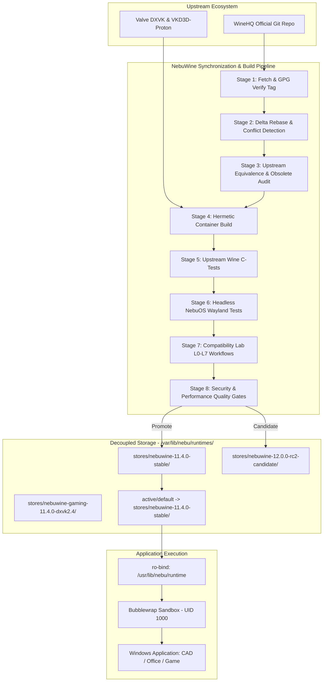
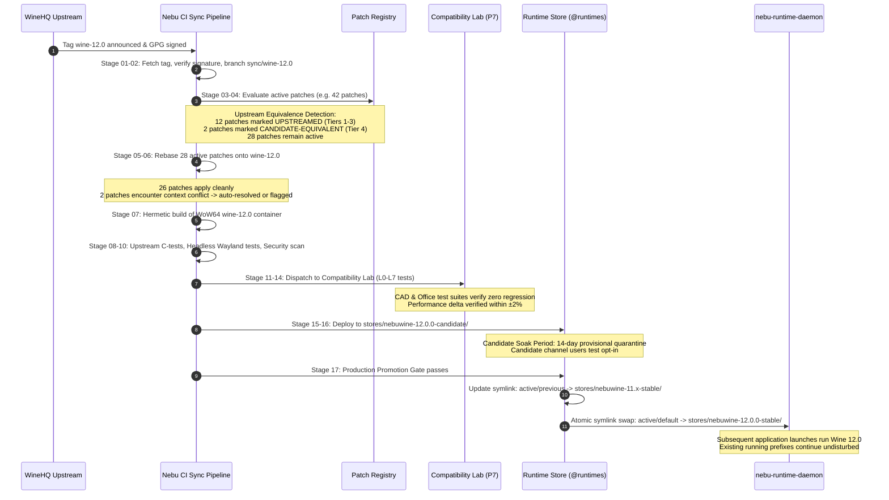

# NebuWine Technical Specification — Subsystem Architecture and Upstream Lifecycle

## Status
DRAFT (Milestone P3/P4 Architecture Specification)

## Purpose
This document defines the comprehensive technical and operational specification for **NebuWine**, the downstream Wine distribution powering Windows application compatibility in NebuOS. NebuWine bridges pristine upstream WineHQ source releases with the NebuOS runtime environment, maintaining a strictly governed, rebaseable downstream patch delta that tracks Wine 11, 12, 13, 14, 15, 16, and beyond without creating an unmaintainable hard fork.

## Scope
This specification encompasses:
- The architectural identity and mathematical model of NebuWine ($\text{NebuWine} = \text{Upstream Wine} + \text{Minimal Maintained Delta}$).
- The multi-generation progression lifecycle across future Wine versions (Wine 11 through Wine 16+).
- Support classifications (`SUPPORTED`, `CANDIDATE`, `LEGACY`, `UNSUPPORTED`) and runtime channels (`Stable`, `Candidate`, `Gaming`, `Legacy`, `Testing`).
- The 17-stage automated Upstream Synchronization Pipeline and machine-readable synchronization report schema.
- Decoupled runtime packaging, storage topology, and execution architecture on the `@runtimes` Btrfs subvolume at `/var/lib/nebu/runtimes/`.
- Runtime version selection, application-specific pinning, known-good retention, and atomic instant rollback.
- Integration boundaries with `nebu-runtime-daemon`, Bubblewrap sandboxing, DXVK, VKD3D-Proton, and Smithay Wayland compositor.

## Non-goals
- **Hard Forking Wine:** NebuWine will not establish a divergent, permanent fork of WineHQ.
- **Prefix Configuration Overlap:** Prefix-level registry tweaks and DLL overrides are handled exclusively by `nebu-patcher` (Domain B) and are out of scope for the Wine binary build tree.
- **Kernel Anti-Cheat Circumvention:** Ring-0 anti-cheat or DRM bypassing is strictly prohibited.
- **In-Tree Base OS Packaging:** Wine runtimes will not be embedded within the immutable `/usr` rootfs of the base `bootc` image.

## Requirements

### Functional Requirements
- **REQ-NW-001 (Upstream Foundation):** Every NebuWine release must be derived from an official, cryptographically verified WineHQ git tag or release commit.
- **REQ-NW-002 (Minimal Maintained Delta):** Downstream source patches applied to `wine.git` must be categorized, documented, and actively driven toward upstream WineHQ submission per `docs/compatibility/07-wine-patch-governance.md`.
- **REQ-NW-003 (Multi-Generation Cadence):** The build and packaging pipeline must support building Wine 11 through Wine 16+ without modifying NebuOS kernel, compositor, or shell architectures.
- **REQ-NW-004 (Decoupled Storage):** Runtime binaries and libraries must be packaged into self-contained versioned directories within `/var/lib/nebu/runtimes/stores/` on the dedicated `@runtimes` Btrfs subvolume.
- **REQ-NW-005 (Bubblewrap Mount Isolation):** During application launch, the selected runtime directory must be mounted **read-only (`ro`)** at `/usr/lib/nebu/runtime/` within the Bubblewrap container.
- **REQ-NW-006 (Runtime Selection & Coexistence):** `nebu-runtime-daemon` must support simultaneous side-by-side installations of multiple Wine versions, dynamically selecting the optimal version based on application profiles.
- **REQ-NW-007 (Atomic Rollback):** Upgrading or rolling back a default runtime channel must be an atomic operation completed via symlink swap in under 50 ms.
- **REQ-NW-008 (Synchronization Report):** Every upstream synchronization run must produce an automated, machine-readable JSON telemetry report and human-readable markdown audit summary.

### Non-Functional Requirements
- **NFR-NW-001 (Build Determinism):** All NebuWine binaries must be built in hermetic OCI build containers producing bit-for-bit reproducible artifacts across identical Git commits.
- **NFR-NW-002 (Recommended Maintenance Threshold):** Downstream source patch governance establishes a Recommended Maintenance Threshold of $\le 60\text{ active patches}$ maintained against `wine.git`. This threshold is an engineering discipline heuristic to prevent unmanageable rebase debt and maintenance bankruptcy. Exceeding 60 active downstream source patches triggers an architectural review and upstreaming acceleration sprint; exceptions are permitted for validated application compatibility needs upon documented review.
- **NFR-NW-003 (Launch Overhead):** Resolving and binding the runtime into an application sandbox must introduce less than 5 ms of latency.
- **NFR-NW-004 (Security Barrier):** A runtime build failing security audit or introducing privilege escalation vectors must be rejected regardless of compatibility gains (`Compatibility PASS + Security FAIL = REJECT`).

## System Overview



## Architecture

NebuWine is structured as an upstream-tracking downstream distribution:

$$\text{NebuWine} = \text{WineHQ Baseline (Tag)} + \sum_{i=1}^{n} \text{Downstream Patch}_i$$

Where every patch $\text{Patch}_i$ satisfies:
$$\text{Patch}_i \in \{\text{UPSTREAM-CANDIDATE}, \text{APPLICATION-COMPATIBILITY}, \text{NEBUOS}, \text{PERFORMANCE}, \text{SECURITY-SENSITIVE}, \text{EXPERIMENTAL}\}$$

### Upstream Synchronization Pipeline (17 Stages)

1. **Stage 01 (Upstream Ingestion):** Fetch Git tags from `https://gitlab.winehq.org/wine/wine.git` and verify GPG release signature.
2. **Stage 02 (Baseline Tagging):** Create internal sync tracking branch `sync/wine-<version>`.
3. **Stage 03 (Delta Analysis):** Query patch metadata registry for active downstream patches applicable to target version.
4. **Stage 04 (Equivalence Detection):** Scan upstream commits for git-patch-id or semantic equivalence to existing downstream patches.
5. **Stage 05 (Automated Rebase):** Apply surviving downstream patches onto upstream baseline.
6. **Stage 06 (Conflict Resolution):** If conflict occurs, isolate patch, invoke automated 3-way merge or flag for manual review.
7. **Stage 07 (Hermetic Build):** Compile 64-bit and 32-bit (WoW64) binaries inside official Fedora buildroot container.
8. **Stage 08 (WineHQ Test Suite):** Execute standard Wine internal test suite (`make test`); record regressions against baseline.
9. **Stage 09 (Headless Wayland Tests):** Run `nebu-test-runner` verifying winewayland.drv against Smithay Wayland protocol extensions.
10. **Stage 10 (Security Audit):** Run static analysis (`flawfinder`, `scan-build`) and seccomp/Bubblewrap barrier validation.
11. **Stage 11 (L0-L3 Core App Tests):** Automated headless launch, UI render, and document save/load on reference apps (Word, Excel, AutoCAD, Blender).
12. **Stage 12 (L4-L7 Stress Tests):** 4-hour stability run, memory leak detection, and CPU profiling.
13. **Stage 13 (Gaming & Graphics Tests):** Validate DXVK 2.4+ and VKD3D-Proton 2.13+ Direct3D translation on reference GPU nodes.
14. **Stage 14 (Performance Delta Analysis):** Ensure startup time, frame time, and memory overhead are within $\pm 2\%$ regression threshold.
15. **Stage 15 (Report Generation):** Generate machine-readable `sync-report.json` and human-readable `SYNC_REPORT.md`.
16. **Stage 16 (Channel Staging):** Publish artifact to `stores/nebuwine-<version>/` and assign `CANDIDATE` status.
17. **Stage 17 (Production Promotion):** After completing the 14-day zero-regression quarantine (Provisional Quality Gate Target / Soak Policy; expedited bypass permitted for critical CVE security hotfixes with Security Lead sign-off), promote `CANDIDATE` to `STABLE` via active symlink update.

## Component Specifications

### Runtime Channels and Profiles
NebuWine runtimes are segregated into distinct release channels:

| Channel | Baseline Source | Target Audience | Promotion Cadence | Fallback Safety |
|---|---|---|---|---|
| **Stable** | WineHQ Stable / Bi-weekly verified | Default desktop users, enterprise CAD | Bi-weekly / Monthly | Pinned previous stable |
| **Candidate** | WineHQ Latest Release Candidate | Opt-in beta testers, lab farm | Weekly | Instant switch to Stable |
| **Gaming** | NebuWine + DXVK + VKD3D + fsync | Gamers, interactive 3D titles | Bi-weekly | Fallback to Stable |
| **Legacy** | Previous major LTS baseline | Legacy Win32 accounting/custom software | Frozen (security only) | N/A |
| **Testing** | WineHQ git master + experimental | Developers, CI automated test farm | Daily / Per-commit | Isolated test ephemeral |

*Rule:* The `Stable` channel must NEVER automatically or silently consume `Testing` or `Candidate` builds. Channel switching is strictly explicit via application manifest or user preference.

### Version Support Progression (Wine 11 through Wine 16+)

| Wine Generation | Support Classification | NebuWine Phase | Downstream Focus Area | Deprecation Horizon |
|---|---|---|---|---|
| **Wine 9.x / 10.x** | Current Validated Baseline | Historical Foundation | Initial Wayland driver stabilization, WoW64 architecture | Legacy support until Wine 12 Stable |
| **Wine 11.x** | Production Target | Production Target (P3/P4) | Native Wayland clipboard/drag-drop, NTSYNC synchronization | Primary supported release |
| **Wine 12.x** | Expected Future Capability | Architectural Projection | Complete WoW64 pure-64bit host transition, HDR color spaces | Planned Candidate |
| **Wine 13.x - 16.x**| Expected Future Capability | Forward Architecture | Wayland fractional scaling, kernel-bypass Direct3D, DRM lease | Upstream tracking via continuous sync |

### Known-Good Runtime Baseline State Machine

To guarantee zero regression during upstream updates, runtime packages transition through a formal deterministic state machine:

```
[ BUILD COMPLETE ]
        |
        v
  [ CANDIDATE ] -----------------------+
        |                              |
        | (Passes 14-day quarantine    | (Fails verification /
        |  & Compatibility Lab gates)  |  regression detected)
        v                              v
[ CURRENT STABLE ]             [ FAILED CANDIDATE ]
        |                              |
        | (New Stable promoted)        +--> Quarantined in stores/;
        v                                   never linked to active/
  [ KNOWN-GOOD ]
        |
        | (Automated rollback triggered)
        v
[ ROLLBACK TARGET ] ---> Promoted to [ CURRENT STABLE ] (< 50ms symlink swap)
```

| State | Description | Storage Location | Activation Mechanism |
|---|---|---|---|
| **`CANDIDATE`** | Newly built runtime package undergoing verification | `stores/nebuwine-<ver>-candidate/` | Mounted only in opt-in test harnesses or Candidate channel |
| **`FAILED CANDIDATE`**| Package that failed automated gates or exhibited regression | `stores/nebuwine-<ver>-failed/` | Quarantined; prevented from active linking; scheduled for GC |
| **`CURRENT STABLE`** | Active production runtime serving all default prefixes | `stores/nebuwine-<ver>-stable/` | Target of symlink `/var/lib/nebu/runtimes/active/default` |
| **`KNOWN-GOOD`** | Immediately prior stable release retained as safety baseline | `stores/nebuwine-<prior>-stable/` | Target of symlink `/var/lib/nebu/runtimes/active/previous` |
| **`ROLLBACK TARGET`** | Verified known-good package selected during emergency reversion | `stores/nebuwine-<prior>-stable/` | Swapped into `/var/lib/nebu/runtimes/active/default` via atomic rename |

## Data Flow

### Hypothetical Upstream Upgrade Scenario (Wine N $\to$ Wine N+1)

To demonstrate the deterministic mechanics of the 17-stage sync pipeline during a major upstream release transition (e.g., Wine 11.0 $\to$ Wine 12.0):



### Application Ingestion to Runtime Execution

```
[ User Launches "AutoCAD.exe" ]
        |
        v
[ nebu-runtime-daemon (UID 1000) ]
        |
        +---> SHA-256 Fingerprint & PE Header Inspection
        +---> Query local SQLite `compat.db`
        |     Result: { App: "AutoCAD 2024", Runtime: "nebuwine-11.4.0", Channel: "Stable", DXVK: true }
        |
        +---> Check runtime store: `/var/lib/nebu/runtimes/stores/nebuwine-11.4.0/`
        |     If missing -> retrieve from signed package repository or use channel default
        |
        +---> Check prefix: `~/.local/share/nebu/prefixes/autocad2024/`
        |     If missing -> Reflink clone from `/var/lib/nebu/runtimes/templates/win64-clean`
        |
        +---> Execute nebu-patcher Tier 1-8 prefix hooks (Domain B)
        |
        v
[ Instantiate Bubblewrap Sandbox ]
        |
        +---> --ro-bind /var/lib/nebu/runtimes/stores/nebuwine-11.4.0 /usr/lib/nebu/runtime
        +---> --bind ~/.local/share/nebu/prefixes/autocad2024 /wineprefix
        +---> --setenv WINEPREFIX /wineprefix
        +---> --setenv WINEDLLOVERRIDES "d3d11=n,b;dxgi=n,b"
        |
        v
[ Spawn: /usr/lib/nebu/runtime/bin/wine64 AutoCAD.exe ]
```

## Interfaces

### Runtime Package Directory Layout Contract
Every installed runtime in `/var/lib/nebu/runtimes/stores/<runtime_id>/` must adhere to standard layout:

```
<runtime_id>/
├── metadata.json          # Complete runtime manifest (version, upstream commit, patches)
├── bin/
│   ├── wine               # Wine launcher script
│   ├── wine64             # 64-bit Wine PE loader
│   ├── wineserver         # Wine server daemon
│   └── msiexec            # Windows installer utility
├── lib/
│   └── wine/              # 32-bit PE and ELF modules
├── lib64/
│   └── wine/              # 64-bit PE and ELF modules (winewayland.drv, ntdll, etc.)
├── share/
│   ├── wine/              # fonts, generic registry templates (wine.inf)
│   └── default_pfx/       # baseline template files
└── verification.sha256    # Cryptographic hashes of all constituent binaries
```

### Metadata JSON Schema (`metadata.json`)
```json
{
  "$schema": "https://schemas.nebuos.org/v1/runtime-metadata.json",
  "runtime_id": "nebuwine-11.4.0-stable",
  "name": "NebuWine",
  "version": "11.4.0",
  "channel": "Stable",
  "upstream_baseline": {
    "repo": "https://gitlab.winehq.org/wine/wine.git",
    "tag": "wine-11.4",
    "commit": "a1b2c3d4e5f60718293a4b5c6d7e8f9012345678"
  },
  "patches_applied": [
    {
      "patch_id": "NW-PATCH-2026-0042",
      "category": "APPLICATION-COMPATIBILITY",
      "upstream_status": "SUBMITTED",
      "target_app": "Autodesk AutoCAD 2024"
    }
  ],
  "build_timestamp": "2026-09-05T14:30:00Z",
  "builder_image": "registry.nebuos.org/toolchain/wine-builder:v2.1",
  "features": {
    "wayland_native": true,
    "ntsync": true,
    "wow64_new": true,
    "dxvk_bundled": false
  }
}
```

## Security

### Read-Only Sandboxed Execution
- All runtime directories under `/var/lib/nebu/runtimes/stores/` are owned by `root:root` with permissions `0755`.
- Inside the Bubblewrap container, the runtime is mounted strictly with `--ro-bind`. Under no circumstances is `--bind` or write access granted to runtime libraries.
- The `wineserver` binary runs strictly within the unprivileged user namespace; setuid/setgid bits are strictly prohibited (`nosuid`).

### The Fundamental Security Gate
$$\text{Compatibility PASS} + \text{Security FAIL} = \mathbf{REJECT}$$

Under no circumstances will a patch, DLL override, or runtime configuration be approved if it:
1. Disables SELinux enforcement or requires `setenforce 0`.
2. Weakens Bubblewrap isolation (e.g. binding `/etc`, `/root`, or raw host devices).
3. Bypasses host firewall rules or allows unfiltered socket creation.
4. Suppresses pointer sanitization or introduces buffer overflow vulnerabilities into `ntdll` or `wineserver`.

## Performance

### Performance Metrics Taxonomy

| Metric | Classification | Target Value | Regression Threshold |
|---|---|---|---|
| **Cold Launch Overhead** | Requirement | $\le 80\text{ ms}$ | $> 120\text{ ms}$ |
| **Warm Launch Overhead** | Requirement | $\le 20\text{ ms}$ | $> 40\text{ ms}$ |
| **wineserver CPU Idle** | Requirement | $0.0\%\text{ CPU}$ | $> 0.5\%\text{ CPU}$ |
| **Direct3D 11 FPS (vs Native Win11)** | Target | $\ge 90\%$ | $< 80\%$ |
| **Direct3D 12 FPS (vs Native Win11)** | Target | $\ge 88\%$ | $< 78\%$ |
| **Frame Time Variance ($\sigma$)** | Target | $\le 1.8\text{ ms}$ | $> 3.5\text{ ms}$ |
| **Memory Footprint (Idle wineserver)** | Benchmark | $\le 12\text{ MB RSS}$ | $> 25\text{ MB RSS}$ |

## Error Handling

1. **Missing Runtime Version:** If an application manifest pins a runtime version that is not installed locally, `nebu-runtime-daemon` automatically falls back to the current active `Stable` channel and registers an alert in the session log.
2. **Runtime Corruption:** If SHA-256 verification of `/usr/lib/nebu/runtime/verification.sha256` fails, the runtime is quarantined, flagged as `CORRUPTED`, and execution switches immediately to the last known-good fallback.
3. **wineserver Deadlock:** If `wineserver` fails to respond to D-Bus ping within 5000 ms, `nebu-runtime-daemon` issues `SIGTERM` followed by `SIGKILL` to the sandbox cgroup, cleanly evicting stale sockets.

## Testing & Verification

- **Upstream C-Test Regression Gate:** All upstream tests in `dlls/*/tests` must produce zero new failures relative to the clean WineHQ baseline.
- **Protocol Conformance Suite:** Headless Wayland tests verify surface commits, subsurfaces, popup placement, and keyboard focus under Smithay.
- **Workflow Verification (L0-L7):** Automated GUI drivers execute real-world tasks across 30 certified applications in the Compatibility Lab.

## Deployment

Runtimes are deployed onto the `@runtimes` subvolume:
```bash
# Atomic deployment sequence
tar -I zstd -xf nebuwine-11.4.0.tar.zst -C /var/lib/nebu/runtimes/stores/
cd /var/lib/nebu/runtimes/active
ln -sfn ../stores/nebuwine-11.4.0-stable default.new
mv -Tf default.new default
```

## Dependencies

- **Linux Kernel:** $\ge 6.6$ (NebuOS baseline: 7.1+) with `futex_waitv` and `CONFIG_NTSYNC` (optional/preferred).
- **Bubblewrap:** $\ge 0.8.0$ for user namespace isolation.
- **Btrfs:** Filesystem supporting reflink deduplication and subvolume snapshots.
- **Smithay / NebuCompositor:** Wayland compositor implementing `xdg-shell`, `linux-dmabuf-v1`, and `fractional-scale-v1`.

## Observability

- **D-Bus Telemetry:** `org.nebu.Runtime1` exposes `ActiveRuntimes`, `PrefixUsage`, and `ProcessAccounting`.
- **Systemd Journal:** Structured logs emitted under syslog identifier `nebu-runtime` with JSON payload tags `[NW-EVENT]`.

## Concurrency

- Each application prefix maintains its own dedicated `wineserver` instance inside its own sandbox.
- Multiple applications using the same runtime binary execute completely independent user processes; runtime files are open read-only with shared memory mappings (`mmap`).

## Configuration

System-wide runtime settings reside in `/etc/nebu/runtime.conf`:
```ini
[runtime]
default_channel = "Stable"
retain_previous_versions = 2
auto_clean_legacy_days = 90
enable_ntsync = true
enable_esync = true
```

## Constraints

- Runtime packages must remain 100% self-contained, resolving all shared libraries either from their own internal `lib/` directory or from standard base OS libraries guaranteed by the immutable base image.
- Total active runtime storage in `/var/lib/nebu/runtimes/stores/` must be bounded; garbage collection removes unreferenced legacy runtimes after retention expiry.

## Migration & Compatibility

- Transition from legacy `/usr/lib/nebu/runtimes/`: Existing prefixes referencing old paths will be transparently migrated during first boot via `nebu-runtime-daemon` prefix symlink updates.
- Backward compatibility: Wine 9/10 prefixes migrate automatically to Wine 11 without requiring user re-installation.

## References

- [ADR-0005: Upstream Wine as Core Compatibility Engine](file:///root/NebuOS/docs/decisions/ADR-0005-wine.md)
- [ADR-0016: NebuWine Downstream Distribution Architecture](file:///root/NebuOS/docs/decisions/ADR-0016-nebuwine-architecture.md)
- [ADR-0017: Decoupled Runtime Packaging and Storage](file:///root/NebuOS/docs/decisions/ADR-0017-decoupled-runtime-packaging-and-storage.md)
- [ADR-0018: NebuWine Gaming Runtime Architecture](file:///root/NebuOS/docs/decisions/ADR-0018-gaming-runtime-architecture.md)
- [WineHQ Source Repository](https://gitlab.winehq.org/wine/wine)
- [NebuOS Wine Patch Governance](file:///root/NebuOS/docs/compatibility/07-wine-patch-governance.md)
