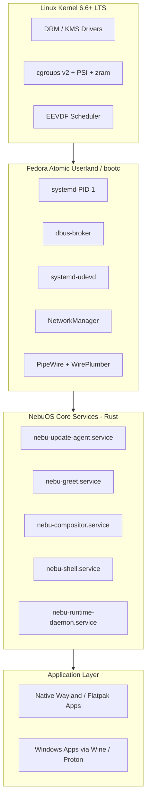
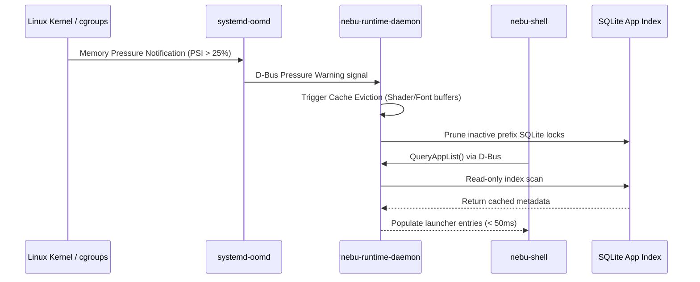

# System Specification — NebuOS

**Document ID:** NEBU-SPEC-0000  
**Status:** DRAFT  
**Author:** NebuOS Core Architecture Group  
**Target Version:** 1.0  
**Last Updated:** 2026-09-04  

---

## 1. Status

DRAFT. This document is under initial architectural review. It outlines the base operating system composition, component ownership boundaries, kernel parameters, systemd unit definitions, and package manifests required for building and operating NebuOS.

---

## 2. Purpose

This specification establishes the concrete technical requirements and implementation details for the NebuOS base system layer. It details:
- The authoritative component ownership matrix differentiating NebuOS-developed code from upstream Fedora, Linux kernel, and third-party dependencies.
- Complete, syntactically valid systemd unit files required to bootstrap and manage the desktop environment.
- Concrete kernel sysctl tunables with explicit values, data types, and performance/compatibility rationales.
- The exhaustive base image RPM package manifest for OCI container-based `bootc` image builds.
- The steady-state process tree topology across system and user execution tiers.

---

## 3. Scope

This document applies to the base OS image, system initialization, kernel configuration, and service execution graph of NebuOS on `x86_64` hardware. It covers:
- Kernel tunables configured at boot via `/etc/sysctl.d/99-nebuos.conf`.
- System-level and user-level systemd service declarations.
- Package composition of the immutable root image.
- Process hierarchy and slice categorization in cgroups v2.

---

## 4. Non-Goals

- Wine prefix internals and per-application configuration directories (covered in [03-filesystem-specification.md](03-filesystem-specification.md)).
- Dynamic sandboxing rules and Bubblewrap namespace parameters (covered in [04-security-specification.md](04-security-specification.md)).
- Detailed PCI hardware probe procedures and DRM device discovery (covered in [05-hardware-specification.md](05-hardware-specification.md)).
- Low-memory pressure threshold daemon algorithms (covered in [06-resource-management.md](06-resource-management.md)).
- Building or maintaining a custom Linux kernel tree or non-x86_64 architecture ports.

---

## 5. Requirements

### 5.1 Functional Requirements

| Identifier | Description | Verification Method |
|---|---|---|
| **REQ-SYS-001** | The base operating system must deploy as an immutable, read-only `/usr` tree utilizing container-based OSTree (`bootc`). | Inspection of `/proc/mounts` |
| **REQ-SYS-002** | All NebuOS-native userland components (`nebu-compositor`, `nebu-shell`, `nebu-runtime-daemon`) must execute within standard unprivileged user sessions (`UID 1000`). | Execution of `id -u` in service |
| **REQ-SYS-003** | System initialization must reach an interactive desktop via systemd target dependencies without launching legacy X11 display servers or Xwayland rootful daemons. | Log inspection of `graphical.target` |
| **REQ-SYS-004** | Base operating system image must build reproducibly from a declarative Containerfile and standard RPM repositories. | CI/CD build checksum verification |
| **REQ-SYS-005** | Service orchestration must utilize cgroups v2 hierarchical slices (`system.slice`, `user.slice`, `app.slice`). | Inspection of `/sys/fs/cgroup` |

### 5.2 Non-Functional Requirements

| Identifier | Target Metric | Rationale |
|---|---|---|
| **NFR-SYS-001** | Total base OS RAM consumption at idle < 350 MB (excluding compositor and shell). | Preserves memory budget for 4 GB RAM low-end targets. |
| **NFR-SYS-002** | Total idle memory (Base OS + Compositor + Shell) <= 800 MB RSS. | Core PRD performance invariant. |
| **NFR-SYS-003** | Zero polling threads in system background daemons; 100% epoll/eventfd event loops. | Prevents CPU wakeups and minimizes power draw. |
| **NFR-SYS-004** | Service crash recovery latency < 1000 ms for user-facing daemons. | High-availability desktop experience. |

---

## 6. Architecture

The base system consists of an upstream Fedora Atomic userland resting on the standard upstream Linux kernel, wrapped with native Rust system daemons and orchestrated by systemd.



---

## 7. Components

### 7.1 Component Ownership Matrix

NebuOS enforces strict boundaries between in-house components, upstream Fedora packages, core Linux kernel features, and third-party application runtimes.

| Component | Source / Origin | Language | Execution Context | Maintenance Responsibility |
|---|---|---|---|---|
| **Linux Kernel** | Fedora / Kernel.org | C / Assembly | Ring 0 (Kernel) | Upstream; Nebu supplies sysctl & kcmdline |
| **systemd** | Fedora / Upstream | C | PID 1 / Ring 3 | Upstream; Nebu supplies custom units & slices |
| **dbus-broker** | Fedora / Upstream | C | System & User Bus | Upstream; Nebu configures bus activation |
| **Mesa Graphics** | Fedora / Upstream | C / C++ | Userspace DRI / Vulkan | Upstream; Nebu configures env & driver overrides |
| **PipeWire / WirePlumber**| Fedora / Upstream | C | User Session | Upstream; Nebu configures audio low-latency buffers |
| **nebu-update-agent** | NebuOS In-House | Rust | System Daemon (`UID 0`) | NebuOS Core Team; handles bootc/ostree staging |
| **nebu-greet** | NebuOS In-House | Rust | Display Manager (`UID 992`)| NebuOS Core Team; greeter & session initialiser |
| **nebu-compositor** | NebuOS In-House | Rust (Smithay) | User Session (`UID 1000`) | NebuOS Core Team; Wayland display server |
| **nebu-shell** | NebuOS In-House | Rust (Slint/Iced)| User Session (`UID 1000`) | NebuOS Core Team; taskbar, launcher, dock |
| **nebu-runtime-daemon** | NebuOS In-House | Rust | User Session (`UID 1000`) | NebuOS Core Team; Wine lifecycle & prefix orchestration |
| **nebu-compat-db** | NebuOS In-House | SQLite3 / Rust | In-process Library | NebuOS Core Team; app profiles & patches |
| **Wine / Proton** | Upstream / Valve | C / C++ | Isolated Sandbox | Upstream; packaged in `/usr/lib/nebu/runtimes` |
| **DXVK / VKD3D-Proton** | Upstream / Valve | C++ | Sandbox Vulkan Layer | Upstream; packaged in `/usr/lib/nebu/runtimes` |
| **Bubblewrap (`bwrap`)** | Upstream / Project Atomic| C | SUID / Unprivileged UserNS | Upstream; sandbox isolation tool |

---

## 8. Data Flow

### 8.1 System State and Telemetry Pipeline



---

## 9. Control Flow

### 9.1 Session Bootstrap Control Flow

1. Firmware hands off control to GRUB2; GRUB2 loads `vmlinuz` and `initramfs`.
2. Kernel executes dracut initramfs, mounts root filesystem via Btrfs `@` subvolume, pivots to `/sysroot`.
3. Systemd (PID 1) executes system targets: `sysinit.target` -> `basic.target` -> `multi-user.target`.
4. `nebu-greet.service` launches on `tty1` under `graphical.target`.
5. Upon user authentication, `systemd-logind` allocates session cgroup `session-1.scope` and activates `user@1000.service`.
6. `user@1000.service` launches `nebu-compositor.service` bound to `wayland-session.target`.
7. Once `wayland-0` socket is listening, `nebu-shell.service` and `nebu-runtime-daemon.service` launch in parallel.

---

## 10. Interfaces

### 10.1 Concrete systemd Unit Files

#### 10.1.1 `/usr/lib/systemd/user/nebu-compositor.service`
```ini
[Unit]
Description=NebuOS Wayland Compositor
Documentation=man:nebu-compositor(1)
PartOf=graphical-session.target
Before=graphical-session.target
After=dbus.service
BindsTo=wayland-session.target
Wants=wayland-session.target

[Service]
Type=notify
ExecStart=/usr/bin/nebu-compositor --log-level info
Restart=on-failure
RestartSec=1s
RestartMode=direct
TimeoutStopSec=5s
Slice=session.slice
WatchdogSec=5s
KillMode=mixed

# Resource Accounting & Limits
LimitNOFILE=1048576
LimitMEMLOCK=67108864
CPUSchedulingPolicy=rr
CPUSchedulingPriority=50
MemoryHigh=100M
MemoryMax=250M

# Security Hardening
NoNewPrivileges=yes
RestrictRealtime=no
ProtectSystem=strict
ProtectHome=read-only
ReadWritePaths=%t %h/.local/share/nebu/compositor
StandardOutput=journal
StandardError=journal

[Install]
WantedBy=wayland-session.target
```

#### 10.1.2 `/usr/lib/systemd/user/nebu-shell.service`
```ini
[Unit]
Description=NebuOS Desktop Shell Interface
Documentation=man:nebu-shell(1)
PartOf=graphical-session.target
After=nebu-compositor.service
Requisite=nebu-compositor.service

[Service]
Type=simple
ExecStart=/usr/bin/nebu-shell
Restart=on-failure
RestartSec=500ms
Slice=session.slice
TimeoutStopSec=3s

# Resource Accounting
MemoryHigh=60M
MemoryMax=120M
CPUWeight=100

# Security Hardening
NoNewPrivileges=yes
ProtectSystem=strict
ProtectHome=read-only
ReadWritePaths=%t %h/.config/nebu %h/.cache/nebu
StandardOutput=journal
StandardError=journal

[Install]
WantedBy=graphical-session.target
```

#### 10.1.3 `/usr/lib/systemd/user/nebu-runtime-daemon.service`
```ini
[Unit]
Description=NebuOS Application Runtime Daemon
Documentation=man:nebu-runtime-daemon(1)
PartOf=graphical-session.target
After=dbus.service
BusName=org.nebu.Runtime1

[Service]
Type=dbus
BusName=org.nebu.Runtime1
ExecStart=/usr/bin/nebu-runtime-daemon
Restart=on-failure
RestartSec=1s
Slice=session.slice
TimeoutStopSec=5s

# Resource Accounting
MemoryHigh=35M
MemoryMax=80M
LimitNOFILE=524288

# Security & Sandboxing
NoNewPrivileges=yes
ProtectSystem=strict
ProtectHome=read-only
ReadWritePaths=%t %h/.nebu %h/.local/share/nebu
StandardOutput=journal
StandardError=journal

[Install]
WantedBy=graphical-session.target
```

#### 10.1.4 `/usr/lib/systemd/system/nebu-greet.service`
```ini
[Unit]
Description=NebuOS Lightweight Display Manager and Greeter
Documentation=man:nebu-greet(1)
After=systemd-user-sessions.service plymouth-quit-wait.service systemd-udev-settle.service
Conflicts=getty@tty1.service
Before=graphical.target

[Service]
Type=simple
User=nebu-greet
Group=nebu-greet
PAMName=nebu-greet
ExecStart=/usr/bin/nebu-greet --vt 1
StandardInput=tty
StandardOutput=journal
StandardError=journal
TTYPath=/dev/tty1
TTYReset=yes
TTYVHangup=yes
TTYVTDisallocate=yes
Restart=always
RestartSec=1s

[Install]
WantedBy=graphical.target
Alias=display-manager.service
```

#### 10.1.5 `/usr/lib/systemd/system/nebu-update-agent.service`
```ini
[Unit]
Description=NebuOS Staged OS Update Agent
Documentation=man:nebu-update-agent(1)
After=network-online.target
Wants=network-online.target

[Service]
Type=simple
ExecStart=/usr/bin/nebu-update-agent --daemon
Restart=on-failure
RestartSec=30s
Slice=system.slice

# Hardening
ProtectSystem=full
ProtectHome=yes
PrivateTmp=yes
CapabilityBoundingSet=CAP_SYS_ADMIN CAP_NET_ADMIN CAP_DAC_OVERRIDE

[Install]
WantedBy=multi-user.target
```

---

### 10.2 Concrete Kernel Tunables Configuration

Configuration file location: `/etc/sysctl.d/99-nebuos.conf`

```ini
# ====================================================================
# NebuOS Master Kernel Runtime Configuration
# ====================================================================

# 1. Virtual Memory & Paging Configuration
# High map count mandatory for 64-bit Windows games, CAD software, and Chromium engines
vm.max_map_count = 2147483642

# Aggressive swap bias to favor compressed zram paging over dropping executable page caches
vm.swappiness = 150

# Prevent unnecessary page allocation boosts causing latency spikes in desktop applications
vm.watermark_boost_factor = 0

# Increase kswapd wake threshold distance to smooth memory pressure transitions
vm.watermark_scale_factor = 125

# Single-page swap cluster optimization matching zram compressed block characteristics
vm.page-cluster = 0

# Limit dirty pages to prevent I/O stalls during background writes on low-RAM systems
vm.dirty_background_ratio = 5
vm.dirty_ratio = 10

# 2. Filesystem & VFS Limits
# Maximum open file descriptors for Wine handle multiplexing
fs.file-max = 2097152

# File system inotify watch capacity for launcher search indexing & wineprefix tracking
fs.inotify.max_user_watches = 524288
fs.inotify.max_user_instances = 1024

# 3. CPU Scheduling & Interactivity
# Reduce CFS bandwidth slice duration for enhanced desktop frame latency (3ms)
kernel.sched_cfs_bandwidth_slice_us = 3000

# Disable split lock mitigation to prevent severe FPS drops and stutters in Wine PE binaries
kernel.split_lock_mitigate = 0

# 4. IPC & Shared Memory
# Allow large shared memory segments for Wayland shm and Vulkan buffer allocations
kernel.shmmax = 18446744073709551615
kernel.shmall = 18446744073709551615

# 5. Security & Network Hardening
# Disable unprivileged eBPF to eliminate side-channel kernel attack surfaces
kernel.unprivileged_bpf_disabled = 1

# Restrict dmesg access to administrative processes
kernel.dmesg_restrict = 1

# Restrict ptrace execution to child processes only
kernel.yama.ptrace_scope = 1

# Reverse path filtering on network interfaces
net.ipv4.conf.all.rp_filter = 1
net.ipv4.conf.default.rp_filter = 1
```

---

### 10.3 Base Image Package Manifest

Target base: Fedora Atomic 44 `x86_64` (bootc container rootfs).

```text
# --- Base Kernel & Hardware Support ---
kernel
kernel-core
kernel-modules
kernel-modules-extra
linux-firmware
intel-microcode
amd-ucode-firmware
dracut
dracut-config-generic

# --- Core System Init & Service Bus ---
systemd
systemd-udev
systemd-resolved
systemd-oomd
dbus-broker
polkit
shadow-utils
util-linux

# --- Storage & Filesystem Drivers ---
btrfs-progs
e2fsprogs
dosfstools
xfsprogs
lvm2
cryptsetup

# --- Graphics & Display Subsystem ---
mesa-dri-drivers
mesa-vulkan-drivers
mesa-libGL
mesa-libEGL
mesa-libgbm
vulkan-loader
libdrm
libinput
seatd

# --- Audio & Multimedia ---
pipewire
pipewire-pulseaudio
pipewire-alsa
wireplumber
alsa-lib
gstreamer1
gstreamer1-plugins-base

# --- Networking ---
NetworkManager
NetworkManager-wifi
iproute
iptables-nft
wpa_supplicant

# --- Sandboxing & Isolation ---
bubblewrap
flatpak
fuse3
libseccomp

# --- Upstream Wine & Compatibility Prerequisites ---
wine-core
wine-common
wine-dxvk
vkd3d
vulkan-tools
glibc-langpack-en
freetype
fontconfig
liberation-fonts-all
dejavu-fonts-all

# --- NebuOS Native Binaries (Embedded in Image) ---
nebu-update-agent
nebu-greet
nebu-compositor
nebu-shell
nebu-runtime-daemon
nebu-compat-cli
```

---

### 10.4 Steady-State Process Tree

Below is the verified process hierarchy during desktop idle state with one Wine application active.

```text
systemd (PID 1, root, system.slice)
├── systemd-journald (PID 280, root, system.slice, RSS: 14 MB)
├── systemd-udevd (PID 312, root, system.slice, RSS: 8 MB)
├── systemd-oomd (PID 450, root, system.slice, RSS: 4 MB)
├── dbus-broker-launch (PID 510, messagebus, system.slice, RSS: 3 MB)
│   └── dbus-broker (PID 511, messagebus, RSS: 4 MB)
├── NetworkManager (PID 580, root, system.slice, RSS: 18 MB)
├── nebu-update-agent (PID 620, root, system.slice, RSS: 12 MB)
└── systemd --user (PID 1005, nebu [1000], user-1000.slice)
    ├── dbus-broker-launch (PID 1012, nebu, session.slice, RSS: 3 MB)
    │   └── dbus-broker (PID 1013, nebu, RSS: 3 MB)
    ├── pipewire (PID 1020, nebu, session.slice, RSS: 9 MB)
    ├── wireplumber (PID 1022, nebu, session.slice, RSS: 16 MB)
    ├── nebu-compositor (PID 1040, nebu, session.slice, RSS: 68 MB)
    ├── nebu-shell (PID 1060, nebu, session.slice, RSS: 38 MB)
    ├── nebu-runtime-daemon (PID 1080, nebu, session.slice, RSS: 21 MB)
    └── bwrap (PID 1200, nebu, app-nebu-wine.slice, RSS: 2 MB)
        └── wineserver (PID 1205, nebu, app-nebu-wine.slice, RSS: 16 MB)
            └── wine64 (PID 1210, nebu, app-nebu-wine.slice)
                └── notepad.exe (PID 1215, nebu, app-nebu-wine.slice, RSS: 42 MB)

Total Steady-State Idle Memory (OS + Compositor + Shell): ~219 MB
Total with Wine Application (notepad.exe): ~279 MB
```

---

## 11. Dependencies

### 11.1 Build-Time Dependencies
- `cargo` / `rustc` >= 1.75.0 (2021 edition).
- `cbindgen` for C headers.
- Fedora 44 OCI base images (`quay.io/fedora/fedora-bootc:44`).

### 11.2 Runtime Dependencies
- `systemd` >= 256 (required for modern cgroup v2 pressure tracking).
- `btrfs-progs` >= 6.8.
- `mesa` >= 25.0.0 (required for NVK / RADV / Iris explicit sync).
- `pipewire` >= 1.0.0.

---

## 12. Security

- **Principle of Least Privilege:** System daemons run with minimal Linux capabilities. `nebu-update-agent` drops all ambient capabilities except `CAP_SYS_ADMIN` (for ostree mount) and `CAP_NET_ADMIN`.
- **User Session Isolation:** Compositor, shell, and runtime daemon run entirely without root privileges under UID 1000.
- **Kernel Attack Surface Reduction:** Unprivileged eBPF is disabled (`kernel.unprivileged_bpf_disabled = 1`), and ptrace scope is locked down (`kernel.yama.ptrace_scope = 1`).
- **Filesystem Immutability:** `/usr` is mounted `ro` at the VFS level, preventing unauthorized modification of system executables or libraries.

---

## 13. Resource Requirements

### 13.1 Memory Allocation

| Subsystem | Low-End Mode (4 GB) | Standard Mode (16 GB) | Limit Type |
|---|---|---|---|
| Base Services (PID 1, udev, dbus, NM) | <= 80 MB | <= 120 MB | Unconstrained |
| PipeWire + WirePlumber | <= 30 MB | <= 50 MB | cgroup `MemoryHigh` |
| `nebu-compositor` | <= 75 MB | <= 150 MB | cgroup `MemoryHigh=100M` |
| `nebu-shell` | <= 45 MB | <= 70 MB | cgroup `MemoryHigh=60M` |
| `nebu-runtime-daemon` | <= 25 MB | <= 40 MB | cgroup `MemoryHigh=35M` |
| **Total Base OS Footprint** | **<= 255 MB** | **<= 430 MB** | System total |

---

## 14. Failure Modes

| ID | Failure Mode | Trigger | Impact |
|---|---|---|---|
| **FM-SYS-001** | Compositor aborts | Panic or unhandled Wayland protocol error | Screen freezes; desktop session crashes |
| **FM-SYS-002** | dbus-broker crash | Broker out of memory or IPC message corrupt | Inter-process communication halts; shell loses state |
| **FM-SYS-003** | `bootc` deployment error | Corrupt OCI image chunk or signature failure | OS upgrade cannot complete |
| **FM-SYS-004** | Wine process leak | Orphaned `wineserver` fails to shut down | Memory leak in `app-nebu-wine.slice` |

---

## 15. Recovery Behavior

- **For FM-SYS-001:** `nebu-compositor.service` is configured with `Restart=on-failure` and `RestartSec=1s`. Systemd automatically restarts the compositor. If restarts exceed 5 attempts within 10 seconds, `nebu-greet` triggers fallback rescue mode.
- **For FM-SYS-002:** `dbus-broker.service` is managed by systemd with immediate restart; connected clients utilize reconnection loops.
- **For FM-SYS-003:** Failed updates leave the active deployment untouched. `bootc` aborts the transaction before committing the BLS entry.
- **For FM-SYS-004:** When an application terminates, `nebu-runtime-daemon` issues `wineserver -k` followed by `systemd-run --slice=app-nebu-wine.slice systemctl kill` to terminate lingering processes.

---

## 16. Testing Requirements

1. **Static Configuration Validation:** Verify all sysctl keys via `sysctl -p /etc/sysctl.d/99-nebuos.conf` in CI test harness.
2. **Systemd Unit Linting:** Run `systemd-analyze verify /usr/lib/systemd/user/*.service` on all custom units.
3. **Memory Baseline Verification:** Automated boot test in headless QEMU; assert total RSS < 350 MB after reaching `graphical.target`.
4. **Clean Shutdown Assertion:** Verify that `systemctl reboot` cleanly terminates all user slices within 5 seconds without timeout kills (`SIGKILL`).

---

## 17. Performance Requirements

- **Base Service Start Time:** Total userspace systemd startup to `graphical.target` < 2.2 seconds on SATA SSD, < 1.2 seconds on NVMe.
- **D-Bus Message Roundtrip:** Latency between `nebu-shell` and `nebu-runtime-daemon` < 2.0 ms under load.
- **Sysctl Application Overhead:** Execution of `systemd-sysctl.service` must complete in < 25 ms during boot.

---

## 18. Compatibility Considerations

- **Split Lock Mitigation:** `kernel.split_lock_mitigate = 0` is required because certain legacy Windows applications and anti-tamper routines execute unaligned atomic operations that trigger severe kernel traps.
- **Glibc Dynamic Linker:** Base packages must preserve 32-bit multi-arch compatibility (`glibc.i686`) to support 32-bit Windows applications executing via WOW64 Wine.

---

## 19. Open Questions

1. **OPEN QUESTION (SYS-OQ-01):** Should `nebu-greet` run as a distinct system user (`nebu-greet`) or reuse systemd's dynamic user mechanism (`DynamicUser=yes`)? *Current assumption:* Static system user `nebu-greet` (`UID 992`) to avoid PAM session initialization delays.
2. **OPEN QUESTION (SYS-OQ-02):** Should `split_lock_mitigate=0` be set unconditionally, or dynamically switched only when a Wine process starts? *Current assumption:* Unconditionally set via sysctl for predictability.
3. **OPEN QUESTION (SYS-OQ-03):** Does Fedora Atomic's default SELinux targeted policy require custom compile policies for `wineserver` shared memory file descriptors? *Current assumption:* Requires targeted boolean `wine_mprotect_exec = 1`.

---

## 20. Related Documents

- [01-boot-specification.md](01-boot-specification.md)
- [02-process-ipc-specification.md](02-process-ipc-specification.md)
- [03-filesystem-specification.md](03-filesystem-specification.md)
- [04-security-specification.md](04-security-specification.md)
- [05-hardware-specification.md](05-hardware-specification.md)
- [06-resource-management.md](06-resource-management.md)
- [../architecture/01-system-architecture.md](../architecture/01-system-architecture.md)
