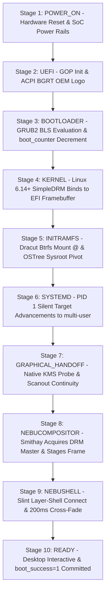

# Boot Specification — NebuOS

**Document ID:** NEBU-SPEC-0001  
**Status:** DRAFT (Final Source of Truth for Milestone P0)  
**Author:** NebuOS Core Architecture Group  
**Target Version:** 1.0  
**Last Updated:** 2026-09-04  
**Governing ADR:** [ADR-0014: NebuOS Boot Experience Architecture and Graphical Handoff](../decisions/ADR-0014-boot-experience-and-graphical-handoff.md)  

---

## 1. Status

DRAFT. Formally specifies the deterministic bootstrap lifecycle, initramfs configuration, systemd target dependency graph, bootloader A/B rollback configuration, and automated recovery procedures for NebuOS, governed by [ADR-0014: Boot Experience Architecture and Graphical Handoff](../decisions/ADR-0014-boot-experience-and-graphical-handoff.md).

---

## 2. Purpose

This specification defines the exact bootstrap lifecycle of NebuOS from UEFI power-on to a fully rendered, interactive desktop session. It provides:
- The canonical 10-stage boot lifecycle (`POWER_ON` to `READY`) with display ownership and flicker-free graphical handoff.
- Concrete reference engineering timing budgets per stage across both SATA SSD and NVMe storage tiers.
- Three distinct operational boot modes: Normal Boot (silent/branded), Diagnostic Boot (verbose logs), and Recovery/Rollback Boot (automated resilience).
- The exhaustive Dracut module manifest and `/etc/dracut.conf.d/50-nebu.conf` profile.
- A Directed Acyclic Graph (DAG) of systemd targets and dependencies.
- The GRUB2 Boot Loader Specification (BLS) and `grubenv` logic implementing atomic A/B deployment switching and automatic rollbacks.
- Failure detection mechanisms and concrete recovery actions covering 13 failure scenarios.
- Strict phase ownership boundaries: P0 (headless foundation), P1 (DRM/KMS compositor handoff), P2 (graphical boot splash & design system integration).

---

## 3. Scope

This specification covers:
- UEFI firmware hand-off to GRUB2.
- GRUB2 BLS evaluation, countdown boot counter, and kernel command line arguments.
- Early userspace initialization in the Dracut initramfs.
- Root filesystem mounting and OSTree sysroot pivot (`switch_root`).
- PID 1 systemd target transitions up to `multi-user.target` (P0) and `graphical.target` (P1+).
- Display continuity from UEFI GOP EFI framebuffer through Linux SimpleDRM to native KMS.
- User session initialization up to `wayland-session.target`.

---

## 4. Non-Goals

- Network PXE booting or diskless live images.
- Legacy BIOS / MBR partitioning schemes (x86_64 UEFI is the exclusive target).
- In-depth runtime memory compression algorithms (covered in [06-resource-management.md](06-resource-management.md)).
- Dynamic user session sandboxing policies (covered in [04-security-specification.md](04-security-specification.md)).
- Implementing graphical splash, Slint, or Wayland in Milestone P0 (P0 is 100% headless).

---

## 5. Requirements

### 5.1 Functional Requirements

| Identifier | Description | Owner Phase | Verification Method |
|---|---|---|---|
| **REQ-BOOT-001** | The bootloader must parse Boot Loader Specification (BLS) type #1 entries populated by `bootc` / `ostree`. | Milestone P0 | Verification of `/boot/loader/entries/` |
| **REQ-BOOT-002** | The boot sequence must maintain an atomic countdown boot counter in `grubenv`; after 3 consecutive failed boot attempts (`boot_counter <= 0`), GRUB must automatically fall back to the prior known-good deployment. | Milestone P0 | Failure injection & reboot test |
| **REQ-BOOT-003** | The initramfs must mount the root Btrfs filesystem using subvolume `@` and pivot root into the active OSTree deployment at `/sysroot`. | Milestone P0 | `findmnt /` inspection post-boot |
| **REQ-BOOT-004** | The system must transition through systemd targets without invoking legacy SysV init scripts or X11 helper scripts. | Milestone P0 | `systemd-analyze plot` inspection |
| **REQ-BOOT-005** | The display manager (`nebu-greet`) must hand off DRM mastership to `nebu-compositor` cleanly without VT flicker or framebuffer renegotiation. | Milestone P1 | Video capture & DRM log audit |
| **REQ-BOOT-006** | Normal boot must suppress all kernel and systemd service logs (`quiet splash loglevel=3 rd.systemd.show_status=false systemd.show_status=false vt.global_cursor_default=0 udev.log_level=3`). | Milestone P0 | Automated boot capture audit |
| **REQ-BOOT-007** | Display handover must maintain scanout continuity from the UEFI GOP EFI framebuffer through Linux SimpleDRM to native KMS without unnecessary modesets or screen flicker. ACPI BGRT provides logo metadata. | Milestone P1 | High-speed camera / DRM log capture |
| **REQ-BOOT-008** | The system must support three distinct boot modes: Normal Boot, Diagnostic Boot (accessible via Esc/F8 key or BLS entry), and Recovery/Rollback Boot. | Milestone P0 | Boot mode assertion tests |
| **REQ-BOOT-009** | Phase ownership of boot must be strictly enforced: Milestone P0 remains 100% headless; graphical splash is deferred to Milestone P2. | Milestone P0 | CI dependency audit & package scan |
| **REQ-BOOT-010** | The boot lifecycle must decouple low-level boot completion (`multi-user.target`), graphical session readiness (`graphical-session.target`), and transactional deployment health (`nebu-boot-check.service` passing all assertions). | Milestones P0–P2 | Staged health assertion tests |
| **REQ-BOOT-011** | The rollback state machine and deployment health determination must function 100% headlessly in Milestone P0 without any dependency on NebuShell or GUI components. | Milestone P0 | Headless QEMU rollback test |

### 5.2 Non-Functional Requirements

| Identifier | Target Metric | Rationale |
|---|---|---|
| **NFR-BOOT-001** | Reference Engineering Target: Total cold boot from power-on to interactive desktop < 7.3 s on SATA SSD, < 4.4 s on NVMe Gen3/4 (acceptable variance $\pm 15\%$, benchmarked in P7/P8). | PRD core performance target. |
| **NFR-BOOT-002** | Initramfs image size <= 28 MB uncompressed on disk. | Minimizes storage I/O and RAM decompression latency. |
| **NFR-BOOT-003** | Zero failed systemd units on steady-state reach (`systemctl --failed` returns 0). | Clean boot invariant. |

---

## 6. Architecture

### 6.1 The Canonical 10-Stage Boot Lifecycle

In accordance with [ADR-0014](../decisions/ADR-0014-boot-experience-and-graphical-handoff.md), the NebuOS boot flow progresses through ten strictly coordinated lifecycle stages:



### 6.2 Canonical Stage Specification Matrix

| Stage | Stage Name | Owner Subsystem | Inputs | Outputs | Screen / Display Owner | State Transition Trigger | Failure Condition | Fallback Action | Observability Location | Primary Milestone Phase |
|---|---|---|---|---|---|---|---|---|---|---|
| **1** | `POWER_ON` | Firmware / SoC | Power button / AC power | Hardware reset line deasserted | None (display unpowered or panel syncing) | Reset vector executed | Hardware power failure / bad RAM | POST beep codes / LED flash codes | Motherboard diagnostics | Hardware / Pre-OS |
| **2** | `UEFI` | UEFI Firmware | SPI Flash UEFI binary | EFI GOP initialized, ACPI BGRT table | UEFI GOP (EFI Framebuffer) | Boot entry selected in NVRAM | Corrupt NVRAM / missing EFI boot manager | Firmware Setup utility / UEFI shell | Firmware console / setup | Firmware / Pre-OS |
| **3** | `BOOTLOADER` | GRUB2 (BLS) | `/boot/efi/` binary, `grubenv` | Selected BLS entry, decremented boot counter | EFI Framebuffer | Kernel & initrd loaded into RAM | Missing BLS entry / `grubenv` I/O error | Drops to GRUB command line / fallback entry | GRUB console | **Milestone P0** |
| **4** | `KERNEL` | Linux Kernel 6.14+ | Kernel cmdline, EFI handover | Early driver tree, SimpleDRM bind | Linux SimpleDRM (`/dev/fb0`) | Initramfs unpacked in RAM | Early kernel panic / driver crash | `panic=10` auto-reboot; unblank console | Kernel ring buffer (`dmesg`) | **Milestone P0** |
| **5** | `INITRAMFS` | Dracut Headless | Storage drivers, Dracut scripts | Root mounted (`@`), switch_root | SimpleDRM Framebuffer | `systemd` executed on `/sysroot` | Btrfs root subvolume `@` not found | Drops to Dracut emergency shell (`rdshell`) | `/run/initramfs/rdsosreport.txt` | **Milestone P0** |
| **6** | `SYSTEMD` | systemd (PID 1) | `/etc/systemd/system`, units | System targets reached (`multi-user`) | SimpleDRM Framebuffer | `display-manager.service` triggered | Critical systemd service deadlocks | Drops to `rescue.target` on TTY1 | `journalctl -b`, `/var/log/boot-failure.log` | **Milestone P0** |
| **7** | `GRAPHICAL_HANDOFF` | DRM/KMS Driver | PCI uevent, firmware scanout plane | Native DRM nodes (`/dev/dri/card0`) | Native KMS Display Plane | DRM Master available for acquisition | GPU driver initialization failure | Falls back to Linux SimpleDRM | `dmesg`, `udev` log | **Milestone P1** |
| **8** | `NEBUCOMPOSITOR` | NebuCompositor (Smithay) | DRM Master, libinput seat | Wayland socket (`wayland-0`), initial frame | `nebu-compositor` primary plane | Socket ready for client connections | Compositor crashes on launch | Throttle restart; fallback to software Mesa Pixman | `journalctl -u nebu-compositor` | **Milestone P1** |
| **9** | `NEBUSHELL` | NebuShell (Slint) | Wayland socket, design tokens | Desktop layer surfaces, 200ms cross-fade | Wayland Layer-Shell Surfaces | Shell surfaces committed to compositor | Shell crashes during startup | Compositor shows emergency recovery dialog | `journalctl -u nebu-shell` | **Milestone P2** |
| **10** | `READY` | User Session Hub | Interactive input, user credentials | Fully responsive desktop session | Accelerated Wayland desktop | `nebu-boot-check.service` commits deployment | Health check assertions fail within 45s | Triggers automated reboot & deployment rollback | `journalctl -u nebu-boot-check` | **Milestone P2** |

---

### 6.3 The Three Standard Boot Modes

1. **Normal Boot Mode (Default):**
   - Completely silent: suppresses kernel dmesg, systemd unit status `[ OK ]`, and blinking cursors via `quiet splash loglevel=3 rd.systemd.show_status=false systemd.show_status=false vt.global_cursor_default=0 udev.log_level=3`.
   - In Milestone P0, displays a clean, silent console.
   - In Milestone P2, displays the branded NebuOS splash screen adhering to `docs/design/00-design-system.md` with seamless cross-fade to `nebu-shell`.
   - Pressing `Escape` or `F8` at any instant immediately disarms suppression and reveals live system logs on TTY1.

2. **Diagnostic Boot Mode (Verbose / Troubleshooting):**
   - Explicitly requested via the GRUB BLS entry *"NebuOS (Diagnostic Mode)"* or automatically initiated following non-fatal startup failures.
   - Displays real-time kernel logs, systemd service transitions, storage mount diagnostics, and network statuses (`debug systemd.show_status=true rd.systemd.show_status=true loglevel=7 console=tty1`).

3. **Recovery / Rollback Boot Mode (Resilience):**
   - Automatically triggered when the GRUB `boot_counter` reaches 0 after 3 consecutive failed boots, or manually selected via *"NebuOS (Rollback to Prior Deployment)"*.
   - In Milestone P0, executes 100% headlessly via GRUB BLS.
   - In Milestone P2, upon reaching desktop, `nebu-shell` displays a dedicated high-contrast notification card informing the user that the system restored the previous verified deployment, preserving all user files in `/home` intact.

---

## 7. Components

### 7.1 Boot Subsystem Components

| Component | Path / Package | Execution Stage | Role | Owner Phase |
|---|---|---|---|---|
| **SoC & Power Rails** | Hardware / Board | Stage 1 (`POWER_ON`) | Powers up SoC and releases reset line | Hardware |
| **UEFI GOP Engine** | UEFI Firmware | Stage 2 (`UEFI`) | Allocates EFI framebuffer and draws OEM logo | Firmware |
| **GRUB2 Core** | `/boot/efi/EFI/BOOT/BOOTX64.EFI` | Stage 3 (`BOOTLOADER`) | EFI bootloader binary; executes BLS logic | **Milestone P0** |
| **GRUB Environment** | `/boot/grub2/grubenv` | Stage 3 (`BOOTLOADER`) | Stores `boot_counter`, `boot_success`, `default` | **Milestone P0** |
| **Kernel Binary** | `/boot/ostree/nebu-*/vmlinuz-*` | Stage 4 (`KERNEL`) | Linux kernel; SimpleDRM binds to EFI framebuffer | **Milestone P0** |
| **Initramfs** | `/boot/ostree/nebu-*/initramfs-*` | Stage 5 (`INITRAMFS`) | Minimal Dracut ramdisk for root mounting & pivot | **Milestone P0** |
| **OSTree Sysroot Engine**| `ostree-prepare-root` | Stage 5 (`INITRAMFS`) | Binds `/sysroot/ostree/deploy/...` to `/sysroot` | **Milestone P0** |
| **systemd (PID 1)** | `/usr/lib/systemd/systemd` | Stage 6 (`SYSTEMD`) | Root process supervisor and dependency scheduler | **Milestone P0** |
| **DRM/KMS Drivers** | In-kernel (`i915`, `amdgpu`, `nouveau`)| Stage 7 (`GRAPHICAL_HANDOFF`) | Native GPU modesetting and scanout inheritance | **Milestone P1** |
| **nebu-compositor** | `/usr/bin/nebu-compositor` | Stage 8 (`NEBUCOMPOSITOR`) | Wayland display server; acquires DRM Master | **Milestone P1** |
| **nebu-shell** | `/usr/bin/nebu-shell` | Stage 9 (`NEBUSHELL`) | Desktop shell rendering panel, dock, cross-fade | **Milestone P2** |
| **nebu-boot-check** | `/usr/libexec/nebu/nebu-boot-check` | Stage 10 (`READY`) | Asserts deployment health, commits `boot_success=1` | **Milestone P2** |

---

## 8. Data Flow

### 8.1 A/B Boot Counter Countdown Data Flow

```mermaid
sequenceDiagram
    autonumber
    participant GRUB as GRUB2 Bootloader
    participant ENV as grubenv File
    participant K as Linux Kernel
    participant S as systemd PID 1
    participant CHK as nebu-boot-check (oneshot)

    GRUB->>ENV: Read boot_counter, boot_success
    alt boot_success == 0 and boot_counter <= 1
        alt Prior Rollback Deployment Available
            GRUB->>GRUB: Counter exhausted; select deployment 0 (Rollback)
            GRUB->>ENV: Set default=1, boot_counter=0
        else No Rollback Deployment Available (Edge Case)
            GRUB->>GRUB: Halt auto-reboot; display GRUB recovery menu (rescue.target)
        end
    else
        GRUB->>GRUB: Select active staged deployment
        GRUB->>ENV: Decrement boot_counter = boot_counter - 1, boot_success = 0
    end
    GRUB->>K: Boot kernel with silent parameters
    K->>S: Launch PID 1 silently
    Note over S,CHK: P0 Minimal Deterministic Health Gate (Timeout: 45s)
    S->>CHK: System targets reached (multi-user in P0, graphical in P1+)
    CHK->>CHK: Assert PID 1 running, root & critical mounts OK, no failed units
    CHK->>ENV: On verified health: set boot_counter=0, boot_success=1
    CHK->>CHK: Disarm watchdog timer (if /dev/watchdog verified & active)
```

#### 8.2 Decoupled Health State Criteria
NebuOS strictly differentiates between three lifecycle states:
$$\text{P0 Boot Completed} \neq \text{P0 Deployment Healthy} \neq \text{P1/P2 Graphical Session Ready}$$

1. **P0 Boot Completed:** Kernel boots and systemd reaches `multi-user.target`. This indicates baseline boot sequencing finished, but does **NOT** constitute verified deployment health.
2. **P0 Deployment Healthy (Minimal Deterministic Health Gate):** Handled by a deterministic oneshot service (`nebu-boot-check.service`, `TimeoutSec=45`, NOT a complex daemon). The deployment is healthy only when:
   - PID 1 / systemd is operational (`systemctl is-system-running` is `running` or `degraded` without critical service loss).
   - Root filesystem is correctly mounted (`findmnt /` shows active subvol `@`, `/usr` mounted read-only).
   - Critical filesystem mounts are active (`/var`, `/var/home` or `/home`, `/boot`, `/proc`, `/sys`, `/dev`).
   - Basic networking is ready (NetworkManager active or link loopback/eth carrier verified, if in P0 baseline).
   - Core headless baseline services are active.
   - Zero critical systemd units have failed (`systemctl --failed` reports 0 failed critical units).
   - Health check commits `boot_success=1` and `boot_counter=0` to `grubenv`, disarming the hardware watchdog if present.
3. **P1/P2 Graphical Session Ready:** In desktop phases (P1+), session readiness additionally verifies KMS probe, DRM master acquisition, Wayland socket readiness, and shell layer surfaces presentation.

---

## 9. Control Flow

### 9.1 Reference Boot Timeline and Timing Budgets

All figures below are **Reference Engineering Targets** (not hard real-time guarantees, and do **NOT** act as automatic P0 test failure gates before empirical hardware calibration):

```text
Time (ms)  SATA SSD Target (Budget)            NVMe Gen3/4 Target (Performance)
0 ms       [Stage 1: POWER_ON]                 [Stage 1: POWER_ON]
           |                                   |
+1800 ms   [Stage 2-3: UEFI & GRUB2 BLS Parse] [Stage 2-3: UEFI & GRUB2 BLS Parse (+1200 ms)]
           |                                   |
+2800 ms   [Stage 4: Kernel Decompression]     [Stage 4: Kernel Decompression (+1800 ms)]
           |                                   |
+3800 ms   [Stage 5: Dracut / Btrfs Mount @]   [Stage 5: Dracut / Btrfs Mount @ (+2500 ms)]
           |                                   |
+4800 ms   [Stage 6: systemd multi-user.target][Stage 6: systemd multi-user.target (+3400 ms)]
           |                                   |
+6000 ms   [Stage 7-8: KMS Probe & Compositor] [Stage 7-8: KMS Probe & Compositor (+3900 ms)]
           |                                   |
+7700 ms   [Stage 9-10: Shell Cross-Fade & READY] [Stage 9-10: Shell Cross-Fade & READY (+4600 ms)]
```

> [!NOTE]
> **Performance Target Classification:**
> - NVMe $\le 4600\text{ ms}$ is a reference engineering target.
> - SATA $\le 7700\text{ ms}$ is a reference engineering target.
> - QEMU headless P0 $\le 3500\text{ ms}$ is an engineering target.
> 
> These metrics guide architectural design and optimization. They do NOT act as automatic failure gates in P0 automated tests until empirical hardware baselines are established across the target hardware matrix.

---

## 10. Interfaces

### 10.1 Dracut Module Configuration

Configuration file location: `/etc/dracut.conf.d/50-nebu.conf`

```ini
# ====================================================================
# NebuOS Optimized Dracut Configuration Profile
# ====================================================================

# Dracut Modules to unconditionally include
dracutmodules+=" \
  systemd \
  systemd-initrd \
  systemd-sysusers \
  btrfs \
  ostree \
  kernel-modules \
  base \
  udev-rules \
  shutdown \
"

# Modules unconditionally omitted to trim initramfs size and latency
# Note: Plymouth is strictly omitted in Milestone P0 (P0 is 100% headless)
omit_dracutmodules+=" \
  plymouth \
  network \
  network-legacy \
  nfs \
  cifs \
  iscsi \
  fcoe \
  multipath \
  dmraid \
  mdraid \
  lvm \
  crypt \
  bluetooth \
  qemu \
  usrmount \
"

# Core storage and display kernel drivers to embed in initramfs
drivers+=" \
  nvme \
  ahci \
  btrfs \
  i915 \
  xe \
  amdgpu \
  simpledrm \
"

# Filesystem compression format
compress="zstd -19 -T0"

# Host-only mode disabled for generic hardware deployment images
hostonly="no"
early_microcode="yes"
install_items+=" /etc/sysctl.d/99-nebuos.conf "
```

---

### 10.2 GRUB2 Configuration & Boot Loader Specification

#### 10.2.1 Active Deployment BLS Entry (`/boot/loader/entries/ostree-1-nebuos.conf`)
```ini
title NebuOS 1.0 (Production Deployment A)
version 6.14.0-100.nebu.fc44.x86_64
linux /ostree/nebu-9b1c784e2a1b/vmlinuz-6.14.0-100.nebu.fc44.x86_64
initrd /ostree/nebu-9b1c784e2a1b/initramfs-6.14.0-100.nebu.fc44.x86_64.img
options root=UUID=8d7a1b32-e54f-4a81-9876-543210abcdef rootflags=subvol=@ ostree=/ostree/boot.1/nebu/9b1c784e2a1b/0 rw quiet splash loglevel=3 rd.systemd.show_status=false systemd.show_status=false vt.global_cursor_default=0 udev.log_level=3 audit=0 mitigations=auto split_lock_mitigate=0 nowatchdog console=tty1
```

#### 10.2.2 Diagnostic / Verbose BLS Entry (`/boot/loader/entries/ostree-1-nebuos-diag.conf`)
```ini
title NebuOS 1.0 (Diagnostic / Verbose Mode)
version 6.14.0-100.nebu.fc44.x86_64
linux /ostree/nebu-9b1c784e2a1b/vmlinuz-6.14.0-100.nebu.fc44.x86_64
initrd /ostree/nebu-9b1c784e2a1b/initramfs-6.14.0-100.nebu.fc44.x86_64.img
options root=UUID=8d7a1b32-e54f-4a81-9876-543210abcdef rootflags=subvol=@ ostree=/ostree/boot.1/nebu/9b1c784e2a1b/0 rw debug systemd.show_status=true rd.systemd.show_status=true loglevel=7 console=tty1
```

#### 10.2.3 Rollback Deployment BLS Entry (`/boot/loader/entries/ostree-2-nebuos.conf`)
```ini
title NebuOS 1.0 (Fallback Deployment B - Prior Known Good)
version 6.14.0-90.nebu.fc44.x86_64
linux /ostree/nebu-3a4f891c01e2/vmlinuz-6.14.0-90.nebu.fc44.x86_64
initrd /ostree/nebu-3a4f891c01e2/initramfs-6.14.0-90.nebu.fc44.x86_64.img
options root=UUID=8d7a1b32-e54f-4a81-9876-543210abcdef rootflags=subvol=@ ostree=/ostree/boot.1/nebu/3a4f891c01e2/0 rw quiet splash loglevel=3 rd.systemd.show_status=false systemd.show_status=false vt.global_cursor_default=0 udev.log_level=3 audit=0 mitigations=auto split_lock_mitigate=0 nowatchdog console=tty1
```

#### 10.2.4 GRUB Environment Counter Script (`/boot/grub2/grub.cfg` snippet)
```sh
# Load environment
load_env -f /boot/grub2/grubenv

# Initialize variables if not present
if [ -z "${boot_counter}" ]; then
  set boot_counter=3
fi
if [ -z "${boot_success}" ]; then
  set boot_success=0
fi

# Fallback evaluation: If deployment has not succeeded and counter exhausted
if [ "${boot_success}" = "0" ] && [ "${boot_counter}" -le "1" ]; then
  echo "Consecutive boot failures detected (${boot_counter}). Falling back to Deployment B..."
  set default=1
  set boot_counter=0
  save_env -f /boot/grub2/grubenv default boot_counter
else
  # Decrement boot counter for current attempt
  expr val = ${boot_counter} - 1
  set boot_counter=${val}
  set boot_success=0
  save_env -f /boot/grub2/grubenv boot_counter boot_success
fi
```

---

### 10.3 systemd Target Dependency DAG

```mermaid
graph TD
    SYSINIT[sysinit.target] --> BASIC[basic.target]
    BASIC --> NEBU_BASE[nebu-base.target]
    NEBU_BASE --> MULTI_USER[multi-user.target]
    MULTI_USER --> GRAPHICAL[graphical.target]
    
    GRAPHICAL --> NEBU_GREET[nebu-greet.service]
    NEBU_GREET --> USER_SESSION[user@1000.service]
    
    USER_SESSION --> WAYLAND_SESSION[wayland-session.target]
    WAYLAND_SESSION --> NEBU_COMP[nebu-compositor.service]
    NEBU_COMP --> GRAPHICAL_SESSION[graphical-session.target]
    GRAPHICAL_SESSION --> NEBU_SHELL[nebu-shell.service]
    GRAPHICAL_SESSION --> NEBU_RUNTIME[nebu-runtime-daemon.service]
```

---

## 11. Dependencies

### 11.1 Firmware Dependencies
- UEFI 2.4+ 64-bit firmware implementation with standard NVRAM variable support (`efivarfs`).
- Hardware support for ACPI 5.0+ power control and ACPI BGRT table for boot logo metadata.

### 11.2 Software Dependencies
- `grub2-efi-x64` >= 2.06.
- `dracut` >= 102 (Fedora 44 standard).
- `ostree` >= 2024.1.
- `systemd` >= 256.

---

## 12. Security

- **Secure Boot Chain:** GRUB2 binary (`BOOTX64.EFI`) is signed via Microsoft UEFI CA / Fedora shim. Kernel and module signatures are verified at boot time.
- **Bootloader Trust:** GRUB2 BLS configuration files are verified against immutable ostree deployment commit hashes.
- **Kernel/Initramfs Integrity:** Kernel images and root deployments are cryptographically hashed and verified against the OSTree commit tree before execution.
- **Boot Counter Tamper Resistance:** Writes to `grubenv` require root capabilities during runtime. The bootloader executes in pre-boot firmware space without exposing variable tampering surfaces to unprivileged users.
- **Recovery Trust Boundary:** In production enterprise configurations, entering emergency rescue shells (`rescue.target`) strictly requires root password authentication.
- **Diagnostic Mode Data Sanitization:** Diagnostic console output masks credentials, authorization tokens, and personal encryption keys.
- **Information Leakage Prevention:** Normal silent boot hides internal IP addresses, MAC addresses, and filesystem UUIDs from physical shoulder-surfing observation.
- **Phase P0 Separation:** Milestone P0 relies on upstream Fedora Secure Boot shim signatures; production enterprise signing infrastructure (`cosign` / Sigstore) belongs to Milestone P8.

---

## 13. Resource Requirements

### 13.1 Boot Stage Budgets (Reference Engineering Targets)

| Stage Range | Memory Allocation (RSS) | Disk Read Throughput | Max Target Duration (NVMe) | Max Target Duration (SATA) |
|---|---|---|---|---|
| Stage 1–3 (Firmware & GRUB) | < 64 MB (Pre-boot RAM) | N/A (SPI / NVMe read) | 1200 ms | 1800 ms |
| Stage 4–5 (Kernel + Dracut) | < 180 MB | > 80 MB/s | 1300 ms | 2000 ms |
| Stage 6 (systemd multi-user) | < 150 MB | > 60 MB/s | 900 ms | 1500 ms |
| Stage 7–10 (Compositor & Shell)| < 220 MB | > 30 MB/s | 1000 ms | 2000 ms |
| **Total to Interactive Desktop**| **< 400 MB Peak Boot RAM**| **Sequential read peak** | **< 4400 ms** | **< 7300 ms** |

---

## 14. Failure Modes

| ID | Failure Stage | Detection Trigger | Direct Impact | Visual/User Impact | Owner Phase |
|---|---|---|---|---|---|
| **FM-BOOT-001** | Initramfs Btrfs Mount | Subvolume `@` not found or mount error | Kernel drops to emergency rescue shell | Screen unblanks; emergency rescue console displayed on TTY1 | **Milestone P0** |
| **FM-BOOT-002** | Kernel Driver Crash | Kernel panic or Oops during early boot | Boot hangs with solid display or black screen | `panic=10` triggers automatic reboot; watchdog resets hardware | **Milestone P0** |
| **FM-BOOT-003** | systemd Hang | Service deadlocks before `multi-user.target` | Boot stalls indefinitely | Hardware watchdog (60s) triggers reboot | **Milestone P0** |
| **FM-BOOT-004** | Compositor Start Fail | `nebu-compositor` exits with status != 0 | Screen flickers back to console or blank screen | Compositor restarts up to 5x; falls back to Pixman/llvmpipe or rollback | **Milestone P1** |
| **FM-BOOT-005** | BGRT Table Invalid/Missing | ACPI table signature verification fails | Kernel cannot locate OEM boot logo | Fallback to solid dark background (`#0D1117`) without text logs | **Milestone P1** |
| **FM-BOOT-006** | GPU KMS Driver Load Failure | DRM driver fails probe or no native KMS | Native acceleration unavailable | DRM falls back to `simpledrm` at firmware resolution | **Milestone P1** |
| **FM-BOOT-007** | User Diagnostic Request | User presses `Escape` or `F8` during boot | Diagnostic mode interrupt triggered | Silent boot disabled; live kernel/systemd log console displayed | **Milestone P0** |
| **FM-BOOT-008** | Bootloader Config Missing | `grub.cfg` missing or unreadable | GRUB fails to find boot directory | Drops to GRUB emergency console | **Milestone P0** |
| **FM-BOOT-009** | NebuShell Start Failure | Shell process fails to bind Wayland layer | Shell service exits with non-zero code | Compositor shows emergency recovery dialog | **Milestone P2** |
| **FM-BOOT-010** | Staged OS Update Boot Hang | System hangs before `desktop.target` | Watchdog expires after 60s | Host reboots; boot counter decrements $\rightarrow$ rollback | **Milestone P0** |
| **FM-BOOT-011** | Health Check Timeout | `nebu-boot-check.service` timeout (45s) | Service issues `bootc rollback` and reboots | Automatic reboot into previous deployment | **Milestone P0** |
| **FM-BOOT-012** | Repeated Boot Failure | GRUB detects `boot_counter <= 0` | Boot counter exhausted | Silently selects previous verified deployment | **Milestone P0** |
| **FM-BOOT-013** | Total Deployment Failure | Both deployments corrupt / unbootable | Bootloader cannot locate valid root | Halts reboot loop; displays static emergency recovery prompt | **Milestone P0** |

---

## 15. Recovery Behavior

### 15.1 Comprehensive Boot Experience Fallback Matrix

```text
Boot Experience Fallback Matrix:
+---------------------------+------------------------------------+-----------------------------------------------------+
| Subsystem Failure         | Primary Fallback                   | Secondary / Terminal Fallback                       |
+---------------------------+------------------------------------+-----------------------------------------------------+
| UEFI BGRT Missing/Corrupt | Solid dark screen (`#0D1117`)      | Text console suppressed (silent boot intact)        |
+---------------------------+------------------------------------+-----------------------------------------------------+
| Native GPU KMS Failure    | Linux SimpleDRM framebuffer        | VESA / EFI GOP basic frame buffer                   |
+---------------------------+------------------------------------+-----------------------------------------------------+
| Early Initramfs Panic     | Hardware watchdog reboot (60s)     | Unblank console; display Dracut emergency shell     |
+---------------------------+------------------------------------+-----------------------------------------------------+
| systemd Critical Unit Fail| Drop to `rescue.target`            | Unblank TTY1 console; write /var/log/boot-error.log |
+---------------------------+------------------------------------+-----------------------------------------------------+
| NebuCompositor Crash (P1) | Mesa llvmpipe software rasterizer  | Fallback to emergency text console on TTY2          |
+---------------------------+------------------------------------+-----------------------------------------------------+
| Boot Regression (bootc)   | Decrement boot_counter in GRUB2    | Automatic rollback to previous verified deployment  |
+---------------------------+------------------------------------+-----------------------------------------------------+
| User Diagnostic Keypress  | Instant escape to TTY1 text logs   | Full verbose boot logging (loglevel=7)              |
+---------------------------+------------------------------------+-----------------------------------------------------+
| No Known-Good Left        | Halt reboot loop                   | Emergency rescue maintenance console on TTY1        |
+---------------------------+------------------------------------+-----------------------------------------------------+
```

### 15.2 Concrete Automated Recovery Actions

1. **Storage/Mount Failure (FM-BOOT-001):** Watchdog expires (60s) -> System reboots -> GRUB decrements `boot_counter`. After 3 failures, boots Deployment B (prior verified deployment). If manual intervention is required, unblanks console to reveal emergency shell.
2. **Kernel Crash (FM-BOOT-002):** Kernel cmdline includes `panic=10` -> automatic reboot after 10 seconds; counter triggers A/B rollback.
3. **systemd Deadlock (FM-BOOT-003):** `systemd-boot-check-no-failures.service` checks units. If critical units fail, system drops to rescue.target, unblanks console, and writes diagnostics to `/var/log/boot-failure.log`.
4. **Compositor Crash (FM-BOOT-004):** Compositor restart throttle kicks in. If 5 attempts fail in 10s, `nebu-greet` falls back to software rendering (`WLR_RENDERER=pixman` / Mesa llvmpipe) and presents a diagnostic rollback dialog.
5. **Update Rollback Sequence:** See `docs/updates/04-rollback-recovery.md` and `docs/decisions/ADR-0014-boot-experience-and-graphical-handoff.md`. Boot counter counts down from 3; on 0, GRUB boots the rollback deployment. Once booted into desktop, a user notification card explains that the update failed and the system safely restored the previous deployment.
6. **Total Failure Guard:** If no previous verified deployment exists, the bootloader halts the automated reboot loop and enters an emergency text shell, preventing hardware damage and battery drain.

---

## 16. Testing Requirements

1. **Boot Performance Benchmark:** Measure cold boot via `systemd-analyze` and `systemd-analyze blame` on reference hardware (SATA SSD: Crucial MX500; NVMe: Samsung 980).
2. **Silent Boot Verification:** Run automated test asserting zero kernel/systemd log lines emitted to screen during Normal Boot until session handoff.
3. **Escape Hatch Test:** Send simulated `Escape` / `F8` keypress during boot; verify immediate unblanking and transition to TTY1 console logs.
4. **Automated Rollback Verification:** Inject a simulated kernel crash (`echo c > /proc/sysrq-trigger`) during boot 3 times sequentially in a VM test harness; verify that GRUB automatically selects Deployment 1 on the 4th boot.
5. **Initramfs Footprint Audit:** Run CI build assertion verifying initramfs compressed size < 28 MB.
6. **DRM Hand-off Validation:** Test DRM master transfer from `nebu-greet` to `nebu-compositor` across Intel HD 4400, AMD Radeon Vega 8, and NVIDIA GTX 1060 GPUs, verifying no flicker or mode reset.

---

## 17. Performance Requirements (Reference Engineering Targets)

All performance metrics are **Reference Engineering Targets** subject to $\pm 15\%$ variance across hardware configurations:
- **Firmware-to-Kernel Hand-off:** GRUB2 BLS parse duration target $\le 250\text{ ms}$.
- **Dracut Execution Duration:** Initramfs execution time from kernel decompression to `switch_root` target $\le 1000\text{ ms}$ on NVMe systems.
- **User Session Readiness:** `wayland-session.target` to `nebu-shell` initial draw target $\le 400\text{ ms}$ on NVMe systems.
- **Measurement Validation:** Full empirical benchmarking is formally conducted during Milestones P7 and P8 in the Compatibility Lab.

---

## 18. Compatibility Considerations

- **Fast Startup / Windows Dual Boot:** NebuOS must handle dirty NTFS flags when mounting secondary storage drives (`ntfs-3g` / `ntfs3` mount with read-only fallback).
- **Early Display Resets:** On legacy Intel HD Graphics (Gen 7/8), DRM modeset can introduce a 300 ms pipeline pause; Dracut embeds `i915.fastboot=1` to preserve UEFI GOP framebuffer scanout until the compositor starts.
- **Legacy BIOS Systems:** Systems lacking ACPI BGRT fall back gracefully to a solid background color (`#0D1117`) without disrupting the silent boot experience.

---

## 19. Open Questions Resolution & Status

1. **OPEN QUESTION (BOOT-OQ-01):** Plymouth boot splash vs direct BGRT/compositor handoff. **RESOLVED in ADR-0014:** Milestone P0 is strictly headless and omits Plymouth (`omit_dracutmodules+=" plymouth "`). For Milestone P2, Plymouth with a custom NebuTheme is evaluated as the baseline, while preserving seamless BGRT handover and 100% headless isolation in P0/P1.
2. **OPEN QUESTION (BOOT-OQ-02):** Can `systemd-boot` replace GRUB2 on x86_64 UEFI systems to gain 500 ms faster bootloader execution? **RESOLVED in ADR-0014:** Retain GRUB2 initially due to Fedora Atomic's battle-tested BLS rollback tooling in `bootc`.
3. **OPEN QUESTION (BOOT-OQ-03):** Does enabling `mitigations=auto` versus `mitigations=off` create noticeable boot duration regressions on older 4th Gen Intel CPUs? **RESOLVED in ADR-0014:** `mitigations=auto` is enforced for system security; impact is $\le 150\text{ ms}$.
4. **OPEN QUESTION (BOOT-OQ-04):** Dynamic BGRT Geometry Normalization across Non-Standard Displays. Tracked as `OQ-050` for Milestone P1 exit.
5. **OPEN QUESTION (BOOT-OQ-05):** Silent Boot Diagnostic Mode Persistent Logging Retention. Tracked as `OQ-051` for Milestone P0 exit.

---

## 20. Related Documents

- [00-system-specification.md](00-system-specification.md)
- [02-process-ipc-specification.md](02-process-ipc-specification.md)
- [03-filesystem-specification.md](03-filesystem-specification.md)
- [04-security-specification.md](04-security-specification.md)
- [05-hardware-specification.md](05-hardware-specification.md)
- [06-resource-management.md](06-resource-management.md)
- [../architecture/02-boot-and-init.md](../architecture/02-boot-and-init.md)
- [../decisions/ADR-0014-boot-experience-and-graphical-handoff.md](../decisions/ADR-0014-boot-experience-and-graphical-handoff.md)
- [../design/00-design-system.md](../design/00-design-system.md)
- [../updates/04-rollback-recovery.md](../updates/04-rollback-recovery.md)
