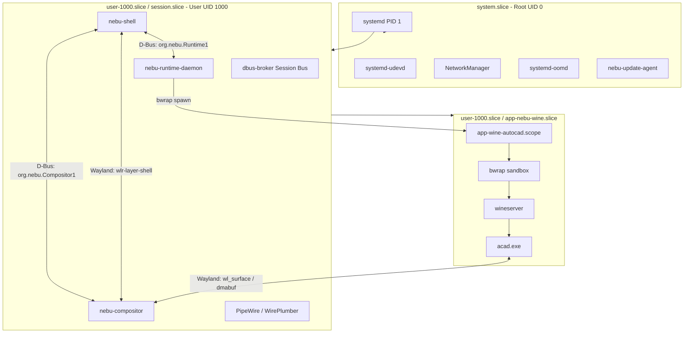
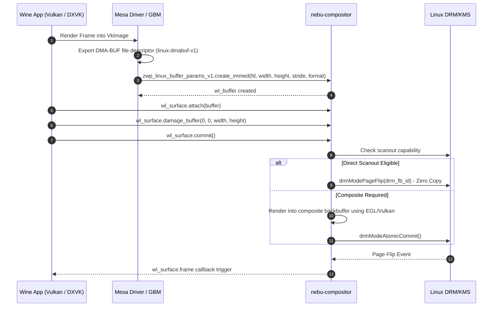

# Process and IPC Specification — NebuOS

**Document ID:** NEBU-SPEC-0002  
**Status:** DRAFT  
**Author:** NebuOS Core Architecture Group  
**Target Version:** 1.0  
**Last Updated:** 2026-09-04  

---

## 1. Status

DRAFT. This document is under initial architectural review. It defines the formal process execution hierarchy, cgroup resource constraints, complete D-Bus interface XML schemas, and Wayland protocol extension matrix for NebuOS.

---

## 2. Purpose

This specification establishes the concrete technical requirements for process management and inter-process communication (IPC) within NebuOS. It details:
- The comprehensive process model detailing binary paths, executing UIDs, cgroup slices, restart semantics, and resource limits.
- The authoritative D-Bus Introspection XML schemas for `org.nebu.Runtime1` and `org.nebu.Compositor1`.
- The exhaustive list of Wayland protocol extensions and their minimum supported versions.
- IPC throughput, latency, and synchronization guarantees.

---

## 3. Scope

This document applies to:
- All system and user processes managed under systemd cgroups v2.
- Session bus IPC interfaces between `nebu-shell`, `nebu-runtime-daemon`, and `nebu-compositor`.
- Wayland display server IPC and buffer passing interfaces.
- Wine and Proton process group isolation under unprivileged user namespaces.

---

## 4. Non-Goals

- Low-level network socket protocols or remote desktop IPC (RDP/VNC).
- Re-architecting the Wine NT kernel synchronization primitives (`ntdll` server calls).
- Defining the database schema for application profiles (covered in [00-system-specification.md](00-system-specification.md)).
- Filesystem storage hierarchy for prefixes (covered in [03-filesystem-specification.md](03-filesystem-specification.md)).

---

## 5. Requirements

### 5.1 Functional Requirements

| Identifier | Description | Verification Method |
|---|---|---|
| **REQ-IPC-001** | All processes must execute within defined cgroups v2 slices (`system.slice`, `session.slice`, `app.slice`, `app-nebu-wine.slice`). | Inspection of `/sys/fs/cgroup` |
| **REQ-IPC-002** | `nebu-runtime-daemon` must expose the `org.nebu.Runtime1` interface on the D-Bus session bus with full introspectability. | `busctl --user introspect` |
| **REQ-IPC-003** | `nebu-compositor` must expose the `org.nebu.Compositor1` interface on the D-Bus session bus for window and workspace management. | `busctl --user introspect` |
| **REQ-IPC-004** | The Wayland compositor must implement zero-copy surface buffer passing via `linux-dmabuf-v1` and explicit synchronization via `linux-drm-syncobj-v1`. | Wayland protocol debug log |
| **REQ-IPC-005** | Windows applications spawned via Bubblewrap must be assigned to dynamically generated scopes under `app-nebu-wine.slice`. | `systemctl --user status` |

### 5.2 Non-Functional Requirements

| Identifier | Target Metric | Rationale |
|---|---|---|
| **NFR-IPC-001** | D-Bus roundtrip latency for method calls < 1.5 ms under idle desktop, < 4.0 ms under 80% CPU load. | Guarantees instant UI responsiveness. |
| **NFR-IPC-002** | Wayland frame callback dispatch latency <= 1.0 ms after page-flip completion. | Eliminates stutter and frame drops. |
| **NFR-IPC-003** | `dbus-broker` memory footprint <= 10 MB total (system + user bus). | Conserves memory on 4 GB target hardware. |

---

## 6. Architecture

NebuOS organizes all executing binaries into an isolated, hierarchical process and IPC graph:



---

## 7. Components

### 7.1 Process Model & Resource Constraint Matrix

| Process Name | Binary Path | Executing UID:GID | Cgroup v2 Slice | Restart Policy | MemoryHigh | MemoryMax | CPUQuota | IOWeight | LimitNOFILE |
|---|---|---|---|---|---|---|---|---|---|
| **systemd** | `/usr/lib/systemd/systemd` | `0:0` | `/` | N/A | None | None | None | 1000 | 1048576 |
| **systemd-journald** | `/usr/lib/systemd/systemd-journald` | `0:0` | `system.slice` | `always` | 32M | 64M | None | 500 | 262144 |
| **systemd-udevd** | `/usr/lib/systemd/systemd-udevd` | `0:0` | `system.slice` | `always` | 16M | 32M | None | 500 | 131072 |
| **systemd-oomd** | `/usr/lib/systemd/systemd-oomd` | `994:994` | `system.slice` | `always` | 8M | 16M | None | 500 | 65536 |
| **dbus-broker (sys)**| `/usr/bin/dbus-broker` | `999:999` | `system.slice` | `always` | 8M | 16M | None | 800 | 65536 |
| **NetworkManager** | `/usr/sbin/NetworkManager` | `0:0` | `system.slice` | `always` | 24M | 48M | None | 500 | 16384 |
| **nebu-update-agent** | `/usr/bin/nebu-update-agent` | `0:0` | `system.slice` | `on-failure` | 20M | 50M | 25% | 100 | 8192 |
| **systemd --user** | `/usr/lib/systemd/systemd` | `1000:1000` | `user-1000.slice` | N/A | None | None | None | 1000 | 524288 |
| **dbus-broker (usr)**| `/usr/bin/dbus-broker` | `1000:1000` | `session.slice` | `always` | 8M | 16M | None | 800 | 65536 |
| **nebu-compositor** | `/usr/bin/nebu-compositor` | `1000:1000` | `session.slice` | `on-failure` | 100M | 250M | None | 1000 | 1048576 |
| **nebu-shell** | `/usr/bin/nebu-shell` | `1000:1000` | `session.slice` | `on-failure` | 60M | 120M | None | 800 | 65536 |
| **nebu-runtime-daemon**| `/usr/bin/nebu-runtime-daemon`| `1000:1000` | `session.slice` | `on-failure` | 35M | 80M | None | 500 | 524288 |
| **PipeWire** | `/usr/bin/pipewire` | `1000:1000` | `session.slice` | `always` | 20M | 40M | None | 800 | 65536 |
| **WirePlumber** | `/usr/bin/wireplumber` | `1000:1000` | `session.slice` | `always` | 25M | 50M | None | 500 | 16384 |
| **wineserver** | `/usr/lib/nebu/runtimes/.../wineserver` | `1000:1000` | `app-nebu-wine.slice` | `no` | 30M | 60M | None | 500 | 524288 |
| **Wine PE Binaries** | `wine64 <app>.exe` | `1000:1000` | `app-nebu-wine.slice` | `no` | Dynamic | Dynamic | Dynamic | 500 | 524288 |

---

## 8. Data Flow

### 8.1 Wayland Surface Buffer Lifecycle



---

## 9. Control Flow

### 9.1 Application Launch Sequence

1. `nebu-shell` receives user action and dispatches `LaunchExecutable(path, args, options)` via D-Bus to `nebu-runtime-daemon`.
2. `nebu-runtime-daemon` inspects the executable PE header and SHA-256 hash against `compat.db`.
3. `nebu-runtime-daemon` configures environment variables (`WINEDLLOVERRIDES`, `DXVK_HUD`, `DRI_PRIME`).
4. `nebu-runtime-daemon` invokes `systemd-run` to allocate a dedicated transient scope `app-wine-<app_id>.scope` under `app-nebu-wine.slice`.
5. The transient scope executes `bwrap` with locked namespaces, binding the application prefix at `~/.nebu/apps/<app_id>/`.
6. Inside the container, `wine64` starts; `wineserver` creates its socket at `/tmp/wine-<uid>/server`.
7. The application initializes its Wayland surface connecting to `$XDG_RUNTIME_DIR/wayland-0`.
8. `nebu-compositor` captures surface mapping, registers window title and metadata, and emits `WindowCreated` over `org.nebu.Compositor1`.
9. `nebu-shell` receives the signal and updates the active taskbar indicator.

---

## 10. Interfaces

### 10.1 D-Bus Interface: `org.nebu.Runtime1`

Service Bus: Session Bus (`dbus-broker`)  
Object Path: `/org/nebu/Runtime1`

```xml
<!DOCTYPE node PUBLIC "-//freedesktop//DTD D-BUS Object Introspection 1.0//EN"
 "http://www.freedesktop.org/standards/dbus/1.0/introspect.dtd">
<node name="/org/nebu/Runtime1">
  <interface name="org.nebu.Runtime1">

    <!-- Methods -->
    <method name="LaunchExecutable">
      <arg name="path" type="s" direction="in" />
      <arg name="args" type="as" direction="in" />
      <arg name="options" type="a{sv}" direction="in" />
      <arg name="app_instance_path" type="o" direction="out" />
    </method>

    <method name="IdentifyExecutable">
      <arg name="path" type="s" direction="in" />
      <arg name="app_id" type="s" direction="out" />
      <arg name="app_name" type="s" direction="out" />
      <arg name="cert_status" type="i" direction="out" />
      <arg name="recommended_runtime" type="s" direction="out" />
    </method>

    <method name="RepairPrefix">
      <arg name="app_id" type="s" direction="in" />
      <arg name="repair_mode" type="i" direction="in" />
      <arg name="success" type="b" direction="out" />
    </method>

    <method name="TerminateApplication">
      <arg name="app_id" type="s" direction="in" />
      <arg name="force" type="b" direction="in" />
      <arg name="success" type="b" direction="out" />
    </method>

    <method name="ListRunningApps">
      <arg name="running_apps" type="a(ssi)" direction="out" />
      <!-- Struct elements: app_id, app_name, pid -->
    </method>

    <!-- Signals -->
    <signal name="ApplicationStarted">
      <arg name="app_id" type="s" />
      <arg name="pid" type="i" />
      <arg name="scope_name" type="s" />
    </signal>

    <signal name="ApplicationTerminated">
      <arg name="app_id" type="s" />
      <arg name="exit_code" type="i" />
    </signal>

    <signal name="ApplicationCrashed">
      <arg name="app_id" type="s" />
      <arg name="error_code" type="i" />
      <arg name="crash_dump_path" type="s" />
    </signal>

    <!-- Properties -->
    <property name="ActivePrefixes" type="as" access="read" />
    <property name="RuntimeVersion" type="s" access="read" />
    <property name="LowEndMode" type="b" access="readwrite" />

  </interface>
</node>
```

---

### 10.2 D-Bus Interface: `org.nebu.Compositor1`

Service Bus: Session Bus (`dbus-broker`)  
Object Path: `/org/nebu/Compositor1`

```xml
<!DOCTYPE node PUBLIC "-//freedesktop//DTD D-BUS Object Introspection 1.0//EN"
 "http://www.freedesktop.org/standards/dbus/1.0/introspect.dtd">
<node name="/org/nebu/Compositor1">
  <interface name="org.nebu.Compositor1">

    <!-- Methods -->
    <method name="GetWindowList">
      <arg name="windows" type="a(uss(iiii))" direction="out" />
      <!-- Struct elements: window_id, title, app_id, Rect(x, y, width, height) -->
    </method>

    <method name="ActivateWindow">
      <arg name="window_id" type="u" direction="in" />
      <arg name="success" type="b" direction="out" />
    </method>

    <method name="CloseWindow">
      <arg name="window_id" type="u" direction="in" />
      <arg name="success" type="b" direction="out" />
    </method>

    <method name="SetWindowGeometry">
      <arg name="window_id" type="u" direction="in" />
      <arg name="x" type="i" direction="in" />
      <arg name="y" type="i" direction="in" />
      <arg name="width" type="i" direction="in" />
      <arg name="height" type="i" direction="in" />
    </method>

    <method name="SetWorkspace">
      <arg name="workspace_index" type="u" direction="in" />
    </method>

    <!-- Signals -->
    <signal name="WindowCreated">
      <arg name="window_id" type="u" />
      <arg name="title" type="s" />
      <arg name="app_id" type="s" />
    </signal>

    <signal name="WindowDestroyed">
      <arg name="window_id" type="u" />
    </signal>

    <signal name="ActiveWindowChanged">
      <arg name="window_id" type="u" />
    </signal>

    <signal name="WorkspaceChanged">
      <arg name="active_workspace" type="u" />
    </signal>

    <!-- Properties -->
    <property name="ActiveWorkspace" type="u" access="read" />
    <property name="WindowCount" type="u" access="read" />
    <property name="FocusedWindowId" type="u" access="read" />

  </interface>
</node>
```

---

### 10.3 Wayland Protocol Extension Matrix

`nebu-compositor` implements the following Wayland protocol interfaces:

| Protocol Name | XML Definition File | Version | Status | Architectural Rationale & Usage |
|---|---|---|---|---|
| `wl_compositor` | `wayland.xml` | 6 | Core Stable | Core surface creation, region tracking, and commit semantics. |
| `wl_subcompositor` | `wayland.xml` | 1 | Core Stable | Subsurface handling for complex Wine dialogs and tooltips. |
| `wl_shm` | `wayland.xml` | 1 | Core Stable | Shared memory buffer exchange for software-rendered UI elements. |
| `wl_seat` | `wayland.xml` | 8 | Core Stable | Multi-device pointer, keyboard, and touch event serialization. |
| `wl_output` | `wayland.xml` | 4 | Core Stable | Display geometry, physical dimensions, refresh rate, and scale. |
| `xdg_wm_base` | `xdg-shell.xml` | 4 | Upstream Stable | Top-level application window state (minimize, maximize, fullscreen). |
| `linux_dmabuf_v1` | `linux-dmabuf-v1.xml` | 4 | Upstream Stable | Direct GPU hardware buffer sharing (zero-copy Vulkan/EGL scanout). |
| `wlr-layer-shell-unstable-v1` | `wlr-layer-shell-unstable-v1.xml`| 4 | De-facto Std | Anchoring shell surfaces (taskbar, launcher, notifications, lock screen). |
| `wp_viewporter` | `viewporter.xml` | 1 | Upstream Stable | Client-side surface cropping and scaling for video & games. |
| `wp_fractional_scale_v1` | `fractional-scale-v1.xml` | 1 | Upstream Stable | Sub-pixel integer scaling support for HiDPI monitors without blur. |
| `ext-session-lock-v1` | `ext-session-lock-v1.xml` | 1 | Staged Ext | Cryptographically secure desktop locking surface protocol. |
| `linux-drm-syncobj-v1` | `linux-drm-syncobj-v1.xml` | 1 | Staged Ext | Explicit synchronization timeline fences across GPU rendering pipes. |
| `tearing_control_v1` | `tearing-control-v1.xml` | 1 | Staged Ext | Allows competitive fullscreen games to disable VSync tearing locks. |
| `wp_single_pixel_buffer_v1` | `single-pixel-buffer-v1.xml` | 1 | Upstream Stable | Ultra-low memory solid-color window backdrops and shadows. |

---

## 11. Dependencies

### 11.1 Build-Time Dependencies
- `wayland-scanner` >= 1.22.0.
- `smithay` >= 0.3.0.
- `zbus` >= 4.0 (Rust D-Bus implementation).

### 11.2 Runtime Dependencies
- `dbus-broker` >= 35.
- `wayland-protocols` >= 1.34.
- `bubblewrap` >= 0.8.0.

---

## 12. Security

- **D-Bus Bus Policy Configuration:** `/usr/share/dbus-1/session.d/org.nebu.Runtime1.conf` restricts method invocation to `user(nebu)` and drops eavesdropping capabilities.
- **Wayland Security Isolation:** Unprivileged applications running in Bubblewrap cannot access privileged Wayland protocols (`wlr-layer-shell`, `ext-session-lock-v1`).
- **No Setuid Binaries in App Slices:** Slices under `app-nebu-wine.slice` enforce `NoNewPrivileges=true` and `ProtectKernelTunables=true`.
- **Restricted Socket Scope:** `$XDG_RUNTIME_DIR` permissions are enforced strictly as `0700` owned by `nebu:nebu`.

---

## 13. Resource Requirements

### 13.1 IPC Buffer & Queue Limits

| Channel | Max Message Size | Queue Depth | Max Buffered Memory |
|---|---|---|---|
| D-Bus Session Bus | 16 MB | 512 messages | 32 MB per connection |
| Wayland Socket Buffer | 4 MB | 256 events | 8 MB per client |
| Wineserver IPC Socket | 1 MB | 1024 calls | 4 MB per prefix |

---

## 14. Failure Modes

| ID | Failure Mode | Trigger | Impact |
|---|---|---|---|
| **FM-IPC-001** | dbus-broker crash | Broker heap exhaustion or message flood | Inter-daemon communication halts; launcher freezes |
| **FM-IPC-002** | Wayland Socket EOF | Compositor aborts or drops client | Application terminates unexpectedly |
| **FM-IPC-003** | Wineserver Hang | Application deadlocks in Win32 kernel call | App window stops repainting; CPU core pegged |
| **FM-IPC-004** | D-Bus Method Timeout | `nebu-runtime-daemon` blocks on disk I/O | `nebu-shell` UI temporarily unresponsive |

---

## 15. Recovery Behavior

- **For FM-IPC-001:** `dbus-broker.service` restarts immediately via systemd. `nebu-shell` and `nebu-runtime-daemon` implement exponential backoff reconnection loops.
- **For FM-IPC-002:** Clients detect socket disconnection; `nebu-runtime-daemon` logs crash state and captures backtraces into `~/.nebu/logs/`.
- **For FM-IPC-003:** User can trigger application termination from `nebu-shell`. `nebu-runtime-daemon` calls `wineserver -k` and terminates the cgroup scope via `systemctl --user stop <scope>`.
- **For FM-IPC-004:** All D-Bus calls between `nebu-shell` and `nebu-runtime-daemon` enforce a strict 2500 ms client-side timeout to prevent shell UI thread blocking.

---

## 16. Testing Requirements

1. **D-Bus Schema Conformance:** Automated verification of `org.nebu.Runtime1` and `org.nebu.Compositor1` using `busctl introspect` and XML validators.
2. **Wayland Conformance Test:** Test compositor against `wlcs` (Wayland Conformance Suite) for `xdg_wm_base` and `linux_dmabuf_v1`.
3. **Cgroup Enforcement Validation:** Launch heavy Windows workload, assert cgroup memory limits via `systemd-cgtop`.
4. **Stress Testing:** Dispatch 10,000 D-Bus method requests in 1 second; verify zero dropped packets and latency < 5 ms.

---

## 17. Performance Requirements

- **D-Bus Roundtrip Latency:** `LaunchExecutable` call acknowledgment must return in < 15 ms.
- **Wayland Event Dispatch:** Pointer motion event propagation from libinput to client < 2.0 ms.
- **Direct Scanout Latency:** Frame presentation latency on fullscreen application < 1.0 ms.

---

## 18. Compatibility Considerations

- **32-Bit Wine Compatibility:** 32-bit Windows applications run on WOW64 Wine, using Unix 64-bit thunking layers. Wayland communication occurs over 64-bit client libraries.
- **Legacy X11 Windows Apps:** Wine PE binaries that do not support the native Wayland driver (`winex11.drv`) are bridged transparently through `Xwayland` running on demand in rootless mode.

---

## 19. Open Questions

1. **OPEN QUESTION (IPC-OQ-01):** Should Wine's experimental native Wayland driver (`winewayland.drv`) be default, or should Wine utilize `Xwayland` for stability in 1.0? *Current assumption:* Target `winewayland.drv` for DXVK games, retain `Xwayland` fallback for legacy GDI apps.
2. **OPEN QUESTION (IPC-OQ-02):** Should `nebu-shell` communicate with `nebu-compositor` exclusively via D-Bus, or introduce a custom private Wayland protocol extension? *Current assumption:* Use `wlr-layer-shell` for surface anchoring and D-Bus for window management telemetry.
3. **OPEN QUESTION (IPC-OQ-03):** Does setting `CPUSchedulingPolicy=rr` on `nebu-compositor` starve low-end dual-core CPUs during heavy Wine compilations? *Current assumption:* Round-robin scheduling with priority 50 ensures UI smoothness without CPU starvation.

---

## 20. Related Documents

- [00-system-specification.md](00-system-specification.md)
- [01-boot-specification.md](01-boot-specification.md)
- [03-filesystem-specification.md](03-filesystem-specification.md)
- [04-security-specification.md](04-security-specification.md)
- [05-hardware-specification.md](05-hardware-specification.md)
- [06-resource-management.md](06-resource-management.md)
- [../architecture/03-process-and-ipc.md](../architecture/03-process-and-ipc.md)
