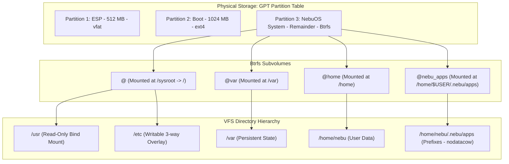
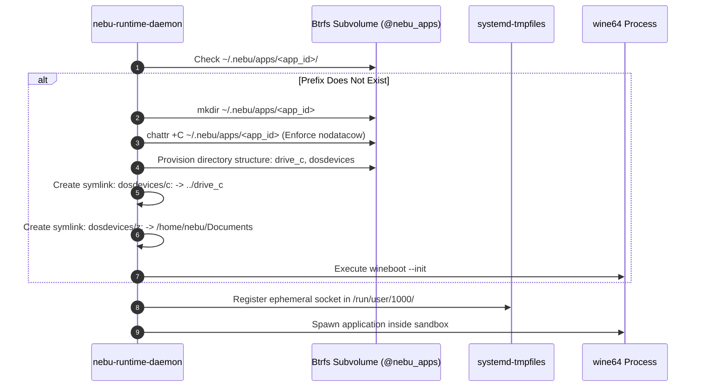

# Filesystem Specification — NebuOS

**Document ID:** NEBU-SPEC-0003  
**Status:** DRAFT  
**Author:** NebuOS Core Architecture Group  
**Target Version:** 1.0  
**Last Updated:** 2026-09-04  

---

## 1. Status

DRAFT. This document is under initial architectural review. It defines the formal storage layout, Btrfs subvolumes, system mount hierarchy, file permissions, `systemd-tmpfiles` rules, and XDG base directory compliance for NebuOS.

---

## 2. Purpose

This specification defines the exact filesystem topology and storage management practices of NebuOS. It details:
- The authoritative running mount table for virtual and physical filesystems.
- Concrete Btrfs subvolume layout and performance-tuned mount flags.
- Directory ownership, permission bits, and SELinux label specifications.
- Complete, syntactically verified `systemd-tmpfiles` configuration manifests.
- Directory internal hierarchy of application prefixes (`~/.nebu/apps/<app_id>/`).
- Declarative maintenance timers for Btrfs scrubbing and trimming.
- Formal XDG base directory allocations and lifecycle eviction rules.

---

## 3. Scope

This document applies to:
- Disk partitioning and Btrfs subvolume structuring on target block storage.
- System initialization mounts managed by Dracut, systemd, and `fstab`.
- Ephemeral runtime filesystems (`tmpfs`, `devpts`, `proc`, `sysfs`).
- User profile isolation, application prefixes, and Windows drive mapping virtualizations.

---

## 4. Non-Goals

- Remote network storage protocols (NFS, SMB/CIFS, iSCSI).
- RAID configuration across heterogeneous disks (handled by standard Btrfs multi-device tooling).
- Proprietary disk encryption firmware (LUKS2 is supported as standard block abstraction).
- Memory swap compression internals (covered in [06-resource-management.md](06-resource-management.md)).

---

## 5. Requirements

### 5.1 Functional Requirements

| Identifier | Description | Verification Method |
|---|---|---|
| **REQ-FS-001** | The root filesystem (`/usr`) must be mounted strictly read-only (`ro`) to ensure OS immutability. | `cat /proc/mounts \| grep " /usr "` |
| **REQ-FS-002** | The Wine prefix storage directory must reside on a dedicated Btrfs subvolume with Copy-on-Write disabled (`nodatacow`). | `lsattr ~/.nebu/apps` |
| **REQ-FS-003** | System persistent state must be isolated to `@var`, preserving user configurations in `@home`. | Verification of subvolume layout |
| **REQ-FS-004** | Ephemeral runtime directories must be managed declaratively via `systemd-tmpfiles`. | `systemd-tmpfiles --create` audit |
| **REQ-FS-005** | Windows applications must never be granted direct access to `/` via `Z:\`; drive letters must be mapped to controlled sub-paths. | Inspection of `dosdevices/` symlinks |
| **REQ-FS-006** | Btrfs maintenance jobs (fstrim, scrub) must execute on system timers during idle periods. | `systemctl list-timers` |

### 5.2 Non-Functional Requirements

| Identifier | Target Metric | Rationale |
|---|---|---|
| **NFR-FS-001** | Zstandard filesystem compression (`compress=zstd:1`) must achieve >= 1.8x ratio on OS binaries. | Conserves storage on 64 GB SSD targets. |
| **NFR-FS-002** | Metadata commit latency on Btrfs subvolumes < 30 ms during heavy Wine I/O. | Prevents frame stutter during game/CAD runtime. |
| **NFR-FS-003** | Prefix creation time < 800 ms from launch request to filesystem readiness. | Minimizes initial app launch cold delay. |

---

## 6. Architecture

The physical disk layout utilizes standard GPT partitioning mapped to Btrfs subvolumes:



---

## 7. Components

### 7.1 Filesystem Components & Engines

| Component | Upstream Origin | Responsibility |
|---|---|---|
| **Btrfs Kernel Module** | Linux Kernel In-Tree | Core COW filesystem driver, compression, and snapshot engine |
| **btrfs-progs** | Fedora / Upstream | CLI tools for subvolume creation, snapshotting, and scrubbing |
| **systemd-tmpfiles** | systemd Upstream | Creation, permission enforcement, and cleanup of volatile files |
| **ostree / bootc** | Project Atomic | Hardlink-based deployment tree and atomic sysroot transitions |
| **nebu-runtime-daemon** | NebuOS In-House | Dynamic provisioning of prefix trees and `dosdevices` symlinks |

---

## 8. Data Flow

### 8.1 Prefix Filesystem Provisioning Flow



---

## 9. Control Flow

### 9.1 Storage Mount Sequencing

1. UEFI loads GRUB from Partition 1 (`/boot/efi`).
2. Kernel and initramfs load from Partition 2 (`/boot`).
3. Initramfs mounts subvolume `@` to `/sysroot` with options `ro,compress=zstd:1`.
4. OSTree pivots root to deployment directory `/sysroot/ostree/deploy/nebu/...`.
5. PID 1 mounts remaining filesystems via `/etc/fstab`:
   - `@var` to `/var` (`rw,noatime,compress=zstd:1`).
   - `@home` to `/home` (`rw,noatime,compress=zstd:1`).
   - `@nebu_apps` to `/home/nebu/.nebu/apps` (`rw,noatime,nodatacow`).
6. `systemd-tmpfiles --create` creates ephemeral runtime directories under `/run`, `/tmp`, and `/var/tmp`.

---

## 10. Interfaces

### 10.1 Running System Complete Mount Table

The following table specifies every mount point present in a fully initialized NebuOS system:

| Source Device / Spec | Target Mount Point | Filesystem Type | Concrete Mount Options | Architectural Purpose |
|---|---|---|---|---|
| `LABEL=nebu-root` | `/sysroot` | `btrfs` | `ro,relatime,seclabel,compress=zstd:1,ssd,space_cache=v2,subvol=@` | Underlying physical OSTree sysroot |
| `/sysroot/ostree/deploy/...` | `/` | `ext4/btrfs` | `ro,relatime,seclabel` | Active OSTree deployment root |
| `/sysroot/ostree/deploy/.../usr`| `/usr` | `btrfs` | `ro,relatime,seclabel,compress=zstd:1` | Immutable OS binaries and libraries |
| `LABEL=nebu-boot` | `/boot` | `ext4` | `ro,relatime,seclabel` | Static kernel images and initramfs |
| `LABEL=nebu-efi` | `/boot/efi` | `vfat` | `rw,nosuid,nodev,noexec,relatime,fmask=0077,dmask=0077,codepage=437,iocharset=ascii,shortname=winnt` | EFI System Partition |
| `LABEL=nebu-root` | `/var` | `btrfs` | `rw,noatime,seclabel,compress=zstd:1,ssd,discard=async,space_cache=v2,subvol=@var` | Persistent variable system data |
| `LABEL=nebu-root` | `/home` | `btrfs` | `rw,noatime,seclabel,compress=zstd:1,ssd,discard=async,space_cache=v2,subvol=@home` | User home directories and documents |
| `LABEL=nebu-root` | `/home/nebu/.nebu/apps` | `btrfs` | `rw,noatime,seclabel,nodatacow,ssd,discard=async,space_cache=v2,subvol=@nebu_apps` | Unfragmented Wine prefixes & registries |
| `tmpfs` | `/run` | `tmpfs` | `rw,nosuid,nodev,seclabel,size=20%,mode=755` | Ephemeral runtime lock & socket files |
| `tmpfs` | `/tmp` | `tmpfs` | `rw,nosuid,nodev,seclabel,size=50%,mode=1777` | System temporary storage |
| `devtmpfs` | `/dev` | `devtmpfs` | `rw,nosuid,seclabel,size=4m,nr_inodes=1048576,mode=755` | Hardware device nodes |
| `devpts` | `/dev/pts` | `devpts` | `rw,nosuid,noexec,relatime,seclabel,gid=5,mode=620,ptmxmode=000` | Pseudo-terminal slave devices |
| `tmpfs` | `/dev/shm` | `tmpfs` | `rw,nosuid,nodev,seclabel,size=50%` | POSIX shared memory segments |
| `proc` | `/proc` | `proc` | `rw,nosuid,nodev,noexec,relatime` | Kernel process and state virtual tree |
| `sysfs` | `/sys` | `sysfs` | `rw,nosuid,nodev,noexec,relatime,seclabel` | Hardware and kernel subsystem tree |
| `cgroup2` | `/sys/fs/cgroup` | `cgroup2` | `rw,nosuid,nodev,noexec,relatime,seclabel,nsdelegate` | Unified cgroups v2 control hierarchy |
| `tmpfs` | `/run/user/1000` | `tmpfs` | `rw,nosuid,nodev,relatime,seclabel,size=10%,mode=700,uid=1000,gid=1000` | User session XDG runtime directory |

---

### 10.2 Concrete Btrfs Subvolume Matrix

| Subvolume Name | Canonical Path | Mount Options | Copy-on-Write (CoW) | Compression | Rationale |
|---|---|---|---|---|---|
| `@` | `/` | `ro,compress=zstd:1` | Enabled | `zstd:1` | Immutability and high read throughput |
| `@var` | `/var` | `rw,noatime,compress=zstd:1,discard=async` | Enabled | `zstd:1` | Logs, caches, Flatpak runtimes |
| `@home` | `/home` | `rw,noatime,compress=zstd:1,discard=async` | Enabled | `zstd:1` | User files; maximum space efficiency |
| `@nebu_apps` | `/home/nebu/.nebu/apps` | `rw,noatime,nodatacow,discard=async` | **DISABLED** | **None** | Prevents SQLite / Wine registry fragmentation |

*Note on `nodatacow`:* Subvolume `@nebu_apps` is created with `chattr +C`. This avoids Btrfs severe fragmentation on random write access patterns typical of Windows registry hives (`system.dat`, `user.dat`) and DXVK shader cache files, while maintaining subvolume snapshot functionality.

---

### 10.3 Directory Ownership and Permission Bits

| Directory Path | User:Group | Octal Mode | SELinux Context | Purpose |
|---|---|---|---|---|
| `/` | `root:root` | `0755` | `system_u:object_r:root_t:s0` | System root |
| `/usr` | `root:root` | `0755` | `system_u:object_r:usr_t:s0` | Immutable OS tree |
| `/etc` | `root:root` | `0755` | `system_u:object_r:etc_t:s0` | Machine configuration |
| `/var` | `root:root` | `0755` | `system_u:object_r:var_t:s0` | Variable state root |
| `/var/lib/nebu` | `root:root` | `0755` | `system_u:object_r:var_lib_t:s0` | Global compatibility DB |
| `/var/log` | `root:root` | `0755` | `system_u:object_r:var_log_t:s0` | System log directory |
| `/tmp` | `root:root` | `1777` | `system_u:object_r:tmp_t:s0` | Sticky world-writable temp |
| `/home` | `root:root` | `0755` | `system_u:object_r:home_root_t:s0` | User home root |
| `/home/nebu` | `nebu:nebu` | `0700` | `unconfined_u:object_r:user_home_dir_t:s0`| Primary user home |
| `/home/nebu/.nebu` | `nebu:nebu` | `0700` | `unconfined_u:object_r:user_home_t:s0`| NebuOS configuration root |
| `/home/nebu/.nebu/apps` | `nebu:nebu` | `0700` | `unconfined_u:object_r:data_home_t:s0`| Prefix isolation subvolume |
| `/run/nebu` | `root:root` | `0755` | `system_u:object_r:var_run_t:s0` | System runtime telemetry |
| `/run/user/1000` | `nebu:nebu` | `0700` | `unconfined_u:object_r:user_tmp_t:s0`| User XDG runtime socket dir |

---

### 10.4 Application Prefix Directory Structure

Each application prefix provisioned at `/home/nebu/.nebu/apps/<app_id>/` follows this exact internal layout:

```text
/home/nebu/.nebu/apps/<app_id>/
├── prefix.json              # Declarative application configuration manifest
├── .lock                    # Advisory flock lockfile preventing concurrent wineboot
├── system.reg               # Windows HKEY_LOCAL_MACHINE registry hive
├── user.reg                 # Windows HKEY_CURRENT_USER registry hive
├── userdef.reg              # Windows default user hive template
├── dosdevices/              # Virtual drive mappings
│   ├── c: -> ../drive_c     # Primary virtual C: drive
│   ├── d: -> /run/media/... # Removable media or ISO mount (optional)
│   └── z: -> /home/nebu/Documents  # Sandboxed host documents directory
├── drive_c/
│   ├── Program Files/
│   ├── Program Files (x86)/
│   ├── ProgramData/
│   ├── users/
│   │   └── nebu/
│   │       ├── AppData/
│   │       ├── Desktop/
│   │       └── Documents/ -> /home/nebu/Documents
│   └── windows/
│       ├── system32/
│       └── syswow64/
└── snapshots/               # Btrfs point-in-time snapshot references
    └── pre-update-20260904/
```

---

### 10.5 systemd-tmpfiles Configurations

#### 10.5.1 `/usr/lib/tmpfiles.d/nebu-system.conf`
```ini
# ====================================================================
# NebuOS System Ephemeral Directory Manifest
# Type Path                 Mode User Group Age Argument
# ====================================================================

# System runtime directories
d    /run/nebu              0755 root root  -   -
d    /run/nebu/telemetry    0755 root root  -   -
d    /run/nebu/dispatch     0755 root root  -   -

# Persistent system state directories
d    /var/lib/nebu          0755 root root  -   -
d    /var/lib/nebu/db       0755 root root  -   -
d    /var/cache/nebu        0755 root root  30d -

# Ensure global compatibility database exists
f    /var/lib/nebu/db/compat.db 0644 root root - -
```

#### 10.5.2 `/usr/lib/tmpfiles.d/nebu-user.conf`
```ini
# ====================================================================
# NebuOS User Runtime Manifest
# ====================================================================

# User-specific runtime directories under $XDG_RUNTIME_DIR
d    %t/nebu                0700 %u   %g    -   -
d    %t/nebu/wine           0700 %u   %g    -   -
d    %t/nebu/compositor     0700 %u   %g    -   -

# Ephemeral Wine server socket redirection
L+   %t/wine-server         -    -    -     -   %t/nebu/wine
```

#### 10.5.3 `/usr/lib/tmpfiles.d/nebu-apps.conf`
```ini
# ====================================================================
# NebuOS Application Prefix Cleaning Rules
# ====================================================================

# Clean up leftover Windows crashdumps and temporary files older than 7 days
e    /home/*/.nebu/apps/*/drive_c/windows/temp/*       - - - 7d -
e    /home/*/.nebu/apps/*/drive_c/users/*/AppData/Local/Temp/* - - - 7d -
```

---

### 10.6 Maintenance Timers

#### 10.6.1 `/usr/lib/systemd/system/nebu-fstrim.timer`
```ini
[Unit]
Description=Discard unused Btrfs blocks weekly
Documentation=man:fstrim(8)
ConditionVirtualization=false

[Timer]
OnCalendar=weekly
AccuracySec=1h
Persistent=true

[Install]
WantedBy=timers.target
```

#### 10.6.2 `/usr/lib/systemd/system/nebu-btrfs-scrub.timer`
```ini
[Unit]
Description=Monthly Btrfs Scrub Timer for Root and Data Subvolumes
Documentation=man:btrfs-scrub(8)

[Timer]
OnCalendar=*-*-01 02:00:00
Persistent=true

[Install]
WantedBy=timers.target
```

---

### 10.7 XDG Base Directory Specification Compliance

NebuOS native applications and daemons strictly conform to the XDG Base Directory Specification:

| Environment Variable | Default Concrete Path | Allocation in NebuOS | Maximum Budget | Lifecycle / Eviction Policy |
|---|---|---|---|---|
| `$XDG_CONFIG_HOME` | `~/.config` | `~/.config/nebu/` (shell, compositor configs) | 10 MB | Retained indefinitely; backed up. |
| `$XDG_DATA_HOME` | `~/.local/share` | `~/.local/share/nebu/` (desktop files, icons) | 250 MB | Retained indefinitely. |
| `$XDG_STATE_HOME` | `~/.local/state` | `~/.local/state/nebu/` (session logs, window history) | 50 MB | Pruned to last 5 sessions. |
| `$XDG_CACHE_HOME` | `~/.cache` | `~/.cache/nebu/` (shader cache, font raster cache) | 2048 MB | Pruned on LRU basis when disk free < 15%. |
| `$XDG_RUNTIME_DIR` | `/run/user/1000` | `%t/wayland-0`, `%t/nebu/` (sockets, locks) | 512 MB (tmpfs) | Purged completely upon user logout. |

---

## 11. Dependencies

### 11.1 Subsystem Dependencies
- `btrfs-progs` >= 6.6 (required for async discard and modern scrub).
- `util-linux` >= 2.39 (for `mount`, `fstab`, `findmnt`).
- `systemd` >= 254 (for `systemd-tmpfiles`).

---

## 12. Security

- **VFS Mount Hardening:** Sensitive virtual mounts (`/dev/shm`, `/tmp`, `/run`) enforce `nosuid,nodev`. `/boot` is mounted `ro` during standard operation.
- **Prefix Isolation:** Each prefix in `~/.nebu/apps/<app_id>` is isolated by permission mask `0700`.
- **Anti-Directory Traversal:** Windows symlinks (`dosdevices/z:`) are restricted strictly to user document directories (`~/Documents`, `~/Downloads`), preventing traversal into host root filesystems.
- **SELinux Labels:** All files inside home directories are labeled with `user_home_t` and `data_home_t`, preventing sandbox escaping via IPC pipes.

---

## 13. Resource Requirements

### 13.1 Storage Allocation Budgets (64 GB Minimum Target)

| Partition / Subvolume | Minimum Size | Recommended Size | Target Utilization |
|---|---|---|---|
| Partition 1: ESP (`/boot/efi`) | 512 MB | 512 MB | < 20% |
| Partition 2: Boot (`/boot`) | 1024 MB | 1024 MB | < 35% |
| Subvolume `@` (Root OS) | 15 GB | 25 GB | < 60% |
| Subvolume `@var` | 8 GB | 15 GB | < 50% |
| Subvolume `@home` + `@nebu_apps`| 35 GB (Remaining)| Remainder | User dependent |

---

## 14. Failure Modes

| ID | Failure Mode | Trigger | System Impact |
|---|---|---|---|
| **FM-FS-001** | Btrfs Read-Only Flip | I/O error or checksum failure on metadata | Filesystem transitions to read-only; writes fail |
| **FM-FS-002** | Root partition full | Disk space exhaustion (< 100 MB free) | Applications fail to write temporary data or logs |
| **FM-FS-003** | Prefix Lock Contention | Orphaned SQLite lock or wineserver lock | Windows application fails to start |
| **FM-FS-004** | EFI Partition Corruption | Abrupt power cut during GRUB install | System fails to boot to GRUB |

---

## 15. Recovery Behavior

- **For FM-FS-001:** Systemd triggers emergency target; automated background `btrfs check --readonly` logs damaged blocks. User is alerted via recovery UI.
- **For FM-FS-002:** `nebu-runtime-daemon` triggers emergency cache pruning: deletes `$XDG_CACHE_HOME/nebu/shaders/*` and `/tmp/*`, freeing critical space.
- **For FM-FS-003:** `nebu-runtime-daemon` inspects `~/.nebu/apps/<app_id>/.lock`. If PID does not exist in `app-nebu-wine.slice`, the lockfile is unlinked.
- **For FM-FS-004:** UEFI fallback bootloader (`/EFI/BOOT/BOOTX64.EFI`) restores primary GRUB pointer from backup EFI tree.

---

## 16. Testing Requirements

1. **Subvolume Mount Verification:** Test suite executing `btrfs subvolume list /` ensuring all 4 subvolumes exist with expected names.
2. **CoW Flag Assertion:** Verify `nodatacow` on newly generated prefix paths via `lsattr -d ~/.nebu/apps/*`.
3. **Tmpfiles Execution:** Run `systemd-tmpfiles --dry-run --create` in CI; verify zero warnings and correct UID/GID assignment.
4. **Symlink Boundary Test:** Verify that attempts to traverse `dosdevices/z:` past allowed directories return `EACCES` or `ENOENT` inside Bubblewrap.

---

## 17. Performance Requirements

- **Subvolume Creation Latency:** Provisioning a new Btrfs prefix subvolume must complete in < 250 ms.
- **Async Discard Latency:** SSD TRIM operations (`discard=async`) must not produce I/O stalls > 10 ms on main threads.
- **Direct I/O Throughput:** Sustained sequential read throughput on `@` > 450 MB/s on SATA SSD, > 1800 MB/s on NVMe.

---

## 18. Compatibility Considerations

- **Windows Case-Insensitivity:** Wine implements case-folding in userland. NebuOS ensures compatibility without requiring kernel-level directory case-folding (`chattr +F`), avoiding Btrfs compatibility constraints.
- **Special Characters:** Windows filenames containing reserved characters (`:`, `*`, `?`, `"`, `<`, `>`, `|`) are escaped by Wine into Unicode Private Use Area characters.

---

## 19. Open Questions

1. **OPEN QUESTION (FS-OQ-01):** Should `@nebu_apps` be a nested Btrfs subvolume under `@home` or a top-level subvolume mounted into `/home/nebu/.nebu/apps`? *Current assumption:* Top-level subvolume mounted into the user directory to enable independent subvolume snapshotting without recursing home data.
2. **OPEN QUESTION (FS-OQ-02):** Does disabling CoW (`nodatacow`) on `@nebu_apps` break Btrfs checksumming on Wine files? *Current assumption:* Yes, disabling CoW disables checksumming on that tree; this trade-off is accepted to prevent severe registry fragmentation.
3. **OPEN QUESTION (FS-OQ-03):** Should `zstd:1` or `zstd:3` be default for `@home`? *Current assumption:* `zstd:1` provides optimal decompression speed on low-end CPUs with negligible size penalty over level 3.

---

## 20. Related Documents

- [00-system-specification.md](00-system-specification.md)
- [01-boot-specification.md](01-boot-specification.md)
- [02-process-ipc-specification.md](02-process-ipc-specification.md)
- [04-security-specification.md](04-security-specification.md)
- [05-hardware-specification.md](05-hardware-specification.md)
- [06-resource-management.md](06-resource-management.md)
- [../architecture/04-filesystem.md](../architecture/04-filesystem.md)
