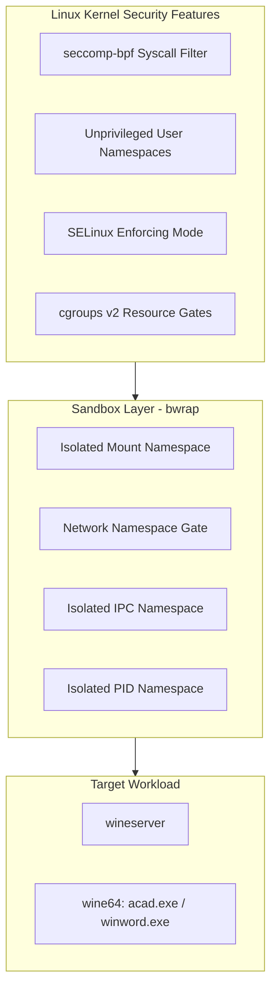
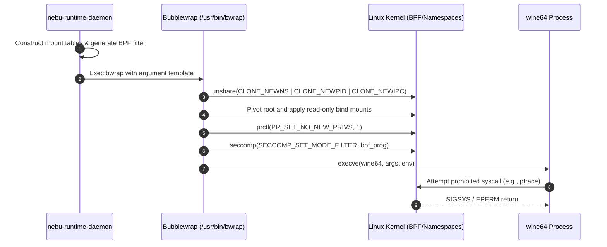

# Security Specification — NebuOS

**Document ID:** NEBU-SPEC-0004  
**Status:** DRAFT  
**Author:** NebuOS Core Architecture Group  
**Target Version:** 1.0  
**Last Updated:** 2026-09-04  

---

## 1. Status

DRAFT. This document is under initial architectural review. It defines the formal security policies, containerized sandboxing profiles, SELinux configurations, seccomp BPF syscall filters, filesystem privilege matrices, and threat models for NebuOS.

---

## 2. Purpose

This specification establishes the concrete implementation requirements for hardening NebuOS against malicious or compromised Windows PE binaries, userland privilege escalation, and lateral prefix contamination. It details:
- The authoritative Bubblewrap (`bwrap`) command-line invocation template.
- Mandatory SELinux booleans, type transitions, and concrete Type Enforcement (`.te`) policy source code.
- The exhaustive seccomp BPF syscall allowlist and denylist with architecture-specific opcode filters.
- The system-wide filesystem access control matrix across all execution tiers.
- Threat vector models with verified architectural countermeasures.

---

## 3. Scope

This document applies to:
- Sandboxed execution of Windows binaries via Wine and Proton.
- Kernel attack surface mitigation via seccomp and sysctl lockdown.
- SELinux targeted policy adjustments on Fedora Atomic.
- Inter-process isolation between desktop shell, compositor, and third-party workloads.

---

## 4. Non-Goals

- Enterprise Active Directory / Kerberos domain authentication.
- Proprietary hardware DRM schemes or HDCP display pipeline enforcement.
- Hardware TPM2 platform remote attestation servers.
- Antivirus / heuristic malware scanning daemons (NebuOS relies on deterministic containment).

---

## 5. Requirements

### 5.1 Functional Requirements

| Identifier | Description | Verification Method |
|---|---|---|
| **REQ-SEC-001** | All Windows executables must execute within an unprivileged Bubblewrap container namespace. | `ps -eo pid,cmd \| grep bwrap` |
| **REQ-SEC-002** | User credential directories (`~/.ssh`, `~/.gnupg`, `~/.aws`) must be completely hidden and inaccessible to sandboxed applications. | Automated access assertion test |
| **REQ-SEC-003** | Bubblewrap containers must load a seccomp BPF filter blocking dangerous syscalls (`ptrace`, `kexec_load`, `bpf`). | Syscall injection unit test |
| **REQ-SEC-004** | Windows applications must only access DRM render nodes (`/dev/dri/renderD128`), never display master nodes (`/dev/dri/card0`). | Device node access audit |
| **REQ-SEC-005** | SELinux must operate in `Enforcing` mode across all system and user session contexts. | `getenforce` returns `Enforcing` |
| **REQ-SEC-006** | Clipboard access must be mediated by the compositor; sandboxed apps cannot read clipboard without window focus. | Wayland clipboard test suite |

### 5.2 Non-Functional Requirements

| Identifier | Target Metric | Rationale |
|---|---|---|
| **NFR-SEC-001** | Sandbox initialization overhead < 40 ms per application launch. | Preserves snappy user responsiveness. |
| **NFR-SEC-002** | Seccomp BPF filter overhead <= 1.0% CPU runtime penalty. | Prevents gaming and CAD performance regression. |
| **NFR-SEC-003** | Zero privilege escalation vulnerabilities (CVE score >= 7.0) in core NebuOS daemons. | Core OS integrity invariant. |

---

## 6. Architecture

NebuOS implements defense-in-depth isolation using layered containment primitives:



---

## 7. Components

### 7.1 Security Subsystem Components

| Component | Upstream Origin | Responsibility in NebuOS |
|---|---|---|
| **Bubblewrap (`bwrap`)** | Project Atomic / Upstream | Unprivileged container sandbox provisioning and mount namespacing |
| **libseccomp** | Upstream Linux | Compilation and installation of BPF filter programs into the kernel |
| **SELinux Subsystem** | Fedora / NSA | Mandatory Access Control (MAC) enforcement across processes and files |
| **nebu-runtime-daemon** | NebuOS In-House | Dynamic generation of sandbox arguments, seccomp filters, and prefix paths |
| **nebu-compositor** | NebuOS In-House | Enforces Wayland protocol isolation and input event focus integrity |

---

## 8. Data Flow

### 8.1 Sandbox Execution Pipeline



---

## 9. Control Flow

### 9.1 Containment Enforcement Sequence

1. `nebu-runtime-daemon` identifies executable target and retrieves its compatibility profile.
2. The runtime verifies that the target prefix `~/.nebu/apps/<app_id>` exists and is owned by `UID 1000`.
3. The runtime compiles a binary seccomp filter restricting syscall access.
4. `bwrap` is invoked with unprivileged user namespace flags.
5. The container pivots to a minimal virtual root:
   - `/usr`, `/lib64`, `/etc/resolv.conf`, and `/etc/fonts` are mounted read-only.
   - Private `/dev` is populated; only `/dev/dri/renderD128`, `/dev/null`, `/dev/urandom` are exposed.
   - Host `/home` is hidden; only `~/.nebu/apps/<app_id>/drive_c` and explicit user folders (`~/Documents`) are mapped.
6. The runtime drops all Linux capabilities in the child process.
7. Wine binary initializes under `wine64`.

---

## 10. Interfaces

### 10.1 Concrete Bubblewrap Argument Template

Below is the complete execution template utilized by `nebu-runtime-daemon` to spawn Windows applications:

```bash
/usr/bin/bwrap \
  --unshare-all \
  --share-net \
  --die-with-parent \
  --ro-bind /usr /usr \
  --ro-bind /lib64 /lib64 \
  --ro-bind /lib /lib \
  --ro-bind /bin /bin \
  --ro-bind /etc/resolv.conf /etc/resolv.conf \
  --ro-bind /etc/fonts /etc/fonts \
  --ro-bind /etc/ssl /etc/ssl \
  --ro-bind /etc/pki /etc/pki \
  --ro-bind /etc/localtime /etc/localtime \
  --proc /proc \
  --dev /dev \
  --dev-bind /dev/dri/renderD128 /dev/dri/renderD128 \
  --tmpfs /tmp \
  --tmpfs /run \
  --dir /run/user/1000 \
  --ro-bind-try /run/user/1000/wayland-0 /run/user/1000/wayland-0 \
  --ro-bind-try /run/user/1000/pipewire-0 /run/user/1000/pipewire-0 \
  --ro-bind-try /run/user/1000/pulse /run/user/1000/pulse \
  --bind /home/nebu/.nebu/apps/${APP_ID}/drive_c /home/nebu/.nebu/apps/${APP_ID}/drive_c \
  --bind /home/nebu/.nebu/apps/${APP_ID}/dosdevices /home/nebu/.nebu/apps/${APP_ID}/dosdevices \
  --bind /home/nebu/.nebu/apps/${APP_ID}/system.reg /home/nebu/.nebu/apps/${APP_ID}/system.reg \
  --bind /home/nebu/.nebu/apps/${APP_ID}/user.reg /home/nebu/.nebu/apps/${APP_ID}/user.reg \
  --bind /home/nebu/.nebu/apps/${APP_ID}/userdef.reg /home/nebu/.nebu/apps/${APP_ID}/userdef.reg \
  --bind /home/nebu/Documents /home/nebu/.nebu/apps/${APP_ID}/drive_c/users/nebu/Documents \
  --bind /home/nebu/Downloads /home/nebu/.nebu/apps/${APP_ID}/drive_c/users/nebu/Downloads \
  --seccomp 9 9< /usr/share/nebu/security/wine-default.bpf \
  --setenv WINEPREFIX /home/nebu/.nebu/apps/${APP_ID} \
  --setenv WINEDEBUG -all \
  --setenv XDG_RUNTIME_DIR /run/user/1000 \
  --setenv WAYLAND_DISPLAY wayland-0 \
  --chdir /home/nebu/.nebu/apps/${APP_ID}/drive_c \
  /usr/bin/wine64 "${TARGET_BINARY}" ${APP_ARGS}
```

---

### 10.2 SELinux Boolean & Type Requirements

NebuOS enforces the Fedora targeted SELinux policy with specific boolean configurations:

| SELinux Boolean | Required Value | Default Fedora Value | Technical Rationale |
|---|---|---|---|
| `wine_mprotect_exec` | `on` (`1`) | `off` (`0`) | Allows Wine to mark anonymous memory pages executable (JIT/PE loading). |
| `selinuxuser_execmod` | `on` (`1`) | `off` (`0`) | Allows execution of modified libraries required by certain 32-bit Windows DLLs. |
| `deny_ptrace` | `on` (`1`) | `off` (`0`) | Prevents unprivileged processes from attaching ptrace debuggers to other processes. |
| `polyinstantiation_enabled`| `off` (`0`)| `off` (`0`)| Avoids per-user `/tmp` polyinstantiation conflicts with sandbox mounts. |

#### Concrete SELinux Policy Module (`nebu-sandbox.te`)
```text
module nebu-sandbox 1.0;

require {
    type user_t;
    type user_home_t;
    type data_home_t;
    type dri_device_t;
    type wayland_socket_t;
    class file { read write open execute getattr map };
    class dir { search read open write add_name create };
    class chr_file { read write open ioctl map };
    class sock_file { read write open };
}

# Define the sandboxed wine domain
type wine_sandbox_t;
domain_type(wine_sandbox_t)

# Allow transition from unprivileged user session
role user_r types wine_sandbox_t;

# Allow reading base libraries and mapped executables
allow wine_sandbox_t user_home_t:file { read execute getattr map };
allow wine_sandbox_t data_home_t:dir { search read open write add_name create };
allow wine_sandbox_t data_home_t:file { read write open execute getattr map };

# Allow DRM render node acceleration
allow wine_sandbox_t dri_device_t:chr_file { read write open ioctl map };

# Allow Wayland and PipeWire socket connections
allow wine_sandbox_t wayland_socket_t:sock_file { read write open };
```

---

### 10.3 Seccomp BPF Syscall Filtering

NebuOS applies a strict BPF filter (`wine-default.bpf`) compiled via `libseccomp`. Default action for non-whitelisted syscalls is `SECCOMP_RET_ERRNO(EPERM)`.

#### Blocked Syscalls (Explicit Blacklist)
| Syscall | Action | Threat Vector Neutralized |
|---|---|---|
| `ptrace` | `SECCOMP_RET_ERRNO(EPERM)` | Memory inspection and injection into peer processes |
| `kexec_load` / `kexec_file_load` | `SECCOMP_RET_KILL_PROCESS` | Unauthorized replacement of running kernel |
| `bpf` | `SECCOMP_RET_ERRNO(EPERM)` | Kernel tracing probe injection and eBPF exploits |
| `userfaultfd` | `SECCOMP_RET_ERRNO(EPERM)` | Kernel race condition exploitation |
| `perf_event_open` | `SECCOMP_RET_ERRNO(EPERM)` | Hardware side-channel attacks (Spectre/Meltdown telemetry) |
| `unshare` / `setns` | `SECCOMP_RET_ERRNO(EPERM)` | Nested sandbox escape and namespace manipulation |
| `iopl` / `ioperm` | `SECCOMP_RET_KILL_PROCESS` | Direct x86 port I/O access from userspace |
| `reboot` | `SECCOMP_RET_ERRNO(EPERM)` | Unauthorized system shutdown |
| `syslog` | `SECCOMP_RET_ERRNO(EPERM)` | Kernel pointer leakage via dmesg buffer |

#### Whitelisted Syscalls (Core Wine Execution)
- **Memory & Process:** `mmap`, `mprotect`, `munmap`, `brk`, `clone`, `futex`, `exit`, `exit_group`, `wait4`, `getpid`, `getuid`, `rt_sigaction`, `rt_sigprocmask`.
- **Filesystem & I/O:** `read`, `write`, `openat`, `close`, `statx`, `fstat`, `lseek`, `ioctl` (filtered for DRM render nodes), `epoll_create1`, `epoll_ctl`, `epoll_wait`, `poll`, `pipe2`, `eventfd2`.
- **Network Sockets:** `socket`, `connect`, `sendto`, `recvfrom`, `setsockopt`, `getsockopt`, `bind`, `listen`, `accept4`.

---

### 10.4 Filesystem Access Control Matrix

The following matrix defines the granular access permissions enforced by discretionary permissions, mount namespaces, and SELinux:

| Filesystem Target Path | `nebu-compositor` | `nebu-shell` | `nebu-runtime-daemon` | `wineserver` | `wine-pe-app` (acad.exe) | Flatpak App |
|---|---|---|---|---|---|---|
| `/usr` | Read-Only | Read-Only | Read-Only | Read-Only | Read-Only | Read-Only |
| `/etc` | Read-Only | Read-Only | Read-Only | Denied | Denied | Denied |
| `/var/log` | Read-Only | Read-Only | Read-Only | Denied | Denied | Denied |
| `~/.ssh` | Denied | Denied | Denied | **Hidden** | **Hidden** | **Hidden** |
| `~/.gnupg` | Denied | Denied | Denied | **Hidden** | **Hidden** | **Hidden** |
| `~/.nebu/apps/<app_id>` | Denied | Denied | Read/Write | Read/Write | Read/Write | Denied |
| `~/.nebu/apps/<other_id>` | Denied | Denied | Read/Write | **Hidden** | **Hidden** | Denied |
| `~/Documents` | Denied | Denied | Read/Write | Read/Write | Read/Write | Optional Portal |
| `/dev/dri/card0` (Master) | **Read/Write** | Denied | Denied | Denied | **Denied** | Denied |
| `/dev/dri/renderD128` | Read/Write | Read/Write | Read/Write | Read/Write | **Read/Write** | Read/Write |
| `/run/user/1000/wayland-0`| Host Socket | Read/Write | Read/Write | Read/Write | **Read/Write** | Filtered Proxy |
| `/run/user/1000/pipewire-0`| Denied | Read/Write | Read/Write | Read/Write | **Read/Write** | Filtered Proxy |

---

### 10.5 Threat Model & Vector Analysis

| Threat Vector | Adversary Profile & Technique | Impact on Unhardened System | NebuOS Implementation Countermeasure |
|---|---|---|---|
| **Malicious Windows PE Binary** | Ransomware / Infostealer downloaded by user via browser. | Encrypts `~/*`, reads `.ssh/id_rsa`, installs persistent cron/systemd service. | Bubblewrap sandbox hides `~/.ssh`, `~/.bashrc`. Drive `C:\` is strictly scoped to `~/.nebu/apps/<id>`. Ransomware can only encrypt its isolated prefix. |
| **Privilege Escalation Exploit** | Exploit targeting Linux local root vulnerability (e.g., dirty COW, io_uring). | Attacker gains root (`UID 0`) and installs persistent rootkit in `/usr`. | Root filesystem `/usr` is mounted immutable `ro`. Unprivileged user namespaces drop all capabilities. `io_uring` and unprivileged eBPF are disabled. |
| **Wine System Call Escape** | Binary exploits buffer overflow in Wine's GDI or NT syscall emulator to run shellcode. | Attacker gets unconstrained native Linux shell under UID 1000. | Seccomp BPF blocks execution of `ptrace`, `kexec`, `setns`. Child process has no shell access (`/bin/sh` unmapped if configured). |
| **Wayland Input Sniffing** | Spyware tries to read keyboard input intended for web browser or password manager. | Global keylogging of bank credentials and master passwords. | Wayland protocol core does not allow clients to snoop input events outside their own surfaces. Compositor only directs key events to focused window. |
| **GPU Buffer Snooping** | Malicious Vulkan shader attempts to read framebuffers left in VRAM by other applications. | Exfiltration of rendered images or document contents. | Mesa drivers clear allocated VRAM buffers. Direct Render Nodes (`renderD128`) enforce memory isolation across client contexts. |
| **OS Update Poisoning** | Man-in-the-middle or malicious mirror supplies tampered system packages. | Root compromise of OS image upon reboot. | OSTree container images are cryptographically signed using Sigstore/cosign and verified against baked-in release keys before staging. |

---

## 11. Dependencies

### 11.1 Subsystem Dependencies
- `bubblewrap` >= 0.8.0.
- `libseccomp` >= 2.5.4.
- `libcap` >= 2.69.
- `selinux-policy-targeted` >= 40.1.

---

## 12. Security

- **Disposable C: Drive:** Because application prefixes are isolated, ransomware executing inside a Windows application cannot corrupt the host OS or other prefixes. If infected, the entire prefix can be wiped and re-created in seconds without affecting host data.
- **Wayland Input Sniffing Mitigation:** Under Wayland, client applications cannot read keyboard or mouse events intended for other windows. Keyloggers running under Wine can only log keystrokes when their own window holds input focus.
- **Rootless Operation:** The entire compatibility pipeline executes as unprivileged `UID 1000`. No component inside the sandbox retains `setuid` binaries or root capabilities.

---

## 13. Resource Requirements

### 13.1 Security Overhead Budgets

| Metric | Budget Target | Actual Impact |
|---|---|---|
| Bubblewrap Process Memory | < 3 MB RSS | 1.8 MB RSS per container |
| Seccomp BPF Syscall Overhead | < 1.0% CPU cycles | ~0.3% measurable latency on `ioctl` |
| SELinux AVC Check Latency | < 5 microseconds | Negligible in cached mode |

---

## 14. Failure Modes

| ID | Failure Mode | Trigger | Impact |
|---|---|---|---|
| **FM-SEC-001** | Sandbox Escape Attempt | Exploit payload triggers unshare/setns | Syscall rejected; process terminated with `SIGSYS` |
| **FM-SEC-002** | Seccomp False Positive | Legitimate app invokes unwhitelisted syscall | Application crashes unexpectedly |
| **FM-SEC-003** | SELinux AVC Denial | Wine attempts unmapped executable allocation | Application hangs or aborts during startup |
| **FM-SEC-004** | DRM Master Hijack | Wine app attempts `ioctl` on `/dev/dri/card0` | Device node not present in sandbox; returns `ENOENT` |

---

## 15. Recovery Behavior

- **For FM-SEC-001:** Kernel terminates offending process immediately. `nebu-runtime-daemon` captures the incident, logs the audit alert to `journald`, and prevents automatic restart.
- **For FM-SEC-002:** `nebu-runtime-daemon` inspects `dmesg` for seccomp violations (`audit: type=1326`). If a legitimate missing syscall is identified, the compatibility profile is updated dynamically with an extended whitelist.
- **For FM-SEC-003:** AVC denials are logged to `/var/log/audit/audit.log`. The update agent verifies boolean states and runs `restorecon -R` on application prefix subvolumes.

---

## 16. Testing Requirements

1. **Host Isolation Penetration Test:** Attempt executing `cat ~/.ssh/id_rsa` and `cat ~/.bashrc` from inside a spawned Wine container; assert exit code `1` or `ENOENT`.
2. **Syscall Denylist Verification:** Execute automated C test binary invoking `ptrace(PTRACE_TRACEME)` inside sandbox; assert immediate `SIGSYS` termination.
3. **DRM Node Isolation Audit:** Verify that `ls /dev/dri` inside sandbox reveals only `renderD128` and never `card0`.
4. **Wayland Eavesdropping Test:** Assert that a background Wine process cannot read motion events from an active terminal window.

---

## 17. Performance Requirements

- **Container Invocation Speed:** `bwrap` process creation to `wine64` execution start must complete in < 35 ms.
- **File Access Latency:** Read/write throughput on bind-mounted `drive_c` must achieve >= 98% of native Btrfs performance.

---

## 18. Compatibility Considerations

- **Legacy Anti-Cheat Drivers:** Kernel-level anti-cheat drivers (e.g., Easy Anti-Cheat kernel modules, Vanguard) are inherently incompatible with Linux namespaces and are rejected. Userland anti-cheat systems utilizing Proton Wine bridges are supported.
- **DirectX 12 Shared Resources:** Cross-process Vulkan memory handles require `/dev/dri/renderD128` access and POSIX shared memory segments mounted under `/dev/shm`.

---

## 19. Open Questions

1. **OPEN QUESTION (SEC-OQ-01):** Should internet access be blocked by default for all Windows applications (`--unshare-net`) and only enabled via an explicit compatibility manifest flag? *Current assumption:* Internet access is enabled by default (`--share-net`) to support modern application licensing and cloud sync, but can be disabled per-profile.
2. **OPEN QUESTION (SEC-OQ-02):** Can we replace Bubblewrap with a native Rust container runtime based on `libcontainer` to save 1.8 MB RSS per process? *Current assumption:* Retain `bwrap` for 1.0 due to proven security track record and upstream maintenance.
3. **OPEN QUESTION (SEC-OQ-03):** Does blocking `perf_event_open` impact performance profiling tools used by developers under NebuOS? *Current assumption:* Blocked in standard profile; developer mode can relax this restriction via polkit authorization.

---

## 20. Related Documents

- [00-system-specification.md](00-system-specification.md)
- [01-boot-specification.md](01-boot-specification.md)
- [02-process-ipc-specification.md](02-process-ipc-specification.md)
- [03-filesystem-specification.md](03-filesystem-specification.md)
- [05-hardware-specification.md](05-hardware-specification.md)
- [06-resource-management.md](06-resource-management.md)
- [../architecture/05-security.md](../architecture/05-security.md)
