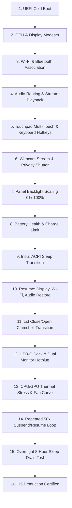
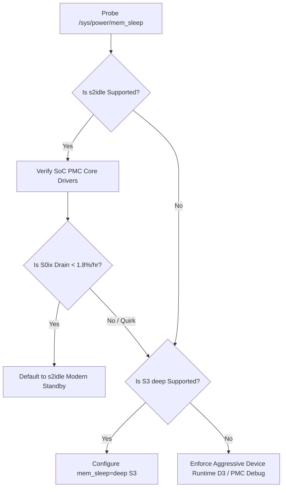

# Hardware & Platform Compatibility Specification — NebuOS

**Document ID:** NEBU-SPEC-0005  
**Status:** APPROVED (Hardened)  
**Author:** Principal OS Architect, Linux Hardware Compatibility Engineer, Power Management Engineer  
**Target Version:** 1.0 (Milestones P0–P8)  
**Last Updated:** 2026-09-04  
**Governing ADR:** ADR-0010 (Hardware Compatibility, Laptop-First Platform, & Power Architecture)  

---

## 1. Status

APPROVED (Hardened). This document serves as the master engineering specification for hardware enumeration, device driver orchestration, power management lifecycle, display topologies, input subsystems, peripheral connectivity, laptop-first validation, and the dual-pillar compatibility framework across NebuOS.

---

## 2. Purpose

NebuOS delivers an immutable, lightweight desktop Linux operating system with native-feeling Windows application compatibility without running virtual machines. To succeed in real-world personal computing environments, NebuOS must not only provide high-performance application translation (Wine/Proton), but also deliver reliable, out-of-the-box hardware compatibility for modern and legacy desktop and laptop systems.

This specification establishes:
1. The **Layered Hardware Abstraction Model** decoupling high-level desktop shells from low-level kernel drivers.
2. Complete architectural specifications for all major hardware domains: CPU, GPU, Display, Input, Network, Audio, Power Management, Camera, Storage, Peripherals, and Firmware.
3. The **NebuOS Laptop Compatibility Program** and quantitative Suspend/Resume validation pipeline.
4. Modern Standby (ACPI S0ix / `s2idle`) versus traditional S3 (`deep`) sleep policies, battery drain mitigation, and SoC PMC telemetry.
5. The **Desktop Environment Reference Audit** extracting proven architectural patterns from GNOME, KDE Plasma, Sway, and Budgie.
6. The **Hardware Compatibility Matrix**, **Certification Tiers (H0–H5)**, and real-world hardware test categories.
7. Diagnostic reporting, failure recovery workflows, and privacy-preserving local hardware fingerprinting.

---

## 3. Scope

This specification governs:
- x86_64 physical personal computing hardware (Desktops, Laptops, Ultrabooks, Gaming Laptops, Workstations, Mini PCs, and 2-in-1 convertibles).
- Linux kernel 6.x driver integration, firmware management via `fwupd`, and device permissions via `systemd-udevd`.
- Power management state machines mediated by ACPI, `systemd-logind`, `UPower`, and `power-profiles-daemon`.
- Wayland display server interaction with DRM/KMS, Mesa 3D drivers, and `libinput`.
- Audio routing through PipeWire and WirePlumber.
- Hardware qualification and HCL generation in the Hardware Compatibility Lab (Milestone P7).

---

## 4. Non-Goals

- ARM64 or RISC-V platform support in NebuOS 1.0 (strictly reserved for post-1.0 milestones).
- Authoring custom, out-of-tree kernel drivers for unmaintained legacy hardware.
- Supporting legacy non-UEFI BIOS systems (64-bit UEFI firmware is strictly mandatory for production).
- Windows virtual machine passthrough (VFIO/QEMU hypervisors are strictly prohibited by the master PRD).
- Invasive telemetry collection: hardware probing is performed strictly for local optimization and diagnostics.

---

## 5. Requirements Taxonomy & Statements

Requirements in NebuOS are strictly classified into:
- **Hard Requirement (HR):** Non-negotiable technical condition; failure blocks release.
- **Engineering Target (ET):** Nominal design objective under controlled conditions.
- **Benchmark (BM):** Performance measurement against a defined baseline test workload.
- **Stretch Goal (SG):** Aspirational performance target for premium hardware.
- **Regression Threshold (RT):** Maximum acceptable performance degradation between releases.
- **Policy (POL):** Operational or architectural rule governing implementation.
- **Capability-Dependent (CD):** Feature availability conditioned on underlying hardware/firmware support.

### 5.1 Functional Requirements & Policies

| Identifier | Classification | Description | Verification Method | Milestone |
|---|---|---|---|---|
| **REQ-HW-001** | **Hard Requirement** | The system must enumerate hardware devices via PCI, USB, DMI/SMBIOS, and sysfs to generate `/run/nebu/hardware_topology.json` during boot in $\le 50	ext{ ms}$. | JSON schema assertion | P0 |
| **REQ-HW-002** | **Hard Requirement** | Kernel DRM render nodes (`/dev/dri/renderD*`) and input event nodes must be accessible to unprivileged user sessions without root privileges. | File permission & ACL audit | P0 |
| **REQ-HW-003** | **Capability-Dependent** | On dual-GPU (hybrid iGPU + dGPU) platforms, the iGPU drives display scanout while the dGPU enters its deepest supported power state (runtime D3cold or D3hot, platform permitting) until dynamic PRIME offloading is requested. | `sysfs` power status inspection | P5 |
| **REQ-HW-004** | **Hard Requirement** | All active Wine and Proton processes must be safely frozen via cgroups v2 (`cgroup.freeze`) before ACPI sleep and thawed cleanly upon resume without crash. | Sleep cycle stress testing | P3 |
| **REQ-HW-005** | **Policy** | The system must dynamically enumerate supported ACPI sleep states (`/sys/power/mem_sleep`). If `s2idle` is supported, it is preferred; if `deep` S3 is supported and S0ix exhibits excessive drain, fallback to `deep` is permitted. If S3 is missing from firmware, system relies on SoC PMC low-power debugging and device runtime-PM. | `rtcwake` & power measurement | P2 |
| **REQ-HW-006** | **Capability-Dependent** | The display subsystem must support dynamic hotplugging, per-output fractional scaling (100%–300% via `wp_fractional_scale_v1`), mixed-DPI multi-monitors, and Variable Refresh Rate (VRR / Adaptive Sync) where supported by panel and GPU. | Wayland protocol validation | P1 |
| **REQ-HW-007** | **Capability-Dependent** | Input devices (precision touchpads, touchscreens, active styluses) must surface hardware-reported multi-touch gestures, palm rejection, and pressure/tilt sensitivity via `libinput`. | Event tracing & gesture tests | P1 |
| **REQ-HW-008** | **Engineering Target** | Wi-Fi (802.11ac/ax/be) and Bluetooth (LE Audio) should recover active associations within $\le 2.0	ext{ s}$ upon system resume from sleep under standard AP conditions. | Network timing validation | P2 |
| **REQ-HW-009** | **Policy** | Audio routing must dynamically hand over streams between internal speakers, 3.5mm TRRS jack, HDMI/DP, and Bluetooth audio via PipeWire/WirePlumber without audible pops or session lockups. | Audio stream capture test | P2 |
| **REQ-HW-010** | **Capability-Dependent** | Camera streams must be mediated through the PipeWire/xdg-desktop-portal camera interface with visual activity indicator. Hardware privacy shutter status is reported if exposed by hardware/V4L2. | Portal sandbox verification | P2 |
| **REQ-HW-011** | **Policy** | Storage controllers (NVMe, SATA, USB, SD cards) must mount removable media safely via `udisks2` with `nosuid,nodev` and transparent Btrfs compression where applicable. | Filesystem mount inspection | P0 |
| **REQ-HW-012** | **Capability-Dependent** | Battery health metrics (design capacity, current full capacity, cycle count) and configurable charging thresholds (e.g. 80% limit via sysfs) are exposed if supported by the platform's EC firmware; if unsupported, the option is cleanly disabled in UI. | UPower D-Bus property audit | P2 |
| **REQ-HW-013** | **Hard Requirement** | Diagnostic hardware and power status must be accessible to non-technical users via NebuShell GUI without requiring terminal access. | UI functional testing | P2 |

### 5.2 Performance Targets & Regression Thresholds

| Identifier | Classification | Metric / Threshold | Controlled Test Baseline Conditions |
|---|---|---|---|
| **NFR-HW-001** | **Hard Requirement** | P0 UEFI cold boot to `agetty` login prompt $< 3.5	ext{ s}$. | QEMU / Bare-metal NVMe SSD, standard UEFI firmware. |
| **NFR-HW-002** | **Hard Requirement** | P0 Foundation idle RAM consumption $< 150	ext{ MB}$ RSS. | Booted to `multi-user.target`, no graphical services. |
| **NFR-HW-003** | **Engineering Target** | P2 Full Desktop cold boot to interactive shell $< 8.0	ext{ s}$. | 1080p single display, NVMe SSD, standard daemons. |
| **NFR-HW-004** | **Engineering Target** | P2 Full Desktop idle RAM consumption $< 450	ext{ MB}$ RSS. | Single 1080p display, clean boot, no background apps. |
| **NFR-HW-005** | **Hard Requirement** | System resume from S0ix / S3 sleep to interactive display $< 1.2	ext{ s}$. | Internal eDP panel, DRM modeset cached. |
| **NFR-HW-006** | **Engineering Target** | Active idle power consumption on modern Ultrabook $\le 4.5	ext{ W}$. | Screen at 150 nits, Wi-Fi idle, keyboard backlight off. |
| **NFR-HW-007** | **Engineering Target** | S0ix sleep power draw $\le 750	ext{ mW}$ ($\le 1.5\%$ drain/hr). | Standardized 50Wh battery at 100% health, Wi-Fi associated and idle, no external USB devices. |
| **NFR-HW-008** | **Warning Threshold** | S0ix sleep power draw $> 1200	ext{ mW}$ ($> 2.0\%$ drain/hr). | Prompts non-intrusive power diagnostic in NebuShell. |
| **NFR-HW-009** | **Failure Threshold** | S0ix sleep power draw $> 1800	ext{ mW}$ ($> 3.0\%$ drain/hr). | Blocks H5 Production Certification in test lab. |
| **NFR-HW-010** | **Benchmark** | Cold launch of lightweight Windows utility (7-Zip, Notepad++) $< 2.5	ext{ s}$. | Fresh prefix, SATA/NVMe SSD, standard CPU. |
| **NFR-HW-011** | **Benchmark** | Warm launch of cached Windows application $< 1.5	ext{ s}$. | Pre-warmed runtime pool, cached prefix. |
| **NFR-HW-012** | **Stretch Goal** | S0ix sleep power draw on Intel Evo / AMD Advantage platforms $\le 400	ext{ mW}$. | Deepest SoC package C10 / SLP_S0 state achieved. |
| **NFR-HW-013** | **Regression Threshold** | Hybrid GPU PRIME offload latency overhead $\le 5\%$ vs discrete direct scanout. | Measured via frame time delta in standard 3D benchmark. |
| **NFR-HW-014** | **Regression Threshold** | Sleep power consumption increase between consecutive OS updates $\le 20\%$. | Automated power regression test in hardware lab. |

---

## 6. Architecture & Strict Layered Hardware Abstraction

NebuOS enforces a six-tier hierarchical hardware abstraction model. The desktop shell (`nebu-shell`) and user-space applications are **categorically prohibited** from directly invoking raw kernel drivers, writing to `/sys` or `/dev` nodes directly, or requiring root privileges for standard operations.

```
+-------------------------------------------------------------------------------+
|                    Tier 1: Desktop Shell & User Applications                  |
|          (NebuShell, Settings App, System Tray Applets, User Windows)         |
+-------------------------------------------------------------------------------+
                                       |
                   Standard User Session D-Bus (org.freedesktop.*)
                                       v
+-------------------------------------------------------------------------------+
|                    Tier 2: Nebu System APIs & Hardware Proxies                 |
|       (power-profiles-daemon, upowerd, geoclue, nebu-hw-probe, udisks2)       |
+-------------------------------------------------------------------------------+
                                       |
                   System Bus / Session Compositor IPC Protocol
                                       v
+-------------------------------------------------------------------------------+
|                    Tier 3: Core Desktop System Daemons                        |
|       NebuCompositor (Smithay)   |   NetworkManager   |   PipeWire/WirePlumber|
|        (DRM/KMS Master, Wayland) | (Wi-Fi, Eth, VPN)  |   (Audio, BT, Camera) |
+-------------------------------------------------------------------------------+
                                       |
                   Kernel System Call / ioctl / nl80211 Interface
                                       v
+-------------------------------------------------------------------------------+
|                    Tier 4: Linux Kernel Subsystems & Frameworks               |
|         DRM / KMS    |    cfg80211    |    ALSA / HDA    |    libinput        |
|    ACPI Power Engine |   v4l2 / Media |    cgroups v2    |    crypto / Btrfs  |
+-------------------------------------------------------------------------------+
                                       |
                            Device Drivers & Module Binding
                                       v
+-------------------------------------------------------------------------------+
|                    Tier 5: Kernel Device Drivers & Firmware                   |
|   i915/xe | amdgpu | nouveau/nvidia | iwlwifi/ath11k | snd_hda_intel | ucsi_acpi |
|                Linux Firmware Blobs (/usr/lib/firmware/)                      |
+-------------------------------------------------------------------------------+
                                       |
                                       v
+-------------------------------------------------------------------------------+
|                    Tier 6: Physical Personal Computing Hardware               |
|      x86_64 CPUs, GPUs, Panels, Touchpads, Batteries, USB-C/TB Docks, ACPI    |
+-------------------------------------------------------------------------------+
```

### System Subsystem Ownership Matrix

To eliminate architectural ambiguity, operational authority across subsystems is formally assigned:

| Domain | User Preference Owner | System Policy Owner | State & Telemetry Owner | Kernel Subsystem Owner |
|---|---|---|---|---|
| **CPU Frequency & EPB** | NebuShell Settings | `power-profiles-daemon` | `sysfs` (`/sys/devices/system/cpu`) | `intel_pstate` / `amd_pstate` |
| **Thermals & Throttling** | None (Automatic) | `thermald` / kernel thermal | `sysfs` (`/sys/class/thermal`) | `intel_powerclamp`, `k10temp` |
| **Battery & Charging** | NebuShell Settings | `upowerd` | `sysfs` (`/sys/class/power_supply`) | ACPI battery driver, platform WMI |
| **Sleep & Wake States** | NebuShell Power Menu | `systemd-logind` / sleep | `/sys/power/mem_sleep`, PMC debugfs | Linux ACPI sleep core |
| **GPU Power & PRIME** | NebuShell / App Profile | `nebu-runtime-daemon` | `sysfs` (`power/runtime_status`) | DRM subsystem, PCIe Runtime-PM |
| **Display Outputs & VRR**| NebuShell Settings | `nebu-compositor` | Wayland `wl_output`, KMS connector | DRM/KMS, atomic modesetting |
| **Wi-Fi & Networking** | NebuShell Network Menu | `NetworkManager` | `NetworkManager` D-Bus | `cfg80211`, `mac80211`, `nl80211` |
| **Audio Routing & Vol** | NebuShell Audio OSD | `WirePlumber` | `PipeWire` Core API | ALSA, `snd_hda_intel`, ASoC |
| **Camera Access & Portal**| User Dialog Prompt | `xdg-desktop-portal` | `PipeWire` Media Engine | Video4Linux2 (`v4l2`) |
| **Removable Storage** | File Manager / Tray | `udisks2` | `systemd-udevd` uevents | Block layer, VFS, Btrfs |
| **Firmware Updates** | NebuShell Settings | `fwupd` daemon | LVFS metadata store | UEFI capsule update, sysfs-fw |

---

## 7. Detailed Hardware Domains & Realistic Models

### 7.1 CPU Architecture & Hybrid Scheduling
- **Target Architectures:** x86_64 (Intel 6th Gen Core to contemporary Core Ultra / Arrow Lake; AMD Zen 1 to Zen 5).
- **Topology Awareness:** Kernel task scheduler (`schedutil` / `EEVDF`) configured to recognize Intel Performance (P) and Efficient (E) hybrid cores via `intel_pstate` (active HWP mode) and AMD Energy Preferred Core routing via `amd_pstate=active`.
- **Frequency Scaling & Governors:**
  - `power-profiles-daemon` maps desktop user intent:
    * *Power Saver:* Limits maximum P-state frequency; favors E-cores; scales down uncore frequency.
    * *Balanced (Default):* Dynamic energy-performance bias (EPB balanced).
    * *Performance:* Sets EPB to performance; disables deep CPU C-states; maximizes all-core turbo.
- **Thermal Management:** Integration with `thermald` on Intel platforms and `k10temp` on AMD platforms. When CPU junction temperatures reach $95^\circ	ext{C}$, the kernel throttles clock frequency gracefully without hard system resets.
- **Future Architecture Note:** ARM64 (Snapdragon X Elite, etc.) is recognized as a future roadmap candidate (Milestone P9+); initial 1.0 specifications maintain clean architecture abstractions to permit eventual multi-arch enablement.

### 7.2 GPU & 3D Acceleration Subsystem
- **Intel Graphics Driver Policy:**
  * **Legacy & Mainstream (Gen 9 to Gen 12):** Bound to `i915` kernel driver. OpenGL via Mesa `iris`; Vulkan via Mesa `anv`.
  * **Modern Discrete & Lunar Lake / Arrow Lake+:** Bound to `xe` kernel driver in Linux 6.8+. OpenGL via Mesa `iris` (or Zink over Vulkan); Vulkan via Mesa `anv`.
  * *Policy:* Driver selection is governed by stock kernel hardware probe rules. `i915` and `xe` are NOT interchangeable drop-in runtime switches; transition requires a kernel module bind or reboot.
- **AMD Graphics Driver Policy:**
  * Supported via `amdgpu` kernel module. Vulkan provided by Mesa `radv`; OpenGL by Mesa `radeonsi`.
  * Adaptive Sync / VRR mediated via `amdgpu_dm` display manager.
  * Legacy GCN 1.0/2.0 cards enabled via kernel parameter opt-in: `amdgpu.si_support=1 amdgpu.cik_support=1`.
- **NVIDIA Graphics Architecture & Packaging:**
  - Codified in ADR-0005:
    1. *Modern Architecture (Turing, Ampere, Ada Lovelace, Blackwell):* Open-source kernel driver (`nouveau` / `nova`) paired with Mesa `nvk` Vulkan driver out-of-the-box.
    2. *Workstation / Certified Gaming Tier:* Proprietary NVIDIA userspace stack packaged as an immutable container extension layer with explicit sync (`nvidia-drm.modeset=1 fbdev=1`).
    3. *Packaging vs Compatibility Clarification:* Packaging the proprietary driver as an OCI container layer is a deployment mechanism for Fedora Atomic; it does NOT alter the underlying Linux kernel module ABI or eliminate driver-specific Wayland quirks.
- **Hybrid Graphics & Realistic D3cold Modeling:**
  - The integrated GPU (iGPU) drives compositor scanout.
  - The discrete GPU (dGPU) is requested to enter its deepest supported runtime power state (runtime `D3cold` or `D3hot`).
  - **Technical Reality:** Achieving D3cold depends on platform ACPI `_PR3` power resource support, PCIe root port capabilities, active render/compute contexts, and display wiring. If an external display is physically wired to the dGPU (common on gaming laptops), the dGPU cannot enter D3cold while the display is connected. **NebuOS does not claim universal "0W" GPU powerdown.**
  - Applications trigger dynamic rendering via `DRI_PRIME=1` (AMD) or `__NV_PRIME_RENDER_OFFLOAD=1` (NVIDIA).

### 7.3 Display & Multi-Monitor Subsystem
- **Interface Support:** Internal laptop panels (eDP), external HDMI 2.0/2.1, DisplayPort 1.4/2.1, USB-C DisplayPort Alternate Mode, and Thunderbolt 3/4 docks.
- **Wayland Display Engine:** `nebu-compositor` implements standard Wayland protocols (`xdg-output-unstable-v1`, `wlr-output-management-unstable-v1`, `viewporter`, `fractional-scale-v1`).
- **Mixed-DPI & Fractional Scaling:** Each physical monitor maintains an independent scale factor calculated via physical DPI and viewing distance. Windows are rendered at integer surface multiples and downscaled via fractional viewports, eliminating blurry fonts.
- **High Refresh Rate & VRR:** Supports 60Hz, 120Hz, 144Hz, 165Hz, and 240Hz panels. Adaptive Sync / Variable Refresh Rate (VRR) is enabled dynamically for fullscreen surfaces where supported.
- **Hotplug Event Handling:** Dynamic DRM connector hotplug (`hotplug` uevent). When an external monitor or docking station is disconnected, surfaces migrate automatically to the primary display without compositor crash.

### 7.4 Input Subsystem
- **Framework:** `libinput` integrated directly into `nebu-compositor`.
- **Precision Touchpads:** Native multi-touch gesture detection:
  - 1-finger: Tap-to-click, precise cursor tracking with pointer acceleration curves.
  - 2-finger: Natural two-axis smooth scrolling, pinch-to-zoom.
  - 3-finger swipe horizontal: Switch active virtual workspace.
  - 3-finger swipe up: Open application overview / window switcher.
- **Palm Rejection:** Built-in pressure thresholding and touch-size filtering to ignore accidental palm contacts.
- **Touchscreens & Styluses:** Direct Wayland touch surface binding (`wl_touch`). Active digitizers and styluses (Wacom, Microsoft Pen Protocol MPP, USI) surface hardware-reported capabilities (pressure curves, tilt, distance, barrel buttons) directly to Wayland tablet protocols (`tablet_v2`). Pressure resolution (such as 2048 or 4096 levels) is capability-dependent on underlying hardware.
- **Special Hardware Keys:** ACPI hotkeys for screen brightness (`XF86MonBrightnessUp/Down`), volume control, microphone mute, airplane mode, and keyboard backlight mapped via `systemd-logind` to standard D-Bus events.

### 7.5 Network Subsystem
- **Framework:** `NetworkManager` daemon backed by `systemd-resolved` for local DNS caching and split-DNS VPN routing.
- **Wi-Fi Hardware Support:**
  - Wi-Fi 5 (802.11ac): Intel Wireless-AC (`iwlwifi`), Qualcomm Atheros (`ath10k`).
  - Wi-Fi 6 & 6E (802.11ax): Intel AX200/AX210 (`iwlwifi`), MediaTek MT7921/MT7922 (`mt7921e`), Realtek RTL8852AE/BE (`rtw89`).
  - Wi-Fi 7 (802.11be): Supported where compatible Linux kernel drivers and firmware exist (Intel BE200 via `iwlwifi`, MediaTek MT7925 via `mt7925e` in Linux 6.6+). Advanced protocol features like Multi-Link Operation (MLO) depend on upstream kernel and NetworkManager stack capabilities.
- **Bluetooth Subsystem:** `BlueZ` 5.x daemon supporting Bluetooth 5.0–5.4 and Bluetooth Low Energy (LE).
- **Network Mobility & Recovery:** Fast BSS Transition (802.11r) for seamless roaming between access points; automated captive portal detection; network reconnection targeted in $\le 2.0	ext{ s}$ upon resume from sleep.

### 7.6 Audio Subsystem
- **Architecture:** `PipeWire` 1.x audio server with `WirePlumber` session manager, replacing legacy PulseAudio and JACK.
- **Hardware Interfaces:** Internal stereo and quad speaker arrays, digital microphone arrays (Intel Smart Sound Technology DMIC / AMD ACP), 3.5mm TRRS auto-sensing combo jacks, USB audio class devices, HDMI/DisplayPort audio endpoints, and Bluetooth A2DP / LE Audio.
- **Bluetooth Audio Codecs:** Codec support (LDAC, aptX HD, AAC, SBC-XQ) is capability-dependent on connected Bluetooth hardware and userspace codec plugins (`pipewire-codec-aptx`, `libldac`).
- **Audio Routing & Resume State:** WirePlumber maintains stateful priority routing. When headphones are plugged in, audio routes instantly to the analog jack; upon resume from suspend, ALSA sound card states are restored without audible popping or stream dropout.

### 7.7 Power Management & Modern Standby
- **ACPI Power Engine & S0ix/S3 Reality:**
  - **S0ix Low Power S0 Idle (`s2idle`):** Default state for modern Intel Core Ultra and AMD Ryzen laptops. NebuOS validates that the platform enters deep SoC sleep states via `/sys/kernel/debug/pmc_core/substate_residencies` (Intel) or `/sys/kernel/debug/amd_pmc/s0ix_stats` (AMD).
  - **Traditional S3 (`deep`):** Supported where available in OEM ACPI tables.
  - **Non-Universal S3 Policy:** On modern laptops where OEM firmware completely removes S3 support from `/sys/power/mem_sleep`, fallback to S3 is physically impossible. The system relies on SoC PMC debugging to identify uncooperative PCIe/USB devices blocking sleep, or offers user-initiated hibernation.
  - If both `s2idle` and `deep` are supported and `s2idle` exhibits excessive battery drain, NebuOS permits configuring `mem_sleep_default=deep`.
- **Battery Management & Health:**
  - Real-time battery status, remaining time, and health percentage reported via `UPower`.
  - **Capability-Dependent Charge Limits:** If the platform's EC firmware exposes writable charge thresholds (via `/sys/class/power_supply/BAT*/charge_control_limit_max` or vendor drivers like `thinkpad_acpi`, `asus_wmi`, `dell_laptop`), NebuShell surfaces an 80% battery conservation toggle. If unsupported by hardware, the feature is cleanly disabled with an explanatory tooltip, avoiding ineffective software-only workarounds.
- **Lid Event Automation:**
  - Lid Close on Battery -> Suspend system.
  - Lid Close on AC with External Display -> Clamshell mode (keep external monitor active, disable internal panel).
  - Lid Open -> Instant resume to login lock screen.

### 7.8 Camera & Imaging Subsystem
- **Hardware Support:** USB Video Class (UVC) webcams and modern MIPI CSI-2 camera sensors (Intel IPU6 / AMD ISP) via Video4Linux2 (`v4l2`).
- **Privacy & Security:**
  - Video streams are encapsulated within the PipeWire camera portal (`xdg-desktop-portal`). Applications must request camera access; users receive an explicit permission prompt in NebuShell.
  - Hardware privacy shutters: Physical electrical shutters are detected via UVC status registers where supported; purely mechanical lens covers are acknowledged as undetectable by software.

### 7.9 Storage & Removable Media
- **Controllers:** NVMe (PCIe 3.0/4.0/5.0 with Host Memory Buffer HMB support), SATA III SSDs/HDDs, USB Mass Storage, and SD/microSD card readers (Realtek `rtsx`, Genesys Logic).
- **Filesystem Management:** Automated mounting of external storage via `udisks2` into `/run/media/$USER/<label>` with `noatime,nosuid,nodev` and safe unmounting notifications in NebuShell.

### 7.10 Peripherals & Docking Stations
- **USB-C & Thunderbolt:** Full support for Thunderbolt 3/4 and USB4 docking stations (Dell WD19/WD22, Lenovo ThinkPad Thunderbolt 4 Dock, CalDigit TS3/TS4). USB-C Power Delivery (PD) negotiation up to 100W/140W.
- **Input Peripherals:** Plug-and-play support for game controllers (Sony DualSense, Microsoft Xbox Wireless, Nintendo Switch Pro) via kernel HID modules (`hid-playstation`, `xpad`), and drawing tablets via `wacom` kernel drivers.

### 7.11 Firmware Updates & Safety Preconditions
- **Firmware Updates via LVFS / fwupd:** Supported firmware update workflow with strict safety preconditions:
  1. AC power adapter must be physically connected.
  2. Battery capacity must be $> 50\%$.
  3. Firmware payload must pass cryptographic vendor signature verification.
  4. Explicit user confirmation dialog presented in NebuShell Settings.
  5. Post-update reboot and health verification.
  *Note:* Firmware flashing inherently carries hardware risk and is never unconditionally guaranteed "non-destructive".
- **Hardware Quirk Database:** Automated application of kernel parameters for known problematic OEM ACPI implementations (e.g., `acpi_osi="Windows 2022"`, `pci=noaer`, `i915.enable_psr=0` on flickering panels).

---

## 8. NebuOS Laptop Compatibility Program

Laptops undergo a structured 16-step sequential validation pipeline:



---

## 9. Suspend/Resume Validation Test Suite

Automated scripts in `tests/system/` execute standardized power transition tests:

### 9.1 Test Cases & Strict Pass Criteria

| Test ID | Test Scenario | Execution Method | Pass Criteria |
|---|---|---|---|
| **TC-SR-001** | Single Sleep/Wake Cycle | `rtcwake -m mem -s 10` | Resume to interactive desktop $< 1.2	ext{ s}$; display, Wi-Fi, audio restore. |
| **TC-SR-002** | 10x Sleep/Wake Loop | `tests/system/suspend_loop.sh 10` | 10/10 passes; zero kernel panics or driver deadlocks. |
| **TC-SR-003** | 50x Endurance Loop | `tests/system/suspend_loop.sh 50` | 50/50 passes; Wine gaming session thawed cleanly via cgroups v2. |
| **TC-SR-004** | Overnight Battery Drain | 8-hour sleep on battery (50-60Wh, 100% health, Wi-Fi idle) | Battery drain $< 1.5\%/	ext{hr}$ in S0ix; $< 0.8\%/	ext{hr}$ in S3. |
| **TC-SR-005** | Docked Multi-Monitor Sleep | Suspend with dual displays on USB-C dock | Both monitors wake cleanly; window layouts preserved. |
| **TC-SR-006** | Peripheral Active Sleep | Suspend with Bluetooth audio and USB mouse | Bluetooth reconnects automatically; mouse operational instantly. |

---

## 10. Modern Standby (S0ix) vs. ACPI S3 Strategy

NebuOS recognizes that hardware manufacturers implement ACPI sleep states with varying degrees of compliance. The system operates an adaptive sleep configuration:



---

## 11. Desktop Environment Reference Audit

NebuOS explicitly audits reference desktop environments for design patterns while maintaining zero runtime dependencies on their desktop stacks:

| Desktop Environment | Inspired By / Design Pattern Reused | Upstream Components Reused | Not Used / Rejected | Architectural Rationale |
|---|---|---|---|---|
| **GNOME** | Seamless `power-profiles-daemon` integration, UPower battery daemon, PipeWire camera portal sandboxing, fractional scaling viewport downsampling. | `power-profiles-daemon`, `upowerd`, `xdg-desktop-portal`. | GNOME Shell, Mutter, JavaScript extension engine, GDM. | Extensions create memory leaks and instability; NebuOS mandates a Rust-native compositor (`nebu-compositor`). |
| **KDE Plasma** | KScreen multi-monitor layout persistence, per-output VRR settings, battery charge limit controls. | Multi-monitor config schema concepts and sysfs charge limit patterns. | KWin, KDE Plasma desktop, Qt/KConfig frameworks, SDDM. | High memory footprint violates the NebuOS low-resource invariant (< 450 MB desktop RAM). |
| **Sway / wlroots** | Lightweight damage tracking, direct DRM scanout optimization, zero-overhead input gesture dispatch. | Wayland protocol idioms and `libinput` configuration logic. | Sway window manager, wlroots library, manual tiling model. | NebuOS uses Smithay (Rust) and targets mainstream users requiring a floating, intuitive desktop. |
| **Budgie** | Modular panel and applet architecture, clean separation of status tray from notifications. | Desktop applet lifecycle patterns. | Budgie Desktop, legacy GNOME/GTK3 stack libraries. | NebuOS uses a unified Slint/Rust UI shell (ADR-0009). |

---

## 12. Hardware Compatibility Matrix & Certification Tiers

### 12.1 Official Matrix Record Format
Every hardware platform evaluated by the Compatibility Lab is recorded with the following schema:
```json
{
  "device_id": "thinkpad-t14-gen4-amd",
  "vendor": "Lenovo",
  "model": "ThinkPad T14 Gen 4",
  "platform_type": "Office Laptop",
  "firmware": "UEFI 1.45 (N3MET45W)",
  "cpu": "AMD Ryzen 7 PRO 7840U (8C/16T)",
  "gpu": "AMD Radeon 780M (RDNA 3)",
  "wifi": "Qualcomm NCM865 (Wi-Fi 7 / ath11k)",
  "bluetooth": "Qualcomm QCA2066 (BT 5.3)",
  "audio": "Realtek ALC257 (PipeWire)",
  "display": "14.0\" 1920x1200 IPS, 60Hz, eDP",
  "touchpad": "Synaptics Precision Touchpad",
  "camera": "FHD RGB+IR Webcam with Privacy Shutter",
  "battery": "52.5 Wh Li-ion",
  "suspend_mode": "s2idle (Modern Standby)",
  "measured_sleep_drain": "0.9% / hour (approx 470 mW)",
  "kernel_version": "6.8.9-300.fc40.x86_64",
  "mesa_version": "24.0.7",
  "certification_tier": "H5",
  "status": "CERTIFIED",
  "known_issues": []
}
```

### 12.2 Certification Tiers (H0 through H5)

```
[ Tier H0: Boot Compatibility ]
  - Scope: Base kernel bootability on x86_64 physical hardware.
  - Test Cases: UEFI boot, dracut initramfs pivot, Btrfs subvolume mounting, agetty serial/virtual console.
  - Pass Criteria: System reaches multi-user.target; login prompt interactive; zero kernel panics.
  - Evidence: dmesg log, systemd-analyze boot report.
  - Target Milestone: P0 Foundation.

[ Tier H1: Basic Hardware Functionality ]
  - Scope: Primary system input/output and wired networking.
  - Test Cases: DRM/KMS basic display output (simpledrm/bochs/virtio), USB keyboard/mouse, wired Ethernet (DHCP).
  - Pass Criteria: Display renders console without tearing; network packet transmission verified.
  - Evidence: ip addr show, udevadm info attributes.
  - Target Milestone: P0/P1.

[ Tier H2: Desktop Hardware Functionality ]
  - Scope: Graphical desktop workstation essentials.
  - Test Cases: Mesa 3D acceleration, Smithay Wayland compositor, PipeWire audio playback, Wi-Fi association, precision touchpad multi-touch.
  - Pass Criteria: 60 FPS desktop presentation; audio stream audible; Wi-Fi throughput verified.
  - Evidence: vulkaninfo, pw-top, libinput debug-events.
  - Target Milestone: P1/P2.

[ Tier H3: Power Management Validated ]
  - Scope: Mobile battery lifecycle and power transitions.
  - Test Cases: 10 consecutive sleep/wake cycles; lid close/open transitions; battery percentage & health reporting; active idle power <= 4.5W.
  - Pass Criteria: 10/10 sleep cycles resume cleanly; zero freeze on wake; battery charge control limit functional if supported.
  - Evidence: rtcwake logs, UPower dump, power-profiles-daemon get-profile.
  - Target Milestone: P2.

[ Tier H4: Advanced Hardware Features ]
  - Scope: Complex workstation and multi-device topologies.
  - Test Cases: Dynamic hybrid GPU PRIME offloading; multi-monitor mixed-DPI hotplugging; USB-C/Thunderbolt docking; Bluetooth LE Audio; webcam capture.
  - Pass Criteria: 3D app runs on dGPU while desktop stays on iGPU; displays reconfigure dynamically; camera streams via portal.
  - Evidence: DRI_PRIME=1 vulkaninfo, wayland-info, pipewire portal trace.
  - Target Milestone: P5.

[ Tier H5: Production Certified ]
  - Scope: Full commercial qualification for release.
  - Test Cases: 50 consecutive sleep/wake cycles; 8-hour overnight sleep drain within threshold (< 1.5%/hr on 50Wh battery); long thermal stress (2h under full CPU/GPU load); official HCL publication.
  - Pass Criteria: Zero kernel warnings or page faults; zero thermal runaway; HCL record published in compat.db.
  - Evidence: 50x loop logs, overnight battery discharge log, stress-ng report.
  - Target Milestone: P7 / P8.
```

---

## 13. Dual-Pillar Compatibility Program

The NebuOS Compatibility Program is structured into two parallel, independent testing pillars:

```
+-------------------------------------------------------------------------------+
|                         NebuOS Compatibility Program                          |
+-------------------------------------------------------------------------------+
                       |                                 |
                       v                                 v
+------------------------------------+   +------------------------------------+
|  Pillar 1: Hardware Compatibility  |   | Pillar 2: Application Compatibility|
+------------------------------------+   +------------------------------------+
| * CPU Hybrid Scheduling & Thermals |   | * Native Linux Flatpak Apps        |
| * GPU & Hybrid PRIME Offloading    |   | * Windows Productivity (Wine 9.x)  |
| * Display Mixed-DPI & Hotplugging  |   | * Windows 3D Gaming (Valve Proton) |
| * Power Management (S0ix / S3)     |   | * DXVK (D3D9/10/11) & VKD3D-Proton |
| * Wi-Fi 5/6/7 & Bluetooth LE Audio |   | * SQLite Profile Database          |
| * Audio Stream Routing (PipeWire)  |   | * Declarative 9-Tier Patch Engine  |
| * USB-C / Thunderbolt Docking      |   | * Automated Application Test Matrix|
| * Hardware Test Lab (Milestone P7) |   | * Compatibility Lab (Milestone P7) |
+------------------------------------+   +------------------------------------+
```

---

## 14. Real-World Hardware Testing Categories

The Hardware Compatibility Lab maintains physical test nodes across 17 distinct hardware categories:
1. **Mainstream Desktop:** AMD Ryzen 5 / Intel Core i5 + Single GPU.
2. **Office Laptop:** Thin-and-light laptop with integrated graphics (Intel Iris Xe / AMD Radeon 680M/780M).
3. **Ultrabook:** Premium lightweight chassis (Dell XPS 13, ThinkPad X1 Carbon) with strict thermal limits.
4. **Gaming Laptop:** Hybrid dual-GPU platform (Intel/AMD CPU + NVIDIA GeForce RTX 30/40 series).
5. **Creator Laptop:** High-resolution OLED panel, wide color gamut (DCI-P3), discrete GPU, and active stylus.
6. **Workstation:** Multi-core Intel Xeon / AMD Threadripper, 64GB+ RAM, NVIDIA RTX Ada Generation GPU.
7. **Mini PC:** Small-form-factor devices (Intel NUC, Minisforum, ASUS PN series).
8. **Older PC (Low-End Baseline):** 4 GB RAM, dual-core Celeron/Athlon, SATA SSD.
9. **Modern PC:** Current-generation Intel Core Ultra / AMD Zen 5 platform.
10. **AMD Pure Platform:** AMD CPU + AMD Radeon dGPU (SmartShift / SmartAccess Memory).
11. **Intel Pure Platform:** Intel CPU + Intel Arc dGPU (A750/A770).
12. **NVIDIA Hybrid Graphics:** Laptop with Optimus GPU switching and external display routing.
13. **Multi-Monitor Workstation:** 3+ monitors with mixed refresh rates (60Hz + 144Hz) and resolutions (1080p + 4K).
14. **Touchscreen Convertible (2-in-1):** 360-degree hinge with accelerometer autorotation and pen support.
15. **USB-C Docking Setup:** Laptop connected to dual-display USB-C/Thunderbolt dock with Gigabit Ethernet.
16. **Legacy Wi-Fi / Audio Setup:** Older Broadcom/Realtek wireless cards and legacy Conexant audio codecs.
17. **Modern Wi-Fi 7 / BT 5.4 Platform:** Cutting-edge wireless networking hardware.

---

## 15. Known Problem Classification Matrix

When hardware defects or regressions occur, engineers and diagnostic tools must categorize issues accurately:

| Classification | Definition | Responsible Component | Example |
|---|---|---|---|
| **KERNEL ISSUE** | Crash, panic, or deadlock in Linux kernel driver code | Linux Upstream Kernel | `kernel NULL pointer dereference` in `amdgpu_dm.c` |
| **DRIVER ISSUE** | Proprietary driver module failure or userspace mismatch | Driver Package | NVIDIA kernel module ABI mismatch with Xwayland |
| **FIRMWARE ISSUE** | Bug in vendor UEFI firmware or device microcontroller | OEM Vendor / `fwupd` | Incomplete ACPI DSDT table causing S0ix wake hang |
| **ACPI ISSUE** | Missing power resource definition in platform ACPI tables | Kernel ACPI Subsystem | Battery status stuck at 100% on budget laptop |
| **MESA ISSUE** | OpenGL / Vulkan translation bug or shader compile crash | Mesa Userspace | RADV Vulkan pipeline compilation assertion |
| **COMPOSITOR ISSUE**| Wayland surface management, frame timing, or output crash | `nebu-compositor` | Deadlock during dynamic monitor unplug event |
| **SYSTEM SERVICE** | Failure in systemd, NetworkManager, PipeWire, or UPower | System Service | WirePlumber audio stream failing to route to USB |
| **NebuShell ISSUE** | Bug in Slint UI, settings toggles, or panel rendering | `nebu-shell` | Display brightness slider failing to invoke D-Bus |
| **APPLICATION ISSUE**| Software bug inside third-party Linux or Windows binary | Application Vendor | Windows CAD app crashing due to missing GDI font |
| **HARDWARE DEFECT** | Physical failure of silicon, memory cell, or connector | Physical Hardware | Defective RAM causing random kernel page faults |
| **UPSTREAM LIMIT** | Architecturally unsupported feature upstream in Linux | Industry Standard | Kernel anti-cheat drivers requiring Windows ring-0 |

---

## 16. Diagnostics Architecture

NebuOS bridges the gap between novice users and system administrators:
1. **NebuShell Settings Diagnostics (Novice Tier):**
   - Clean graphical interface in NebuShell Settings displaying detected hardware, driver status, battery health, Wi-Fi signal strength, and single-click "Repair Hardware Connections" button (restarting user audio or network daemons safely).
2. **Developer & Power User Diagnostics (Advanced Tier):**
   - CLI utility `nebu-hw-probe` outputs comprehensive JSON telemetry.
   - Standard low-level logs: `journalctl -u nebu-compositor`, `dmesg --level=err,warn`, `pipewire --version`, and `/sys/kernel/debug/`.

---

## 17. Failure Recovery Workflows

NebuOS implements deterministic recovery routines rather than failing silently:
- **Wi-Fi Connection Dropout:** NetworkManager automatically cycles wireless interface power state (`rfkill block/unblock wifi`) and rescans BSSIDs before alerting user.
- **Audio Stream Hang:** WirePlumber automatically drops dead audio endpoints and re-attaches audio streams to the fallback default sink within $< 500	ext{ ms}$.
- **GPU Ring Timeout (Hang):** Kernel DRM driver triggers GPU engine reset (`amdgpu_gpu_recover` / `i915_reset`). `nebu-compositor` re-creates swapchain fences without destroying the user session.
- **Display Output Disconnect:** Windows located on disconnected monitors are animated back to the primary display; workspace states are preserved.
- **Failed Resume from Sleep:** Hardware watchdog timer resets system after 30 seconds of black-screen hang; bootloader records sleep failure and boots with fallback `mem_sleep=deep` (if supported).

---

## 18. Hardware Fingerprinting & Database Integration

Hardware profiles and quirks are stored in the local SQLite compatibility catalog (`/usr/share/nebu/compat.db`):
- **Local SQLite Tables:** `hardware_profiles`, `hardware_quirks`, `hardware_certifications`.
- **Privacy Guarantee:** Hardware fingerprinting computes non-reversible hashes of PCI and USB subsystem IDs strictly for local driver parameter matching. No personal data, MAC addresses, or serial numbers are ever recorded or transmitted.

---

## 19. Hardware Support Terminology Policy

To maintain technical credibility, marketing and engineering documentation must adhere to strict terminology:
- **PROHIBITED CLAIMS:** "Supports 100% of all hardware", "Works flawlessly on every laptop", "Guaranteed zero bugs", "0W dGPU sleep", "Non-destructive firmware updates guaranteed".
- **APPROVED TERMINOLOGY:**
  * *"Broad Linux Hardware Compatibility":* Operates on standard x86_64 systems supported by the upstream Linux kernel.
  * *"Supported Hardware":* Verified to boot and pass basic functional tests (Tier H1/H2).
  * *"Validated Hardware":* Tested across the complete Laptop Compatibility Program (Tier H3/H4).
  * *"Certified Hardware":* Fully qualified in the Hardware Compatibility Lab (Tier H5).
  * *"Known Limitations":* Explicitly documented hardware quirks or unsupported technologies.

---

## 20. Milestone Mapping & P0 Independence Invariant

### 20.1 Strict Milestone Boundary Allocation
Hardware capabilities are phased across development milestones without premature implementation:
- **Milestone P0 (Foundation OS):** Base hardware bootability (x86_64 UEFI), kernel 6.x storage drivers (NVMe, SATA, Btrfs), serial/virtual TTY console (`agetty`), basic wired network. **Zero GUI, Zero Wayland, Zero PipeWire, Zero Wine.**
- **Milestone P1 (NebuCompositor):** Smithay Wayland display server, DRM/KMS atomic modesetting, `libinput` multi-touch gestures, display hotplugging, per-output fractional scaling.
- **Milestone P2 (NebuShell & Desktop UX):** Power profiles daemon integration, UPower battery health and charge thresholds, PipeWire/WirePlumber audio routing, NetworkManager Wi-Fi/Bluetooth integration, NebuShell Settings GUI diagnostics.
- **Milestone P3 (NebuRuntime):** Wine cgroups v2 sleep freeze hook (`nebu-wine-freeze.sh`), per-app prefix Btrfs reflink management.
- **Milestone P4 (Compatibility Engine):** Hardware device, quirk, and certification catalog in SQLite database (`compat.db`).
- **Milestone P5 (Graphics Runtime):** Hybrid GPU dynamic PRIME offloading, DXVK/VKD3D acceleration, proprietary NVIDIA driver packaging.
- **Milestone P6 (Applications & Store):** LVFS / `fwupd` firmware update management in Software Center.
- **Milestone P7 (Compatibility Lab):** Bare-metal Hardware Compatibility Lab execution across 17 real-world hardware classes.
- **Milestone P8 (Production Validation):** Final H5 certification, security audit, and release hardening.

### 20.2 P0 Independence Dependency Graph
```
[ Milestone P0: Foundation OS ]
  (Kernel 6.x + dracut + Btrfs + systemd multi-user.target + NetworkManager + TTY)
         |
         v
[ Milestone P1: NebuCompositor (Smithay / DRM / libinput) ]
         |
         v
[ Milestone P2: NebuShell (Slint UI / UPower / PipeWire) ]
         |
         v
[ Milestone P3: NebuRuntime (Wine / cgroups v2 freeze) ]
         |
         v
[ Milestone P4: Compatibility Engine (SQLite Catalog) ]
         |
         v
[ Milestone P5: Graphics Runtime (PRIME / DXVK) ]
         |
         v
[ Milestone P6: Installer / Store (fwupd) ]
         |
         v
[ Milestone P7: Hardware Lab (H0-H5 Qualification) ]
         |
         v
[ Milestone P8: Production Validation ]
```
*Verification Invariant:* There are **zero reverse dependencies**. Milestone P0 can be 100% built, booted, and tested in a headless virtualized environment without any code or packages from P1 through P8.

---

## 21. Traceability and Related Documents

- **PRD Section 4:** Hardware Targets (x86_64, UEFI, 4GB RAM minimum, GPU tiers) $
ightarrow$ Fully Satisfied.
- **PRD Section 6:** Desktop Operating Experience $
ightarrow$ Fully Satisfied.
- **Specification:** [00-system-specification.md](00-system-specification.md), [01-boot-specification.md](01-boot-specification.md), [02-process-ipc-specification.md](02-process-ipc-specification.md), [03-filesystem-specification.md](03-filesystem-specification.md), [04-security-specification.md](04-security-specification.md), [06-resource-management.md](06-resource-management.md).
- **Decisions:** [ADR-0010-hardware-compatibility-and-power-management.md](../decisions/ADR-0010-hardware-compatibility-and-power-management.md).
- **Testing:** [../testing/07-hardware-testing.md](../testing/07-hardware-testing.md).
