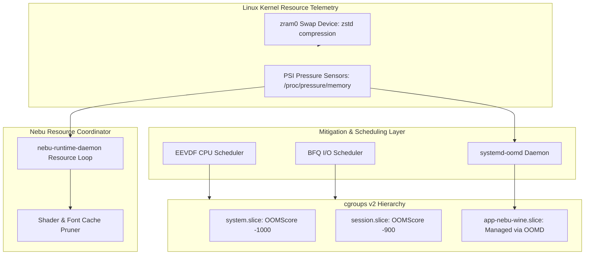
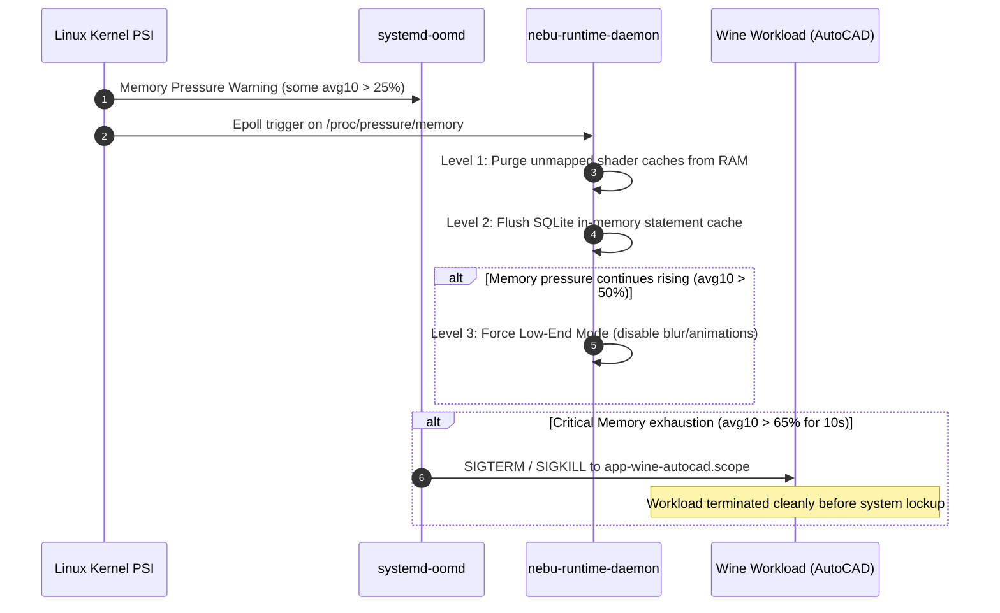

# Resource Management Specification — NebuOS

**Document ID:** NEBU-SPEC-0006  
**Status:** DRAFT  
**Author:** NebuOS Core Architecture Group  
**Target Version:** 1.0  
**Last Updated:** 2026-09-04  

---

## 1. Status

DRAFT. This document is under initial architectural review. It defines the formal memory allocation budgets, CPU scheduling classes, disk I/O priorities, zram swap compression parameters, `systemd-oomd` PSI monitoring rules, cache eviction thresholds, and operational differences between Low-End Mode and Standard Mode in NebuOS.

---

## 2. Purpose

This specification establishes the concrete technical requirements and configurations for system resource budgeting in NebuOS. It details:
- Granular memory budgets per system and desktop component.
- The authoritative CPU scheduling policies, RT priorities, and cgroups v2 weights.
- Disk I/O scheduling profiles and cgroup block I/O priorities.
- Complete `/etc/systemd/zram-generator.conf` and `/etc/systemd/oomd.conf` manifests.
- Concrete systemd service unit definitions for runtime low-memory monitoring.
- Rust implementation patterns for kernel PSI epoll event loops.
- Cache eviction algorithms and hard size limits for Vulkan and font caches.
- A functional comparison matrix between Low-End Mode (4 GB RAM) and Standard Mode (16+ GB RAM).

---

## 3. Scope

This document applies to:
- Kernel memory management, paging, and swap compression.
- CPU scheduling via the Linux EEVDF scheduler and real-time rings.
- Cgroups v2 resource controllers (`memory`, `cpu`, `io`).
- Out-of-memory mitigation and proactive pressure recovery.

---

## 4. Non-Goals

- Network bandwidth shaping or traffic policing.
- Thermal management and CPU undervolting/overclocking.
- Custom kernel allocator algorithms (standard Linux SLUB allocator is retained).
- Virtual machine memory ballooning (VMs are strictly excluded).

---

## 5. Requirements

### 5.1 Functional Requirements

| Identifier | Description | Verification Method |
|---|---|---|
| **REQ-RES-001** | Total system idle memory consumption on 4 GB hardware must not exceed 800 MB RSS. | `free -m` and `ps_mem` audit |
| **REQ-RES-002** | System swap must be backed entirely by compressed in-memory zram using the Zstandard algorithm (`zstd`). | `swapon --show` |
| **REQ-RES-003** | `systemd-oomd` must actively monitor cgroups v2 Pressure Stall Information (PSI) and kill misbehaving scopes in `app-nebu-wine.slice` before desktop components freeze. | Pressure injection testing |
| **REQ-RES-004** | The Wayland compositor main thread must execute under real-time round-robin scheduling (`SCHED_RR`). | `chrt -p <pid>` |
| **REQ-RES-005** | On systems with <= 4 GB RAM, Nebu Lite Mode must activate automatically upon system startup. | D-Bus property inspection |
| **REQ-RES-006** | System daemons must register non-blocking epoll event listeners on `/proc/pressure/memory`. | Daemon log verification |

### 5.2 Non-Functional Requirements

| Identifier | Target Metric | Rationale |
|---|---|---|
| **NFR-RES-001** | Total idle CPU consumption across all Nebu daemons <= 0.5% average load. | Eliminates battery drain on mobile devices. |
| **NFR-RES-002** | Proactive cache eviction execution latency < 100 ms upon PSI threshold crossing. | Swiftly alleviates acute memory pressure. |
| **NFR-RES-003** | Zero unmanaged system lockups under 95% RAM utilization. | System remains responsive under heavy workloads. |

---

## 6. Architecture

Resource management relies on kernel PSI metrics, cgroups v2 controllers, and proactive daemon intervention:



---

## 7. Components

### 7.1 Resource Management Components

| Component | Upstream Origin | Responsibility in NebuOS |
|---|---|---|
| **systemd-oomd** | systemd Upstream | User-space out-of-memory daemon evaluating PSI memory and swap pressure |
| **zram-generator** | Fedora / Upstream | Automatically initializes compressed in-memory swap block devices |
| **nebu-runtime-daemon** | NebuOS In-House | Monitors pressure metrics, trims application caches, and toggles Low-End Mode |
| **nebu-compositor** | NebuOS In-House | Adjusts visual effect pipelines and buffer allocations dynamically |

---

## 8. Data Flow

### 8.1 Memory Pressure Alleviation Pipeline



---

## 9. Control Flow

### 9.1 Escalating Mitigation Ladder

1. **Stage 0 (Normal Desktop, PSI < 15%):** Full compositor animations active, DXVK pipeline caching enabled, warm runtime pre-spawning active.
2. **Stage 1 (Proactive Eviction, PSI 15% - 30%):** Prune in-memory font rasters and cached translation DLLs.
3. **Stage 2 (Degraded Presentation, PSI 30% - 50%):** Deactivate compositor glass blurs and drop shadows; terminate pre-warmed idle Wine instances.
4. **Stage 3 (cgroup Throttling, PSI 50% - 65%):** Restrict background slices to `CPUWeight=50` and prioritize active foreground Wayland surface.
5. **Stage 4 (OOM Intervention, PSI > 65% for 10s):** `systemd-oomd` executes targeted termination of the largest cgroup scope under `app-nebu-wine.slice`.

---

## 10. Interfaces

### 10.1 Component Memory Budgets

The following allocations govern memory consumption during steady-state operation:

| Component Name | Low-End Target (4 GB RAM) | Standard Target (16 GB RAM) | cgroup `MemoryHigh` | cgroup `MemoryMax` | `OOMScoreAdjust` |
|---|---|---|---|---|---|
| **Base OS (PID 1, udev, dbus, NM)**| 180 MB | 250 MB | None | None | `-1000` (Immune) |
| **PipeWire + WirePlumber** | 30 MB | 45 MB | 40M | 60M | `-950` |
| **nebu-compositor** | 70 MB | 140 MB | 100M | 250M | `-900` |
| **nebu-shell** | 40 MB | 70 MB | 60M | 120M | `-800` |
| **nebu-runtime-daemon** | 20 MB | 35 MB | 35M | 80M | `-700` |
| **wineserver** | 15 MB | 30 MB | 40M | 80M | `0` |
| **Per-App Budget (Wine Workload)** | Dynamic (Up to 2.8 GB) | Dynamic (Up to 13.5 GB) | Dynamic | Dynamic | `100` to `500` |
| **Total System Idle Footprint** | **<= 355 MB** | **<= 570 MB** | System total | System total | N/A |

---

### 10.2 CPU Scheduling Policies & Priority Matrix

| Process / Thread | Scheduling Policy | Nice Value / RT Priority | cgroup `cpu.weight` | cgroup `cpu.max` (Quota) | Rationale |
|---|---|---|---|---|---|
| **nebu-compositor (Render Thread)** | `SCHED_RR` | Priority `50` | 1000 | None | Guarantees frame presentation deadline |
| **nebu-compositor (Worker Threads)**| `SCHED_OTHER`| Nice `-5` | 1000 | None | Smooth frame composition |
| **PipeWire Audio Processing** | `SCHED_RR` | Priority `60` | 1000 | None | Prevents audio buffer underruns |
| **nebu-shell** | `SCHED_OTHER`| Nice `-2` | 800 | None | Responsive launcher and desktop clicks |
| **nebu-runtime-daemon** | `SCHED_OTHER`| Nice `0` | 500 | None | Standard event-driven background IPC |
| **Wine Active Foreground App** | `SCHED_OTHER`| Nice `-1` | 800 | None | Ensures high interactive rendering FPS |
| **Wine Background Apps** | `SCHED_OTHER`| Nice `10` | 100 | None | Yields CPU to active foreground tasks |
| **nebu-update-agent** | `SCHED_OTHER`| Nice `19` | 50 | 25000 100000 (25%) | Background updates must not stutter UI |

---

### 10.3 Disk I/O Priorities

NebuOS assigns block I/O priorities utilizing the Linux `io.weight` controller and BFQ/Kyber schedulers:

| Storage Type | Kernel I/O Scheduler | Default `io.weight` Allocation |
|---|---|---|
| NVMe SSD | `none` (or `kyber`) | `session.slice` (1000), `app.slice` (500), `system.slice` (100) |
| SATA SSD | `bfq` | `session.slice` (1000), `app.slice` (500), `system.slice` (100) |
| Traditional Mechanical HDD | `bfq` with low-latency mode | `session.slice` (1000), `app.slice` (400), `system.slice` (50) |

---

### 10.4 zram Swap Compression Manifest

Configuration file location: `/etc/systemd/zram-generator.conf`

```ini
# ====================================================================
# NebuOS Compressed In-Memory Swap Configuration
# ====================================================================

[zram0]
# Allocate 50% of available RAM on systems >= 8GB, 75% on 4GB systems
zram-size = min(ram / 2, 4096)

# High-performance, low-latency compression algorithm
compression-algorithm = zstd

# Single-page swap cluster optimization matching zram characteristics
options = discard

# Prioritize zram above any physical swap partitions
swap-priority = 100
```

---

### 10.5 systemd-oomd Configuration

#### 10.5.1 `/etc/systemd/oomd.conf`
```ini
# ====================================================================
# NebuOS Master Out-Of-Memory Daemon Configuration
# ====================================================================

[OOM]
SwapUsedLimit=90%
DefaultMemoryPressureDurationSec=10s
DefaultMemoryPressureLimit=60%
```

#### 10.5.2 `/etc/systemd/system/app-nebu-wine.slice.d/10-oomd.conf`
```ini
# ====================================================================
# OOM Policy for Sandboxed Wine Workloads
# ====================================================================

[Slice]
ManagedOOMMemoryPressure=kill
ManagedOOMMemoryPressureLimit=50%
ManagedOOMPreference=avoid
```

---

### 10.6 PSI Monitoring Implementation (`nebu-runtime`)

To achieve zero polling while reacting instantaneously to memory pressure, `nebu-runtime-daemon` configures an epoll descriptor on `/proc/pressure/memory`:

```rust
use std::fs::OpenOptions;
use std::io::Write;
use std::os::unix::io::AsRawFd;

pub fn setup_memory_pressure_listener() -> Result<i32, Box<dyn std::error::Error>> {
    let mut file = OpenOptions::new()
        .read(true)
        .write(true)
        .open("/proc/pressure/memory")?;

    // Trigger notification when memory stall exceeds 25ms in a 1000ms window (25% pressure)
    let trigger = "some 25000 1000000\0";
    file.write_all(trigger.as_bytes())?;

    let epoll_fd = unsafe { libc::epoll_create1(libc::EPOLL_CLOEXEC) };
    let mut event = libc::epoll_event {
        events: (libc::EPOLLPRI | libc::EPOLLERR) as u32,
        u64: file.as_raw_fd() as u64,
    };

    unsafe {
        libc::epoll_ctl(
            epoll_fd,
            libc::EPOLL_CTL_ADD,
            file.as_raw_fd(),
            &mut event,
        );
    }

    Ok(epoll_fd)
}
```

---

### 10.7 Cache Eviction Policies & Size Limits

| Cache Subsystem | Concrete Disk Path | Standard Limit | Low-End Mode Limit | Eviction Threshold & Action |
|---|---|---|---|---|
| **DXVK Pipeline Cache** | `~/.nebu/apps/<id>/drive_c/dxvk.cache` | 256 MB | 64 MB | LRU eviction when file exceeds limit |
| **Vulkan Mesa Shader Cache**| `~/.cache/mesa_shader_cache/` | 512 MB | 128 MB | Automatic prune on app termination |
| **Fontconfig Raster Cache** | `~/.cache/fontconfig/` | 50 MB | 16 MB | Flushed when memory pressure > 30% |
| **Wine AppData Temp** | `~/.nebu/apps/<id>/drive_c/.../Temp` | 500 MB | 100 MB | Purged on application exit |
| **Prefix SQLite Journal** | In-memory WAL | 16 MB | 4 MB | Forced `PRAGMA wal_checkpoint(TRUNCATE)` on idle |

---

### 10.8 Low-End Mode (4 GB) vs Standard Mode Behavioral Matrix

NebuOS dynamically adjusts runtime features depending on hardware memory tier:

| Feature / Behavior | Low-End Mode (<= 4 GB RAM) | Standard Mode (>= 8 GB RAM) |
|---|---|---|
| **Compositor Window Blur** | **Disabled** (Opaque surfaces only) | Enabled (Dual-filter kawase blur) |
| **Compositor Drop Shadows** | **Disabled** (Simple 1px border) | Enabled (Gaussian soft shadows) |
| **Window Animations** | **Disabled** (Instant state transition) | Enabled (Smooth cubic-bezier scales) |
| **Warm Runtime Pre-spawning** | **Disabled** (Spawn on demand) | Enabled (1 pre-warmed Wine instance) |
| **DXVK Pipeline Cache in RAM** | Pruned immediately on app exit | Retained in page cache for rapid restart |
| **zram Allocation Ratio** | 75% of physical RAM (~3 GB zram) | 50% of physical RAM (Up to 4 GB zram) |
| **Kernel Swappiness** | `vm.swappiness = 180` | `vm.swappiness = 150` |
| **Max Concurrent Wine Prefixes**| 2 applications maximum | Unlimited (governed by RAM) |

---

## 11. Dependencies

### 11.1 Subsystem Dependencies
- `systemd-oomd` >= 254.
- `zram-generator` >= 1.1.2.
- Linux Kernel >= 6.6 LTS with `CONFIG_PSI=y` and `CONFIG_ZRAM=y`.

---

## 12. Security

- **Denial-of-Service Protection:** Critical desktop services (`nebu-compositor`, `nebu-shell`) have negative `OOMScoreAdjust` values, ensuring they are never chosen as OOM targets.
- **Resource Starvation Mitigation:** Cgroup `cpu.max` limits untrusted background workers, preventing rogue applications from causing CPU lockups.

---

## 13. Resource Requirements

### 13.1 Overhead Budgets for Resource Monitors

| Monitoring Task | CPU Overhead Target | Memory Overhead Target |
|---|---|---|
| `systemd-oomd` PSI polling | < 0.1% CPU | < 6 MB RSS |
| `nebu-runtime-daemon` cache monitor | < 0.05% CPU | < 3 MB RSS |
| zstd decompression engine | < 1.0% CPU during active swap | 0 MB (In-kernel driver) |

---

## 14. Failure Modes

| ID | Failure Mode | Trigger | Impact |
|---|---|---|---|
| **FM-RES-001** | Swap Space Exhaustion | Compressed zram fills completely (> 95%) | System memory allocations fail (`ENOMEM`) |
| **FM-RES-002** | OOM Kill Cascade | Memory pressure triggers multiple process kills | User applications close sequentially |
| **FM-RES-003** | Compositor Dropped Frame | Background I/O causes VSync deadline miss | Visible desktop stutter |
| **FM-RES-004** | Cache Eviction Thrash | Tight cache limit forces frequent re-compilations | Intermittent CPU spikes during game start |

---

## 15. Recovery Behavior

- **For FM-RES-001:** `nebu-runtime-daemon` detects swap exhaustion and executes emergency cache purge followed by gentle termination (`SIGTERM`) of the oldest background application.
- **For FM-RES-002:** `systemd-oomd` applies a 10-second cooldown period between kill actions to allow memory recovery before terminating secondary processes.
- **For FM-RES-003:** The compositor boosts worker thread priorities to `SCHED_RR` temporarily to restore steady 60 FPS presentation.
- **For FM-RES-004:** Cache limits adaptively grow by 25% if cache eviction rate exceeds 5 evictions per minute.

---

## 16. Testing Requirements

1. **Low-End Idle RAM Test:** Boot NebuOS on a 4 GB RAM test VM; assert total RAM usage < 800 MB at desktop steady state.
2. **OOM Resilience Stress Test:** Run `stress-ng --vm 2 --vm-bytes 3G` under `app-nebu-wine.slice`; verify that `systemd-oomd` kills the stress scope while compositor remains active.
3. **zram Compression Efficiency:** Measure compression ratio under realistic CAD/gaming memory allocation; assert ratio >= 2.2x.
4. **Compositor RT Scheduling Verification:** Execute `chrt -p $(pgrep nebu-compositor)` and verify policy `SCHED_RR` with priority 50.

---

## 17. Performance Requirements

- **OOM Kill Action Latency:** `systemd-oomd` must execute kill action within 500 ms of threshold exceedance.
- **Cache Eviction Duration:** Trimming 256 MB of shader cache must complete in < 80 ms without blocking the display server.
- **Zram Page Fetch Latency:** Decompressing a 4 KB page from zram swap must take < 5 microseconds on modern CPUs.

---

## 18. Compatibility Considerations

- **Virtual Allocation Limits:** CAD applications (e.g. AutoCAD, SolidWorks) allocate multi-gigabyte sparse virtual memory spaces; `vm.max_map_count = 2147483642` prevents address space allocation failures.
- **Wine Memory Address Mapping:** Wine requires low 2 GB virtual address space reservation for legacy 32-bit Windows compatibility (`vm.mmap_min_addr = 65536`).

---

## 19. Open Questions

1. **OPEN QUESTION (RES-OQ-01):** Should zram compression use `lz4` instead of `zstd` on ultra-low-end dual-core CPUs to minimize CPU cycles during decompression? *Current assumption:* `zstd` offers significantly higher compression ratio (saving precious RAM), and modern zstd decompression speed is CPU-efficient enough for 4 GB targets.
2. **OPEN QUESTION (RES-OQ-02):** Should Low-End Mode be user-overrideable via desktop settings, or strictly enforced when physical RAM <= 4 GB? *Current assumption:* Enforced by default on <= 4 GB systems, but user can force Standard Mode via Quick Settings toggle.
3. **OPEN QUESTION (RES-OQ-03):** Does `ManagedOOMMemoryPressureLimit=50%` cause premature termination in heavy CAD rendering workloads with burst memory spikes? *Current assumption:* Retain 10-second duration gate (`DefaultMemoryPressureDurationSec=10s`) to tolerate brief memory spikes without killing the application.

---

## 20. Related Documents

- [00-system-specification.md](00-system-specification.md)
- [01-boot-specification.md](01-boot-specification.md)
- [02-process-ipc-specification.md](02-process-ipc-specification.md)
- [03-filesystem-specification.md](03-filesystem-specification.md)
- [04-security-specification.md](04-security-specification.md)
- [05-hardware-specification.md](05-hardware-specification.md)
- [../performance/01-memory.md](../performance/01-memory.md)
