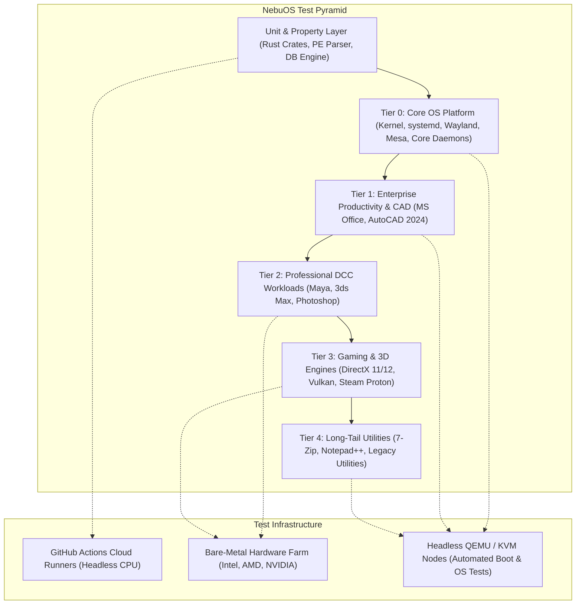
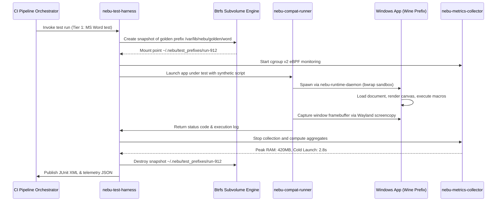

# Master Testing Specification — NebuOS

## 1. Status
**Status:** DRAFT  
**Type:** Master Engineering Specification  
**Domain:** Quality Assurance, CI/CD, and Compatibility Verification  
**Target Architecture:** x86_64  
**Target Release:** NebuOS 1.0 (Milestones P0-P12)

---

## 2. Purpose
This master specification defines the quality assurance framework, testing pyramid, continuous verification infrastructure, and lifecycle gates for NebuOS. NebuOS integrates custom native Rust system daemons (`nebu-compositor`, `nebu-shell`, `nebu-runtime-daemon`, `nebu-patcher`, `nebu-compat-db`) on top of Fedora Atomic (bootc/ostree) with an isolated, process-level Windows compatibility subsystem (Wine/Proton, DXVK, VKD3D). This document codifies how regression prevention, binary compatibility, graphics correctness, and performance benchmarks are verified without reliance on hypervisors or manual ad-hoc testing.

---

## 3. Scope
This specification governs:
- The multi-tier testing pyramid from kernel-level boot testing to userland Windows applications.
- Hardware and virtualized execution environments in CI/CD pipelines.
- Continuous verification pipelines across pull requests, nightly integration runs, and release builds.
- Test data acquisition, sanitization, version control, and lifecycle retention.
- Qualification criteria for certified software running in sandboxed Bubblewrap/Wine prefixes.
- Operational policies for bare-metal testing racks and software-rasterized cloud test runners.

---

## 4. Non-Goals
- Testing or validating Windows virtualization hypervisors (QEMU guest OS, VirtualBox, VMware) as NebuOS strictly forbids virtual machines for application execution.
- Developing clean-room test suites for proprietary Windows source code or reverse-engineering closed APIs beyond standard Wine development practices.
- Guaranteeing 100% bug-for-bug compatibility with undocumented Windows NT kernel internal behaviors that are not exercised by target application tiers.
- Manual exploratory QA as a gatekeeper for automated continuous deployment.
- Testing non-x86_64 architectures during the initial 1.0 milestone phase.

---

## 5. Requirements

### 5.1 Functional Requirements
- **REQ-TEST-001:** The testing framework must execute isolated unit tests for all workspace crates with zero host contamination.
- **REQ-TEST-002:** The system must validate OS boot to interactive desktop within a virtualized headless runner in less than 30 seconds.
- **REQ-TEST-003:** Headless compatibility test agents must execute Windows binaries in synthetic Xwayland/Wayland environments without attached physical displays.
- **REQ-TEST-004:** Test telemetry must collect structured machine-readable results (JUnit XML, OpenTelemetry spans, JSON crash dumps) for every execution.
- **REQ-TEST-005:** Test fixtures must use deterministic Btrfs snapshot rollbacks to guarantee identical starting states across test iterations.
- **REQ-TEST-006:** The test suite must support headless rendering verification using `lavapipe` software rasterization with a minimum image similarity threshold (SSIM >= 0.98).
- **REQ-TEST-007:** The testing infrastructure must support automated input synthesis (keyboard scancodes, mouse motion, touch events) via Wayland virtual input protocols.

### 5.2 Non-Functional Requirements
- **REQ-TEST-008:** Fast-feedback pull request gates (lint, unit, basic integration) must complete in under 10 minutes total wall-clock time.
- **REQ-TEST-009:** End-to-end nightly integration tests must complete within a 90-minute operational window across parallel test nodes.
- **REQ-TEST-010:** Test execution must not cause permanent modifications to the host environment or persistent user directories outside the designated scratch area.
- **REQ-TEST-011:** Test data storage must enforce cryptographic SHA-256 integrity verification before runner ingestion.
- **REQ-TEST-012:** Memory consumption during test runner orchestration must not exceed 512 MB RSS on the host runner node.

---

## 6. Architecture

NebuOS organizes verification along a strict multi-tier pyramid that maps directly to OS abstractions:



### 6.1 Tier Definitions and Validation Objectives

| Tier | Focus Area | Execution Target | Automation Mode | Blocking Gate |
|---|---|---|---|---|
| **Tier 0** | Core OS Platform: Kernel boot, systemd init, Btrfs subvolumes, `nebu-compositor` startup, `nebu-shell` rendering, D-Bus activation, PipeWire audio graph. | Ephemeral QEMU/KVM virtual machine running bootc ostree commit. | 100% Automated headless script via serial console and Wayland screencopy. | Blocks image build and pull request merges to `main`. |
| **Tier 1** | Enterprise Productivity: Microsoft Office 2021 (Word, Excel, PowerPoint), Autodesk AutoCAD 2024. Complex document rendering, calculations, and plotting. | Headless Xwayland container with isolated Wine prefix on Btrfs snapshot. | Fully automated scripted workflows via synthetic input and COM automation. | Blocks Beta and Stable release candidates. |
| **Tier 2** | Professional DCC Tools: Autodesk Maya, 3ds Max, Adobe Photoshop. Viewport rendering, compute tasks, export filters. | Bare-metal test lab nodes with physical GPU acceleration (AMD/NVIDIA). | Automated script batches with reference image diffing and memory leak checks. | Blocks Stable releases. |
| **Tier 3** | Gaming & 3D Graphics: DirectX 11/12 and Vulkan titles running under Proton + DXVK + VKD3D-Proton. | Bare-metal nodes across AMD, Intel, and NVIDIA graphics hardware. | Automated benchmark loops measuring frame pacing and 99th percentile latencies. | Non-blocking advisory; regressions trigger high-priority alerts. |
| **Tier 4** | Long-Tail Windows Software: Notepad++, 7-Zip, Total Commander, legacy Win32 utilities. | Cloud container runners using headless Wine. | Automated headless execution, exit code inspection, and smoke testing. | Community advisory channel; non-blocking. |

---

## 7. Components

### 7.1 Testing Subsystems
- **`nebu-test-harness` (Rust):** Command-line orchestration tool managing fixture lifecycles, test container provisioning, D-Bus session mock buses, and report aggregation.
- **`nebu-compat-runner` (Rust):** Test automation agent running inside test targets, capable of injecting synthetic input, driving Windows UI widgets via accessibility APIs and XTest, and evaluating exit codes.
- **`nebu-metrics-collector` (Rust/eBPF):** System telemetry daemon measuring CPU cycles, peak resident set size (RSS), page faults, Wayland frame pacing, and disk I/O during test execution.
- **`lavapipe` Software Rasterizer (Mesa):** CPU-based Vulkan implementation enabling DirectX 11/12 translation testing in cloud VM runners without physical GPUs.
- **Btrfs Snapshot Manager:** Low-level filesystem agent providing instant copy-on-write scratch prefixes at `/var/lib/nebu/test_prefixes/<uuid>` discarded upon test termination.
- **Test Asset Store:** Git-LFS and private S3 bucket holding golden files, reference screenshots, test documents, and sanitized binary fixtures.

### 7.2 Subsystem Ownership Classification
| Component | Classification | Origin / Dependency |
|---|---|---|
| `nebu-test-harness` | NebuOS Component | In-house Rust crate (`tests/harness`) |
| `nebu-compat-runner` | NebuOS Component | In-house Rust crate (`tests/compat-runner`) |
| `nebu-metrics-collector` | NebuOS Component | In-house Rust/eBPF daemon (`crates/nebu-perf-bench`) |
| `lavapipe` / `llvmpipe` | Linux Ecosystem | Upstream Mesa 24.x package |
| QEMU / KVM | Linux Ecosystem | Upstream Fedora package |
| Bubblewrap (`bwrap`) | Linux Ecosystem | Upstream container virtualization tool |
| `wlr-screencopy` protocol | Wayland Standard | Upstream Wayland protocol extension |

---

## 8. Data Flow

The following sequence details how test assets flow through the testing infrastructure during a Tier 1 compatibility run:



---

## 9. Control Flow

1. **Trigger Phase:** Webhook event from GitHub Actions (Pull Request or Schedule) dispatches a workflow job.
2. **Matrix Expansion:** Job expands into platform matrices (e.g., Headless CPU, Intel UHD 630, AMD Radeon 680M, NVIDIA RTX 3060).
3. **Environment Provisioning:**
   - For virtualized tests: QEMU boots ephemeral Fedora Atomic rootfs containing the target bootc commit.
   - For containerized tests: Podman boots an OCI container with unprivileged user namespace mapping and `/dev/dri` pass-through.
4. **Fixture Preparation:** Golden prefix images are checked against SHA-256 manifests and cloned to ephemeral Btrfs subvolumes.
5. **Execution Loop:**
   - Harness executes the test runner binary.
   - Watchdog timers enforce strict timeouts (unit: 10s, integration: 60s, app workflow: 300s).
   - `nebu-compat-runner` interacts with UI via virtual input protocol and monitors process health.
6. **Telemetry & Verification:** Process exit codes, standard output streams, screencopy buffers, and eBPF kernel traces are evaluated against golden baselines.
7. **Teardown & Cleanup:** Ephemeral subvolumes are deleted via `btrfs subvolume delete --commit-after`. Telemetry artifacts are uploaded to object storage.

---

## 10. Interfaces

### 10.1 Command-Line Interface (`nebu-test-harness`)
```bash
nebu-test-harness run \
    --tier <tier0|tier1|tier2|tier3|tier4> \
    --app-id <application_unique_identifier> \
    --profile <path_to_profile.json> \
    --backend <wayland-headless|drm-software|hardware-direct> \
    --timeout-secs 180 \
    --output-dir /var/log/nebu-tests/run-20260904-01 \
    --report-format junit,json
```

### 10.2 Test Output Schema (JSON)
```json
{
  "$schema": "https://nebuos.org/schemas/v1/test-result.json",
  "run_id": "test-run-a48ca758",
  "timestamp": "2026-09-04T10:45:00Z",
  "tier": 1,
  "app_id": "com.microsoft.word.2021",
  "environment": {
    "kernel": "6.10.4-nebu.fc40.x86_64",
    "wine_version": "9.14-staging-nebu",
    "mesa_version": "24.1.2",
    "renderer": "llvmpipe (LLVM 18.1.1, 256 bits)"
  },
  "verdict": "PASS",
  "duration_ms": 4820,
  "metrics": {
    "launch_latency_ms": 2810,
    "peak_rss_bytes": 440401920,
    "cpu_cycles": 18450123900,
    "ssim_visual_score": 0.994
  },
  "artifacts": [
    "screenshot_final.png",
    "wineserver_err.log",
    "perf_trace.json"
  ]
}
```

### 10.3 Test Runner Exit Codes
- `0`: Test suite passed completely; all assertions verified.
- `1`: Assertion failure; functional or visual discrepancy detected.
- `2`: Harness configuration or fixture acquisition error.
- `3`: Timeout triggered by execution watchdog.
- `4`: Out-of-memory condition detected by cgroup telemetry monitor.
- `5`: Internal crash in Wine, DXVK, or runtime daemon.

---

## 11. Dependencies

### 11.1 Build and Toolchain Dependencies
- **Rust Toolchain:** `1.80.0+` (stable-x86_64-unknown-linux-gnu) with `cargo-nextest`, `cargo-llvm-cov`.
- **System Compilers:** `clang` 18.1+, `gcc` 14.1+ for native stub libraries.
- **Cargo Crates:** `tokio` (1.38+), `zbus` (4.2+), `smithay` (0.3+), `image` (0.25+), `serde` (1.0+).

### 11.2 Runtime and Environment Dependencies
- **Operating System Base:** Fedora Atomic 40 (bootc/ostree deployment).
- **Core Virtualization:** QEMU 8.2+ with KVM acceleration enabled (`/dev/kvm`).
- **Mesa Software Drivers:** `mesa-dri-drivers`, `mesa-vulkan-drivers` with `lavapipe` and `llvmpipe`.
- **System Utilities:** `btrfs-progs` (6.8+), `bubblewrap` (>= 0.8.0), `dbus-daemon` (1.14+), `wayland-utils`.
- **Automation Libraries:** `pytest` (8.0+), `python-xlib`, `pywin32` (installed inside Wine prefixes for COM driving).

---

## 12. Security
- **Sandbox Confinement:** All tests executing untrusted Windows binaries must run inside unprivileged Bubblewrap (`bwrap`) containers without network access (`--unshare-net`) unless network testing is explicitly declared.
- **Fixture Immutability:** Golden application images are stored in read-only storage paths mounted `MS_RDONLY` to prevent test-induced contamination.
- **Secrets Protection:** Test logs and screencopy captures are scrubbed of environment tokens, developer keys, and host filesystem paths before being committed to CI artifact archives.
- **Rootless Execution:** Test harnesses run strictly under an unprivileged service account (`nebutest`, UID 10001, GID 10001); no test suite requires `sudo` privileges during execution.
- **IPC Isolation:** Ephemeral D-Bus session buses are spawned per test case (`dbus-daemon --session --print-address`) to prevent test cross-talk or leakage into user sessions.

---

## 13. Resource Requirements

| Resource Type | Minimum CI Runner | Hardware Lab Node | Headless Virtual Node |
|---|---|---|---|
| **CPU** | 4 vCPUs (x86_64) | 8 Cores / 16 Threads | 2 vCPUs (QEMU KVM) |
| **RAM** | 8 GB | 32 GB | 4 GB (Strict Low-End Mode) |
| **Storage** | 50 GB NVMe | 500 GB NVMe (Btrfs) | 20 GB Sparse QCOW2 |
| **GPU** | None (CPU llvmpipe) | AMD Radeon RX 6600 / Intel Arc A580 | Virtualized virtio-gpu |
| **Network** | 100 Mbps egress | 1 Gbps isolated LAN | Isolated loopback (no egress) |

---

## 14. Failure Modes

| Failure Identifier | Symptom | Underlying Root Cause | Impact Level |
|---|---|---|---|
| **FAIL-TEST-001** | Test runner timeout (> 300s) | Wineserver deadlocked waiting for synchronous IPC or unhandled message loop | Critical (Hangs pipeline) |
| **FAIL-TEST-002** | Visual verification failure (SSIM < 0.95) | Font rendering discrepancy, missing TrueType fallback, or Mesa shader regression | High (Blocks release) |
| **FAIL-TEST-003** | Btrfs snapshot creation error (`ENOSPC`) | Disk storage exhaustion from uncleaned ephemeral test prefixes | Medium (Runner abort) |
| **FAIL-TEST-004** | D-Bus connection refused | `nebu-runtime-daemon` crashed during cold initialization | High (Integration block) |
| **FAIL-TEST-005** | Memory limit exceeded (> 800MB idle) | Memory leak in `nebu-compositor` surface tracking | High (Perf regression) |
| **FAIL-TEST-006** | Flaky synthetic input event delivery | Window focus race condition before synthetic keyboard injection | Medium (False positive) |

---

## 15. Recovery Behavior
- **Deadlock Watchdog:** The `nebu-test-harness` attaches a process watchdog to all child processes. Upon timeout expiration, it sends `SIGABRT` to produce a core dump, followed by `SIGKILL` to wineserver and sandbox wrappers.
- **Leaked Prefix Cleanup:** A post-execution trap script executes `btrfs subvolume list` and forcefully unmounts and removes any subvolume matching the pattern `/var/lib/nebu/test_prefixes/*`.
- **Runner Auto-Remediation:** If a hardware lab node experiences GPU DRM ring hangs, the node orchestrator issues an IPMI warm reset and marks the node unavailable until driver re-probe succeeds.
- **Flaky Test Retries:** Integration tests with network or timing sensitivities are permitted at most one automated retry in CI. If the retry fails, the build is marked failed and quarantined.

---

## 16. Testing Requirements
- **Self-Testing Harness:** `nebu-test-harness` and `nebu-compat-runner` must maintain >= 90% unit test coverage using Rust mocks.
- **Fixture Verification:** All golden test data (documents, DWG drawings, 3D assets) must pass deterministic validation checks before inclusion in the git-lfs asset repository.
- **Negative Testing:** The harness must be verified against deliberately broken Windows binaries (corrupted PE headers, missing dependent DLLs, invalid COM GUIDs) to ensure graceful error capture.
- **Chaos Injection:** Test harnesses periodically inject simulated signal interruptions (`SIGINT`, `SIGTERM`, `SIGHUP`) during Wine prefix initialization to verify atomic rollback mechanics.

---

## 17. Performance Requirements
- **Test Orchestration Overhead:** The harness must complete prefix provisioning and environment setup in less than 500 milliseconds per test case using Btrfs reflink/snapshotting.
- **CI Suite Execution Limits:**
  - Pull Request Gate (Tier 0 + Unit): <= 8 minutes total wall-clock time.
  - Nightly Gate (Tier 0, Tier 1, Tier 2): <= 90 minutes across parallel runners.
  - Weekly Stress & Compatibility Sweep: <= 6 hours across full bare-metal lab.
- **Artifact Upload Speed:** Test logs and screenshot diffs must compress with `zstd` (level 3) and upload within 30 seconds of test completion.

---

## 18. Compatibility Considerations
- **Upstream Wine Drift:** When updating Wine versions (e.g., Wine 9.x to 10.x), the Tier 1 compatibility suite must be executed against both versions in parallel to detect regressions before merging into `main`.
- **Mesa Version Skew:** Software rendering tests using `lavapipe` may exhibit minor floating-point precision differences compared to bare-metal hardware GPUs; SSIM thresholds are calibrated with a 2% variance allowance for software backends.
- **Immutable Rootfs Constraints:** Tests must never attempt to write to `/usr`; all runtime state, logs, and prefixes must strictly reside within `/tmp`, `/var`, or `~/.nebu`.
- **Windows Version Simulation:** Wine prefixes must default to simulating `win10` (Windows 10 Build 19045) while supporting legacy profiles specifying `win7` for specific CAD plugins.

---

## 19. Open Questions
1. *OPEN QUESTION:* Should Tier 3 gaming compatibility tests execute on proprietary game titles via licensed test accounts in CI, or should an open-source synthetic DirectX 11/12 benchmark suite (e.g., Unigine Superposition, 3DMark via Proton) serve as the primary automated gate?
2. *OPEN QUESTION:* How should Windows application activations (e.g., Microsoft Office 365 licensing tokens) be maintained in ephemeral CI runners without triggering anti-fraud machine-deactivation blocks?
3. *OPEN QUESTION:* What is the optimal storage policy for long-term retention of raw video recordings generated by failed visual regression tests in the bare-metal lab?

---

## 20. Related Documents
- [01-unit-testing.md](01-unit-testing.md) — Rust unit testing patterns and coverage standards.
- [02-integration-testing.md](02-integration-testing.md) — Containerized multi-daemon test harnesses.
- [03-compatibility-testing.md](03-compatibility-testing.md) — Windows application automated testing matrix.
- [04-graphics-testing.md](04-graphics-testing.md) — Headless GPU rendering and visual regression.
- [05-performance-testing.md](05-performance-testing.md) — Benchmarking suites and regression thresholds.
- [06-hardware-testing.md](06-hardware-testing.md) — Hardware lab specification and HCL qualification.
- [07-release-certification.md](07-release-certification.md) — Formal release gates and sign-off criteria.
- [../development/03-ci-cd.md](../development/03-ci-cd.md) — Continuous integration and delivery pipelines.
