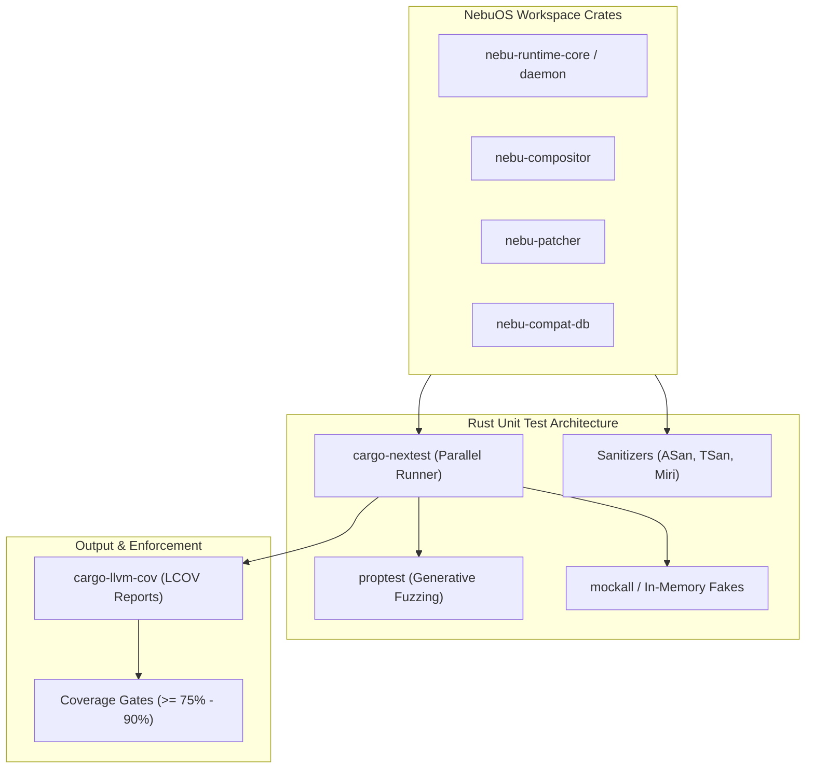
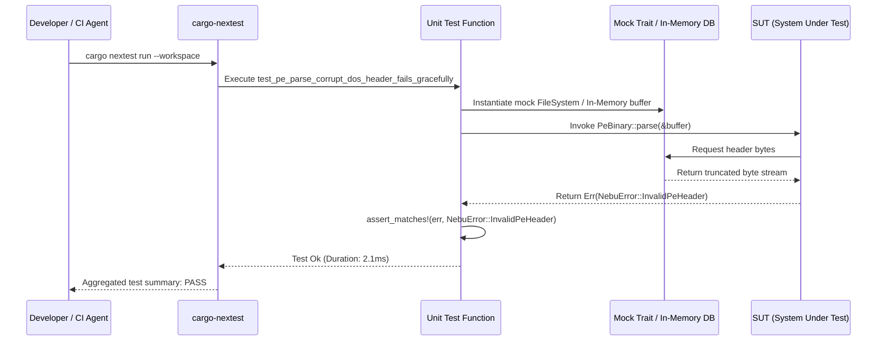

# Unit Testing Specification — NebuOS

## 1. Status
**Status:** DRAFT  
**Type:** Subsystem Engineering Specification  
**Domain:** Quality Assurance, Rust Toolchain, and Component Verification  
**Target Architecture:** x86_64  
**Target Release:** NebuOS 1.0 (Milestones P0-P12)

---

## 2. Purpose
This specification establishes the architectural standards, execution frameworks, mock interfaces, code coverage targets, and test naming conventions for native Rust unit tests across all NebuOS system crates. NebuOS core system components (`nebu-compositor`, `nebu-shell`, `nebu-runtime-daemon`, `nebu-runtime-core`, `nebu-patcher`, `nebu-compat-db`, `nebu-gpu-probe`) are authored in Rust. This document ensures that memory safety invariants, error-handling paths, asynchronous state machines, and FFI boundaries with native C libraries (libinput, Wayland, Mesa, SQLite) are systematically validated in isolation.

---

## 3. Scope
This specification governs:
- Unit testing patterns and execution harnesses using native `cargo test` and `cargo-nextest`.
- Asynchronous test design for Tokio runtime loops and D-Bus services (`zbus`).
- Mocking strategies for hardware interfaces, DRM/KMS, IPC endpoints, and SQLite storage.
- Property-based testing for binary parsing (PE/COFF headers, `.reg` hive files, JSON schemas).
- Line and branch code coverage targets per workspace crate.
- Sanitizer configurations (ASan, TSan, Miri) for validating unsafe Rust code and C FFI layers.
- Test harness execution environments in developer workstations and automated CI pipelines.

---

## 4. Non-Goals
- End-to-end integration testing of multi-process OS boot or desktop login sessions (governed by [02-integration-testing.md](02-integration-testing.md)).
- Validating real Windows binary execution under Wine prefixes (governed by [03-compatibility-testing.md](03-compatibility-testing.md)).
- Replacing integration and hardware regression suites with oversized unit tests.
- Testing non-standard external dependencies or upstream Linux kernel internals.
- Verification of bootloader code (GRUB2) or initial RAM disk generation (Dracut).

---

## 5. Requirements

### 5.1 Functional Requirements
- **REQ-UNIT-001:** Every public API function across all workspace crates must have at least one dedicated unit test validating standard input and error handling.
- **REQ-UNIT-002:** PE binary header parsing (`nebu-runtime-core::pe`) must never panic when fed truncated, randomized, or maliciously formatted byte slices.
- **REQ-UNIT-003:** SQLite query wrappers (`nebu-compat-db`) must execute against in-memory SQLite instances (`:memory:`) with identical schema definitions.
- **REQ-UNIT-004:** Asynchronous actors and D-Bus services must execute tests with bounded timeouts to prevent hanging CI workers.
- **REQ-UNIT-005:** Property-based tests must generate at least 1,000 iterations per test run for parsers and serialization code.
- **REQ-UNIT-006:** D-Bus service mocks must simulate client disconnects, method call timeouts, and malformed payload injection.
- **REQ-UNIT-007:** Registry patching algorithms (`nebu-patcher`) must guarantee atomic all-or-nothing hive merge transactions.

### 5.2 Non-Functional Requirements
- **REQ-UNIT-008:** All workspace unit tests must execute in under 45 seconds total wall-clock time on a 4-core CI runner using `cargo nextest`.
- **REQ-UNIT-009:** Unit tests must be completely deterministic and hermetic: zero network access, zero hardcoded absolute host paths, zero dependency on ambient environment variables.
- **REQ-UNIT-010:** Unsafe Rust blocks must pass validation under Miri without undefined behavior warnings.
- **REQ-UNIT-011:** Memory allocation during unit test suite execution must remain under 256 MB RSS per worker process.

---

## 6. Architecture

Unit testing in NebuOS is structured around three core testing methodologies: Deterministic Example Tests, Property-Based Fuzz Tests, and Mocked Interface Tests.



---

## 7. Components

### 7.1 Workspace Crates and Coverage Mandates

| Crate Name | Primary Role | Code Coverage Target (Line) | Coverage Target (Branch) | Primary Test Tooling |
|---|---|---|---|---|
| `nebu-runtime-core` | PE parsing, Bwrap arguments, prefix logic | >= 85% | >= 80% | `proptest`, `mockall` |
| `nebu-runtime-daemon` | D-Bus daemon, process lifecycle, supervisor | >= 85% | >= 75% | `tokio::test`, `zbus` mocks |
| `nebu-compositor` | Smithay Wayland compositor, window management | >= 80% | >= 70% | Headless backend, Miri |
| `nebu-shell` | Desktop UI, panel, application launcher | >= 75% | >= 65% | Headless renderer, input events |
| `nebu-patcher` | Declarative registry modifications, DLL patching | >= 90% | >= 85% | `proptest`, in-memory hives |
| `nebu-compat-db` | Application profile database, migrations | >= 90% | >= 85% | `:memory:` SQLite, migrations |
| `nebu-gpu-probe` | PCI ID matching, driver capabilities | >= 85% | >= 75% | Fake `/sys` and `/dev` mocks |
| `nebu-cli` | Developer and admin CLI tool | >= 80% | >= 70% | `assert_cmd`, `predicates` |

### 7.2 Framework Selection
- **Test Runner:** `cargo-nextest` for isolated, parallel execution and structured JUnit reporting.
- **Async Runtime:** `tokio::test` with paused time (`start_paused = true`) for timing-sensitive state transitions.
- **Mocking:** `mockall` for trait-level mocking of system interactions (filesystem, process spawning, D-Bus).
- **Property Testing:** `proptest` for generative inputs targeting parsers and deserializers.
- **Coverage Engine:** `cargo-llvm-cov` producing clean HTML and LCOV output for CI tracking.

---

## 8. Data Flow



---

## 9. Control Flow

### 9.1 Test Execution Lifecycle
1. **Compilation Phase:** `cargo test --no-run` compiles all test targets with test harness instrumentation.
2. **Environment Sanitization:** Test runners establish clean temporary directories (`tempfile::tempdir()`) and unset host configuration variables (`NEBU_*`).
3. **Execution Phase:**
   - Tests execute in isolated worker processes managed by `nextest`.
   - Async tests spawn lightweight Tokio local runtimes with simulated event loops.
   - Property tests generate randomized input seeds based on defined strategies.
4. **Assertion Evaluation:** Panics or unexpected `Err` results are captured by the runner framework.
5. **Coverage Aggregation:** Profiling data collected by LLVM coverage instrumentation is written to `.profraw` files and merged.

---

## 10. Interfaces

### 10.1 Test Naming Conventions
All unit tests must strictly adhere to the following snake_case naming pattern:
```text
test_<unit_or_function>_<scenario_or_input_state>_<expected_outcome>
```

#### Examples:
- `test_pe_parse_valid_64bit_returns_correct_subsystem()`
- `test_pe_parse_zero_length_buffer_returns_unexpected_eof()`
- `test_registry_merge_duplicate_dword_key_overwrites_cleanly()`
- `test_db_get_profile_unknown_id_returns_not_found()`
- `test_bwrap_args_network_disabled_contains_unshare_net()`

### 10.2 Mock Trait Definition Example (`nebu-runtime-core`)
```rust
#[cfg_attr(test, mockall::automock)]
pub trait ProcessSpawner: Send + Sync {
    fn spawn(
        &self,
        binary_path: &std::path::Path,
        args: &[String],
        env: &[(String, String)],
        sandbox: &SandboxConfig,
    ) -> Result<u32, NebuError>;
    
    fn wait_for_exit(&self, pid: u32, timeout_ms: u64) -> Result<i32, NebuError>;
}
```

### 10.3 Mock D-Bus Interface Example (`zbus` in `nebu-runtime-daemon`)
```rust
#[cfg(test)]
mod tests {
    use zbus::{Connection, Result};
    
    struct MockRuntimeInterface;
    
    #[zbus::interface(name = "org.nebu.Runtime1")]
    impl MockRuntimeInterface {
        async fn launch_app(&self, app_id: &str) -> zbus::fdo::Result<u32> {
            if app_id == "com.invalid.app" {
                Err(zbus::fdo::Error::InvalidArgs("Unknown App ID".into()))
            } else {
                Ok(12345) // Fake PID
            }
        }
    }
}
```

### 10.4 Property-Based Testing Example (`nebu-patcher`)
```rust
#[cfg(test)]
mod tests {
    use super::*;
    use proptest::prelude::*;

    proptest! {
        #[test]
        fn test_registry_key_parser_never_panics_on_arbitrary_utf8(s in "\\PC*") {
            let mut parser = RegistryHiveParser::new();
            let _ = parser.parse_key_path(&s);
            // Invariant: Parser must return Ok or Err, NEVER panic
        }
    }
}
```

---

## 11. Dependencies

### 11.1 Cargo Dependencies (`[dev-dependencies]`)
- **`cargo-nextest`:** Modern execution harness replacing standard cargo test output.
- **`proptest` (1.4+):** Generative property-based testing.
- **`mockall` (0.13+):** Procedural macros for mocking Rust traits.
- **`tempfile` (3.10+):** Scoped, auto-cleaning temporary directories for filesystem tests.
- **`assert_matches` (1.5+):** Pattern matching assertions for enum variants.
- **`tokio-test` (0.4+):** Utilities for testing async streams and timers.
- **`rusqlite` (0.31+):** Configured with feature `bundled` for consistent test execution.
- **`predicates` (3.1+):** Composable assertion matchers.

---

## 12. Security
- **Untrusted Input Ingestion:** All parsers handling external data (PE files, registry exports, JSON profiles) are subjected to Miri validation to identify undefined memory behavior, buffer overflows, or pointer misalignment.
- **Sanitizer Runs:** CI includes dedicated sanitizer passes:
  - **ASan (AddressSanitizer):** Detects memory corruption in C FFI bridges (libinput, Wayland client bindings).
  - **TSan (ThreadSanitizer):** Identifies data races in multi-threaded compositor and runtime code.
  - **MSan (MemorySanitizer):** Flags reads of uninitialized memory.
- **Sandbox Isolation Verification:** Unit tests for sandbox configuration generation verify that forbidden paths (e.g., `/etc/shadow`, `/boot`, `/sys/firmware`) are never mounted with write permissions.

---

## 13. Resource Requirements

| Metric | Target Limit | Enforcement Mechanism |
|---|---|---|
| **Max Execution Time (Single Test)** | 500 ms | Runner timeout watchdog |
| **Max Memory RSS (Per Test Runner)** | 256 MB | CI cgroup enforcement |
| **Parallel Threads** | Number of logical CPU cores | `cargo-nextest --test-threads` |
| **Disk Consumption** | < 100 MB scratch storage | Cleaned up on `tempfile` drop |
| **Network Access** | 0 sockets allowed | Hermetic execution boundary |

---

## 14. Failure Modes

| Failure Identifier | Root Cause | CI Result | Remediation Action |
|---|---|---|---|
| **FAIL-UNIT-001** | Assertion failure in logic test | Test failed | Developer inspects diff between expected and actual output |
| **FAIL-UNIT-002** | Panic during property fuzz test | Proptest regression found | Proptest outputs minimized failing seed; developer commits seed as regression test |
| **FAIL-UNIT-003** | Test timeout (> 500ms) | Deadlock in async mutex or infinite loop | Inspect task state; convert blocking code to async channel |
| **FAIL-UNIT-004** | Undefined behavior under Miri | Invalid pointer cast or unaligned read | Correct Rust pointer logic or wrap in safe abstractions |
| **FAIL-UNIT-005** | Coverage below threshold | Insufficient test cases committed | Block pull request merge until coverage targets are restored |

---

## 15. Recovery Behavior
- **Reproducible Fuzz Seeds:** When a `proptest` case fails, the framework automatically generates a `.proptest-regressions` file containing the minimal failing byte sequence. Developers check this file into source control to prevent regressions.
- **Flaky Test Handling:** Unit tests must exhibit zero tolerance for flakiness. Any test displaying non-deterministic results across 100 consecutive iterations is quarantined and treated as a P0 blocker.
- **Tempfile Cleanup Guarantee:** All unit tests create scratch files using the RAII-based `tempfile::TempDir`. Upon thread unwind or test exit, destructor methods ensure complete removal of temporary artifacts.

---

## 16. Testing Requirements
- **Regression Suite:** Every reported bug in production or compatibility testing must be accompanied by a reproducing unit test before code fixes are merged.
- **Compiler Warning Zero-Tolerance:** Unit test suites must compile cleanly with `#![deny(warnings)]`.
- **Cross-Crate Boundary Testing:** Crates exposing shared structures (e.g., `nebu-compat-db` models consumed by `nebu-runtime-daemon`) must include serialization round-trip unit tests.
- **Miri Test Target:** Pure Rust modules (`nebu-runtime-core::pe`, `nebu-patcher::reg`) must execute under `cargo miri test` in nightly CI.

---

## 17. Performance Requirements
- Individual unit tests must execute in under **10 milliseconds** on reference developer hardware (AMD Ryzen 5 5600X or Intel Core i5-12400).
- Parser benchmark suites using `criterion` must confirm PE header parsing throughput exceeding **50 MB/s** per core.
- Full workspace unit test compilation and execution must not exceed **60 seconds** in CI.

---

## 18. Compatibility Considerations
- **Rust Edition:** All unit tests must compile against Rust 2021 edition and maintain compatibility with the workspace MSRV (Minimum Supported Rust Version) of 1.80.0.
- **32-Bit Windows Target Verification:** PE parsing unit tests must validate both PE32 (32-bit x86) and PE32+ (64-bit x86_64) binaries to support legacy Windows utilities.
- **Endianness:** Registry parser tests must explicitly test little-endian UTF-16LE decoding to mirror native Windows registry serialization formats.

---

## 19. Open Questions
1. *OPEN QUESTION:* Should Miri verification be executed on every pull request, or relegated to a nightly scheduled job due to its significant execution time overhead (typically 10x-50x slower)?
2. *OPEN QUESTION:* How should `nebu-compositor` unit tests simulate physical DRM/KMS hardware display hotplug events without requiring root privileges or real kernel DRM nodes?

---

## 20. Related Documents
- [00-testing-specification.md](00-testing-specification.md) — Master testing specification and test pyramid.
- [02-integration-testing.md](02-integration-testing.md) — Multi-daemon integration and container runners.
- [03-compatibility-testing.md](03-compatibility-testing.md) — Headless Wine and Windows application testing.
- [../development/05-coding-guidelines.md](../development/05-coding-guidelines.md) — Rust style, error handling, and coding standards.
- [../development/01-repository-structure.md](../development/01-repository-structure.md) — Cargo workspace layout and crate organization.
