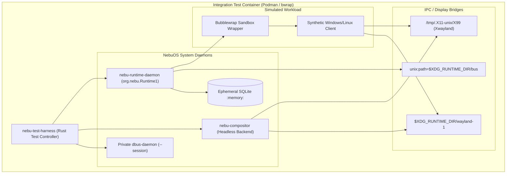
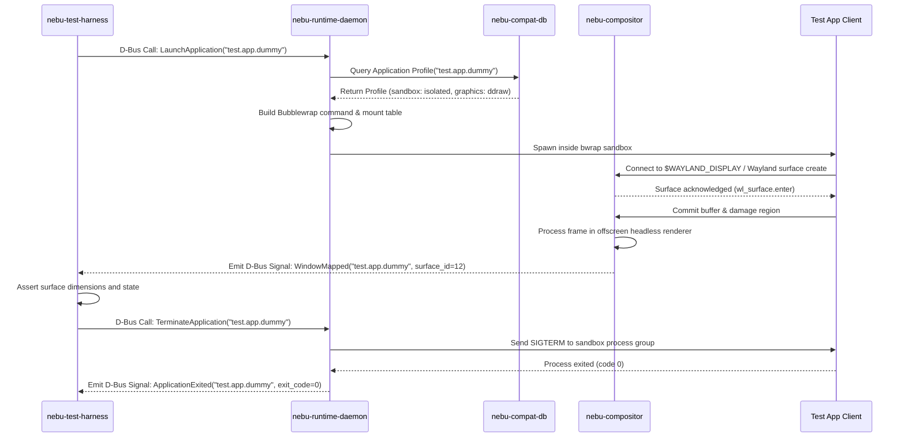

# Integration Testing Specification — NebuOS

## 1. Status
**Status:** DRAFT  
**Type:** Subsystem Engineering Specification  
**Domain:** Quality Assurance, Multi-Daemon Orchestration, and System Verification  
**Target Architecture:** x86_64  
**Target Release:** NebuOS 1.0 (Milestones P0-P12)

---

## 2. Purpose
This specification defines the multi-daemon integration testing architecture, container-based test runners, inter-component verification scenarios, and environment isolation frameworks for NebuOS. NebuOS relies on tightly coordinated interactions between `nebu-compositor` (Smithay Wayland compositor), `nebu-shell` (desktop user interface), `nebu-runtime-daemon` (process lifecycle manager), and `nebu-compat-db` (SQLite compatibility profile repository). This document specifies how these distinct components are tested collectively under realistic session conditions without requiring full bare-metal OS reboots.

---

## 3. Scope
This specification governs:
- Headless execution environments for the Wayland display server and Xwayland compatibility bridge.
- Containerized test orchestration using Podman OCI containers and Bubblewrap sandboxes.
- Inter-process communication (IPC) validation over private D-Bus session buses and Wayland UNIX domain sockets.
- File system isolation and state management using ephemeral Btrfs subvolumes.
- Inter-component lifecycle scenarios including process spawning, window mapping, crash recovery, and prefix tear-down.
- Continuous verification execution within CI pull request and nightly pipeline runs.

---

## 4. Non-Goals
- Unit testing internal Rust crate algorithms in isolation (governed by [01-unit-testing.md](01-unit-testing.md)).
- Complex application-specific compatibility testing for third-party Windows software (governed by [03-compatibility-testing.md](03-compatibility-testing.md)).
- Direct kernel DRM/KMS hardware scanout validation on physical displays (governed by [06-hardware-testing.md](06-hardware-testing.md)).
- Performance and framerate benchmarking under heavy graphics load (governed by [05-performance-testing.md](05-performance-testing.md)).

---

## 5. Requirements

### 5.1 Functional Requirements
- **REQ-INT-001:** Integration test suites must execute within an isolated user namespace container without requiring host root privileges (`sudo`).
- **REQ-INT-002:** The test harness must bootstrap an ephemeral D-Bus session daemon (`dbus-daemon --session`) and register `org.nebu.Runtime1` and `org.nebu.Compositor1`.
- **REQ-INT-003:** The compositor must initialize a headless Smithay backend capable of receiving Wayland buffer commitments and responding to presentation feedback.
- **REQ-INT-004:** The test environment must provide a functional Xwayland server (`/tmp/.X11-unix/X99`) to validate legacy Win32/X11 window mapping.
- **REQ-INT-005:** The runtime daemon must successfully spawn a dummy PE binary or containerized process within a Bubblewrap sandbox and report PID and status back over D-Bus.
- **REQ-INT-006:** Btrfs snapshotting must create an ephemeral test prefix in `< 300 ms` and clean it up completely upon test exit.

### 5.2 Non-Functional Requirements
- **REQ-INT-007:** Each integration test case must execute in `< 10 seconds` wall-clock time.
- **REQ-INT-008:** The full suite of inter-component integration tests must complete within `< 5 minutes` in CI.
- **REQ-INT-009:** Memory consumption of the entire multi-daemon test fixture (compositor, shell stub, runtime daemon, D-Bus, Xwayland) must not exceed `350 MB RSS`.
- **REQ-INT-010:** Tests must leave zero leaked sockets, temporary directories, or orphan processes after completion.

---

## 6. Architecture

The NebuOS integration test architecture constructs an ephemeral, miniature desktop session inside an isolated container runner:



---

## 7. Components

### 7.1 Test Framework Components
- **`nebu-test-harness`:** Rust orchestration binary providing CLI commands to spin up and tear down daemon groups, monitor IPC signals, and inject synthetic input.
- **Headless Compositor (`nebu-compositor --backend headless`):** Special runtime mode of the compositor utilizing Smithay's headless backend, rendering frames to off-screen shared memory buffers without KMS devices.
- **Runtime Daemon (`nebu-runtime-daemon`):** Background process manager handling application launch requests, prefix isolation, and sandbox construction.
- **Mock Shell Stub (`nebu-shell-stub`):** Minimal Wayland client connecting via `wlr-layer-shell` to simulate panel and launcher presence.
- **Xwayland Server:** Managed upstream Xwayland instance spawned by `nebu-compositor` when legacy X11 windows are requested.
- **Btrfs Test Volume Manager:** Utility managing temporary subvolumes mounted at `/tmp/nebu-test-vol` with copy-on-write semantics.

### 7.2 Subsystem Ownership Classification
| Component | Classification | Origin / Dependency |
|---|---|---|
| `nebu-test-harness` | NebuOS Component | In-house Rust test crate (`tests/harness`) |
| `nebu-compositor` (headless) | NebuOS Component | In-house Rust crate (`crates/nebu-compositor`) |
| `nebu-runtime-daemon` | NebuOS Component | In-house Rust crate (`crates/nebu-runtime-daemon`) |
| `nebu-compat-db` | NebuOS Component | In-house Rust crate (`crates/nebu-compat-db`) |
| `dbus-daemon` | Linux Ecosystem | Fedora upstream package |
| `Xwayland` | Linux Ecosystem | Fedora upstream package |
| `bwrap` | Linux Ecosystem | Fedora upstream package |

---

## 8. Data Flow



---

## 9. Control Flow

### 9.1 Test Session Lifecycle
1. **Runner Initialization:** `nebu-test-harness` creates a dedicated temporary directory (`/tmp/nebu-int-XXXXXX`) configured as `$XDG_RUNTIME_DIR`.
2. **IPC Initialization:** Spawns `dbus-daemon --session --nofork --address=unix:path=$XDG_RUNTIME_DIR/bus`.
3. **Display Server Spin-up:**
   - Spawns `nebu-compositor --backend headless --socket wayland-1`.
   - Waits for compositor socket readiness (polling with 10ms backoff, 2.0s timeout).
4. **Daemon Startup:**
   - Initializes `nebu-runtime-daemon --config test-config.toml`.
   - Verifies D-Bus service registration of `org.nebu.Runtime1`.
5. **Scenario Execution:**
   - Harness issues D-Bus calls, injects synthetic inputs, and verifies state changes across daemons.
6. **Session Teardown:**
   - Harness sends `SIGTERM` to `nebu-runtime-daemon`, followed by `nebu-compositor`, and finally `dbus-daemon`.
   - Inspects exit codes and verifies clean shutdown without core dumps.
   - Deletes `$XDG_RUNTIME_DIR`.

---

## 10. Interfaces

### 10.1 D-Bus Interface Under Test (`org.nebu.Runtime1`)
```xml
<!DOCTYPE node PUBLIC "-//freedesktop//DTD D-BUS Object Introspection 1.0//EN"
"http://www.freedesktop.org/standards/dbus/1.0/introspect.dtd">
<node>
  <interface name="org.nebu.Runtime1">
    <method name="LaunchApplication">
      <arg name="app_id" type="s" direction="in"/>
      <arg name="flags" type="u" direction="in"/>
      <arg name="process_id" type="u" direction="out"/>
    </method>
    <method name="TerminateApplication">
      <arg name="app_id" type="s" direction="in"/>
      <arg name="force" type="b" direction="in"/>
      <arg name="success" type="b" direction="out"/>
    </method>
    <signal name="ApplicationStateChanged">
      <arg name="app_id" type="s"/>
      <arg name="state" type="u"/>
      <arg name="exit_code" type="i"/>
    </signal>
  </interface>
</node>
```

### 10.2 Harness Configuration File (`test-harness.toml`)
```toml
[environment]
runtime_dir_prefix = "/tmp/nebu-int"
dbus_timeout_ms = 3000
compositor_ready_timeout_ms = 5000
headless_width = 1920
headless_height = 1080

[daemons.compositor]
binary = "target/debug/nebu-compositor"
args = ["--backend", "headless", "--socket", "wayland-test-0"]

[daemons.runtime]
binary = "target/debug/nebu-runtime-daemon"
args = ["--log-level", "debug"]
```

---

## 11. Dependencies

### 11.1 System Packages (Container Environment)
- **`podman` (4.9+):** Rootless container engine for CI runners.
- **`dbus-daemon` (1.14+):** Session message bus.
- **`xorg-x11-server-Xwayland` (23.2+):** X11 compatibility server.
- **`bubblewrap` (0.8.0+):** Sandbox isolation engine.
- **`btrfs-progs` (6.8+):** Filesystem snapshot and subvolume manipulation tools.
- **`libxkbcommon` (1.6+):** Keymap compilation for Wayland inputs.

### 11.2 Rust Workspace Crates
- **`wayland-client` (0.31+):** Rust Wayland client bindings for test assertion clients.
- **`zbus` (4.2+):** Async D-Bus client for invoking runtime methods.
- **`nix` (0.28+):** Process signal handling and Unix domain socket inspection.

---

## 12. Security
- **Rootless Operation:** Integration tests execute entirely without root privileges. User namespaces (`CLONE_NEWUSER`) are utilized by Podman and Bubblewrap.
- **Filesystem Confinement:** Test workloads are restricted to `$XDG_RUNTIME_DIR` and ephemeral subvolumes. Host `/home`, `/etc`, and `/proc/sys` are mounted read-only or masked.
- **IPC Sandboxing:** The private D-Bus session bus rejects any external connections. Sockets use strict Unix filesystem permissions (`0700`).

---

## 13. Resource Requirements

| Resource | Single Test Run | Full Integration Suite (CI) | Limit Enforcement |
|---|---|---|---|
| **CPU** | 1 Core (burst 2) | 4 Cores | Container cgroup quota |
| **RAM (RSS)** | 250 MB | 512 MB total | Container memory limit (1 GB cap) |
| **Disk Space** | 50 MB scratch | 1 GB temporary Btrfs storage | Ephemeral tmpfs mount |
| **Time (Wall Clock)** | < 8 seconds | < 5 minutes | CI workflow job timeout (15 min) |

---

## 14. Failure Modes

| Failure Identifier | Symptom | Root Cause | Triage Strategy |
|---|---|---|---|
| **FAIL-INT-001** | Compositor socket timeout | Smithay backend panic or EGL initialization failure in headless mode | Inspect compositor stdout/stderr logs in `$XDG_RUNTIME_DIR/compositor.log` |
| **FAIL-INT-002** | D-Bus name acquisition failure | Duplicate service or permission denied on session socket | Verify `dbus-daemon` is running and socket path matches `$DBUS_SESSION_BUS_ADDRESS` |
| **FAIL-INT-003** | Zombie sandbox processes | Bubblewrap child did not forward `SIGTERM` to internal wine process | Check process tree with `ps aux | grep bwrap` and verify signal handlers |
| **FAIL-INT-004** | Xwayland connection failure | Display `:99` socket locked or Xwayland crashed | Inspect Xwayland error log; verify display variable propagation |
| **FAIL-INT-005** | Btrfs snapshot busy error | File descriptor held open inside subvolume during deletion | Run `lsof +D` on test directory before attempting subvolume deletion |

---

## 15. Recovery Behavior
- **Orphan Process Sweeper:** When `nebu-test-harness` finishes (or encounters an unhandled panic), an exit hook iterates over the recorded process group PIDs and issues `SIGKILL` to prevent orphan daemons.
- **Socket Purge:** Trapped exits automatically execute `rm -rf $XDG_RUNTIME_DIR` to ensure subsequent test runs do not inherit stale Wayland or D-Bus sockets.
- **Subvolume Force Cleanup:** If `btrfs subvolume delete` encounters `EBUSY`, the harness waits 500 ms, retries twice, and unlinks remaining mount references.

---

## 16. Testing Requirements

### 16.1 Critical Integration Scenarios
1. **Cold Boot to Shell Ready:** Verify compositor and shell stub reach stable rendering state within 1.5 seconds.
2. **Sandboxed App Launch & Termination:** Launch client binary via D-Bus, verify window mapping in compositor, send graceful exit, verify clean cleanup.
3. **Prefix Crash Recovery:** Deliberately kill sandboxed client with `SIGSEGV`; verify `nebu-runtime-daemon` catches abnormal termination, logs failure event, and notifies shell without crashing.
4. **Compositor Restart Recovery:** Terminate `nebu-compositor`; verify `nebu-runtime-daemon` buffers outgoing messages and reconnects when compositor restarts.
5. **Database Migration on Startup:** Verify `nebu-compat-db` initializes in-memory schema and runs migrations cleanly before accepting runtime queries.

---

## 17. Performance Requirements
- **Compositor Startup:** Headless compositor must be ready to accept Wayland client connections within **200 ms** of invocation.
- **D-Bus Call Roundtrip:** `LaunchApplication` method call to process fork must execute in **< 50 ms**.
- **Window Mapping Latency:** Time from client buffer commit to compositor surface acknowledgment must be **< 16 ms** (1 frame at 60Hz).

---

## 18. Compatibility Considerations
- **Wayland Protocol Evolution:** Test suite must validate stable protocols (`xdg-shell`, `linux-dmabuf-v1`) as well as staging protocols (`wlr-layer-shell-unstable-v1`, `tearing-control-v1`).
- **X11 Backward Compatibility:** Xwayland integration tests must verify that legacy ICCCM and EWMH window properties are correctly translated to Wayland surface states.
- **Sandboxing Variations:** Bubblewrap arguments must be validated against both standard Linux kernel namespaces and hardened kernels with restricted unprivileged user namespaces.

---

## 19. Open Questions
1. *OPEN QUESTION:* Should integration tests run on every pull request, or should they be split into a minimal fast set (PR gate) and a comprehensive suite (nightly)?
2. *OPEN QUESTION:* How can we best simulate multi-monitor hotplug events within Smithay's headless backend during automated integration test runs?
3. *OPEN QUESTION:* Does running Xwayland inside rootless Podman containers introduce race conditions with shared memory (`/dev/shm`) across different container runtimes?

---

## 20. Related Documents
- [00-testing-specification.md](00-testing-specification.md) — Master testing specification.
- [01-unit-testing.md](01-unit-testing.md) — Rust unit testing standards.
- [03-compatibility-testing.md](03-compatibility-testing.md) — Windows application automated testing.
- [04-graphics-testing.md](04-graphics-testing.md) — GPU rendering and visual regression.
- [../architecture/03-process-and-ipc.md](../architecture/03-process-and-ipc.md) — Process model and D-Bus architecture.
- [../desktop/01-compositor.md](../desktop/01-compositor.md) — NebuCompositor architecture and Wayland protocols.
