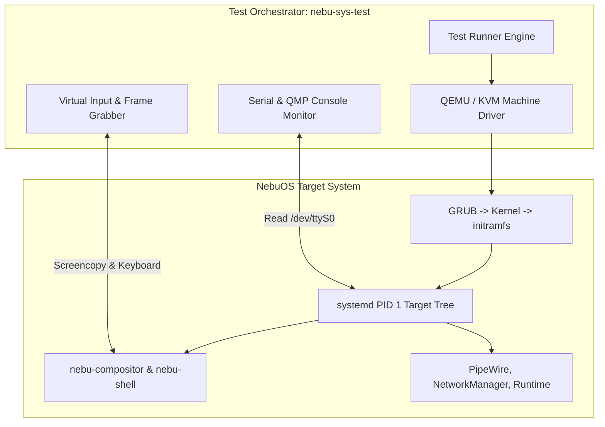
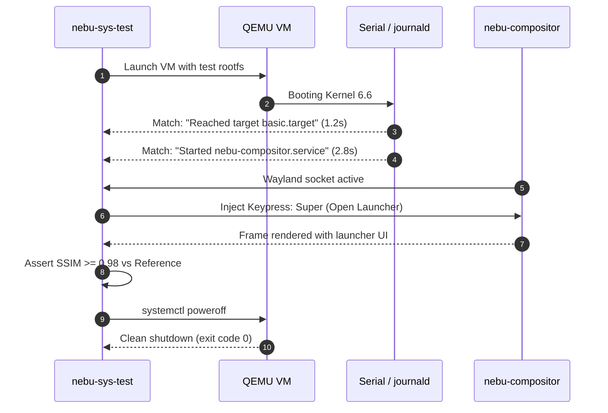

# System Testing Specification — NebuOS

**Status:** DRAFT  
**Purpose:** Specify end-to-end system testing, boot-to-desktop automation, systemd target validation, session lifecycle testing, and power management transitions in NebuOS.

---

## 1. Status
DRAFT — Technical implementation specification for Phase P7 system-level testing.

## 2. Purpose
System testing evaluates NebuOS as an integrated whole, validating that the Linux kernel, systemd service dependency DAG, display server (`nebu-compositor`), desktop shell (`nebu-shell`), and userland daemons cooperate seamlessly from cold boot through shutdown across various hardware profiles and power states.

## 3. Scope
- Boot-to-desktop automation in headless virtual machines (QEMU/KVM) and bare metal.
- Systemd target state validation (`basic.target`, `graphical.target`, `default.target`).
- User session lifecycle testing: login, screen locking, user switching, and logout.
- Power state transitions: ACPI S3 (`suspend-to-ram`), S4 (`hibernate`), and modern standby (`s2idle`).
- Network and audio pipeline stability during sleep/wake cycles.

## 4. Non-goals
- Application-specific functional testing (governed by Compatibility Testing).
- Unit testing individual Rust crates (governed by Unit Testing).
- Fuzzing proprietary third-party BIOS/UEFI implementations.

## 5. Requirements
1. **R-SYS-01:** Execute automated end-to-end boot tests verifying that `graphical-session.target` reaches `active` status within 8.0 seconds.
2. **R-SYS-02:** Verify that `nebu-compositor` and `nebu-shell` initialize and bind to `$XDG_RUNTIME_DIR/wayland-0` cleanly.
3. **R-SYS-03:** Automate screen locking (`ext-session-lock-v1`) and unlock authentication via simulated PAM inputs.
4. **R-SYS-04:** Perform automated 100-cycle suspend/resume stress tests verifying zero device driver desynchronization.
5. **R-SYS-05:** Validate that systemd user slices (`app.slice`, `session.slice`) isolate resource usage under load.

## 6. Architecture
System testing operates via an external test orchestrator driving QEMU virtualized test nodes and bare-metal lab machines:



## 7. Components
1. **System Test Harness (`nebu-sys-test`):** Rust CLI tool managing VM lifecycles, injecting test commands, and capturing state.
2. **Virtual Machine Driver:** Configures QEMU instances with varying RAM (4GB vs 16GB), CPU topologies, and virtual GPUs (virtio-gpu).
3. **Console Telemetry Monitor:** Streams systemd journald logs over virtual serial port (`/dev/ttyS0`).
4. **Frame Capture Validator:** Takes screenshots over Wayland screencopy protocol and performs perceptual hash comparisons (SSIM >= 0.98).

## 8. Data Flow
1. Harness launches NebuOS container image inside QEMU.
2. Kernel boots with console directed to serial port (`console=ttyS0`).
3. Harness parses serial output for systemd milestone timestamps:
   - `Reached target basic.target`
   - `Started nebu-compositor.service`
   - `Started nebu-shell.service`
   - `Reached target graphical-session.target`
4. Virtual input driver simulates keypresses (`Super`, `Enter`) and clicks.
5. Screencopy captures desktop pixels; verifies launcher opened correctly.
6. Test harness issues `systemctl suspend`; tests ACPI sleep state entry and wake triggers.

## 9. Control Flow


## 10. Interfaces
- **Test Definition Format (TOML):**
  ```toml
  [test_case.boot_sanity]
  description = "Verify cold boot reaches graphical session"
  timeout_seconds = 15
  expected_services = [
      "nebu-compositor.service",
      "nebu-shell.service",
      "nebu-runtime-daemon.service",
      "pipewire.service"
  ]
  max_boot_time_s = 8.0
  ```
- **Harness CLI:** `nebu-sys-test run --suite boot,session,power --vm qemu-4gb`

## 11. Dependencies
- QEMU / KVM (`qemu-system-x86_64`).
- OVMF UEFI firmware binaries.
- Perceptual image hashing tools (`image-hasher` / OpenCV).

## 12. Security
- System tests verify that unauthorized services cannot escalate to root.
- Asserts that `/usr` remains read-only even after executing misbehaved applications.
- Verifies that `ext-session-lock-v1` rejects brute-force password inputs.

## 13. Resource Requirements
- Host testing RAM: >= 8 GB (for hosting 4GB virtual machine).
- Test execution time: <= 5 minutes for full boot, session, and power suite.
- Disk requirement: ~10 GB temporary QCOW2 overlay.

## 14. Failure Modes
1. **Target Hang:** Systemd deadlock waiting on an unfulfilled unit dependency.
2. **Wayland Display Stall:** Compositor fails to acquire DRM master node in VM.
3. **Sleep Wake Failure:** Guest kernel panics upon ACPI wakeup interrupt.

## 15. Recovery Behavior
- Test harness enforces hard 30-second watchdog per test step; dumps full serial backtrace on timeout.
- Failed VMs are preserved in `~/.local/state/nebu-test-failures/` for post-mortem analysis.

## 16. Testing Requirements
- Continuous CI execution on every base OS image build.
- Multi-architecture verification (x86_64 bare-metal and VM).
- Stress testing under simulated high memory and CPU load.

## 17. Performance Requirements
- Total system boot to interactive desktop: <= 6.5s in VM, <= 4.5s on NVMe bare metal.
- Suspend to resume latency: <= 1.2s.

## 18. Compatibility Considerations
- Tests validate both modern UEFI 2.4+ platforms and legacy BIOS configurations.

## 19. Open Questions
- **OQ-SYS-01:** Should system test runs execute on physical bare-metal hardware via automated netboot in Phase P7?
- **OQ-SYS-02:** What is the optimal automated test harness for multi-monitor display testing?

## 20. Related Documents
- [00-test-strategy.md](00-test-strategy.md)
- [01-unit-testing.md](01-unit-testing.md)
- [02-integration-testing.md](02-integration-testing.md)
- [04-compatibility-testing.md](04-compatibility-testing.md)
