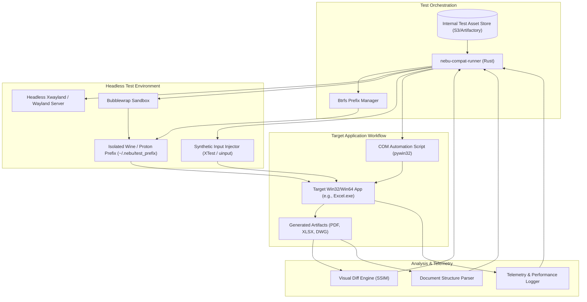
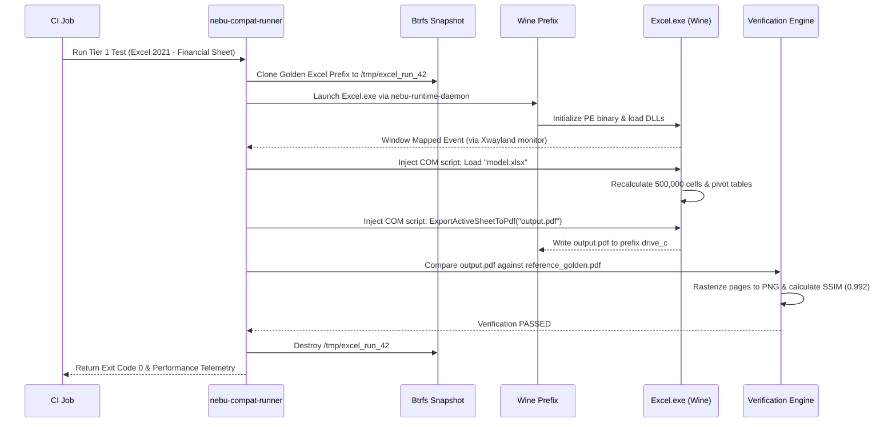

# Compatibility Testing Specification — NebuOS

## 1. Status
**Status:** DRAFT  
**Type:** Subsystem Engineering Specification  
**Domain:** Windows Binary Compatibility, Wine/Proton Verification, and Application QA  
**Target Architecture:** x86_64  
**Target Release:** NebuOS 1.0 (Milestones P0-P12)

---

## 2. Purpose
This specification defines the testing framework, automation architecture, procurement strategy, and qualification matrix for Windows applications running on NebuOS. NebuOS executes Windows PE binaries natively via isolated per-application Wine/Proton prefixes with DXVK and VKD3D graphics translation, avoiding virtual machines entirely. This document details how real-world commercial productivity software (Microsoft Office, Autodesk AutoCAD), digital content creation tools (Maya, Adobe Photoshop), games, and desktop utilities are validated without manual intervention.

---

## 3. Scope
This specification governs:
- The multi-tier Windows application test matrix across Tiers 1 through 4.
- Automated testing harnesses using headless Wine and virtual display environments.
- Synthetic input injection, COM automation scripting, and UI accessibility inspection.
- Visual regression testing using frame captures and structural document validation.
- Procurement, licensing, caching, and distribution of Windows test binaries and workloads.
- Automated compatibility regression gates for Wine, Proton, DXVK, and Mesa updates.

---

## 4. Non-Goals
- Testing applications inside Windows virtual machines (VMs are strictly prohibited in NebuOS).
- Reverse engineering anti-cheat drivers (e.g., Easy Anti-Cheat, BattlEye, Vanguard) that operate as Windows kernel ring-0 drivers unsupported by Wine.
- Distributing proprietary Windows installation binaries to end users.
- Certifying untested, obsolete 16-bit Win16 applications.

---

## 5. Requirements

### 5.1 Functional Requirements
- **REQ-COMPAT-001:** The test harness (`nebu-compat-runner`) must execute Windows applications headlessly without requiring a physical display.
- **REQ-COMPAT-002:** The runner must support automated synthetic input injection (keystrokes, mouse moves, clicks, drag-and-drop) via Wayland virtual input and XTest.
- **REQ-COMPAT-003:** The harness must support Microsoft Component Object Model (COM) script execution inside the Wine prefix using Python (`pywin32`) or Windows Script Host (`cscript.exe`).
- **REQ-COMPAT-004:** Application export artifacts (PDFs, images, DWG files) must be extracted and verified for structural integrity and visual fidelity against golden references.
- **REQ-COMPAT-005:** The test runner must isolate each test run within an ephemeral Btrfs snapshot prefix, preventing state carry-over.

### 5.2 Non-Functional Requirements
- **REQ-COMPAT-006:** A full Tier 1 smoke test suite (Word, Excel, PowerPoint, AutoCAD basic test) must complete in `< 15 minutes` in automated CI.
- **REQ-COMPAT-007:** Visual diff comparison (SSIM) between native reference outputs and NebuOS Wine rendering must achieve `>= 0.98` similarity.
- **REQ-COMPAT-008:** Test application binaries and assets must be cryptographically verified using SHA-256 digests prior to runner installation.
- **REQ-COMPAT-009:** Crash telemetry must reliably record wineserver error traces and register state upon unhandled Windows exceptions.

---

## 6. Architecture

Compatibility testing utilizes a headless automation agent that orchestrates application installation, execution, input injection, and artifact verification:



---

## 7. Components

### 7.1 Windows Application Test Matrix

| Tier | Category | Representative Applications | Validation Workflow | CI Cadence |
|---|---|---|---|---|
| **Tier 1** | Enterprise Productivity & CAD | Microsoft Word 2021<br>Microsoft Excel 2021<br>PowerPoint 2021<br>Autodesk AutoCAD 2024 | Document generation, complex formulas (500k rows), macro execution, DWG viewport orbit, PDF/DWG export. | Every Wine/Kernel/Mesa bump; blocks release. |
| **Tier 2** | Professional DCC & Creative | Autodesk Maya 2024<br>Autodesk 3ds Max<br>Adobe Photoshop 2023 | 3D scene assembly, Direct3D 11 viewport navigation, Arnold CPU render, filter pipeline processing. | Weekly regression run; blocks Stable release. |
| **Tier 3** | Gaming & 3D Engines | DirectX 11 Benchmark<br>DirectX 12 (VKD3D) Benchmark<br>Steam Proton Test Titles | Automated game launch, frame pacing benchmark, shader compilation test, input responsiveness. | Bi-weekly run; non-blocking advisory. |
| **Tier 4** | Long-Tail Desktop Utilities | Notepad++<br>7-Zip<br>Total Commander<br>WinRAR | File compression/decompression, text search & replace, archive parsing, dialog box interaction. | Monthly sweep; community advisory. |

### 7.2 Automation Subsystems
- **`nebu-compat-runner`:** Rust CLI driver that provisions prefixes, applies compatibility profiles from `nebu-compat-db`, and monitors execution.
- **`win-automation-agent`:** Lightweight Python helper running inside Wine via `pywin32`, communicating with the runner via a named pipe or localhost socket to drive Win32 COM interfaces.
- **Synthetic Input Injector:** Tool using Linux `/dev/uinput` or Xwayland `XTest` extension to simulate hardware keystrokes and mouse motions.
- **Visual Regression Engine:** Rust-based image comparison tool utilizing `pixelmatch` and Structural Similarity Index (SSIM) calculations.

---

## 8. Data Flow



---

## 9. Control Flow

### 9.1 Headless Execution Flow
1. **Runner Invocation:** CI invokes `nebu-compat-runner --app-id com.microsoft.excel.2021 --test-case calc_benchmark`.
2. **Display Setup:** Runner launches `Xvfb` or headless `nebu-compositor` with Xwayland on display `:99`.
3. **Prefix Provisioning:** Clones a pristine golden Wine prefix using `btrfs subvolume snapshot`.
4. **Environment Initialization:** Configures Wine environment variables:
   - `WINEPREFIX=/tmp/nebu_compat_XXX`
   - `WINEDEBUG=-all,+err`
   - `VK_ICD_FILENAMES=/usr/share/vulkan/icd.d/lvp_icd.x86_64.json` (if headless software rendering).
5. **Execution & Interaction:**
   - Launches application with sandboxed wrapper (`bwrap`).
   - Polls for window mapping using X11/Wayland connection.
   - Executes scripted inputs or invokes COM automation helper.
6. **Output Collection:** Waits for output files, copies them to host verification folder, and triggers graceful app termination (`WM_CLOSE`).
7. **Timeout Watchdog:** Kills all processes if total time exceeds threshold (e.g., 300s).

---

## 10. Interfaces

### 10.1 Compatibility Test Suite Manifest (`test_matrix.json`)
```json
{
  "$schema": "https://nebuos.org/schemas/v1/compat-test.json",
  "app_id": "com.autodesk.autocad.2024",
  "tier": 1,
  "wine_profile": "autocad-2024-default",
  "timeout_seconds": 600,
  "memory_limit_mb": 8192,
  "test_cases": [
    {
      "name": "load_dwg_150mb",
      "action": "script",
      "script_path": "scripts/autocad_load_dwg.py",
      "input_file": "fixtures/dwg/complex_facility_150mb.dwg",
      "expected_artifacts": [
        {
          "path": "drive_c/output/rendered_plan.png",
          "verifier": "visual_ssim",
          "min_score": 0.98
        },
        {
          "path": "drive_c/output/drawing_export.pdf",
          "verifier": "pdf_structure",
          "min_pages": 1
        }
      ]
    }
  ]
}
```

### 10.2 Runner CLI Parameters
```bash
nebu-compat-runner \
    --manifest tests/matrix/tier1_office.json \
    --golden-dir /var/cache/nebu/golden-prefixes \
    --output-dir /var/log/nebu-compat-results \
    --headless \
    --record-video \
    --fail-fast
```

---

## 11. Dependencies

### 11.1 System Packages & Runtimes
- **Wine / Proton:** `wine-core-9.x`, `proton-ge-custom` binaries.
- **Graphics Translation:** `dxvk` (2.4+), `vkd3d-proton` (2.12+).
- **Display Emulation:** `xorg-x11-server-Xvfb` or headless `nebu-compositor`.
- **Image Processing:** `ImageMagick` (7.1+), `poppler-utils` (`pdftoppm`).
- **Python Automation:** `python3` with `pywin32`, `pynput`, `pymupdf`.

### 11.2 Rust Crates (`nebu-compat-runner`)
- **`image` (0.25+):** Framebuffer decoding and raster diffing.
- **`zbus` (4.2+):** Telemetry reporting over system bus.
- **`serde_json` (1.0+):** Manifest and test report parsing.

---

## 12. Security
- **Clean Procurement:** Proprietary test software is procured strictly through legitimate commercial enterprise volume licensing or authorized developer programs.
- **No Redistribution:** Test binaries, installers, and golden prefixes are stored in an encrypted private artifact repository and are never bundled with public NebuOS releases.
- **Air-Gapped Test Sandboxes:** Bubblewrap containers for compatibility tests disallow network access (`--unshare-net`) to prevent telemetry exfiltration or license deactivation loops during testing.
- **Scrubbing:** All test crash logs and memory dumps are scrubbed for hardcoded user credentials, license serial numbers, and host machine information.

---

## 13. Resource Requirements

| Environment | CPU Allocation | RAM Allocation | Storage Per Test | Execution Timeout |
|---|---|---|---|---|
| **Tier 1 (Office)** | 4 Cores | 4 GB | 5 GB Btrfs CoW | 300 seconds |
| **Tier 1 (AutoCAD)** | 6 Cores | 8 GB | 12 GB Btrfs CoW | 600 seconds |
| **Tier 2 (Maya/DCC)** | 8 Cores | 16 GB | 25 GB Btrfs CoW | 900 seconds |
| **Tier 3 (DirectX Games)** | 8 Cores (GPU pass) | 16 GB | 50 GB Btrfs CoW | 1200 seconds |
| **Tier 4 (Utilities)** | 2 Cores | 2 GB | 2 GB Btrfs CoW | 120 seconds |

---

## 14. Failure Modes

| Failure ID | Symptom | Underlying Cause | Triage Action |
|---|---|---|---|
| **FAIL-COMP-001** | Application crash on launch | Missing native DLL override (e.g., `mfc140u.dll`) or unresolved Wine API stub | Inspect Wine log (`WINEDEBUG=+relay,+seh`); add DLL override to profile |
| **FAIL-COMP-002** | Visual mismatch (< 0.98 SSIM) | Missing Windows TrueType fonts or DirectWrite glyph fallback failure | Install core fonts into prefix; check font-config substitution |
| **FAIL-COMP-003** | COM automation timeout | Application hung displaying modal activation dialog | Update registry keys to suppress first-run wizard dialogs |
| **FAIL-COMP-004** | Vulkan device lost (`VK_ERROR_DEVICE_LOST`) | Shader compilation failure in DXVK or driver hang | Check DXVK log (`DXVK_LOG_LEVEL=debug`) and dmesg for GPU resets |
| **FAIL-COMP-005** | Out of disk space (`ENOSPC`) | Btrfs CoW metadata fragmentation or orphaned prefix volumes | Trigger automated subvolume garbage collection |

---

## 15. Recovery Behavior
- **Modal Dialog Dismissal:** The synthetic input injector includes a heuristic dialog watcher that automatically sends `Escape` or `Enter` if an unexpected modal window halts execution for > 5 seconds.
- **Stuck Process Termination:** If an application fails to exit within 10 seconds of a `WM_CLOSE` request, the runner executes `wineserver -k` to forcefully release locks and reclaim memory.
- **Snapshot Rollback:** Any failed test automatically rolls back the ephemeral prefix to the initial snapshot state, ensuring subsequent tests start with a known clean state.

---

## 16. Testing Requirements
- **Runner Unit Tests:** The `nebu-compat-runner` Rust binary must achieve >= 85% unit test coverage using mock execution stubs.
- **Regression Catalog:** Every identified application compatibility defect must result in a permanent regression test case added to the automated suite.
- **Clean-State Validation:** Periodically, golden prefixes must be re-created from scratch using unattended installer scripts to verify reproducibility.

---

## 17. Performance Requirements
- **Launch Duration:**
  - Microsoft Word cold launch inside ephemeral prefix: **< 3.5 seconds** (Standard Node).
  - AutoCAD 2024 cold launch to viewport active: **< 8.0 seconds** (Standard Node).
- **Calculation Throughput:** Excel 500k-row financial model calculation duration on NebuOS Wine must be within **15%** of native Windows execution time on identical hardware.
- **Runner Overhead:** Prefix clone and teardown overhead must take **< 1.0 second** total.

---

## 18. Compatibility Considerations
- **Wine Prefix Upgrades:** Upgrading Wine versions must not break existing application prefix configurations; compatibility testing validates prefix migration paths (`wineboot -u`).
- **Font Rendering Parity:** Rendering differences between Windows GDI/DirectWrite and FreeType/Wine must be compensated using configured font smoothing and hinting profiles.
- **High-DPI Scaling:** Test matrix includes multi-DPI testing (100%, 150%, 200%) to verify correct UI scaling without blurred text or clipped controls.

---

## 19. Open Questions
1. *OPEN QUESTION:* How can we reliably automate the procurement and refresh of commercial trialware installers without violating vendor terms of service?
2. *OPEN QUESTION:* Should the compatibility test runner implement automated screen optical character recognition (OCR) to detect localized error strings in non-English software?
3. *OPEN QUESTION:* What is the threshold of acceptable visual variance when running DXVK on software rasterizers (`lavapipe`) versus physical GPUs?

---

## 20. Related Documents
- [00-testing-specification.md](00-testing-specification.md) — Master testing specification.
- [04-graphics-testing.md](04-graphics-testing.md) — Headless GPU and visual regression testing.
- [05-performance-testing.md](05-performance-testing.md) — Performance benchmarking and launch metrics.
- [../compatibility/00-compatibility-overview.md](../compatibility/00-compatibility-overview.md) — Compatibility subsystem architecture.
- [../runtime/03-prefix-management.md](../runtime/03-prefix-management.md) — Wine prefix lifecycle and Btrfs snapshotting.
