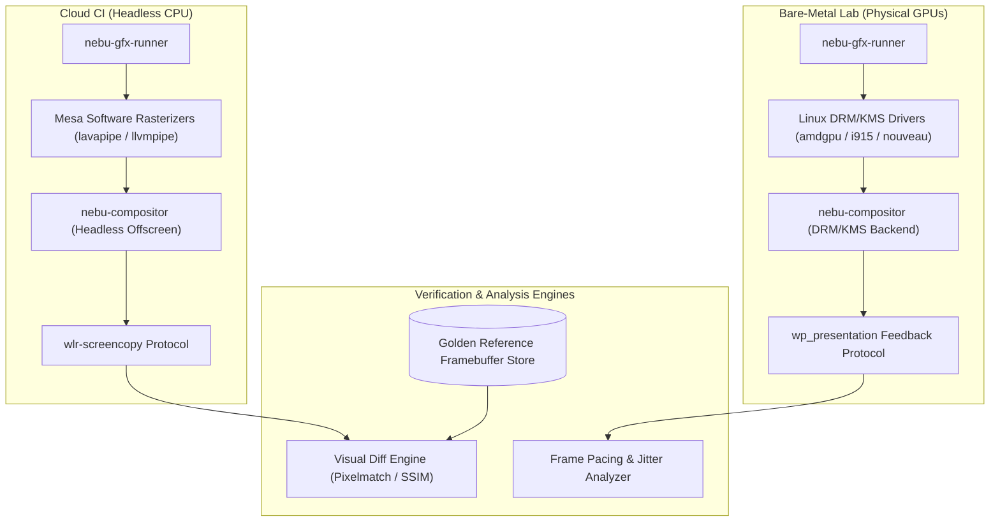
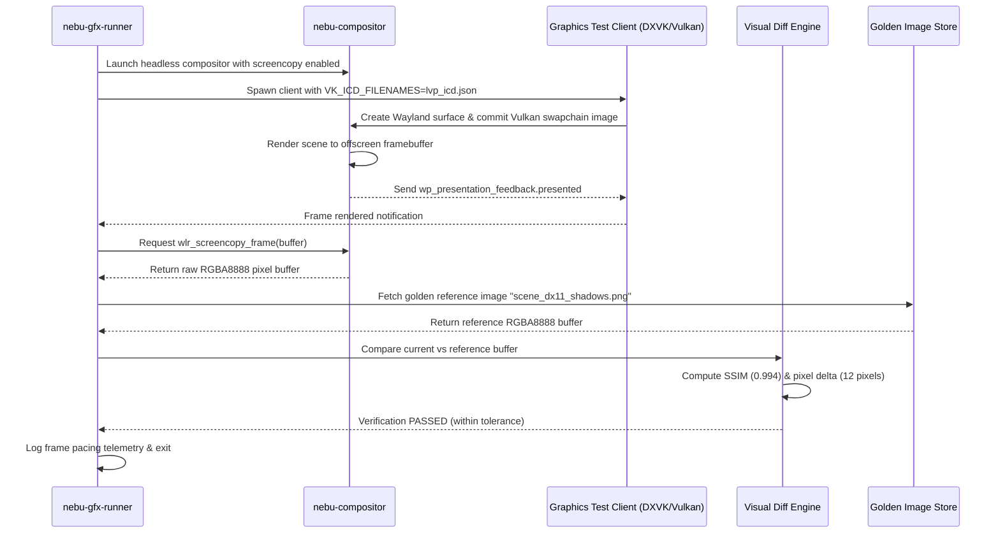

# Graphics Testing Specification — NebuOS

## 1. Status
**Status:** DRAFT  
**Type:** Subsystem Engineering Specification  
**Domain:** Graphics Pipeline, Wayland Presentation, and Visual Quality Assurance  
**Target Architecture:** x86_64  
**Target Release:** NebuOS 1.0 (Milestones P0-P12)

---

## 2. Purpose
This specification defines the graphics verification framework, visual regression testing architecture, software rendering fallback infrastructure, and frame timing validation methodologies for NebuOS. NebuOS relies on a modern Linux graphics stack composed of DRM/KMS, Mesa, Vulkan, DXVK, VKD3D-Proton, and the native Rust `nebu-compositor` built with Smithay. This document establishes how graphics correctness, rendering fidelity, zero-tear presentation, and frame pacing are tested in both headless cloud CI environments and bare-metal hardware labs.

---

## 3. Scope
This specification governs:
- Headless graphics execution using Mesa software rasterizers (`lavapipe`, `llvmpipe`).
- Visual regression testing using frame captures, pixel-diff algorithms, and structural similarity analysis (SSIM).
- Direct frame timing validation utilizing the Wayland Presentation Time protocol (`wp_presentation`).
- Vulkan and DirectX API conformance and translation regression tests (DXVK/VKD3D).
- Direct scanout verification and multi-plane hardware overlay testing.
- Graphics error monitoring (DRM ring timeouts, Vulkan device loss, shader compile failures).
- CI/CD integration of automated visual diffing with git-lfs asset storage.

---

## 4. Non-Goals
- Developing custom Mesa graphics driver replacements.
- Implementing software rasterizers from scratch.
- Validating proprietary virtual machine GPU drivers (VMware SVGA, VirtualBox VMSVGA).
- Conducting perceptual color calibration for studio reference monitors.
- Emulating Vulkan ray tracing features on CPU rasterizers.

---

## 5. Requirements

### 5.1 Functional Requirements
- **REQ-GFX-001:** The graphics test harness must run in cloud CI without a physical GPU by utilizing Mesa's `lavapipe` (Vulkan) and `llvmpipe` (OpenGL) CPU rasterizers.
- **REQ-GFX-002:** The compositor must implement the `wlr-screencopy-unstable-v1` protocol to allow test runners to capture bit-exact framebuffer snapshots.
- **REQ-GFX-003:** Frame timing verification must measure presentation timestamps using `wp_presentation` to detect jitter, dropped frames, and late presents.
- **REQ-GFX-004:** Visual regression testing must support configurable perceptual tolerance thresholds (SSIM >= 0.98, Peak Signal-to-Noise Ratio PSNR >= 35 dB).
- **REQ-GFX-005:** The test harness must detect and record all Vulkan validation layer errors (`VK_LAYER_KHR_validation`) during test execution.
- **REQ-GFX-006:** The system must verify explicit sync synchronization primitives (`linux-drm-syncobj-v1`) across client-compositor boundaries.

### 5.2 Non-Functional Requirements
- **REQ-GFX-007:** A standard visual regression test suite of 50 desktop widgets and 3D scenes must complete in `< 4 minutes` under software rasterization.
- **REQ-GFX-008:** Frame timing analysis on bare-metal 60Hz displays must guarantee frame time variance `< 2.0 ms` from the 16.67 ms target interval.
- **REQ-GFX-009:** Framebuffer image comparison must not allocate more than `512 MB RSS` during large 4K resolution diff operations.
- **REQ-GFX-010:** Golden image assets must be stored in compressed PNG formats with maximum artifact size limits.

---

## 6. Architecture

The graphics testing architecture encompasses two parallel execution pipelines: a Cloud Headless Pipeline using software rasterization, and a Bare-Metal Lab Pipeline with hardware GPUs.



---

## 7. Components

### 7.1 Testing Components
- **`nebu-gfx-runner` (Rust):** Test harness orchestrating display setup, launching graphics test clients, capturing framebuffers, and analyzing timing feedback.
- **Visual Diff Engine (Rust):** Multi-threaded image comparison tool implementing `pixelmatch` (color delta calculation) and Structural Similarity Index Measure (SSIM).
- **Presentation Timing Validator:** Telemetry module collecting `wp_presentation_feedback` events, computing inter-frame intervals, and detecting VSync misses.
- **Software Rendering Provider:** Upstream Mesa libraries:
  - `lavapipe` (`libvulkan_lvp.so`): CPU-based Vulkan 1.3 implementation.
  - `llvmpipe` (`swrast_dri.so`): CPU-based OpenGL 4.5 rasterizer.
- **Synthetic Graphics Workloads:** Set of curated test clients:
  - `vkcube` and `gears`: Basic API smoke tests.
  - `nebu-shader-bench`: Collection of complex compute and fragment shaders.
  - DXVK/VKD3D translation test harness rendering DirectX sample frames.

### 7.2 Subsystem Ownership Classification
| Component | Classification | Origin / Dependency |
|---|---|---|
| `nebu-gfx-runner` | NebuOS Component | In-house Rust test crate (`tests/gfx-runner`) |
| `nebu-compositor` (Smithay) | NebuOS Component | In-house Rust crate (`crates/nebu-compositor`) |
| Visual Diff Engine | NebuOS Component | In-house Rust crate (`crates/nebu-diff`) |
| `lavapipe` / `llvmpipe` | Linux Ecosystem | Fedora Mesa 24.x package |
| `wp_presentation` Protocol | Wayland Standard | Upstream Wayland protocols extension |
| `VK_LAYER_KHR_validation` | Khronos Group | Upstream Vulkan SDK package |

---

## 8. Data Flow



---

## 9. Control Flow

### 9.1 Graphics CI Test Execution Workflow
1. **Runner Initialization:** `nebu-gfx-runner` inspects environment. If no DRM device exists (`/dev/dri/card0`), it selects the software rasterizer profile.
2. **Environment Variables Exported:**
   - `VK_ICD_FILENAMES=/usr/share/vulkan/icd.d/lvp_icd.x86_64.json`
   - `LIBGL_ALWAYS_SOFTWARE=1`
   - `GALLIUM_DRIVER=llvmpipe`
   - `WLR_RENDERER=pixman` (or GLES2 via software EGL)
3. **Compositor Startup:** Launches `nebu-compositor --backend headless --width 1920 --height 1080`.
4. **Client Dispatch:** Executes target rendering workload for a fixed number of frames (e.g., 60 frames) to allow shader compilation to settle.
5. **Frame Capture:** Initiates `wlr-screencopy` capture on frame 61.
6. **Comparison & Evaluation:** Decodes captured pixels and golden reference PNG; computes SSIM, PSNR, and pixel difference mask.
7. **Report Generation:** Generates side-by-side diff image and appends metrics to JUnit report.

---

## 10. Interfaces

### 10.1 Wayland Presentation Feedback Protocol (`wp_presentation`)
```text
interface: wp_presentation_feedback
  event: sync_output(output: wl_output)
  event: presented(
    tv_sec_hi: u32,
    tv_sec_lo: u32,
    tv_nsec: u32,
    refresh: u32,
    seq_hi: u32,
    seq_lo: u32,
    flags: u32
  )
  event: discarded()
```

### 10.2 Graphics Test Scenario Manifest (`gfx_suite.json`)
```json
{
  "$schema": "https://nebuos.org/schemas/v1/gfx-test.json",
  "suite_name": "directx11_translation_basic",
  "renderer_target": "lavapipe",
  "resolution": {"width": 1920, "height": 1080},
  "scenarios": [
    {
      "name": "clear_and_triangle",
      "command": "/usr/bin/dx11_triangle_sample",
      "warmup_frames": 30,
      "capture_frame": 31,
      "reference_image": "golden/dx11_triangle.png",
      "tolerance": {
        "min_ssim": 0.985,
        "max_differing_pixels": 50,
        "color_threshold_e": 0.05
      }
    }
  ]
}
```

---

## 11. Dependencies

### 11.1 System Packages
- **`mesa-dri-drivers` / `mesa-vulkan-drivers`:** Software and hardware rendering backends.
- **`vulkan-tools` / `vulkan-loader`:** ICD management and query utilities.
- **`glslang` / `spirv-tools`:** Shader compilation and disassembly.
- **`libdrm` (2.4.120+):** Userspace DRM/KMS interface library.
- **`wayland-protocols` (1.36+):** Protocols for screencopy and presentation timing.

### 11.2 Rust Crates
- **`smithay` (0.3+):** Headless compositor building blocks.
- **`ash` (0.38+):** Rust Vulkan bindings for test assertions.
- **`image` (0.25+):** Image reading, writing, and manipulation.
- **`rgb` / `imgref`:** Pixel buffer handling.

---

## 12. Security
- **Untrusted Shaders:** Graphics testing involves compiling untrusted SPIR-V and DirectX bytecode; Mesa shader compilers are executed within sandboxed Bubblewrap instances to isolate driver flaws.
- **Capture Permissions:** Framebuffer capture protocols (`wlr-screencopy`) are restricted to privileged test runner clients and are strictly disabled for untrusted client applications in production.
- **Memory Scrubbing:** Offscreen framebuffers are initialized to zero (`0x00`) to prevent leaking previous session surface data across test cases.

---

## 13. Resource Requirements

| Metric | Cloud CI Runner (lavapipe) | Bare-Metal Lab (AMD/Intel/NVIDIA) |
|---|---|---|
| **CPU** | 4 Cores (Dedicated) | 8 Cores |
| **RAM** | 4 GB RSS | 16 GB System RAM |
| **GPU VRAM** | N/A (Shared host RAM) | >= 4 GB Dedicated VRAM |
| **Execution Time** | < 15 seconds per test | < 3 seconds per test |
| **Disk Storage** | 200 MB for golden frames | 2 GB for frame history |

---

## 14. Failure Modes

| Failure ID | Symptom | Underlying Cause | Triage Action |
|---|---|---|---|
| **FAIL-GFX-001** | Visual regression (SSIM < 0.98) | Shader compiler precision bug or texture filtering mismatch | Inspect generated diff image; check git log for recent Mesa/DXVK updates |
| **FAIL-GFX-002** | Presentation jitter (> 3ms variance) | Compositor event loop blocked by synchronous disk I/O or lock contention | Profile compositor with `perf` to locate event loop latency sources |
| **FAIL-GFX-003** | `lavapipe` initialization crash | Unsupported Vulkan extension requested by test client | Query `vulkaninfo` under lavapipe and verify required extensions |
| **FAIL-GFX-004** | Screencopy timeout | Client failed to commit buffer to Wayland surface | Check client stderr for swapchain creation failure |
| **FAIL-GFX-005** | GPU Hang / Ring Timeout | Kernel driver timeout on complex compute shader | Review `dmesg -T` for AMDGPU or i915 ring timeout logs |

---

## 15. Recovery Behavior
- **Driver Hang Recovery:** In bare-metal labs, the test harness monitors kernel DRM event interfaces. Upon detecting `DRM_EVENT_VBLANK` failure or GPU resets, the runner aborts the test, resets the GPU power state via sysfs, and continues to the next test.
- **Fallback to Reference Rasterizer:** If hardware acceleration fails during a smoke test, the runner automatically re-executes using `lavapipe` to isolate driver issues from application logic bugs.
- **Artifact Quarantine:** Failing visual comparisons automatically output three images: `actual.png`, `expected.png`, and `diff_mask.png`, stored in the CI job artifact bundle.

---

## 16. Testing Requirements
- **API Matrix Conformance:** Test suite must validate OpenGL 3.3-4.6, Vulkan 1.2-1.3, and DirectX 9-12 via DXVK/VKD3D.
- **Zero-Copy Scanout:** On bare-metal nodes, verify direct scanout activation when a fullscreen client surface matches display mode and format.
- **Damage Region Verification:** Confirm that incremental window updates submit localized damage rects without repainting the entire surface.

---

## 17. Performance Requirements
- **Frame Timing:** Under bare metal, 99.9% of frames must display within `+/- 1.0 ms` of the display refresh target (e.g., 16.67 ms at 60 Hz).
- **Software Rendering Latency:** Headless `lavapipe` test execution must render a 1080p test frame in `< 100 ms`.
- **Image Comparison Throughput:** The Visual Diff Engine must compare two 1080p RGBA buffers in `< 25 ms`.

---

## 18. Compatibility Considerations
- **Software Rasterizer Parity:** Due to differing IEEE-754 floating-point rounding between physical GPUs and CPU SIMD instructions (AVX2/AVX-512), visual comparison thresholds use perceptual SSIM rather than strict bitwise SHA-256 matching.
- **Mesa Version Differences:** Golden images are tagged with the specific Mesa version used during capture to prevent false positives when upstream updates color management formulas.
- **Color Spaces:** Test suites verify both standard sRGB buffers and HDR10 wide-gamut buffers (when running on supported hardware displays).

---

## 19. Open Questions
1. *OPEN QUESTION:* Should NebuOS maintain separate golden image reference repositories for AMD, Intel, and NVIDIA hardware due to sub-pixel rasterization differences across hardware architectures?
2. *OPEN QUESTION:* What automated mechanism should be used to test variable refresh rate (VRR / FreeSync) displays within an automated headless environment?

---

## 20. Related Documents
- [00-testing-specification.md](00-testing-specification.md) — Master testing specification.
- [03-compatibility-testing.md](03-compatibility-testing.md) — Windows application automated testing.
- [05-performance-testing.md](05-performance-testing.md) — Benchmarking and performance telemetry.
- [06-hardware-testing.md](06-hardware-testing.md) — Hardware compatibility list and lab setup.
- [../graphics/00-graphics-overview.md](../graphics/00-graphics-overview.md) — Graphics subsystem architecture.
- [../graphics/03-dxvk-vkd3d.md](../graphics/03-dxvk-vkd3d.md) — DirectX to Vulkan translation architecture.
