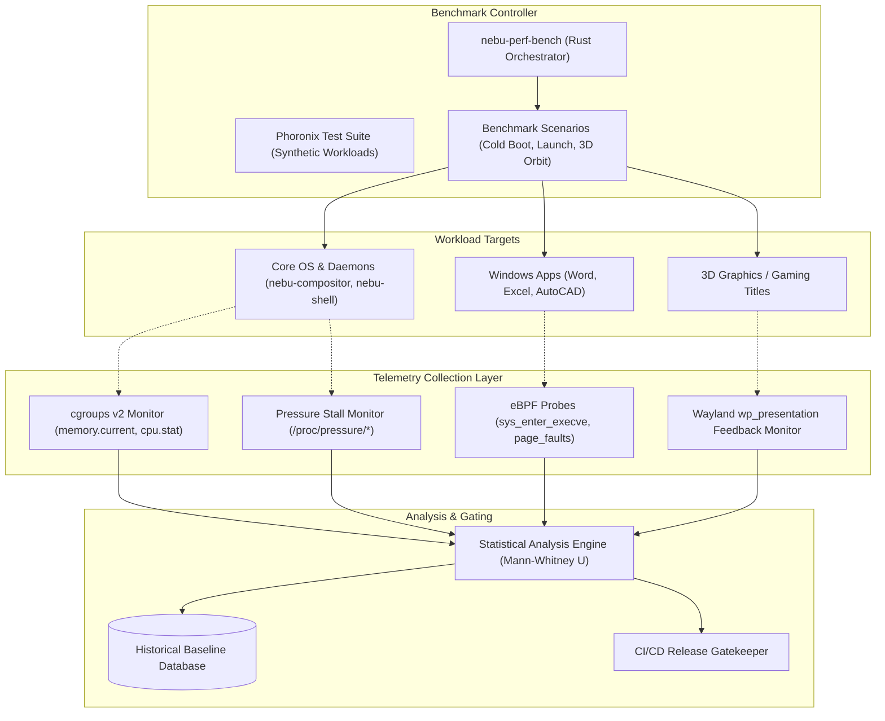
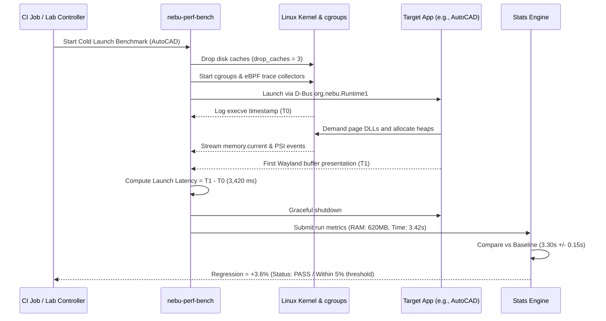

# Performance Testing Specification — NebuOS

## 1. Status
**Status:** DRAFT  
**Type:** Subsystem Engineering Specification  
**Domain:** Performance Benchmarking, Telemetry, and Regression Detection  
**Target Architecture:** x86_64  
**Target Release:** NebuOS 1.0 (Milestones P0-P12)

---

## 2. Purpose
This specification defines the performance testing framework, automated benchmarking suites, telemetry collection engines, and regression threshold enforcement policies for NebuOS. NebuOS is engineered to provide a lightweight, native-feeling desktop experience capable of running smoothly on legacy hardware with 4 GB RAM (< 800 MB idle RAM) while scaling efficiently to high-performance multi-core workstations. This document details how boot duration, memory pressure, cold/warm application launch latencies, I/O throughput, and frame presentation pacing are measured and continuously gated.

---

## 3. Scope
This specification governs:
- Standardized automated benchmark suites including custom `nebu-perf-bench` and upstream tools (Phoronix Test Suite).
- Telemetry collection mechanisms using cgroups v2, eBPF probes, Pressure Stall Information (PSI), and `perf_event_open`.
- Measurement protocols for cold versus warm application launch sequences.
- Desktop responsiveness metrics: input-to-photon latency and Wayland frame presentation pacing.
- Automated regression gating in CI/CD and release pipelines.
- Qualification benchmarks for the 4 GB RAM "Low-End Mode" profile.

---

## 4. Non-Goals
- Testing virtualization hypervisors (QEMU, KVM, VirtualBox) as application runtimes.
- Subjective manual stopwatch testing; all measurements must be programmatic.
- Optimizing for synthetic micro-benchmarks that do not reflect real-world desktop or Wine workloads.
- Supporting automated regression benchmarking on non-x86_64 architectures in Milestone P0-P12.

---

## 5. Requirements

### 5.1 Functional Requirements
- **REQ-PERF-001:** The performance test runner (`nebu-perf-bench`) must collect memory metrics (RSS, PSS, Swap, Page Faults) via cgroups v2 memory controllers for all spawned daemons.
- **REQ-PERF-002:** Boot time benchmarking must parse `systemd-analyze` firmware, loader, kernel, and userspace milestones with sub-millisecond precision.
- **REQ-PERF-003:** The runner must distinguish between cold launches (page caches dropped via `echo 3 > /proc/sys/vm/drop_caches`) and warm launches (prefix cached in RAM).
- **REQ-PERF-004:** Frame time collection must integrate with the Wayland presentation-time protocol to log frame presentation timestamps with microsecond resolution.
- **REQ-PERF-005:** Regression detection algorithms must compare test run distributions against a rolling 30-day baseline using Mann-Whitney U statistical hypothesis testing.

### 5.2 Non-Functional Requirements
- **REQ-PERF-006:** Instrumentation overhead during performance runs must not alter measured latencies by more than `1.5%`.
- **REQ-PERF-007:** Automated regression detection must enforce strict gating: any performance drop `> 5%` triggers a warning, and `> 10%` blocks CI merges.
- **REQ-PERF-008:** Benchmark runs must execute on isolated, bare-metal hardware nodes with CPU frequency governors locked to `performance` to eliminate scaling jitter.
- **REQ-PERF-009:** Performance telemetry datasets must be serialized to standard OpenTelemetry/JSON formats and uploaded to centralized time-series storage.

---

## 6. Architecture

Performance verification utilizes a dedicated telemetry collection harness that captures system state across kernel, compositor, and Wine runtime boundaries:



---

## 7. Components

### 7.1 Performance Tooling Subsystems
- **`nebu-perf-bench` (Rust):** Custom command-line orchestration tool executing benchmark workloads, managing CPU isolation, dropping caches, and formatting JSON reports.
- **`nebu-telemetry-agent` (Rust/eBPF):** High-frequency kernel event listener monitoring scheduler latency, context switches, and page faults.
- **cgroups v2 Telemetry Collector:** Direct reader of `/sys/fs/cgroup/system.slice` and `/sys/fs/cgroup/user.slice` metrics.
- **Phoronix Test Suite:** Upstream open-source benchmarking engine executing standard Linux kernel, filesystem, and graphics benchmarks.
- **Statistical Gatekeeper:** Analysis script evaluating p-values and percentage deviations against established baseline distributions.

### 7.2 Subsystem Ownership Classification
| Component | Classification | Origin / Dependency |
|---|---|---|
| `nebu-perf-bench` | NebuOS Component | In-house Rust crate (`crates/nebu-perf-bench`) |
| `nebu-telemetry-agent` | NebuOS Component | In-house Rust/eBPF agent |
| cgroups v2 / PSI | Linux Kernel | Upstream Linux kernel 6.x interfaces |
| Phoronix Test Suite | Open Source Tool | Upstream PTS benchmarking framework |
| OpenTelemetry Collector | CNCF Standard | Telemetry export pipeline |

---

## 8. Data Flow



---

## 9. Control Flow

### 9.1 Benchmark Execution Sequence
1. **Node Quarantine:** Node orchestrator disables background services, cron jobs, and CPU frequency scaling (`scaling_governor = performance`).
2. **Pre-flight Health Check:** Verifies ambient CPU temperature (< 45°C) and idle system load (< 0.05).
3. **Cache Invalidation (Cold Tests):**
   - Flushes dirty buffers: `sync`.
   - Clears page cache, dentries, and inodes: `echo 3 > /proc/sys/vm/drop_caches`.
4. **Execution Loop:**
   - Launches application workload under cgroup isolation (`/sys/fs/cgroup/nebu-bench.slice`).
   - Collects samples at 100 Hz (every 10 ms).
   - Monitors for process exit or steady-state presentation events.
5. **Post-Execution Aggregation:**
   - Aggregates mean, median, standard deviation, 95th, and 99th percentiles across N=10 consecutive iterations.
6. **Regression Gate Evaluation:**
   - Calculates percentage delta against reference baseline.
   - Evaluates warning (> 5%) and blocker (> 10%) criteria.

---

## 10. Interfaces

### 10.1 Command-Line Interface (`nebu-perf-bench`)
```bash
nebu-perf-bench run \
    --suite <boot|launch|memory|graphics|io> \
    --iterations 10 \
    --drop-cache \
    --cgroup-slice nebu-bench.slice \
    --output-json /tmp/perf_results.json \
    --baseline-db http://perf.nebuos.internal/api/v1
```

### 10.2 Performance Report Schema (JSON)
```json
{
  "$schema": "https://nebuos.org/schemas/v1/perf-report.json",
  "run_id": "perf-run-20260904-88",
  "hardware_profile": "intel_i5_12400_16gb",
  "kernel_version": "6.10.4-nebu.fc40.x86_64",
  "test_case": "word_2021_cold_launch",
  "iterations": 10,
  "summary": {
    "mean_ms": 2840.5,
    "median_ms": 2835.0,
    "std_dev_ms": 42.1,
    "p95_ms": 2895.0,
    "p99_ms": 2912.0,
    "peak_rss_mb": 425.4,
    "psi_memory_some_avg10": 0.00
  },
  "regression_status": {
    "baseline_mean_ms": 2810.0,
    "delta_percentage": 1.08,
    "verdict": "PASS"
  }
}
```

---

## 11. Dependencies

### 11.1 System Packages
- **`systemd` (255+):** `systemd-analyze` boot profiling tools.
- **`kernel-tools` / `perf`:** CPU event counters and hardware performance registers.
- **`bpftool` / `bcc-tools`:** eBPF program loading and tracepoint attachment.
- **`sysstat`:** `iostat`, `sar`, `pidstat` resource accounting tools.
- **`phoronix-test-suite` (10.8+):** Industry-standard cross-platform benchmark suite.

### 11.2 Rust Crates
- **`aya` (0.12+):** Pure Rust eBPF library for tracepoint attachment.
- **`statrs` (0.16+):** Statistical distribution and hypothesis testing library.
- **`serde` / `serde_json`:** Report parsing and serialization.

---

## 12. Security
- **Privileged Probes:** eBPF probes require `CAP_BPF` and `CAP_PERFMON`; the benchmark agent runs under a restricted service account with specific capabilities granted via systemd service units rather than full `root`.
- **Telemetry Sanitization:** Memory profiling data records only anonymous byte counts and page counts; raw memory contents are never inspected or dumped.
- **Hardware Register Safety:** Direct model-specific register (MSR) access is restricted to read-only energy counter profiling (`intel-rapl`).

---

## 13. Resource Requirements

| Resource | Low-End Test Node (4 GB) | Standard Test Node (16 GB) | High-End Node (32 GB+) |
|---|---|---|---|
| **CPU Target** | 2 Cores / 4 Threads | 6 Cores / 12 Threads | 16+ Cores |
| **RAM** | 4 GB DDR4 | 16 GB DDR4/DDR5 | 32+ GB DDR5 |
| **Storage** | SATA SSD (>= 500 MB/s) | PCIe 3.0 NVMe | PCIe 4.0/5.0 NVMe |
| **Max Ambient Load** | < 0.10 load average | < 0.05 load average | < 0.05 load average |
| **Measurement Duration**| 120 minutes full suite | 45 minutes full suite | 30 minutes full suite |

---

## 14. Failure Modes

| Failure ID | Symptom | Root Cause | Remediation Action |
|---|---|---|---|
| **FAIL-PERF-001** | Regression block (> 10% degradation) | Unoptimized query in `nebu-compat-db` or synchronous I/O in compositor loop | Bisect commits using automated regression runner to identify offending change |
| **FAIL-PERF-002** | High run-to-run variance (std dev > 10%) | Background thermal throttling or uncontrolled kernel background flush | Verify CPU cooling and ensure governors are locked; re-run in isolated runlevel |
| **FAIL-PERF-003** | eBPF probe attach failure | Kernel configuration missing `CONFIG_BPF_EVENTS` or permission denied | Verify kernel configuration flags and capability assignments |
| **FAIL-PERF-004** | Out-of-memory during benchmark | Test workload exceeded available physical RAM on 4 GB node | Check for memory leaks in Wine prefix or adjust cgroup memory limits |
| **FAIL-PERF-005** | Missing Wayland presentation events | Client compositor crashed or disconnected unexpectedly | Inspect compositor crash logs and core dumps |

---

## 15. Recovery Behavior
- **Automatic Retries on High Variance:** If the coefficient of variation (CV = std_dev / mean) exceeds 8% across 10 iterations, the suite automatically flushes caches, waits for thermal equilibrium (30s), and re-executes.
- **Thermal Throttle Watcher:** The runner queries CPU thermal zones (`/sys/class/thermal/thermal_zone*/temp`). If throttling is detected, testing pauses until temperatures drop below 40°C.
- **Graceful Process Abort:** If an application hangs during a launch benchmark, a 30-second timeout watchdog terminates the process group via `SIGKILL` and records a zero-score timeout event.

---

## 16. Testing Requirements
- **Harness Self-Verification:** The `nebu-perf-bench` tool must be verified against synthetic delay workloads to confirm measurement accuracy within +/- 1 ms.
- **eBPF Probe Invariant Checks:** Validate that kernel tracepoints do not drop events under high load (> 10,000 events/sec).
- **Baseline Calibration:** Baselines must be re-calibrated upon major Linux kernel or GCC/Clang compiler version upgrades.

---

## 17. Performance Requirements
- **Cold Boot Time:** Total boot duration from bootloader handoff to interactive shell ready must be **< 5.0 seconds** on SATA SSD, **< 3.5 seconds** on NVMe.
- **Desktop Idle RAM:** Total operating system memory consumption at idle desktop (no user apps) must be **< 800 MB** on 4 GB machines.
- **Cold Launch Latency:** Microsoft Word cold launch must execute in **< 4.0 seconds** on standard hardware (**< 8.0 seconds** on 4 GB hardware).
- **Warm Launch Latency:** Application warm launch must complete in **< 1.5 seconds**.

---

## 18. Compatibility Considerations
- **Hardware Scaling:** Performance targets must scale predictably between low-end dual-core hardware and high-end workstation CPUs; separate SLA baselines are maintained per hardware tier.
- **Btrfs Compression Overhead:** Performance runs test both compressed (`zstd:1`) and uncompressed filesystems to verify that CPU decompression overhead does not regress cold launch times.
- **Wine Staging Patches:** Performance benchmarks must validate whether experimental Wine synchronization patches (e.g., `fsync` / futex2) deliver measurable latency reductions without causing stability regressions.

---

## 19. Open Questions
1. *OPEN QUESTION:* Should CI pull request gates run a fast micro-performance suite on simulated cloud runners, or should all performance gating be strictly restricted to dedicated bare-metal lab hardware?
2. *OPEN QUESTION:* How can we reliably isolate background Btrfs background metadata cleaner threads from interfering with launch latency measurements?
3. *OPEN QUESTION:* Should the regression threshold for gaming workloads (Tier 3) be based on average framerate, 99th percentile frame times, or shader compilation hitch count?

---

## 20. Related Documents
- [00-testing-specification.md](00-testing-specification.md) — Master testing specification.
- [04-graphics-testing.md](04-graphics-testing.md) — Graphics testing and presentation validation.
- [06-hardware-testing.md](06-hardware-testing.md) — Bare-metal hardware testing lab specification.
- [../performance/00-performance-specification.md](../performance/00-performance-specification.md) — Master performance SLA table.
- [../performance/01-memory-budget.md](../performance/01-memory-budget.md) — Memory budget and allocation per component.
- [../performance/04-launch-performance.md](../performance/04-launch-performance.md) — Application launch lifecycle and latency budget.
