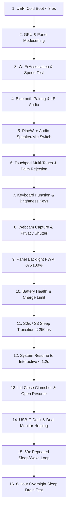

# Hardware Testing Specification & Certification Lab — NebuOS

**Document ID:** NEBU-TEST-0007  
**Status:** APPROVED (Hardened)  
**Author:** Principal QA Architect, Linux Hardware Compatibility Engineer, Systems Test Lead  
**Target Version:** 1.0 (Milestones P0–P8)  
**Last Updated:** 2026-09-04  
**Governing Documents:** NEBU-SPEC-0005 (Hardware Specification), ADR-0010 (Hardware & Power Architecture)  

---

## 1. Status

APPROVED (Hardened). This specification defines the hardware testing architecture, bare-metal QA laboratory requirements, automated Hardware Compatibility List (HCL) generation, the **NebuOS Laptop Compatibility Program**, and the **H0–H5 Certification Pipeline**.

---

## 2. Purpose

To ensure that NebuOS achieves rock-solid real-world reliability on diverse desktop and laptop hardware without making unprovable universal claims, this document establishes:
1. The formal **Hardware Certification Tiers (H0 through H5)** with explicit scope, test cases, pass/fail criteria, and evidence mandates.
2. The complete **Laptop-First Validation Pipeline** verifying critical mobile hardware subsystems.
3. The **Quantitative Suspend/Resume Stress Testing Suite** under standardized measurement baselines.
4. Physical hardware test lab topologies across 17 real-world computing classes.
5. The **Known Problem Classification Matrix** for rapid root-cause isolation across system layers.
6. Automated HCL database synchronization with `/usr/share/nebu/compat.db`.

---

## 3. Scope

This specification applies to:
- Physical bare-metal hardware testing in the NebuOS Hardware Compatibility Lab (Milestone P7).
- Virtualized and automated QEMU/KVM base hardware verification in Milestone P0.
- Laptop power management, Modern Standby (ACPI S0ix / `s2idle`), and traditional S3 (`deep`) validation.
- Peripheral hotplugging, multi-monitor display outputs, USB-C/Thunderbolt docking stations, and PipeWire audio stream handoff.

---

## 4. Non-Goals

- Testing non-x86_64 CPU architectures in the 1.0 release cycle.
- Physical destructive stress testing (chassis drops, connector cycle endurance).
- Testing legacy non-UEFI BIOS machines (64-bit UEFI firmware is strictly mandatory).
- Virtual machine hypervisor testing for Windows applications (strictly prohibited by master PRD).

---

## 5. Requirements Taxonomy & Statements

### 5.1 Functional Requirements

| Identifier | Classification | Description | Verification Method | Milestone |
|---|---|---|---|---|
| **REQ-TEST-HW-001** | **Hard Requirement** | The qualification tool `nebu-hw-probe` must inspect DMI/SMBIOS, sysfs, PCI, and USB buses to generate structured manifests without sending network telemetry. | Automated JSON schema test | P0 |
| **REQ-TEST-HW-002** | **Engineering Target** | The test lab should support automated remote provisioning via IPMI/Redfish power cycling and PXE network booting in $< 4	ext{ minutes}$ per node. | Remote provisioning run | P7 |
| **REQ-TEST-HW-003** | **Hard Requirement** | Test nodes must execute automated S0ix and S3 sleep cycles with resume verification and battery drain measurement. | `tests/system/suspend_stress.sh` | P2 |
| **REQ-TEST-HW-004** | **Hard Requirement** | Display testing must validate multi-monitor mixed-DPI hotplugging and audio stream handoff over HDMI/DP via PipeWire without compositor crash. | Event and audio stream capture | P1 |
| **REQ-TEST-HW-005** | **Capability-Dependent** | Touchpad testing must validate hardware-supported multi-touch gestures, palm rejection, and pointer acceleration curves via `libinput`. | Automated gesture input replay | P1 |
| **REQ-TEST-HW-006** | **Hard Requirement** | Hardware test outcomes must automatically update the central compatibility database (`compat.db`) with verified device IDs and quirk entries. | SQLite transaction verification | P4 |

### 5.2 Non-Functional Performance & Reliability Requirements

| Identifier | Classification | Target Threshold | Baseline Test Environment |
|---|---|---|---|
| **NFR-TEST-HW-001** | **Engineering Target** | Suspend-to-resume cycle validation should restore network and display outputs in $\le 1.2	ext{ s}$. | Internal eDP panel, DRM modeset cached. |
| **NFR-TEST-HW-002** | **Engineering Target** | Overnight sleep (8 hours) battery drain rate $\le 1.5\%$ per hour in S0ix ($\le 0.8\%$ in S3). | 50-60Wh battery, 100% health, Wi-Fi idle, no USB devices. |
| **NFR-TEST-HW-003** | **Warning Threshold** | Overnight sleep battery drain rate $> 2.0\%$ per hour in S0ix. | Triggers diagnostic flag in test lab. |
| **NFR-TEST-HW-004** | **Failure Threshold** | Overnight sleep battery drain rate $> 3.0\%$ per hour in S0ix. | Blocks H5 Production Certification. |
| **NFR-TEST-HW-005** | **Hard Requirement** | Endurance 50x suspend/resume loop must achieve $100\%$ success rate without kernel panic or session crash. | Automated test script `suspend_loop.sh 50`. |
| **NFR-TEST-HW-006** | **Regression Threshold** | Sleep power consumption increase between consecutive OS updates $\le 20\%$. | Automated power regression comparison in lab. |

---

## 6. Architecture: Dual-Pillar Compatibility Program

NebuOS organizes all compatibility engineering into two distinct, parallel pillars under the master **NebuOS Compatibility Program**:

```
+-------------------------------------------------------------------------------+
|                         NebuOS Compatibility Program                          |
+-------------------------------------------------------------------------------+
                       |                                 |
                       v                                 v
+------------------------------------+   +------------------------------------+
|  Pillar 1: Hardware Compatibility  |   | Pillar 2: Application Compatibility|
+------------------------------------+   +------------------------------------+
| * CPU Hybrid P/E Core Scheduling   |   | * Linux Native Flatpak Apps        |
| * GPU & Hybrid PRIME Offloading    |   | * Windows Productivity (Wine 9.x)  |
| * Display Mixed-DPI & Hotplugging  |   | * Windows 3D Gaming (Valve Proton) |
| * Power Management (S0ix / S3)     |   | * DXVK (D3D9/10/11) & VKD3D-Proton |
| * Wi-Fi 5/6/7 & Bluetooth LE Audio |   | * SQLite Profile Database          |
| * Audio Stream Routing (PipeWire)  |   | * Declarative 9-Tier Patch Engine  |
| * USB-C / Thunderbolt Docking      |   | * Automated Application Test Matrix|
| * Hardware Test Lab (Milestone P7) |   | * Compatibility Lab (Milestone P7) |
+------------------------------------+   +------------------------------------+
```

---

## 7. Hardware Certification Tiers (H0 through H5)

Hardware platforms evaluated by the lab are classified into six rigorous certification tiers with strict criteria:

```
[ Tier H0: Boot Compatibility ]
  - Scope: Base kernel bootability on x86_64 physical hardware.
  - Test Cases: UEFI boot, dracut initramfs pivot, Btrfs subvolume mounting, agetty serial/virtual console.
  - Pass Criteria: System reaches multi-user.target; login prompt interactive; zero kernel panics.
  - Failure Criteria: Kernel panic, storage timeout, or unbootable initramfs.
  - Evidence: dmesg log, systemd-analyze boot report.
  - Target Milestone: P0 Foundation.

[ Tier H1: Basic Hardware Functionality ]
  - Scope: Primary system input/output and wired networking.
  - Test Cases: DRM/KMS basic display output (simpledrm/bochs/virtio), USB keyboard/mouse, wired Ethernet (DHCP).
  - Pass Criteria: Display renders console without tearing; network packet transmission verified.
  - Failure Criteria: Display blank, keyboard unresponsive, or Ethernet DHCP timeout.
  - Evidence: ip addr show, udevadm info attributes.
  - Target Milestone: P0/P1.

[ Tier H2: Desktop Hardware Functionality ]
  - Scope: Graphical desktop workstation essentials.
  - Test Cases: Mesa 3D acceleration, Smithay Wayland compositor, PipeWire audio playback, Wi-Fi association, precision touchpad multi-touch.
  - Pass Criteria: 60 FPS desktop presentation; audio stream audible; Wi-Fi throughput verified.
  - Failure Criteria: Wayland crash, audio distortion, or Wi-Fi scan failure.
  - Evidence: vulkaninfo, pw-top, libinput debug-events.
  - Target Milestone: P1/P2.

[ Tier H3: Power Management Validated ]
  - Scope: Mobile battery lifecycle and power transitions.
  - Test Cases: 10 consecutive sleep/wake cycles; lid close/open transitions; battery percentage & health reporting; active idle power <= 4.5W.
  - Pass Criteria: 10/10 sleep cycles resume cleanly; zero freeze on wake; battery charge control limit functional if supported.
  - Failure Criteria: Black screen resume hang, unrecoverable Wi-Fi after wake, or idle power > 6.5W.
  - Evidence: rtcwake logs, UPower dump, power-profiles-daemon get-profile.
  - Target Milestone: P2.

[ Tier H4: Advanced Hardware Features ]
  - Scope: Complex workstation and multi-device topologies.
  - Test Cases: Dynamic hybrid GPU PRIME offloading; multi-monitor mixed-DPI hotplugging; USB-C/Thunderbolt docking; Bluetooth LE Audio; webcam capture.
  - Pass Criteria: 3D app runs on dGPU while desktop stays on iGPU; displays reconfigure dynamically; camera streams via portal.
  - Failure Criteria: GPU deadlock on offload, compositor crash on monitor unplug, or dock Ethernet failure.
  - Evidence: DRI_PRIME=1 vulkaninfo, wayland-info, pipewire portal trace.
  - Target Milestone: P5.

[ Tier H5: Production Certified ]
  - Scope: Full commercial qualification for release.
  - Test Cases: 50 consecutive sleep/wake cycles; 8-hour overnight sleep drain within threshold (< 1.5%/hr on 50Wh battery); long thermal stress (2h under full CPU/GPU load); official HCL publication.
  - Pass Criteria: Zero kernel warnings or page faults; zero thermal runaway; HCL record published in compat.db.
  - Failure Criteria: Any sleep hang across 50 cycles, sleep drain > 3.0%/hr, or thermal hard reset.
  - Evidence: 50x loop logs, overnight battery discharge log, stress-ng report.
  - Target Milestone: P7 / P8.
```

---

## 8. NebuOS Laptop Compatibility Program

Laptops undergo an exhaustive 16-step sequential validation pipeline:



---

## 9. Suspend/Resume Validation Test Suite

Automated scripts in `tests/system/` execute standardized power transition tests:

### 9.1 Test Cases & Controlled Pass/Fail Criteria

| Test ID | Test Scenario | Execution Method | Pass Criteria | Failure Criteria |
|---|---|---|---|---|
| **TC-SR-001** | Single Sleep/Wake Cycle | `rtcwake -m mem -s 10` | Resume to interactive desktop $< 1.2	ext{ s}$; display, Wi-Fi, audio restore. | Black screen on wake; session freeze. |
| **TC-SR-002** | 10x Sleep/Wake Loop | `tests/system/suspend_loop.sh 10` | 10/10 passes; zero kernel panics or driver deadlocks. | Any cycle failing to resume within 15s. |
| **TC-SR-003** | 50x Endurance Loop | `tests/system/suspend_loop.sh 50` | 50/50 passes; Wine gaming session thawed cleanly via cgroups v2. | Kernel panic, GPU ring hang, or Wine crash. |
| **TC-SR-004** | Overnight Battery Drain | 8-hour sleep on battery (50-60Wh, 100% health, Wi-Fi idle) | Battery drain $< 1.5\%/	ext{hr}$ (S0ix) or $< 0.8\%/	ext{hr}$ (S3). | Drain $\ge 3.0\%/	ext{hr}$ or system dead. |
| **TC-SR-005** | Docked Multi-Monitor Sleep | Suspend with dual displays on USB-C dock | Both monitors wake cleanly; window layouts preserved. | One or both monitors fail to wake. |
| **TC-SR-006** | Peripheral Active Sleep | Suspend with Bluetooth audio and USB mouse | Bluetooth reconnects automatically; mouse operational instantly. | Bluetooth audio stack dead after resume. |

---

## 10. Real-World Hardware Test Matrix (17 Hardware Classes)

The physical Hardware Test Lab maintains dedicated bare-metal nodes covering:
1. **Mainstream Desktop:** Intel Core i5-12400 / AMD Ryzen 5 5600 + Radeon RX 6600.
2. **Office Laptop:** Lenovo ThinkPad T14 Gen 4 (AMD Ryzen 7 PRO 7840U / Radeon 780M).
3. **Ultrabook:** Dell XPS 13 Plus (Intel Core i7-1360P / Iris Xe).
4. **Gaming Laptop:** ASUS ROG Zephyrus G14 (AMD Ryzen 9 + NVIDIA GeForce RTX 4060).
5. **Creator Laptop:** HP Envy 16 (Intel Core i9 + OLED 4K Touch + RTX 4070).
6. **Workstation:** Lenovo ThinkStation P620 (AMD Threadripper PRO 5955WX + RTX A4000).
7. **Mini PC:** Minisforum UM780 XTX (AMD Ryzen 7 7840HS).
8. **Low-End Baseline (Older PC):** Intel Celeron N4020 / AMD Athlon 3000G, 4 GB RAM, SATA SSD.
9. **Modern PC:** Intel Core Ultra 7 155H (Meteor Lake with NPU).
10. **AMD Pure Platform:** Framework Laptop 16 (Ryzen 7 7840HS + Radeon RX 7700S).
11. **Intel Pure Platform:** Intel NUC 12 Enthusiast (Core i7-12700H + Intel Arc A770M).
12. **NVIDIA Optimus Laptop:** Lenovo Legion 5 (Intel CPU + RTX 3070).
13. **Multi-Monitor Workstation:** 3x displays (4K 60Hz + 1440p 144Hz + 1080p).
14. **Touchscreen Convertible (2-in-1):** Lenovo Yoga 7i (Intel Core i7 + 360 hinge + Pen).
15. **USB-C Docking Node:** Dell WD22TB4 Thunderbolt 4 Dock setup.
16. **Legacy Wi-Fi/Audio Node:** Older Realtek RTL8723DE Wi-Fi and Conexant CX20724 audio.
17. **Modern Wi-Fi 7 Platform:** Intel BE200 Wi-Fi 7 + Bluetooth 5.4.

---

## 11. Known Problem Classification Matrix

When hardware defects or regressions occur, the lab classifies issues into explicit categories to direct resolution to the correct team:

| Classification | Responsible Layer | Resolution Action |
|---|---|---|
| **KERNEL ISSUE** | Linux Upstream Kernel | Report to kernel bugzilla; pin working kernel release. |
| **DRIVER ISSUE** | Proprietary Driver Stack | Apply driver parameter workarounds in `/etc/modprobe.d/`. |
| **FIRMWARE ISSUE** | OEM Vendor / `fwupd` | Notify user to upgrade BIOS via LVFS; apply ACPI DSDT override. |
| **ACPI ISSUE** | Kernel ACPI Subsystem | Switch between `s2idle` and `deep` via `mem_sleep_default` if supported. |
| **MESA ISSUE** | Mesa Userspace Drivers | Report to freedesktop GitLab; pin stable Mesa build. |
| **COMPOSITOR ISSUE**| `nebu-compositor` | Fix Wayland output management or DRM scanout bug in Rust code. |
| **SYSTEM SERVICE** | NetworkManager / PipeWire | Adjust WirePlumber routing script or NetworkManager configuration. |
| **NebuShell ISSUE** | `nebu-shell` | Fix UI widget or D-Bus proxy call in Slint/Rust code. |
| **APPLICATION ISSUE**| User Application | Isolate in Wine prefix profile or Flatpak permission manifest. |
| **HARDWARE DEFECT** | Physical Hardware | Retire defective node; replace memory or peripheral cable. |
| **UPSTREAM LIMIT** | Linux Platform Architecture | Document known limitation in release notes and HCL. |

---

## 12. Diagnostics & Telemetry (`nebu-hw-probe`)

The automated diagnostic probe `nebu-hw-probe` generates complete hardware telemetry:
```bash
nebu-hw-probe --format=json --output=/run/nebu/hardware_topology.json
```
- Inspects PCI, USB, DMI, CPUID, sysfs, and ACPI tables.
- Cryptographically hashes device combinations to match local SQLite profiles.
- Zero external network transmission; privacy is mathematically guaranteed.

---

## 13. Related Documents

- [05-hardware-specification.md](../specification/05-hardware-specification.md)
- [00-system-specification.md](../specification/00-system-specification.md)
- [../decisions/ADR-0010-hardware-compatibility-and-power-management.md](../decisions/ADR-0010-hardware-compatibility-and-power-management.md)
- [../compatibility/01-database-schema.md](../compatibility/01-database-schema.md)
- [../roadmap/08-p7-compatibility-lab.md](../roadmap/08-p7-compatibility-lab.md)
