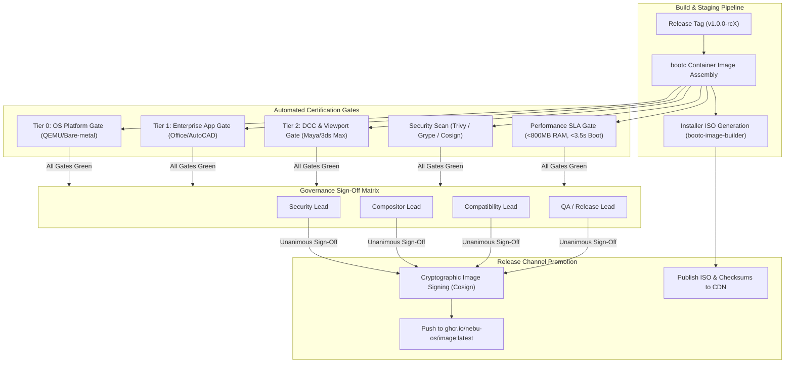
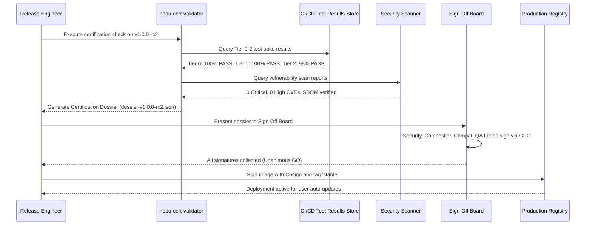

# Release Certification Specification — NebuOS

## 1. Status
**Status:** DRAFT  
**Type:** Governance and Quality Engineering Specification  
**Domain:** Release Engineering, Certification Gates, and Go/No-Go Decision Matrix  
**Target Architecture:** x86_64  
**Target Release:** NebuOS 1.0 (Milestones P0-P12)

---

## 2. Purpose
This specification establishes the release certification process, release checklist, qualification gates, formal sign-off matrix, and go/no-go criteria for NebuOS operating system releases. NebuOS is an immutable, image-based operating system distributed via Fedora bootc/ostree containers. Because updates replace the active system image atomically, every released build must satisfy rigorous binary stability, Windows application compatibility, security CVE thresholds, and resource envelope requirements before being promoted to Stable channels.

---

## 3. Scope
This specification governs:
- End-to-end certification requirements for Alpha, Beta, Release Candidate (RC), and General Availability (GA) releases.
- Technical verification checklists covering Tiers 0 through 4.
- Security vulnerability thresholds and cryptographic image signing gates.
- Multi-stakeholder sign-off authority matrix across engineering domains.
- Automated and manual Go/No-Go decision criteria.
- Rollback and emergency patch criteria for released production images.
- Supply chain provenance, SBOM validation, and Cosign attestation protocols.
- Post-release telemetry monitoring during the initial 72-hour adoption window.

---

## 4. Non-Goals
- Defining internal sprint planning or issue triage procedures.
- Regulating third-party community repository certification.
- Replacing the low-level test execution details covered in domain-specific test specs.
- Defining marketing launch schedules or external commercial product announcements.
- Certification of third-party custom kernel forks or unsupported Wine staging branches.
- Endorsing non-certified proprietary drivers outside the official base image manifest.

---

## 5. Requirements

### 5.1 Functional Requirements
- **REQ-CERT-001:** Every release candidate must pass 100% of Tier 0 system tests (boot, initramfs, core daemons) without exceptions.
- **REQ-CERT-002:** Tier 1 commercial productivity software (Microsoft Office 2021, AutoCAD 2024) must pass all automated workflow and visual verification suites.
- **REQ-CERT-003:** Vulnerability scanning on the final bootc image must report zero unresolved Critical (CVSS >= 9.0) or High (CVSS >= 7.0) CVEs in core packages.
- **REQ-CERT-004:** The release candidate must verify atomic rollback capability from the new image to the previous stable deployment using `bootc rollback`.
- **REQ-CERT-005:** All official release artifacts (OCI container images, ISO installers, UEFI shims) must be cryptographically signed using Cosign and Sigstore infrastructure.
- **REQ-CERT-006:** The release candidate must provide an automated Software Bill of Materials (SBOM) in SPDX and CycloneDX formats.
- **REQ-CERT-007:** The image must boot cleanly on all five bare-metal reference hardware tiers in the QA lab.

### 5.2 Non-Functional Requirements
- **REQ-CERT-008:** The formal sign-off process must be recorded in an immutable, auditable Git commit in `docs/certification/`.
- **REQ-CERT-009:** Total qualification duration from release tag creation to release decision must not exceed `48 hours`.
- **REQ-CERT-010:** Idle desktop memory consumption on reference 4 GB hardware must strictly remain `< 800 MB`.
- **REQ-CERT-011:** Cold system boot on SATA SSD reference hardware must complete in `< 5.0 seconds`.
- **REQ-CERT-012:** Release notes and changelogs must be automatically compiled from conventional commit messages.

---

## 6. Architecture

The release certification workflow coordinates multi-tier verification pipelines, security scanners, and human approval gates into an auditable promotion path:



---

## 7. Components

### 7.1 Formal Sign-Off Matrix

Promotion to General Availability requires explicit cryptographic approvals from four designated domain leads:

| Domain Role | Responsible Lead | Verification Scope | Authority |
|---|---|---|---|
| **Security Lead** | AppSec Engineering | Zero Critical/High CVEs, sandbox boundaries, SBOM validation, UEFI Secure Boot signatures. | VETO |
| **Compositor Lead** | Desktop Engineering | Wayland presentation timing, zero compositor crashes, display hotplug stability, input latency. | VETO |
| **Compatibility Lead**| Compatibility Team | Tier 1/2 application test results, Wine prefix stability, DXVK translation fidelity, DB schema. | VETO |
| **QA / Release Lead** | Quality Assurance | Test suite completeness, performance budget compliance (<800MB RAM), hardware lab results. | FINAL APPROVAL |

### 7.2 Subsystem Components
- **`nebu-cert-validator` (Rust):** Command-line tool that aggregates JUnit XML test results, Trivy vulnerability reports, and performance JSON files to compute an overall certification score.
- **Cosign Image Signer:** Sigstore tool providing cryptographic OCI container image signing and transparency log attestation.
- **`bootc-image-builder`:** Upstream utility converting ostree bootc containers into bootable ISO and RAW disk images.
- **SBOM Generator:** Syft-based Software Bill of Materials generator providing SPDX/CycloneDX manifests for the complete root filesystem.

---

## 8. Data Flow



---

## 9. Control Flow

### 9.1 Release Gate Decision Protocol
1. **Candidate Tagging:** Git tag `vX.Y.Z-rcN` is pushed; automated builders assemble the immutable bootc image.
2. **Automated Qualification Run:**
   - Tier 0 platform boot tests execute across QEMU and bare-metal nodes.
   - Tier 1 compatibility suites run against golden enterprise prefixes.
   - Performance benchmarks execute on 4 GB reference node.
   - Vulnerability scanners audit all RPM packages and Cargo binaries.
3. **Dossier Compilation:** `nebu-cert-validator` generates the machine-readable release dossier.
4. **Sign-Off Review:**
   - If ANY blocking criterion is violated, status is immediately set to **NO-GO**; candidate is rejected.
   - If all automated criteria pass, domain leads review telemetry and cast cryptographic votes.
5. **Image Promotion:** Image is signed via Cosign, pushed to production registry, and changelog is published.

---

## 10. Interfaces

### 10.1 Go/No-Go Decision Matrix

| Gate Identifier | Metric / Criterion | Threshold for "GO" | Threshold for "NO-GO" |
|---|---|---|---|
| **GATE-PLAT-01** | Tier 0 Boot & OS Platform Tests | 100% Pass Rate | Any test failure or kernel panic |
| **GATE-COMP-01** | Tier 1 Applications (Word, Excel, AutoCAD) | 100% Pass Rate | Any functional failure or crash |
| **GATE-COMP-02** | Tier 2 DCC Software (Maya, Photoshop) | >= 95% Pass Rate | Critical viewport or file corruption bug |
| **GATE-MEM-01** | Idle Desktop RAM (4 GB Reference Node) | < 800 MB RSS | >= 800 MB RSS |
| **GATE-BOOT-01** | Cold Boot Time (SATA SSD) | < 5.0 seconds | >= 5.0 seconds |
| **GATE-SEC-01** | Unresolved Vulnerabilities (CVE) | 0 Critical, 0 High | >= 1 Unmitigated High/Critical CVE |
| **GATE-ROLL-01** | Atomic Rollback Verification | 100% Successful Rollback | Failure to revert rootfs deployment |
| **GATE-CRASH-01**| Unhandled Compositor Crashes | Exactly 0 Crashes | >= 1 Unhandled Compositor Crash |

### 10.2 Certification Dossier Schema (`dossier.json`)
```json
{
  "$schema": "https://nebuos.org/schemas/v1/certification-dossier.json",
  "release_version": "v1.0.0",
  "commit_sha": "7f8b9a1c2d3e4f5a6b7c8d9e0f1a2b3c4d5e6f7a",
  "bootc_image_digest": "sha256:e3b0c44298fc1c149afbf4c8996fb92427ae41e4649b934ca495991b7852b855",
  "timestamp": "2026-09-04T11:00:00Z",
  "automated_gates": {
    "tier0_platform": {"verdict": "PASS", "tests_total": 420, "tests_passed": 420},
    "tier1_enterprise": {"verdict": "PASS", "tests_total": 85, "tests_passed": 85},
    "tier2_dcc": {"verdict": "PASS", "tests_total": 40, "tests_passed": 39},
    "performance_sla": {"verdict": "PASS", "idle_ram_mb": 742, "boot_time_s": 4.2},
    "security_audit": {"verdict": "PASS", "critical_cve": 0, "high_cve": 0}
  },
  "signoffs": [
    {"role": "Security Lead", "signer": "appsec@nebuos.org", "signature": "GPG-KEY-A1..."},
    {"role": "Compositor Lead", "signer": "desktop@nebuos.org", "signature": "GPG-KEY-B2..."},
    {"role": "Compatibility Lead", "signer": "compat@nebuos.org", "signature": "GPG-KEY-C3..."},
    {"role": "QA Lead", "signer": "qa@nebuos.org", "signature": "GPG-KEY-D4..."}
  ],
  "certification_decision": "GO"
}
```

---

## 11. Dependencies

### 11.1 Verification Tools
- **`cosign` (2.2+):** OCI image signing and key management.
- **`syft` (1.0+):** Software Bill of Materials (SBOM) generation.
- **`trivy` (0.50+):** Container vulnerability and configuration scanner.
- **`grype` (0.75+):** Secondary CVE auditor for cross-validation.
- **`bootc` (1.1+):** Deployment and rollback inspection utility.

---

## 12. Security
- **Signing Key Security:** Private signing keys are held in hardware security modules (HSM) or cloud KMS with strict role-based access; automated CI jobs utilize short-lived OIDC tokens via Sigstore.
- **Cryptographic Provenance:** Release builds generate SLSA Level 3 provenance metadata detailing the exact builder container, build arguments, and source commit.
- **Immutable Rootfs Guarantees:** Verification verifies that `/usr` is mounted strictly read-only and that no setuid binaries exist outside the base system specification.
- **Key Rotation Policy:** Release signing keys are rotated every 12 months with revocation certificates pre-published to transparency logs.
- **Certificate Pinning:** The update client pins root trust certificates to prevent man-in-the-middle attacks on update delivery networks.

---

## 13. Resource Requirements

| Resource | Release Certification Environment |
|---|---|
| **Evaluation Window** | Maximum 48 hours from tag to decision |
| **Storage (Release Staging)** | 500 GB NVMe for release images and historical dossiers |
| **Compute Power** | Dedicated 32-core verification runner cluster |
| **Personnel** | 4 Authorized Domain Leads available for sign-off review |

---

## 14. Failure Modes

| Failure ID | Condition | Impact | Mandatory Remediation |
|---|---|---|---|
| **FAIL-CERT-001** | Tier 1 test regression discovered | Release blocked (NO-GO) | Fix issue in release branch; mint new RC tag; restart full qualification |
| **FAIL-CERT-002** | New High/Critical CVE announced | Release blocked (NO-GO) | Apply upstream security errata via bootc base rebuild; re-verify image |
| **FAIL-CERT-003** | Idle RAM exceeds 800 MB target | Release blocked (NO-GO) | Profile memory consumption with `ps_mem`; revert offending background daemon changes |
| **FAIL-CERT-004** | Sign-off deadlock (Lead veto) | Release stalled | Convene emergency architecture council meeting to adjudicate technical dispute |

---

## 15. Recovery Behavior
- **Candidate Rejection & Branch Fix:** When a release candidate is marked NO-GO, the release engineer creates a patch commit on the `release/vX.Y` branch and mints `vX.Y.Z-rc(N+1)`. Tests never re-run on a failed candidate tag.
- **Post-Release Hotfix Protocol:** If an undetected regression escapes into Stable, the team triggers the Emergency Hotfix Procedure: cherry-pick fix, fast-track Tier 0/1 testing within 6 hours, publish atomic update `vX.Y.(Z+1)`.
- **Fast Rollback Attestation:** If user telemetry indicates unexpected boot failures on release day, the release team updates the OCI release tag to point back to the previous stable digest within 15 minutes.
- **Registry Failover:** In the event of primary container registry outage, secondary OCI mirrors automatically serve update payloads to endpoints.

---

## 16. Testing Requirements
- **Release Dossier Verification:** The `nebu-cert-validator` itself must be unit-tested to ensure it strictly fails whenever a single mandatory gate is missing or negative.
- **Simulated Rollback:** Every certification run must execute an end-to-end upgrade-and-rollback cycle in a virtualized test node to prove recovery safety.
- **Clean Installer Boot:** Test installer ISO boots cleanly and performs an unattended installation on bare-metal Class A and Class B hardware.
- **Network Disconnect Immunity:** Verify that update application completes safely and rollbacks succeed even if network connection drops during image staging.
- **D-Bus Schema Compatibility:** Validate that new release images maintain backward wire compatibility for all D-Bus signals and methods.

---

## 17. Performance Requirements
- **Validation Engine Speed:** Aggregating test logs and generating the certification dossier must complete in **< 60 seconds**.
- **Container Pull Latency:** Production bootc image layers must be optimized to allow user system updates to download within **< 3 minutes** on a standard 50 Mbps connection.

---

## 18. Compatibility Considerations
- **Backward Migration:** New OS releases must guarantee seamless database schema upgrades for `nebu-compat-db` without wiping user application profiles or prefix configurations.
- **Prefix Preservation:** Operating system updates must never modify user data stored in `/var/home` or `~/.nebu/apps`.
- **Driver Continuity:** Kernel minor updates in stable branches must not break proprietary NVIDIA out-of-tree kernel modules if enabled by user.

---

## 19. Open Questions
1. *OPEN QUESTION:* Should NebuOS implement automated canary deployment channels (e.g., rolling out updates to 5% of opt-in users for 24 hours) prior to broad General Availability?
2. *OPEN QUESTION:* How should release certification handle upstream Fedora CVEs that have no available upstream fix but are determined to be non-exploitable in the NebuOS immutable architecture?

---

## 20. Related Documents
- [00-testing-specification.md](00-testing-specification.md) — Master testing specification and test pyramid.
- [03-compatibility-testing.md](03-compatibility-testing.md) — Windows application automated testing matrix.
- [05-performance-testing.md](05-performance-testing.md) — Performance benchmarking and SLA thresholds.
- [06-hardware-testing.md](06-hardware-testing.md) — Bare-metal hardware testing lab specification.
- [../development/06-release-engineering.md](../development/06-release-engineering.md) — Release engineering lifecycle and distribution.
- [../updates/00-update-strategy.md](../updates/00-update-strategy.md) — Atomic update and rollback architecture.
