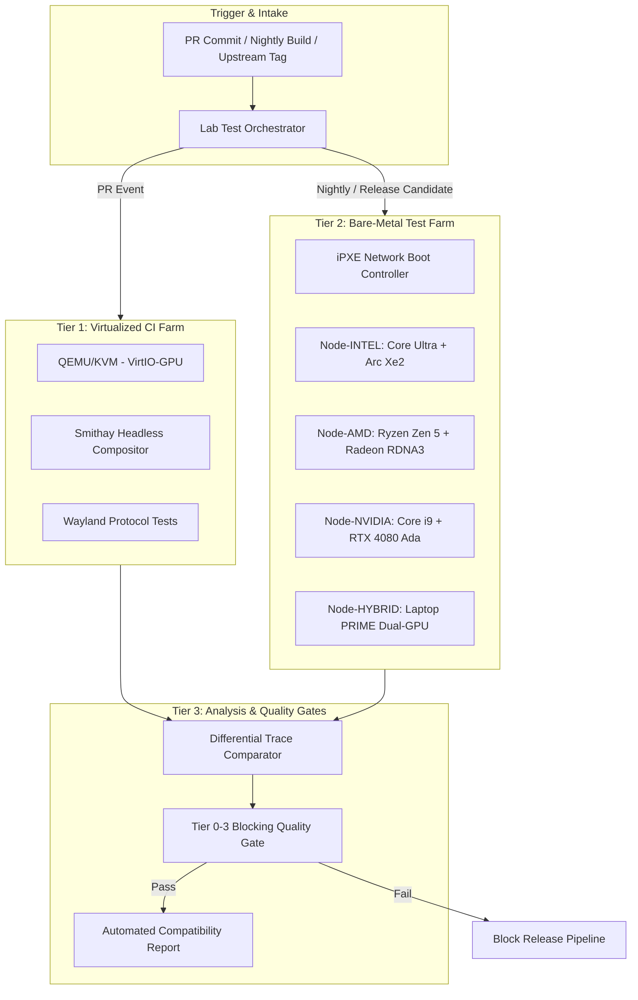

# Compatibility Lab Technical Specification — NebuOS

## Status
APPROVED (Design Specification for Milestone P7)

## Purpose
This document establishes the technical, operational, and architectural specification for the **NebuOS Compatibility Lab**, the automated multi-tier testing farm and validation harness. The Lab provides empirical, reproducible verification of native Linux and Windows applications running under NebuWine, DXVK, VKD3D-Proton, and NebuCompositor across physical and virtualized hardware configurations.

## Scope
This specification encompasses:
- The multi-tier laboratory topology (Tier 1 Virtualized CI, Tier 2 Physical Bare-Metal Racks, Tier 3 Differential Verification).
- Reference hardware node topologies (Node-INTEL, Node-AMD, Node-NVIDIA, Node-HYBRID).
- Automated bare-metal deployment infrastructure (iPXE, ephemeral Btrfs subvolumes).
- The Headless Wayland Test Runner (`nebu-test-runner`) architecture.
- Application workflow evaluation levels (L0 Launch through L7 Long-Running Stability).
- The Windows Native vs. NebuWine Differential Testing Engine and comparative trace classifier.
- Automated release blocking gates (Tiers 0 through 3).
- Telemetry ingestion schemas, database models, and report generation pipelines.

## Non-goals
- **Immediate Implementation (P3/P4):** Physical hardware procurement, rack wiring, and deployment scripts are strictly scheduled for Milestone P7.
- **Manual Crowd-Sourced Reviews:** Subjective, unverified user comments are excluded from official certification scoring.
- **Anti-Cheat Circumvention Testing:** Validating cracked binaries or kernel anti-cheat bypasses is strictly forbidden.

## Requirements

### Functional Requirements
- **REQ-LAB-001 (Automated Ingestion):** The lab must automatically ingest new NebuOS OS images, NebuWine runtime packages, and upstream Wine/Mesa releases for regression testing.
- **REQ-LAB-002 (Ephemeral Test Isolation):** Every test run must execute inside an ephemeral Btrfs snapshot and unprivileged Bubblewrap container, tearing down the environment post-test to prevent state pollution.
- **REQ-LAB-003 (Headless Wayland Conformance):** The test harness must execute Wayland client applications against an offscreen Smithay compositor instance without requiring physical display outputs.
- **REQ-LAB-004 (L0-L7 Workflow Execution):** The test harness must execute deterministic synthetic GUI interactions validating functionality from initial launch (L0) through production export (L6) and 4-hour stability (L7).
- **REQ-LAB-005 (Differential Trace Analysis):** The system must compare Windows 11 reference trace logs against NebuWine execution logs, classifying divergences into `MATCH`, `EXPECTED DIFFERENCE`, `REGRESSION`, and `UNKNOWN`.
- **REQ-LAB-006 (Automated Gate Enforcement):** Regressions violating Tier 0-3 thresholds must automatically block candidate promotions and alert release engineering.

### Non-Functional Requirements
- **NFR-LAB-001 (CI Turnaround Time):** Tier 1 virtualized test suites on PRs must execute in under 15 minutes.
- **NFR-LAB-002 (Bare-Metal Turnaround):** Tier 2 nightly bare-metal test matrices must complete across all 4 reference nodes within 6 hours.
- **NFR-LAB-003 (Telemetry Reproducibility):** Every reported failure must capture execution logs, dmesg, DXVK HUD stats, frame-time graphs, and offscreen framebuffer dumps.

## System Overview



## Architecture

The Compatibility Lab operates as a decoupled orchestration network:
- **Lab Orchestrator (`nebu-lab-orchestrator`):** Central coordinator scheduling jobs, tracking hardware node states, and parsing telemetry.
- **Test Worker Node Agent (`nebu-node-agent`):** Unprivileged daemon running on test machines executing commands received over secure gRPC.
- **Headless Runner (`nebu-test-runner`):** Client-side automation utility using synthetic Wayland input protocols to drive application GUIs.
- **Differential Comparator (`nebu-diff-engine`):** Offline trace parser performing alignment and diffing between Windows and Linux execution logs.

## Component Specifications

### 1. Hardware Node Specifications (Tier 2 Target)

```
+-------------------------------------------------------------------------------+
|                      Tier 2 Physical Hardware Reference Nodes                 |
+-------------------+-------------------+-------------------+-------------------+
| Node-INTEL        | Node-AMD          | Node-NVIDIA       | Node-HYBRID       |
+-------------------+-------------------+-------------------+-------------------+
| CPU: Intel Core   | CPU: AMD Ryzen 9  | CPU: AMD Ryzen 7  | CPU: Intel Core   |
|   Ultra 7 155H    |   7950X (Zen 4)   |   7800X3D         |   i7-13700H       |
| GPU: Intel Arc    | GPU: AMD Radeon   | GPU: NVIDIA RTX   | GPU: Intel Iris Xe|
|   A770 (16GB)     |   RX 7900 XTX     |   4080 (16GB)     |   + RTX 4060 dGPU |
| Driver: Mesa ANV  | Driver: Mesa RADV | Driver: NVIDIA 555| Driver: PRIME     |
| Memory: 32 GB     | Memory: 64 GB     | Memory: 32 GB     | Memory: 32 GB     |
| Display: 4K 144Hz | Display: 1440p VRR| Display: 4K HDR   | Display: eDP 165Hz|
+-------------------+-------------------+-------------------+-------------------+
```

### 2. Application Workflow Hierarchy (L0 through L7)

| Level | Designation | Execution Objective | Success Criteria |
|---|---|---|---|
| **L0** | Launch Verification | Process fork, sandbox instantiation, Wayland window creation | Window mapped $\le 15\text{s}$, zero abort |
| **L1** | UI Presentation | Buffer attach, damage commit, redraw cycle | Non-black frame rendered, resize redraws |
| **L2** | Core Interaction | Synthetic keyboard and mouse input to menus/dialogs | Menus open, modal dialogs return focus |
| **L3** | Interoperability | Open standard test files, edit contents, save to disk | File SHA-256 matches schema, clean save |
| **L4** | 3D / GPU Pipeline | D3D9/11/12 or OpenGL pipeline rendering | Shaders compile, $\ge 30\text{ FPS}$, zero GPU hang |
| **L5** | Plugins & Bridges | Load 3rd-party audio VSTs, CAD scripts, or .NET hooks | Plugin loads and returns valid handle |
| **L6** | Production Batch | Render 100-frame video or compute structural model | Export file completes bit-identical output |
| **L7** | Long-Run Stability | Continuous cyclical workflow execution for 4 hours | Memory leak $< 25\text{ MB/hr}$, zero hang |

## Data Flow

### Headless Wayland Automation Flow

```
[ nebu-test-runner ]
        |
        +---> Spawns Headless NebuCompositor instance (Wayland socket: wayland-lab-0)
        +---> Creates ephemeral Btrfs prefix snapshot: `/tmp/test-pfx-$$/`
        +---> Launches: bwrap --ro-bind ... wine64 "AutoCAD.exe"
        |
        v
[ Wayland Protocol Handshake ]
        |
        +---> Client creates `wl_surface`, requests `xdg_toplevel`
        +---> Compositor maps surface to offscreen Virtual Output (1920x1080)
        |
        v
[ Synthetic Event Injection ]
        |
        +---> Injects mouse click via `virtual_pointer_v1` at (x=45, y=12) ["File" Menu]
        +---> Injects key combo `Ctrl+O` via `virtual_keyboard_v1`
        +---> Captures offscreen buffer via `wlr-screencopy-unstable-v1`
        |
        v
[ Assertion & Validation ]
        |
        +---> Image perceptual hash comparison against golden master screenshot
        +---> Telemetry metrics stream to `nebu-diff-engine`
```

## Interfaces

### Telemetry Ingestion JSON Schema (`test-telemetry.json`)
```json
{
  "$schema": "https://schemas.nebuos.org/v1/lab-telemetry.json",
  "run_id": "lab-run-20260905-0842",
  "timestamp": "2026-09-05T15:00:00Z",
  "node_id": "Node-AMD",
  "os_version": "NebuOS 1.0-alpha.2",
  "kernel_version": "7.1.13-200.fc44.x86_64",
  "runtime_id": "nebuwine-11.4.0-stable",
  "mesa_version": "24.2.0",
  "application": {
    "app_id": "autodesk-autocad-2024",
    "name": "AutoCAD 2024",
    "version": "24.0.0.12",
    "binary_hash": "e3b0c44298fc1c149afbf4c8996fb92427ae41e4649b934ca495991b7852b855"
  },
  "workflow_results": {
    "L0_launch": "PASS",
    "L1_ui_display": "PASS",
    "L2_interaction": "PASS",
    "L3_file_io": "PASS",
    "L4_graphics_3d": "PASS",
    "L5_plugins": "SKIPPED",
    "L6_production_batch": "PASS",
    "L7_stability_4hr": "PASS"
  },
  "metrics": {
    "cold_launch_ms": 1120,
    "idle_memory_rss_mb": 142.5,
    "max_frame_time_ms": 14.2,
    "average_fps": 74.8,
    "stutter_events": 0
  },
  "differential_status": "MATCH"
}
```

## Security

### Lab Sandbox Containment
- Bare-metal and virtual test runners execute under dedicated test user accounts (`uid=1500`, `gid=1500`).
- Network access during tests is restricted to localhost (`127.0.0.1`) and local mock licensing servers via private network namespaces (`--unshare-net`).
- Host `/dev` access is restricted to direct GPU render nodes (`/dev/dri/renderD128`) and input devices; raw storage nodes (`/dev/sd*`, `/dev/nvme*`) are invisible.

## Performance

### Quality Gate Performance Thresholds

| Metric | Stable Gate Threshold | Action on Breach |
|---|---|---|
| **L0-L3 Core Workflow Pass Rate** | $100\%$ | Block promotion to Candidate/Stable |
| **L4-L7 Extended Workflow Pass Rate** | $\ge 95\%$ | Block promotion to Stable |
| **Frame Time Degradation vs Baseline** | $> 5\%$ increase | Flag for graphics triage |
| **Cold Launch Time Degradation** | $> 10\%$ increase | Block promotion |
| **System Memory Leak** | $> 50\text{ MB/hour}$ | Fail L7 stability certification |

## Error Handling

1. **GPU Hang / Ring Timeout:** If the GPU driver encounters a ring timeout or reset (`dmesg` contains `amdgpu: GPU reset begin` or `i915: GPU hang`), the runner terminates the application, archives `/sys/class/drm/card*/error`, and registers an `INFRA-ERROR-GPU-RESET`.
2. **Process Deadlock:** Workflows enforce strict timeout limits per level (L0: 30s, L1-L3: 60s, L6: 300s). Breaching timeout triggers automated core dump and SIGKILL.
3. **Flaky Test Triage:** If a test fails once, it is retried twice in freshly reflinked prefixes. If 2/3 pass, it is flagged as `UNSTABLE-FLAKY` for human review.

## Testing & Verification

The Compatibility Lab self-validates through recursive integration suites:
- **Runner Mock Suite:** Executes synthetic dummy applications to verify that `nebu-test-runner` correctly detects intentional crashes, timeouts, and graphical distortions.
- **Network Isolation Audit:** Verifies that no external Internet outbound packets escape test sandboxes during closed application execution.

## Deployment

Physical lab nodes boot through the PXE deployment manager:
```bash
# iPXE automated boot command
kernel http://lab-controller.internal/images/nebuos-lab-current/vmlinuz ip=dhcp bootc=http://lab-controller.internal/images/nebuos-lab-current.tar
initrd http://lab-controller.internal/images/nebuos-lab-current/initramfs.img
```

## Dependencies

- **Smithay Headless Backend:** For headless offscreen Wayland frame generation.
- **iPXE & dnsmasq:** For bare-metal node network provisioning.
- **Btrfs Tools:** For instant reflink prefix generation and destruction.
- **PostgreSQL / TimescaleDB:** For time-series performance metric storage.

## Observability

- Real-time grafana dashboards display:
  - Node availability and GPU temperatures
  - Real-time frame-rate telemetry
  - Pass/fail rate across application suites
  - Delta comparison against previous baseline builds

## Concurrency

- Each physical node executes one full-system benchmark at a time to eliminate CPU/GPU contention and cache thrashing.
- Virtualized Tier 1 CI runs up to 32 concurrent headless instances on cloud workers.

## Configuration

Runner configuration resides in `/etc/nebu/lab-runner.toml`:
```toml
[runner]
log_level = "info"
artifacts_dir = "/var/lib/nebu/lab-artifacts"
max_l7_duration_seconds = 14400

[network]
isolate_namespaces = true
allow_mock_license_server = true
mock_license_ip = "192.168.100.1"
```

## Constraints

- Lab automation must never use commercial license keys illegally; test suites operate against demo versions, evaluation modes, open standards, or officially provisioned lab developer licenses.

## Migration & Compatibility

- Telemetry schemas maintain backward compatibility across minor versions via JSON Schema validation.

## References

- [ADR-0015: Compatibility Lab Architecture](file:///root/NebuOS/docs/decisions/ADR-0015-compatibility-lab.md)
- [ADR-0016: NebuWine Downstream Distribution Architecture](file:///root/NebuOS/docs/decisions/ADR-0016-nebuwine-architecture.md)
- [NebuWine Technical Specification](file:///root/NebuOS/docs/runtime/08-nebuwine-specification.md)
- [Application Compatibility Testing](file:///root/NebuOS/docs/testing/04-compatibility-testing.md)
