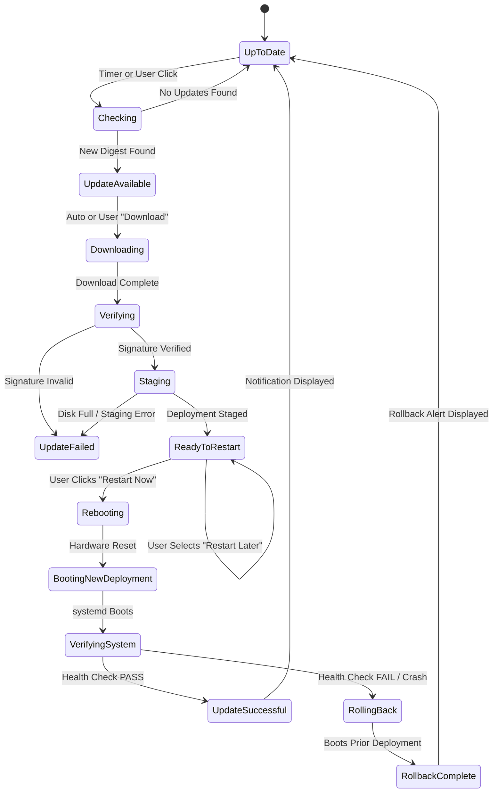

# Update Subsystem Specification — NebuOS

**Status:** APPROVED ARCHITECTURAL SPECIFICATION  
**Document ID:** NEBU-SPEC-UPD-001  
**Authority:** Principal OS Architect, OS Update/Release Engineer, bootc/Ostree Engineer  
**Purpose:** Comprehensive specification for the atomic, image-based operating system update architecture, bootc transactional deployments, release channels, health verification, and automated rollback in NebuOS.  

---

## 1. Status and Invariants

- **Status:** APPROVED — Foundational update architecture governing all phases from Milestone P0 through P8.
- **Architectural Invariants:**
  1. **Image-Based Model:** The base OS is distributed exclusively as an immutable, cryptographically signed OCI container image. Traditional package management (`dnf upgrade`, `rpm -U`) is forbidden as an OS upgrade mechanism.
  2. **Deployment Engine:** `bootc` is the sole OS deployment engine. NebuOS constructs release infrastructure, metadata, security verification, health monitoring, and UX orchestration above `bootc`.
  3. **Zero Active Interruption:** OS updates are staged to an inactive deployment. Active user processes, GUI sessions, and runtime workloads are never mutated at runtime.
  4. **Strict Isolation of User Data:** Upgrades and rollbacks never alter, delete, or revert files in `/home` or user persistent application data.
  5. **Unprivileged Client Boundary:** Desktop UI (`nebu-shell`) has zero direct access to `/dev`, `/sys`, or privileged `bootc` CLI commands; all interactions route through `org.nebu.Update1` over D-Bus via `NebuUpdateService`.
  6. **P0 Milestone Independence:** Milestone P0 establishes the bootc/Btrfs base update substrate. P0 has zero dependency on graphical compositors, desktop shells, or Windows runtimes.

---

## 2. End-to-End Update Lifecycle

The complete update pipeline from code commit to active user deployment is structured as follows:

```
+-------------------------------------------------------------------------+
|                                DEVELOPER                                |
|  - Git commit & semantic version tag (e.g. v1.0.1)                      |
+-------------------------------------------------------------------------+
                                    │
                                    ▼
+-------------------------------------------------------------------------+
|                           CI / CD BUILD SYSTEM                          |
|  - Multi-stage Containerfile compilation (Containerfile.p0 / release)   |
|  - Static analysis, unit tests, security vulnerability scan (Trivy)     |
+-------------------------------------------------------------------------+
                                    │
                                    ▼
+-------------------------------------------------------------------------+
|                        AUTOMATED VERIFICATION GATE                      |
|  - Headless QEMU virtual boot test (TC-P0-001 through TC-P0-012)        |
|  - Compatibility Lab regression suites (P7 Hardware & App Matrix)       |
+-------------------------------------------------------------------------+
                                    │
                                    ▼
+-------------------------------------------------------------------------+
|                          CRYPTOGRAPHIC SIGNING                          |
|  - Cosign / Sigstore Ed25519 signing with hardware-backed root key      |
|  - Rekor transparency log entry & in-toto provenance attestation        |
+-------------------------------------------------------------------------+
                                    │
                                    ▼
+-------------------------------------------------------------------------+
|                       PRODUCTION OCI REGISTRY                           |
|  - Quay.io / NebuOS Registry (quay.io/nebuos/base)                      |
|  - Content-addressed layer blobs & immutable manifest digests           |
+-------------------------------------------------------------------------+
                                    │
                                    ▼ [Encrypted HTTPS / OCI Distribution]
+-------------------------------------------------------------------------+
|                        USER DEVICE (CLIENT HOST)                        |
|  1. NebuUpdateService: Evaluates update policy (Power, Network, Time)   |
|  2. Metadata Check: Anonymously queries release metadata & signature    |
|  3. bootc upgrade (staging flow): Pulls OCI layer deltas in background  |
|  4. Signature Verification: Validates Cosign signature against root key  |
|  5. Transactional Staging: Writes new deployment to inactive sysroot    |
|  6. User Decision: User prompted via NebuShell to restart now or later  |
|  7. Reboot: GRUB boots new deployment with boot_counter=3 armed        |
|  8. Health Check: nebu-boot-check.service validates system integrity     |
|     - PASS: boot_counter=0 -> Deployment marked permanent (Active)      |
|     - FAIL: Watchdog resets host -> GRUB rolls back to previous deployment|
+-------------------------------------------------------------------------+
```

---

## 3. Subsystem Boundaries and Update Separation

NebuOS enforces strict separation between five distinct update layers. A single update mechanism is never used for heterogeneous concerns:

```
+-----------------------------------------------------------------------------------+
| LAYER 1: OPERATING SYSTEM BASE                                                    |
| Mechanism: bootc / OSTree Transactional Image Deployments                         |
| Scope: Linux kernel, systemd, libc, Mesa, Wayland base, core daemons              |
| Cadence: Monthly stable releases, bi-weekly testing, emergency security hotfixes  |
| Activation: Requires system reboot into new deployment                           |
+-----------------------------------------------------------------------------------+

+-----------------------------------------------------------------------------------+
| LAYER 2: NATIVE LINUX APPLICATIONS                                                |
| Mechanism: Flatpak (Flathub & Nebu Application Repository)                        |
| Scope: Desktop productivity apps, browsers, media players, utilities              |
| Cadence: Independent continuous updates direct from application developers        |
| Activation: Instant upon application restart; zero OS reboot required            |
+-----------------------------------------------------------------------------------+

+-----------------------------------------------------------------------------------+
| LAYER 3: WINDOWS APPLICATION RUNTIMES & PREFIXES                                  |
| Mechanism: NebuRuntime Engine + Btrfs Reflink Cloning                              |
| Scope: Wine/Proton binary runners, DXVK/VKD3D DLLs, per-app WINEPREFIXes          |
| Cadence: Decoupled runtime engine updates; prefixes pinned to validated runner    |
| Activation: Process restart; zero OS reboot required                              |
+-----------------------------------------------------------------------------------+

+-----------------------------------------------------------------------------------+
| LAYER 4: COMPATIBILITY DATABASE (compat.db)                                       |
| Mechanism: Signed SQLite Drop-in Replacement / Delta Sync                         |
| Scope: Hardware quirks, application compatibility recipes, PE header fingerprints |
| Cadence: Weekly or on-demand out-of-band updates without OS rebuild               |
| Activation: Atomic SQLite connection swap; zero OS reboot required               |
+-----------------------------------------------------------------------------------+

+-----------------------------------------------------------------------------------+
| LAYER 5: HARDWARE & SYSTEM FIRMWARE                                               |
| Mechanism: fwupd / Linux Vendor Firmware Service (LVFS)                           |
| Scope: Motherboard UEFI BIOS, Embedded Controller (EC), Thunderbolt controllers    |
| Cadence: As published by hardware OEMs                                            |
| Activation: Power-gated staged capsule update; requires cold reboot               |
+-----------------------------------------------------------------------------------+
```

---

## 4. bootc Integration & Transactional Mechanics

NebuOS utilizes standard upstream `bootc` commands as its underlying transactional primitives:

### 4.1 Staged Upgrades without Disruption
```bash
# Executed by NebuUpdateService in background (using available bootc 1.x staging CLI):
bootc upgrade
```
1. `bootc` contacts the OCI registry to compare the local deployed image digest with the remote channel digest.
2. If a new digest is present, `bootc` downloads only the changed OCI layer deltas into `/sysroot/ostree/repo/objects/`.
3. `bootc` constructs a new OSTree deployment tree in `/sysroot/ostree/deploy/nebu/deploy/<new-deployment-id>`.
4. Staging operates in the background with `IOWriteBandwidthMax=25M` and idle CPU scheduling, causing zero dropped frames in active desktop applications.
5. The currently running deployment remains untouched at `/sysroot/ostree/deploy/nebu/deploy/<current-deployment-id>`.

### 4.2 Channel Switching
```bash
# Executed when user switches channel (e.g. Stable -> Testing):
bootc switch quay.io/nebuos/base:testing
```
`bootc switch` changes the origin ref of the OS without affecting `/home` or `/var`. If the user chooses to switch back, `bootc switch quay.io/nebuos/base:stable` cleanly stages the stable deployment.

### 4.3 Deployment Status Querying
```bash
# Queried by NebuUpdateService to populate D-Bus state:
bootc status --format=json
```
The JSON output provides authoritative state on:
- `status.type`: Active boot deployment.
- `status.image.image`: Registry reference and immutable SHA-256 digest.
- `status.staged`: Whether a new deployment is staged and awaiting reboot.
- `status.rollback`: The previous known-good deployment details.
- `status.pinned`: Pinned deployments protected from garbage collection.

### 4.4 Rollback Invocation
```bash
# Executed automatically upon health check failure or manually by admin:
bootc rollback
```
Reorders GRUB BLS boot targets, swapping the previous deployment back into the primary boot position.

---

## 5. Storage Topology & Filesystem Semantics

NebuOS leverages Btrfs subvolumes and OSTree filesystem semantics to guarantee transactional stability:

```
Physical Storage (Btrfs Root)
│
├── /sysroot                       [Btrfs Subvolume @]
│   └── ostree/deploy/nebu/
│       ├── deploy/<deploy.0>/     [Previous Working Deployment - Read-Only]
│       │   ├── usr/               [Read-Only System Binaries]
│       │   └── etc/               [Merged Config Snapshot]
│       ├── deploy/<deploy.1>/     [Active Running Deployment - Read-Only]
│       │   ├── usr/               [Read-Only System Binaries]
│       │   └── etc/               [Active Merged Config]
│       └── var/                   [Btrfs Subvolume @var - Shared Persistent State]
│           ├── home/              [Btrfs Subvolume @home - Persistent User Files]
│           ├── log/               [Persistent System Logs]
│           └── lib/containers/    [Container & Layer Cache Storage]
│
└── /nebu/apps/                    [Btrfs Subvolume @nebu_apps - Windows Prefixes]
```

### 5.1 Semantics of `/etc`, `/var`, and `/home` Across Updates
| Directory | Filesystem Layer | Upgrade Behavior | Rollback Behavior | Invariant Guarantee |
|---|---|---|---|---|
| `/usr` | Base OS Image | 100% atomically replaced by new image. | 100% reverted to previous image binaries. | Purely immutable; never mutated at runtime. |
| `/etc` | OSTree 3-way merge | 3-way merged: local changes preserved; new vendor defaults added. | Reverts to config snapshot corresponding to rollback deployment; local diffs preserved. | System boots even if admin modified local configs. |
| `/var` | `@var` Subvolume | Shared across deployments; completely preserved. | Retains current state; NOT reverted. | Logs, flatpak data, and system databases persist. |
| `/home` | `@home` Subvolume | Completely preserved; never touched by update. | Completely preserved; NEVER touched or reverted. | Zero user document loss under any update/rollback. |
| `@nebu_apps` | Dedicated Subvolume | Completely preserved; runtimes referenced via symlink. | Retains current application state. | Wine prefixes remain functional across updates. |

---

## 6. Update UX Contract & State Machine

The interaction between the user interface (`nebu-shell`) and the system update engine is strictly decoupled. The user never sees raw terminal output or `bootc` commands.

### 6.1 State Machine


### 6.2 UX State Definitions
1. **Up to date:** System image digest matches latest published release for the current channel.
2. **Checking for updates:** Querying release metadata and verifying cryptographic signatures.
3. **Update available:** New version detected; release notes, security rating, and size displayed.
4. **Downloading:** Fetching OCI layer deltas; displays progress percentage, download speed, and remaining time.
5. **Verifying:** Validating Ed25519 signature and layer SHA-256 hashes against transparency logs.
6. **Ready to restart:** Staging complete; displays prominent banner: *"NebuOS Update Ready. Restart to apply."* with options: `[Restart Now]`, `[Restart Tonight]`, `[Later]`.
7. **Rebooting & Verifying:** Splash screen displays *"Finalizing system update..."* while early boot health verification executes.
8. **Update successful:** Desktop displays subtle toast notification: *"Welcome to NebuOS 1.0.1. What's new in this release."*
9. **Rollback active:** If the update fails, host boots prior image and displays diagnostic dialog: *"NebuOS encountered an issue starting the latest update. Your system was automatically restored to version 1.0.0. No data was lost."*

---

## 7. D-Bus Interface Specification: `org.nebu.Update1`

`NebuUpdateService` exposes the `org.nebu.Update1` interface on the system message bus (`/org/nebu/Update1`). Polkit authorizes privileged operations.

### 7.1 D-Bus Introspection XML
```xml
<!DOCTYPE node PUBLIC "-//freedesktop//DTD D-BUS Object Introspection 1.0//EN"
"http://www.freedesktop.org/standards/dbus/1.0/introspect.dtd">
<node name="/org/nebu/Update1">
  <interface name="org.nebu.Update1">
    
    <!-- Methods -->
    <method name="GetCurrentVersion">
      <arg name="version_info" type="a{sv}" direction="out"/>
    </method>
    
    <method name="CheckForUpdates">
      <arg name="force" type="b" direction="in"/>
      <arg name="status" type="s" direction="out"/>
    </method>
    
    <method name="GetUpdateStatus">
      <arg name="status_dict" type="a{sv}" direction="out"/>
    </method>
    
    <method name="GetAvailableRelease">
      <arg name="release_metadata" type="a{sv}" direction="out"/>
    </method>
    
    <method name="DownloadUpdate">
      <arg name="job_path" type="o" direction="out"/>
    </method>
    
    <method name="VerifyUpdate">
      <arg name="verification_result" type="b" direction="out"/>
    </method>
    
    <method name="StageUpdate">
      <arg name="job_path" type="o" direction="out"/>
    </method>
    
    <method name="ScheduleRestart">
      <arg name="scheduled_time_utc" type="t" direction="in"/>
      <arg name="success" type="b" direction="out"/>
    </method>
    
    <method name="ApplyUpdate">
      <arg name="reboot_immediately" type="b" direction="in"/>
      <arg name="success" type="b" direction="out"/>
    </method>
    
    <method name="GetHealthStatus">
      <arg name="health_dict" type="a{sv}" direction="out"/>
    </method>
    
    <method name="Rollback">
      <arg name="reboot_immediately" type="b" direction="in"/>
      <arg name="success" type="b" direction="out"/>
    </method>

    <!-- Properties -->
    <property name="State" type="s" access="read"/>
    <property name="ProgressPercentage" type="d" access="read"/>
    <property name="CurrentChannel" type="s" access="read"/>
    <property name="StagedVersion" type="s" access="read"/>
    <property name="LastCheckTimestamp" type="t" access="read"/>

    <!-- Signals -->
    <signal name="StateChanged">
      <arg name="old_state" type="s"/>
      <arg name="new_state" type="s"/>
    </signal>
    
    <signal name="DownloadProgress">
      <arg name="bytes_downloaded" type="t"/>
      <arg name="total_bytes" type="t"/>
      <arg name="percentage" type="d"/>
    </signal>
    
    <signal name="UpdateStaged">
      <arg name="version" type="s"/>
      <arg name="release_id" type="s"/>
    </signal>
    
    <signal name="RollbackOccurred">
      <arg name="failed_version" type="s"/>
      <arg name="restored_version" type="s"/>
      <arg name="reason" type="s"/>
    </signal>

  </interface>
</node>
```

---

## 8. Release Channels & Versioning Taxonomy

### 8.1 Release Channel Topology
1. **`stable` (Default):**
   - Intended for: End-users, gaming workstations, office desktop environments.
   - Update Frequency: Monthly cadence + immediate out-of-band security releases.
   - Quality Requirement: 100% pass rate in Compatibility Lab across Tier 0–2 suites.
2. **`testing` (Beta):**
   - Intended for: Enthusiasts, QA community, hardware early-adopters.
   - Update Frequency: Bi-weekly release candidates.
   - Quality Requirement: Automated virtual boot PASS + clean smoke tests.
3. **`development` (Nightly):**
   - Intended for: Core developers and automated CI pipelines.
   - Update Frequency: Daily automated builds tracking `main`.
   - Quality Requirement: Successful build compilation and basic container lint.

### 8.2 Versioning Structure
Every release is identified by a multi-part taxonomy separating marketing version from immutable technical identity:

```
NebuOS Product Version : 1.0.1
Base OS Platform       : Fedora 44 (bootc)
Kernel Version         : 6.14.0-200.fc44.x86_64
Mesa 3D Driver         : 25.0.0
Immutable Image Digest : sha256:8f4c2e6b0a1d9e5f3c7b2a8e1d4c9f0b5a3e7d1c6b2a4e8f0d3c5b7a9e1f2a4b
Unique Release ID      : nebu-20260904.1
Release Channel        : stable
```

**Rule:** Container tags (e.g. `:stable`, `:latest`) are mutable routing pointers. Client deployments bind permanently to the immutable SHA-256 digest.

---

## 9. Staged Rollout Strategy & Canary Deployment

Production releases to the `stable` channel follow an automated, staged cohort rollout:

```
[Release Candidate Approved]
             │
             ▼
[Phase 1: Internal CI & Dogfooding]  ─── 0% Public / 100% Team (48 Hours)
             │
             ▼
[Phase 2: Canary Cohort 1]           ─── 5% Random Stable Devices (48 Hours)
             │
             ▼  [Telemetry/Error Rate Threshold: < 0.1% Failure]
[Phase 3: Expanded Cohort 2]         ─── 25% Random Stable Devices (72 Hours)
             │
             ▼  [Crash Rate Stability Validated]
[Phase 4: Full Deployment]           ─── 100% All Stable Devices
```

### Fast-Abort Mechanism (Release Rollback)
If the crash rate or boot failure rate in an early cohort exceeds 0.25%, the Release Engineering team executes a **Release Rollback**:
1. The registry channel pointer `:stable` is immediately pointed back to the previous stable digest (`1.0.0`).
2. Client devices that have not yet downloaded the update never receive it.
3. Client devices that have staged the update but not rebooted cancel staging upon the next metadata sync.
4. Client devices that have rebooted and experienced failures automatically fall back via local device rollback.

---

## 10. Post-Boot Health Verification & Watchdog Architecture

Rollback is never assumed to happen magically; it relies on explicit coordination between the Linux kernel watchdog, GRUB boot counter, and `nebu-boot-check.service`.

### 10.1 Boot Attempt Counter
1. Upon staging an update, `NebuUpdateService` writes to `/boot/grub2/grubenv`:
   ```ini
   boot_counter=3
   ```
2. During system startup, GRUB reads `boot_counter`. If `boot_counter > 0`, GRUB decrements it by 1 and writes it back before loading the kernel.
3. If the kernel panics, displays a black screen, or crashes before userspace initializes, the hardware watchdog resets the computer.
4. Upon subsequent boots, GRUB decrements the counter again.
5. When `boot_counter == 0`, GRUB detects exhaustion, aborts loading the new deployment, and boots the previous deployment entry (`deployment.0`).

### 10.2 Post-Boot Health Check Service (`nebu-boot-check.service`)
`nebu-boot-check.service` executes after systemd reaches target milestone:

#### Milestone P0 Health Assertions (Headless Foundation):
- `systemd.unit == multi-user.target` reached.
- Zero critical services in `failed` state (`systemctl --failed --no-legend` returns empty).
- Root filesystem (`/sysroot`) mounted cleanly in `ro` mode.
- Persistent state (`/var`) and `/home` mounted without corruption.
- Local loopback network interface active (`ip link show lo` reports `UP`).
- Active deployment image digest matches staged release metadata.

#### Milestone P2+ Health Assertions (Desktop System):
- Display server (`nebu-compositor`) active and acquired DRM Master on primary GPU.
- Display pipeline successfully completed first frame scanout without atomic modesetting commit failure.
- `nebu-shell` bound to Wayland socket.
- Audio server (`pipewire`) socket accessible.

**Commit Action:** Once all assertions pass, `nebu-boot-check.service` sets:
```ini
boot_counter=0
boot_success=1
```
The new deployment is now formally committed as the permanent active OS.

---

## 11. Rollback Safety & Invariant Guarantees

### 11.1 What Rollback Does:
- Reverts all operating system binaries, kernel modules, and libraries in `/usr` to the exact bit-for-bit state of the previous deployment.
- Reverts system configuration in `/etc` to the snapshot associated with the previous deployment, while preserving independent admin files.
- Re-points the bootloader default target.

### 11.2 What Rollback Does NOT Do:
- **Does NOT touch personal files in `/home`:** All user documents, desktop folders, downloads, and browser profiles remain exactly as they were.
- **Does NOT revert database entries in `/var`:** System logs, flatpak applications in `/var/lib/flatpak`, and container images remain untouched.
- **Does NOT revert Windows application data in `@nebu_apps`:** Game saves, CAD project files, and user prefix data are not affected by OS image rollback.

---

## 12. Storage, Quotas, & Retention Policy

Operating an image-based OS requires explicit storage management to prevent disk starvation:

### 12.1 Minimum Free Space Thresholds
- **Optimal Staging Headroom:** >= 5.0 GB available space on `/sysroot`.
- **Warning Threshold:** If free space is between 3.5 GB and 5.0 GB, `NebuUpdateService` logs a warning and warns the user in UI.
- **Hard Blocking Threshold:** If free space is < 2.5 GB, update staging is **strictly aborted**. The system will not attempt to pull layers to prevent filling the disk.

### 12.2 Deployment Retention Rules
1. **Current Active Deployment:** The currently running deployment.
2. **Previous Known-Good Deployment:** Retained permanently until a newer update successfully passes health checks.
3. **Pinned Deployment (Optional):** Users or administrators can explicitly pin a deployment via `bootc pin <deploy-id>` to prevent automated garbage collection.
4. **Pruning:** During `bootc upgrade`, all unreferenced historical deployments older than the rollback deployment are automatically pruned via `bootc prune`.

---

## 13. Security Updates & Incident Response

### 13.1 Vulnerability Classification
- **Standard Security Update:** Low / Moderate CVEs; batched into standard bi-weekly or monthly release.
- **Critical Security Hotfix:** High / Critical CVEs (e.g. remote code execution, kernel privilege escalation, WebKit zero-day). Fast-tracked via expedited pipeline within 24 hours.

### 13.2 Expedited Hotfix Pipeline
1. Security patch applied to `main` and release branch.
2. Accelerated CI build executes Gate 1 (Security Scan) and Gate 2 (Virtual Boot).
3. Image signed and pushed to OCI registry with `security_urgency=critical` metadata flag.
4. Client `NebuUpdateService` polls every 2 hours for critical security flags.
5. High-priority desktop notification prompts user: *"Critical Security Update Available. Restart recommended to protect your system."*

### 13.3 Signing Key Rotation & Compromise Recovery
- Release images are signed with an Ed25519 key backed by Hardware Security Module (HSM).
- Public verification keys are shipped in the base image at `/etc/pki/nebu/release.pub`.
- In the event of key compromise:
  1. Revocation notice published to Rekor transparency log.
  2. Fallback secondary verification key activated.
  3. Emergency base update pushed signed by the offline secondary root key.

---

## 14. Fedora Base Updates & Version Upgrades

NebuOS base images derive from upstream Fedora Atomic (`quay.io/fedora/fedora-bootc:44`). Updates are strictly governed:

### 14.1 Routine Fedora Base Updates (Within Same Fedora Major Release)
- Example: `Fedora 44 kernel 6.14 -> Fedora 44 kernel 6.15`
- Process: Automated weekly rebuild in CI -> full automated testing -> promotion to `testing` -> promotion to `stable`.
- Invariant: Zero package upgrades executed on user host; all updates delivered as unified NebuOS images.

### 14.2 Major Fedora Base Upgrades (e.g. Fedora 44 -> Fedora 45)
- Major base distribution upgrades are treated as major release engineering events.
- Requires:
  1. Complete re-validation in physical Compatibility Lab across all 17 hardware test tiers.
  2. Full 11-stage regression run across Windows productivity suites (Office, CAD, Adobe).
  3. Verification that Smithay compositor and Slint shell compile against newer LLVM/toolchains.
  4. 30-day soak period in `testing` channel prior to public stable promotion.

---

## 15. GPU & NVIDIA Driver Considerations

Kernel and graphics userspace must remain in lockstep:
1. **Open-Source Drivers (Intel / AMD):** Shipped directly inside the base image. The Linux kernel (`amdgpu`, `i915`/`xe`) and Mesa userspace drivers are built and verified together in CI, eliminating version mismatches.
2. **NVIDIA Proprietary Drivers:**
   - Packaged as pre-compiled OCI container layers layered over the base image.
   - Built in CI against the exact kernel version embedded in that image digest.
   - If NVIDIA driver compilation fails in CI, the base OS image is blocked from release promotion. Users never experience broken Xwayland or missing NVidia kernel modules after an update.

---

## 16. Power Safety Invariants

Update operations are gated on device power state to prevent power loss corruption:
- **Download & Staging:** Blocked if device is running on battery with charge < 25%, unless user explicitly overrides.
- **Reboot Activation:** If system is running on battery with charge < 40%, NebuShell displays a warning advising the user to plug in AC power before restarting.

---

## 17. Telemetry, Privacy, & Network Invariants

- **Zero Surveillance:** Update checking does not require user accounts, telemetry IDs, device serial numbers, or hardware profiling.
- **Metadata Requests:** The client queries the OCI registry manifest via standard anonymous HTTPS GET requests.
- **Metered Connection Respect:** If NetworkManager reports the active link is metered (e.g. mobile hotspot), background automatic downloads are paused. Updates are downloaded only when user clicks "Download on Metered Network" or reconnects to an unmetered Wi-Fi/LAN connection.

---

## 18. Milestone Allocation Matrix

| Milestone | Update Responsibility | Anti-Scope (What is NOT in this Milestone) |
|---|---|---|
| **P0: Foundation OS** | Minimal `bootc` containerfile (`Containerfile.p0`), Btrfs subvolumes, GRUB BLS boot counter, basic `nebu-boot-check.service` (headless). | No Update UI, no `NebuUpdateService` D-Bus daemon, no graphical notifications. |
| **P1: Compositor** | Validate compositor survivability across display driver updates. | No update client UI. |
| **P2: Desktop Shell** | Implement `NebuUpdateService` system daemon and NebuShell Settings -> System -> Software Update UI. | No production registry deployment. |
| **P7: Compatibility Lab** | Execute automated update and rollback test suites on bare-metal hardware. | Not end-user facing. |
| **P8: Production Release** | Production OCI registry (`quay.io/nebuos/base`), HSM Cosign signing pipeline, CDN distribution, canary rollout controller. | N/A (Complete production system). |

---

## 19. Related Specifications & Architecture Decisions
- [01-image-build.md](01-image-build.md) — Containerfile specification and build pipeline.
- [02-release-channels.md](02-release-channels.md) — Release channel management and promotion criteria.
- [03-regression-gates.md](03-regression-gates.md) — Automated quality and compatibility gates.
- [04-rollback-recovery.md](04-rollback-recovery.md) — Low-level rollback and bootloader watchdog specification.
- [../decisions/ADR-0011-os-image-updates-and-rollback.md](../decisions/ADR-0011-os-image-updates-and-rollback.md) — Binding architectural decision record.
