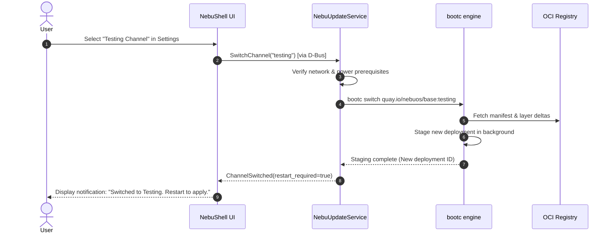

# Release Channels and Versioning Specification — NebuOS

**Status:** APPROVED ARCHITECTURAL SPECIFICATION  
**Document ID:** NEBU-SPEC-CHN-001  
**Authority:** OS Update/Release Engineer, Principal OS Architect  
**Purpose:** Specify the release channel topology (stable, testing, development), semantic product versioning, immutable tagging strategies, staged canary rollouts, and emergency incident handling in NebuOS.  

---

## 1. Status and Invariants

- **Status:** APPROVED — Governs all release engineering activities across Milestone P0 through P8.
- **Architectural Invariants:**
  1. **User Safety Default:** All end-user installations default strictly to the `stable` channel. Switching to `testing` or `development` requires explicit user confirmation via NebuShell Settings or root CLI commands.
  2. **Immutable Release Identity:** While human-readable tags (`:stable`, `:testing`, `:1.0.1`) exist for channel routing, every production release is bound immutably to a cryptographically verified SHA-256 container digest.
  3. **No Monolithic Rebuilds:** A build promoted from `testing` to `stable` is retagged by its exact digest; recompiling or rebuilding source code during promotion is forbidden.
  4. **Rollout Separation:** Release rollback (stopping/reverting a channel pointer in the registry) and Device rollback (a local machine reverting to its prior deployment) are treated as distinct operational concepts.

---

## 2. Release Channel Topology

NebuOS establishes three official release channels:

```
+-------------------------------------------------------------------------+
|                       RELEASE CHANNEL TAXONOMY                          |
+-------------------------------------------------------------------------+
                                    │
       ┌────────────────────────────┼────────────────────────────┐
       ▼                            ▼                            ▼
+---------------------+    +---------------------+    +---------------------+
|       STABLE        |    |       TESTING       |    |     DEVELOPMENT     |
|   (Default User)    |    |  (Advanced Testers) |    |     (Developers)    |
+---------------------+    +---------------------+    +---------------------+
| - General consumers |    | - Community QA      |    | - Core OS engineers |
| - Office & gaming   |    | - Hardware lab test |    | - CI smoke tests    |
| - Monthly updates   |    | - Bi-weekly updates |    | - Daily nightly     |
| - 100% Gated PASS   |    | - Release Candidate |    | - Experimental code |
+---------------------+    +---------------------+    +---------------------+
```

### 2.1 Channel Guarantees & Target Audiences
1. **`stable` (Production Desktop):**
   - **Audience:** Everyday desktop users, gaming enthusiasts, enterprise workstations.
   - **Update Cadence:** Monthly regular updates (second Tuesday of each month) plus out-of-band critical security hotfixes.
   - **Stability Criteria:** 100% pass rate in the Compatibility Lab across Tier 0–2 suites, zero open High/Critical CVEs, 0.0% boot failure in canary cohorts.
2. **`testing` (Release Candidates & Beta):**
   - **Audience:** Advanced users, hardware compatibility testers, community bug hunters.
   - **Update Cadence:** Bi-weekly release candidate drops.
   - **Stability Criteria:** Passes automated headless virtual boot and basic desktop smoke tests. May contain experimental Wine patches or newer kernel minor versions.
3. **`development` (Nightly Trunk):**
   - **Audience:** NebuOS core developers and automated test automation.
   - **Update Cadence:** Nightly builds generated at 02:00 UTC from `main`.
   - **Stability Criteria:** Successful build compilation and basic container linting. No stability guarantees provided.

---

## 3. Versioning Architecture

NebuOS adopts strict semantic product versioning (`MAJOR.MINOR.PATCH`) decoupled from upstream package versions:

```
+-------------------------------------------------------------------------+
|                  NEBUOS VERSIONING IDENTIFIER SCHEMA                    |
+-------------------------------------------------------------------------+
|                                                                         |
|  NebuOS Product Version : 1.0.1                                         |
|  ├── MAJOR (1)  : Major desktop architecture or paradigm shift          |
|  ├── MINOR (0)  : Feature enhancements, new profiles, platform updates   |
|  └── PATCH (1)  : Bug fixes, stability patches, security remediations   |
|                                                                         |
|  Underlying Layer Identification (Decoupled):                           |
|  ├── Upstream Base   : Fedora 44 (bootc base image)                     |
|  ├── Kernel Release  : Linux 6.14.0-200.fc44.x86_64                     |
|  ├── Graphics Stack  : Mesa 25.0.0 (RADV / Iris / NVK / Zink)          |
|  ├── Compatibility   : Wine 9.12-staging / Proton 9.0-2                 |
|  ├── Unique Build ID : nebu-20260904.1                                  |
|  └── Immutable Digest: sha256:7f83b165249a0c71...                       |
|                                                                         |
+-------------------------------------------------------------------------+
```

### Rules:
- **Never rely on `:latest`:** The `:latest` tag is unversioned and nondeterministic. Production clients query specific semantic version manifests.
- **Independent Base Upgrades:** Upgrading Fedora base from 44 to 45 increments the NebuOS Minor or Major version (e.g. `NebuOS 1.1.0` or `2.0.0`), reflecting a major platform transition.

---

## 4. OCI Tagging Strategy

Images published to the OCI container registry (`quay.io/nebuos/base`) utilize a multi-tagging structure:

| Tag Pattern | Example Tag | Mutability | Usage / Description |
|---|---|---|---|
| `:stable` | `quay.io/nebuos/base:stable` | Mutable | Points to the currently active general release. |
| `:testing` | `quay.io/nebuos/base:testing` | Mutable | Points to the currently active release candidate. |
| `:development` | `quay.io/nebuos/base:development` | Mutable | Points to the latest nightly developer build. |
| `:<semver>` | `quay.io/nebuos/base:1.0.1` | Immutable | Pinned to specific release version. |
| `:<build-id>` | `quay.io/nebuos/base:nebu-20260904.1` | Immutable | Exact build identifier matching CI pipeline run. |
| `@sha256:<hash>` | `quay.io/nebuos/base@sha256:...` | Strictly Immutable | Content-addressed cryptographic reference used by `bootc`. |

---

## 5. Channel Switching Architecture

Users may switch between release channels via NebuShell Settings or the CLI:

### 5.1 CLI Execution
```bash
# Query active channel:
nebu channel get

# Switch to Testing channel:
nebu channel set testing
```

### 5.2 Underlying Execution Sequence


### 5.3 Data Safety During Channel Switching
- Switching between channels operates via transactional staging.
- User files in `/home`, application prefixes in `@nebu_apps`, and databases in `/var` remain completely intact.
- If a user wishes to return to `stable`, invoking `nebu channel set stable` downloads the stable layer deltas and stages the stable image.

---

## 6. Staged Rollout Strategy (Canary Releases)

To protect the user community against unforeseen hardware incompatibilities, all releases to the `stable` channel follow a phased canary progression:

```
+-------------------------------------------------------------------------+
|                  STAGED CANARY ROLLOUT PROGRESSION                      |
+-------------------------------------------------------------------------+
|                                                                         |
|  [PHASE 0: Testing Channel Soak] ─────────────────────> 14 Days Soak    |
|                                                                         |
|  [PHASE 1: Internal Dogfooding]  ─────────────────────> 48 Hours        |
|  - 0% Public / 100% NebuOS Engineering Fleet                            |
|                                                                         |
|  [PHASE 2: Canary Cohort 1]      ─────────────────────> 48 Hours        |
|  - 5% Random Stable Devices                                             |
|  - Telemetry Gate: Crash rate < 0.1%, Boot failure = 0.0%               |
|                                                                         |
|  [PHASE 3: Canary Cohort 2]      ─────────────────────> 72 Hours        |
|  - 25% Random Stable Devices                                            |
|  - Telemetry Gate: Crash rate < 0.1%, Hardware sleep regression = 0.0%  |
|                                                                         |
|  [PHASE 4: General Availability] ─────────────────────> 100% All Users |
|                                                                         |
+-------------------------------------------------------------------------+
```

### 6.1 Cohort Assignment Algorithm
Client devices generate an anonymous, locally derived 16-bit pseudo-random cohort bucket integer upon initial installation:
$$\text{CohortID} = \text{SHA256}(\text{MachineID} \parallel \text{"nebu-salt"}) \pmod{100}$$
When querying the registry metadata:
- If metadata specifies `rollout_percentage = 5`, only clients with $\text{CohortID} < 5$ receive the update.
- This requires zero server-side tracking of user devices.

---

## 7. Release Rollback vs. Device Rollback

NebuOS explicitly differentiates between publisher-side and client-side rollbacks:

| Dimension | Release Rollback (Publisher-Side) | Device Rollback (Client-Side) |
|---|---|---|
| **Actor** | NebuOS Release Engineering Team | Client Machine / Automated Watchdog |
| **Trigger** | High failure rate detected in Canary cohort (> 0.25%). | Boot failure, kernel panic, or broken display on a single device. |
| **Mechanism** | Re-pointing mutable `:stable` registry tag to prior digest. | GRUB boot counter exhaustion invoking `bootc rollback`. |
| **Scope** | Global: prevents any further devices from pulling bad release. | Local: restores the individual machine to previous working image. |
| **Speed** | Instantaneous upon registry pointer update. | Immediate upon hardware reboot (< 15 seconds). |

---

## 8. Security Incident & Emergency Release Protocol

When a Critical zero-day vulnerability (CVSS >= 9.0) is identified:

```
[Zero-Day Incident Confirmed]
              │
              ▼
[Accelerated Build & Patching] ─── Patch merged into main & release branch
              │
              ▼
[Fast-Track Security Gates]    ─── Gate 1 (Vulnerability Scan) + Gate 2 (Virtual Boot)
              │
              ▼
[HSM Release Signing]          ─── Signed via release root key; labeled:
                                    security_urgency = "CRITICAL"
              │
              ▼
[Direct Promotion to Stable]   ─── Bypasses standard 14-day soak period
              │
              ▼
[Client Polling Acceleration]  ─── Client polling interval drops from 24h to 2h
              │
              ▼
[High-Priority User Alert]     ─── NebuShell displays persistent security banner:
                                    "Critical Security Update: Restart Recommended"
```

---

## 9. Related Specifications
- [00-update-specification.md](00-update-specification.md) — Master update specification.
- [01-image-build.md](01-image-build.md) — Containerfile specification and build pipeline.
- [03-regression-gates.md](03-regression-gates.md) — Automated regression gates.
- [04-rollback-recovery.md](04-rollback-recovery.md) — Rollback recovery mechanics.
